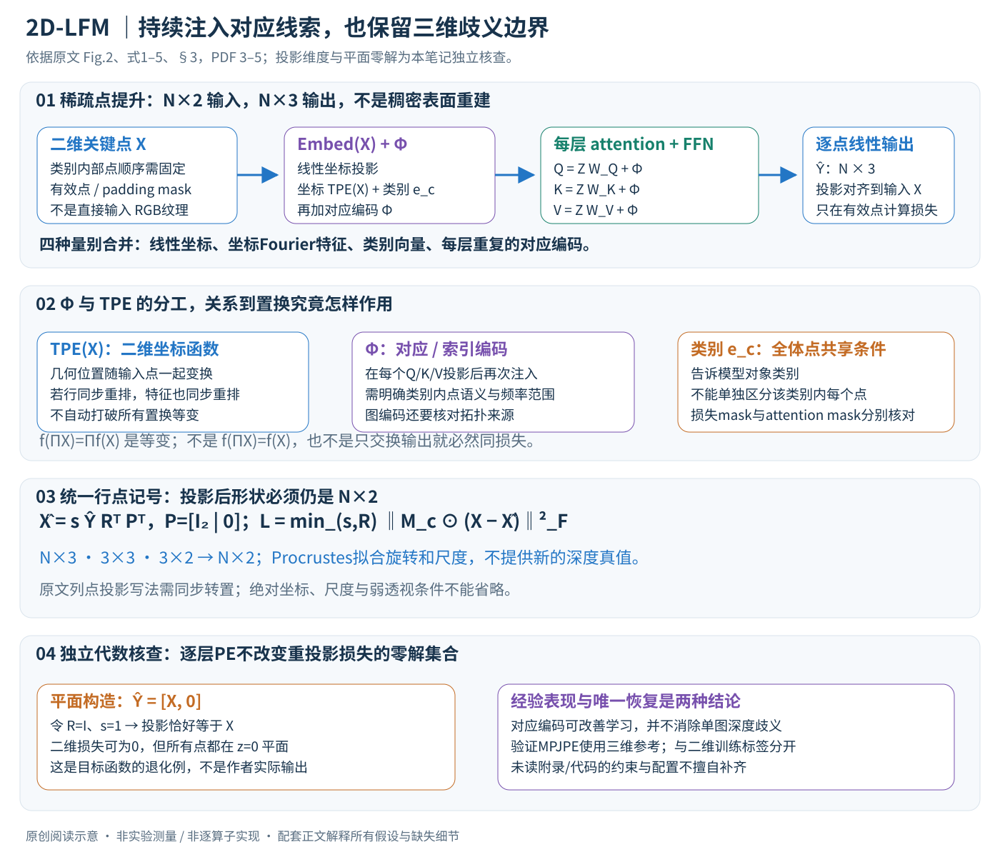

# 2D-LFM: Lifting Foundation Model without 3D Supervision

作者：Mosam Dabhi, Irhas Gill, László A. Jeni, Simon Lucey。

分类：3d-vision；交付形式：Markdown 中文论文讲解。

核对日期：2026-10-20。以下实验均为作者报告；本地完成原文阅读与讲解自检，未复现实验。

方法与配图详细版返工：2026-10-23。重读§3–4并核对Fig.2；分清Φ/TPE/类别嵌入、投影维度、置换假设和二维监督退化，未复现。

## 一句话总结

在Transformer每层重新注入位置与类别编码，以二维关键点的重投影约束训练跨类别三维提升模型；不使用三维训练标签并不消除单视图深度歧义。

## 研究背景与动机

稀疏关键点提升容易依赖固定人体骨架或对象类别；输入一次的位置编码也可能在深层被稀释。论文希望用统一结构覆盖45种以上类别，并保持点的结构身份（第1–3页）。

## 方法总览

### 输出是稀疏三维关键点，不是整张照片的三维表面

2D-LFM输入单帧的N个二维关键点，输出对应N个三维位置。它不直接读取RGB纹理，也不要求推理时输入多视角或运动轨迹；类别信息与有效点mask用于多类别学习。模型关注人体、手、动物或物体的语义结构点，不是直接生成网格、深度图或完整场景。（§3.1、3.5，PDF第3、5页）

作者的主要架构改动，是不只在输入处加入位置编码，而是在每层attention的Q/K/V中再次加入对应编码，持续提供点身份/结构线索。需要把输入里的坐标编码、类别嵌入与每层重复的Φ分开，不能简单合并为“每层都重新编码类别和坐标”。

原创图依据Fig.2、式1–5、§3，PDF第3–5页。投影与平面零损失例子是对正文目标的独立代数核查，不是作者模型实际输出；逐层PE改善经验表现，不等于单张二维点已经唯一确定三维。

| 量 | 行点表示下的形状 | 角色 |
|---|---|---|
| X | N×2 | 二维关键点坐标 |
| \(\hat Y\) | N×3 | 网络预测的三维关键点 |
| \(Z_\ell\) | N×D | 第ℓ层token特征 |
| \(TPE(X)\) | N×D | 直接作用于二维坐标的Fourier编码 |
| \(e_c\) | D维，广播到各点 | 可学习类别表示 |
| Φ | N×D（按头实现可再切分） | 输入及每层Q/K/V使用的对应编码 |
| \(M_c\) | 有效点mask | 排除补齐点对监督的贡献 |
| R、s | 3×3旋转与尺度 | 弱透视投影中的对齐变量 |

## 核心创新与关键设计

### 1. 二维监督怎样约束三维输出？

弱透视假设用一个整体尺度和旋转描述三维点到二维点的投影。为统一矩阵维度，本笔记采用“每行一个点”的X与Y，写为

\[\hat X=s\hat YR^\top P^\top,\quad P=[I_2\mid0]\in\mathbb R^{2\times3},\]
\[L_{2D}=\min_{s,R}\|M_c\odot(X-\hat X)\|_F^2.\]

原文式1按\(sPR\hat Y^\top\)写投影，那是2×N的列点形式；若X定义为N×2，就需同步转置后比较。这里统一记号只是避免把N×2和2×N直接相减，不是改变算法的几何含义。（§3.1、3.5，PDF第3、5页）

弱透视用统一尺度近似深度变化，适合对象厚度相对相机距离不太大的条件，不等同于完整透视\(u=fX/Z\)。正文没有在主损失中显式写二维平移，数据中心化/归一化及其还原约定需核对实现；不能直接把输出当作绝对相机坐标或米制尺度。

### 2. Procrustes对齐让网络少承担相机姿态，但不创造深度真值

网络预测\(\hat Y\)，对齐步骤寻找让投影与X最匹配的s和R，正文说明采用可微Procrustes/SVD。这使训练把相机朝向和整体缩放作为可调整变量，而更多关注结构形变。（式1、Implementation，PDF第3、6页）

对齐变量本身也依赖预测，因此不能简单把它理解为固定真值相机；它是当前重投影目标内的最优拟合。SVD的旋转约束、符号修正、缺失点处理和退化构型会影响梯度稳定性，主文没有逐行给出实现，本笔记不补造完整求解配方。

### 3. 先把输入嵌入中的三个成分拆开

原文式5为

\[\operatorname{Embed}(X)=XW_{proj}+b_{proj}+TPE(X)+e_c.\]

线性项把2维点坐标投影到D维；TPE(X)是直接对每点二维坐标计算的RFF编码，保留几何位置；ec区分类别，在同一类别的各点间广播。ec告诉模型“这是哪类对象”，却不单独区分“该类对象的第几个语义点”。（§3.5，PDF第5页）

比如同为二维坐标(0.2,0.4)，在人体和汽车中可能对应不同结构角色；类别表示提供条件，而点的对应编码提供类别内部身份线索。点表的顺序和语义映射因此仍需定义，不能把跨类别输入当作完全无标识的任意点云。

### 4. 每层重新注入Φ，分别影响匹配权重和传递内容

初始化\(Z_0=\operatorname{Embed}(X)+\Phi\)，第ℓ层按原文写

\[Q_\ell=Z_\ell W_Q+\Phi,\quad
K_\ell=Z_\ell W_K+\Phi,\quad
V_\ell=Z_\ell W_V+\Phi.\]

Q/K上的编码影响点对点注意力相似度，V上的编码影响被聚合的内容。采用标准单头背景记号，输出可理解为\(\operatorname{softmax}(QK^\top/\sqrt{d_h})V\)，再经输出投影、残差与FFN；具体多头切分、归一化和残差细节需看实现。（式2–3、Fig.2，PDF第4页）

仅在输入加一次编码时，后续模块必须自己持续携带这些信息；每层再次注入提供一个反复出现的结构参照。这个设计动机不要求声称所有普通Transformer深层必然“变成完全不变”，也不证明输入一次的模型理论上无法保留位置；经验消融与普遍不可能性是不同结论。

若N=17、D=256的解释设置，每层token矩阵17×256；单头注意力矩阵17×17。N描述关键点，不是原图像素。模型不在4K像素上做完整attention，因而不能把它的成本和RGB稠密重建网络直接当作同输入预算比较。

### 5. Φ与TPE(X)都可用Fourier思想，但不是同一个公式

§3.4先以token索引i写位置编码：

\[\Phi_{2k,i}=\sin(\omega_ki),\qquad
\Phi_{2k+1,i}=\cos(\omega_ki).\]

ViT式频率采用\(10000^{-2k/D}\)，作者另提出确定性频率\(\omega_k=\sigma\operatorname{erf}^{-1}(2k/D)\)，用结构化频率覆盖替代随机抽频率，报告σ=2.5表现较好。频率尺度影响相邻点索引能否形成易区分编码。（PDF第4–5页）

而§3.5明确TPE作用于**二维坐标**而非token索引，两者应分别实现和登记。频率k的范围、逆误差函数端点、坐标标准化以及两套编码怎样同时使用，正文没有完整列成代码；尤其不能把\(\operatorname{erf}^{-1}(1)\)这样的无穷端点直接放入特征。Graph PE则依赖图拉普拉斯结构，不能在没有拓扑输入时偷偷使用真实骨架图。

### 6. 多类别如何共享一个骨干？

各类别点数不同，作者补齐到\(N_{max}\)，用Mc在二维损失中排除无效点，并做类别均衡采样。Transformer和输出投影可以共享，类别嵌入/对应编码提供不同结构条件。（§3.5，PDF第5页）

mask在监督中使用，不自动说明attention里也以同样方式屏蔽padding。若无效token参与Q/K/V聚合，它们仍可能影响有效点；具体attention mask应核对代码。类别均衡也不是所有类原始样本数相等，而是采样权重层面的调节。

这解释跨类别迁移的可能来源：共享注意力学习局部几何关系，小数据类别借用更多结构统计。但同一索引在手和飞机上不具有天然同一语义，必须保留类别内部的点映射；不能由“统一Nmax”推断所有类别已建立一一物理对应。

### 7. 置换等变、置换不变和对应关系不是一回事

等变是\(f(\Pi X)=\Pi f(X)\)：输入点行重排，输出对应重排。它并不是\(f(\Pi X)=f(X)\)这种整体不变，也不意味着模型必然忘掉几何。若输入和输出同步重排，逐点对应关系实际上仍然存在。

原文Proposition 1还假设数据分布与二维损失对关键点索引置换不作区分，在这些条件下讨论语义身份不可识别。不能只摘出“Transformer等变”就推出任意输出重排都有相同逐点重投影误差：固定X而仅交换输出行，一般会改变误差。（§3.2、Proposition 1，PDF第4页）

固定索引编码可打破“不带身份的输入集合”对称；纯坐标函数TPE若随输入行一起置换，则仍可能保持等变。这再次说明要分清Φ的索引身份与TPE的坐标几何，不能把它们统称“任何PE都会破坏等变”。本地没有独立完成命题证明，保留其假设边界。

### 8. 每层PE也没有消除单图二维监督的平面零解

只看正文列出的重投影损失，令\(\hat Y=[X,0]\)，取R为单位阵、s=1，就有\(\hat X=X\)，有效点损失为0。也就是把全部二维点放进z=0平面，可满足这一项监督。这个独立代数检验不表示作者实际模型一定输出平面，而是说明该损失本身不唯一规定真实深度。

若真实点深度分别为\((z_1,\ldots,z_N)\)，在相机朝向固定、投影丢弃深度分量的情况下，也可有多组不同深度投到相同X。数据分布、架构偏置、跨实例共享和训练细节可能使模型经验上偏向合理结构，但不能从“对应身份恢复”直接推出“三维可识别问题全部解决”。

因此图中将PE作用和深度歧义分开。减少token身份混淆是一个问题，避免平面塌缩、深度翻转和绝对尺度不确定是另一些问题；两者都需验证。

### 9. 训练中的二维标签与三维验证信号分开记录

训练目标不使用三维点标签，是论文明确的特点；但Implementation写early stopping依据validation MPJPE，该指标计算需要三维参考。因而“不用三维训练损失”不能扩展成“包括模型选择在内完全不接触三维真值”。（PDF第6页）

正文§3.5写Adam，实验实现写AdamW；层数/宽度也随配置变化，部分扩展图注与正文描述不同。当前无法由主文拼出一个唯一的完整配置，复现应逐实验记录优化器、深度、head数、D与checkpoint选择规则，不把某一表的最佳结果套到另一个配置。

### 10. 对齐后的MPJPE回答的是结构误差

作者报告Procrustes对齐后的毫米级MPJPE，消除了部分旋转/尺度等全局差异。它可以评价形状结构是否接近三维参考，但不能直接说明已恢复绝对相机位置、真实尺度和物理世界坐标。采用检测关键点时Human3.6M从30.9变34.4，也表明输入误差会传到三维输出。（§4 Metrics、§4.4，PDF第6、8页）

与RGB场景深度网络相比，2D-LFM输入已经有语义关键点，对照方法依靠RGB重建后反投影；监督、输入信息和可见点约定都不同，不能仅从一列误差推出它在所有稠密重建任务更强。

### 11. 成本与复现优先级

逐层加编码主要是N×D级别的加法，核心注意力仍有N²关系计算；作者报告PE注入增加不到2% FLOPs和3%训练时间，完整模型约25M参数，这是作者报告而非本地测量。网络层数和输入关键点集合变化时，不能默认这些比例恒定。（PDF第5页）

复现先固定坐标中心化/尺度、类别点顺序、Φ与TPE实现、padding attention mask和Procrustes求解，再检查平面/深度翻转退化、缺失点和检测噪声。对每层注入与输入一次的对照，应保持其他训练配置一致；三维验证与三维训练的使用范围也分别说明。

本次重读方法和实验，渲染核对Fig.2与公式页面；矩阵维度、等变含义和平面零解为独立分析，未替作者补写未公开约束。补充材料、代码、许可和精确配置未逐项核验，**未训练模型或复现实验**。

## 实验与关键结果

第6页表1是Procrustes对齐后的MPJPE（毫米）：Human3.6M中C3DPO95.6、PAUL88.3、监督3D-LFM46.3，本方法30.9；Pascal3D对应15.0、9.4、5.2、本方法8.1，故并非所有数据都超过三维监督模型。第8页检测关键点输入为34.4，相比GT关键点30.9变差。对齐误差不代表恢复绝对相机坐标。

## 消融实验与证据强度

论文比较输入一次与逐层位置编码、Fourier与图拉普拉斯编码。第7页瓶类单类基线100降至7.2，应为92.8%下降，正文96.5%与表不符；图4及正文还出现图编码9.3/40、Fourier11.2/8.1等不同口径，不能拼成统一排行榜。应依配置和实现进一步核对。

## 局限与讨论

遮挡、强透视缩短、深度翻转仍可能失败。正文对优化器和部分规模配置描述不完全一致；验证MPJPE需要三维真值，因此“不用三维监督”主要指训练目标，不能默认模型选择也完全不接触三维验证信号。

## 复现提示

先准备关键点语义映射、类别掩码和对齐评估，区分训练二维标签与验证三维标签。论文报告约25M参数、单A100、学习率10⁻⁴、batch64；准确层数和Adam/AdamW配置需查代码。未下载权重，未复现训练。

## 相关工作与阅读顺序

从非刚性运动恢复结构、弱透视关键点提升读起，再比较C3DPO、PAUL、3D-LFM与输入位置编码的ViT。项目入口为论文所列2dlfm.github.io，尚未核验具体代码版本。

## 来源与校验

- 已渲染并目视核对 PDF 第6页关键表格/图；其余正文与公式通过原文文本核对。
- [CVF 官方论文页](https://openaccess.thecvf.com/content/CVPR2026/html/Dabhi_2D-LFM_Lifting_Foundation_Model_without_3D_Supervision_CVPR_2026_paper.html) · [所读 PDF](https://openaccess.thecvf.com/content/CVPR2026/papers/Dabhi_2D-LFM_Lifting_Foundation_Model_without_3D_Supervision_CVPR_2026_paper.pdf)。页码均为该 PDF 的页序。
- 阅读范围：正文、公式与实验表；补充材料、上游代码与权重未逐项核验。许可证和固定代码 commit 尚未确认，不复制原文全文或数据。
- PDF SHA-256：`efe1683f5675e21aaf10912ec89fcab99f63092a22720814417e28ca4625003f`；版本为本次下载的 CVF 接收稿，核对日期 2026-10-20。
