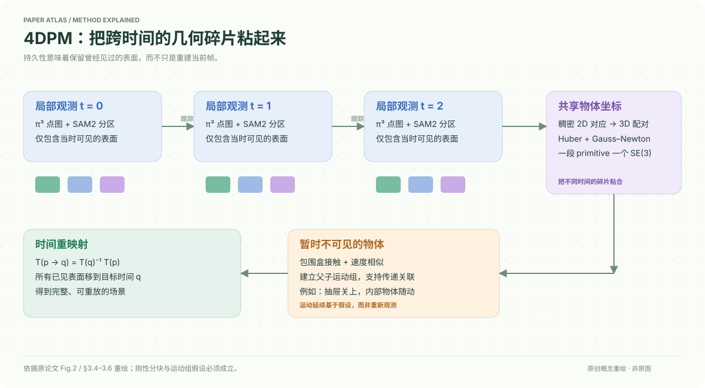

# 4D Primitive-Mache: Glueing Primitives for Persistent 4D Scene Reconstruction

核对日期：2026-10-20。以下实验均为作者报告；本地完成原文阅读与讲解自检，未复现实验。

## 一句话总结

4DPM把同一物体在不同时间露出的几何碎片，以刚性运动变换粘合并重映射到目标时刻；暂时遮挡时用关联运动维持空间记忆。

## 研究背景与动机

普通逐帧重建只知道“当前可见表面在哪里”，丢掉了背面等过去观测；将所有点图简单叠加又会留下运动拖影。本文的目标是持久重建：让曾经见过的表面在任意已观测时间都能正确重放，而不是凭空生成从未见过的细节。[PDF2–3]

与一般非刚性模型不同，作者采用分块刚性假设：每个primitive内部近似不变形，整体运动可以由若干不同刚性块组成。它适合多物体、部分关节运动，但不是任意软体的通用模型。

## 方法总览

原创重绘，依据原文Fig.2及§3；色块表示同一物体跨时间的可见碎片，不是额外训练标签。

π³预测各关键帧点图，SAM2传播分区；密集跟踪在邻帧建立对应。后端共同优化物体primitive姿态，最后用变换链把所有观测搬到指定时间。静态物体依据初始残差冻结，以区分相机运动与物体运动。[PDF3–5]

## 核心创新与关键设计

给每个对象选择最后可见片段为参考，并令其姿态为单位矩阵；每段T(S)把几何送到此共同坐标。于是从片段p映射到时间q为\(T_{p\to q}=T(S_q)^{-1}T(S_p)\)。这比为每个点、每对时间独立估计位移更紧凑，但表达能力来自刚性假设。

优化按对应置信、双方mask加权，最小化变换后3D点与邻帧warp点的Huber残差，再以Gauss–Newton/IRLS求解。遮挡延续另依赖OBB接触（扩大系数1.1）和速度相似的父子运动组，可经抽屉本体传递至里面的物体。[式2–6，PDF5]

## 实验与关键结果

作者仅用单路RGB作输入，以多视图辅助真值评估动态部分；预测按最后帧作Sim(3)/Umeyama对齐，阈值1cm。长序列切成150帧块，单RTX4090。[PDF6]

| 数据/方法 | F-score↑ | Precision↑ | Recall↑ |
|---|---:|---:|---:|
| HO3D / π³最后帧 | 0.3206 | 0.9255 | 0.2018 |
| HO3D / TraceAnything | 0.6365 | 0.5748 | 0.7398 |
| HO3D / 4DPM | 0.7573 | 0.7630 | 0.7774 |
| 自采多物体 / POMATO | 0.5864 | 0.4668 | 0.8071 |
| 自采多物体 / 4DPM | 0.7948 | 0.7195 | 0.9000 |

来源Table1–2，PDF7–8。HO3D最后帧精确率更高却覆盖不足，正是持久聚合的取舍。自采多物体GT由多视图π³度量对齐生成，是伪真值，不应当作独立深度传感器绝对精度。

## 消融实验与证据强度

正文没有单独量化“去接触分组”“去运动延续”等组件消融；不能把与π³最后帧基线的差值全部归因于某个模块。抽屉关闭后的物体保持主要为Fig.5定性证据，支持一个示例中的传递关联，不证明所有遮挡与重新出现情形都可靠。[PDF7–8]

## 局限与讨论

初始点图、分割和跟踪的错误会影响粘合；相似运动或近邻接触可能误建父子关系。内部真实运动若与可见父对象不同，仅凭外部观测无法知道。作者明确未解决精细非刚性形变和超长序列增量建图。[§5，PDF8]

## 复现提示

先分别保存π³点图、SAM2对象ID、对应置信和静态冻结结果，再核查变换方向与参考帧。应报告对齐前后误差、动态mask、阈值及序列切块，避免把短块结果当长时无漂移。项目4DPM页在原文PDF2列出；代码版本、许可证与权重未核验，本地未运行。

## 相关工作与阅读顺序

先读SuperPrimitive的分块表示和SE(3)优化，再对照St4RTrack、POMATO与TraceAnything。本文可接在前馈重建器之后，关键是跨时间复用观测；与4C4D侧重新视角外观拟合的目标不同。

## 来源与校验

- [CVF 官方论文页](https://openaccess.thecvf.com/content/CVPR2026/html/Mazur_4D_Primitive-Mache_Glueing_Primitives_for_Persistent_4D_Scene_Reconstruction_CVPR_2026_paper.html) · [所读 PDF](https://openaccess.thecvf.com/content/CVPR2026/papers/Mazur_4D_Primitive-Mache_Glueing_Primitives_for_Persistent_4D_Scene_Reconstruction_CVPR_2026_paper.pdf)。页码均为该 PDF 的页序。
- 阅读范围：正文、公式与实验表；补充材料、上游代码与权重未逐项核验。许可证和固定代码 commit 尚未确认，不复制原文全文或数据。
- PDF SHA-256：`0c6a5ecdcf21000609c05c4702d8be095c87c0742d3cc3f3ea9e3765daf524fa`；版本为本次下载的 CVF 接收稿，核对日期 2026-10-20。

- 视觉核对：渲染查看 PDF 第 8 页，检查关键实验表或方法相关证据；未将作者实验表述为本地复现。
