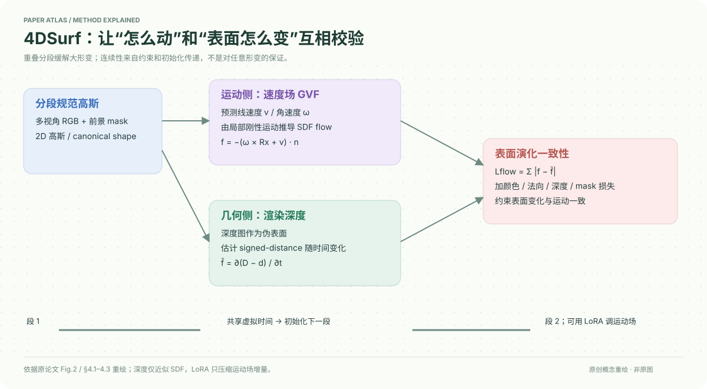

# 4DSurf: High-Fidelity Dynamic Scene Surface Reconstruction

核对日期：2026-10-20。以下实验均为作者报告；本地完成原文阅读与讲解自检，未复现实验。

## 一句话总结

4DSurf把高斯运动诱导的SDF变化与深度几何估计的SDF变化对齐，再通过重叠分段重建大形变动态表面。

## 研究背景与动机

动态高斯渲染可逼真，却可能给出抖动、断裂或随时间不一致的表面；单个规范空间也难解释长序列大形变。作者侧重表面网格而非单纯图像PSNR，不预先指定人物或物体类别。[PDF1–2]

## 方法总览

原创重绘，依据Fig.2与§4。红色损失连接运动和几何两种估计；它们是同一模型的约束，不是两套独立传感真值。

以前景mask视觉壳初始化2D高斯，速度场预测位置、旋转和尺度变化；渲染深度近似SDF，再匹配运动诱导的SDF-flow。每段含共享虚拟时刻，把上一段几何传给下一段，后续运动场可用LoRA适配。[PDF3–5]

## 核心创新与关键设计

局部刚性假设下，表面法向n与运动给出\(f=-(\omega\times Rx+v)^\top n\)。几何侧以\(\tilde s=\hat D(p^*,t)-d(\mu,t)\)近似距离，再取时间变化，约束\(L_{flow}=\sum_i|f_i-\tilde f_i|\)。该近似是沿相机光轴的深度差，不是任意空间点精确欧氏SDF。

速度场写为\(\mu_t=\mu+v(\mu,t)t\)、旋转由ωt转换，不能无条件当成连续ODE速度积分；应进一步核对补充推导与实现。总损失还含图像L1/DSSIM、法向、深度畸变与mask。LoRA只压缩运动参数增量，不合并各段规范高斯。[PDF4–5]

## 实验与关键结果

CMU Panoptic4场景、10视角，Hi4D6场景、8视角，全部RGB视图训练，评网格而非留出视图渲染。段大小5加一虚拟时刻，每段30k步约30分钟，单3090Ti；TSDF融合训练视角渲染深度提网格。

第6页CMU Band1 Overall CD12.7mm，对Dynamic2DGS16.0mm；Ian3为10.5mm对12.5mm。Hi4D Cheers37为0.47cm，对Dynamic2DGS2.29cm；Backhug02为0.84cm对1.07cm。两表mm/cm不同，不能直接横向比较数值；作者49%/19%摘要概括亦不代表每场相同百分比。

## 消融实验与证据强度

第8页Hi4D六景均值：仅速度场Overall1.49cm，加SDF-flow1.02，独立分段0.77，重叠分段0.67，IMT64为0.70；压缩略牺牲精度。时间STD完整0.18，对Sparse2DGS0.68，但这是误差波动指标，低STD不独立证明每帧几何准确。

LoRA rank16/32/64 Overall0.89/0.82/0.70；Backhug02运动场存储57.7MB降至9.4/16.5/30.6MB，各段规范形状仍38–39MB，不能把运动场压缩比例套给整个模型。

## 局限与讨论

“prior-free”表示无需额外SMPL/基础模型深度先验，不表示无标定、无前景mask或无正则。视觉壳、深度SDF近似、局部刚性以及分段传递都有假设；无明确可见证据的新拓扑与复杂遮挡仍可能失败。用全部视图评表面并不证明随意少摄像机都可获得相同质量。

## 复现提示

先核对相机、mask、单位与视觉壳，再分开复现速度场、flow约束和重叠段；保存共享时刻去重与TSDF配置。理论细节在未读补充§7–8，未据正文推断实现完全等价。代码、权重与许可证未核验；本地未训练、未提取真实网格。

## 相关工作与阅读顺序

先读2DGS与SDF-flow，再比较Dynamic-2DGS、GauSTAR及Sparse2DGS。它与4DPM分别针对连续动态表面和刚性碎片持久化，可以围绕不同运动假设比较，而非只比“4D”标签。

## 来源与校验

- [CVF 官方论文页](https://openaccess.thecvf.com/content/CVPR2026/html/Wu_4DSurf_High-Fidelity_Dynamic_Scene_Surface_Reconstruction_CVPR_2026_paper.html) · [所读 PDF](https://openaccess.thecvf.com/content/CVPR2026/papers/Wu_4DSurf_High-Fidelity_Dynamic_Scene_Surface_Reconstruction_CVPR_2026_paper.pdf)。页码均为该 PDF 的页序。
- 阅读范围：正文、公式与实验表；补充材料、上游代码与权重未逐项核验。许可证和固定代码 commit 尚未确认，不复制原文全文或数据。
- PDF SHA-256：`922d0ecd2dc50511e89fd97cb6f4028eb72dcce39bd640ff24f564c080c3aca1`；版本为本次下载的 CVF 接收稿，核对日期 2026-10-20。

- 视觉核对：渲染查看 PDF 第 8 页，检查关键实验表或方法相关证据；未将作者实验表述为本地复现。
