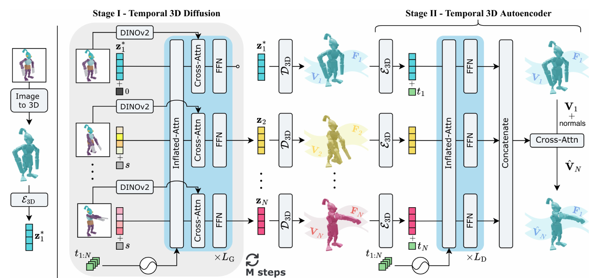

# ActionMesh: Animated 3D Mesh Generation with Temporal 3D Diffusion

核对日期：2026-10-21。实验数值均为作者报告；本地完成原文阅读与讲解自检，未复现实验。

## 一句话总结

ActionMesh先从视频同步生成逐帧3D形状，再预测参考网格的逐帧顶点位移，获得无骨架、固定面连接的动画网格。

## 研究背景与动机

逐帧图生3D会改变朝向和细节，各帧网格连接也不一致，妨碍贴图随动作传递。逐场景优化虽能提高一致性却慢。作者复用预训练3D先验，将跨帧生成与固定拓扑动画组装分开。[§1–3，PDF1–4]

固定拓扑指所有帧保留相同顶点索引和三角面连接；不等于表面永不自交、体积保持或动画已经达到任何生产流程验收标准。

## 方法总览

原论文Fig.2，PDF第3页。仅裁切相关图示，保留图内科学标签；著作权属于原作者，用于本篇方法分析，不并入本站原创图授权。[来源与作者](https://openaccess.thecvf.com/content/CVPR2026/html/Sabathier_ActionMesh_Animated_3D_Mesh_Generation_with_Temporal_3D_Diffusion_CVPR_2026_paper.html) · [PDF](https://openaccess.thecvf.com/content/CVPR2026/papers/Sabathier_ActionMesh_Animated_3D_Mesh_Generation_with_Temporal_3D_Diffusion_CVPR_2026_paper.pdf)。点击可打开高清图。

阶段一以TripoSG为3D潜扩散骨干，将多帧token放进同一自注意力并加时间RoPE，输出同步但仍各自独立的网格。某一清晰帧先由图生3D生成参考网格，其干净潜变量在每次去噪中固定为条件。[Fig.2、§3.1–3.2，PDF3–5]

阶段二用冻结3D编码器处理各帧形状，改造的时序解码器根据源/目标时间、参考顶点及法线预测位移。于是第k帧为(V+δ_k,F)，F保持不变；前一阶段的逐帧mesh并不是直接最终动画。[§3.3，PDF5]

## 核心创新与关键设计

对N帧、每帧T个token，把X∈R^(N×T×D)展成NT个token做注意力：
\[\operatorname{InfAttn}(X)=\operatorname{reshape}^{-1}(\operatorname{SelfAttn}(\operatorname{reshape}(X))).\]
FlashAttention2改善执行与显存开销，但精确全注意力的理论算术量仍随(NT)²增长，不能说它消除了二次复杂度。[式1，PDF5]

masked generation保留已知网格潜变量，令其flow时间为0、训练不对这些位置计扩散损失；推理每步重新写回已知潜变量。时序解码器额外查询法线，帮助区分空间相近但表面不同的点。它学习形变，不依赖预先指定骨骼，但不能表示切开、融合等真正拓扑变化。

## 实验与关键结果

ActionBench含Objaverse的128个动画场景。CD-3D逐帧ICP后衡量形状，CD-4D只用第一帧ICP统一对齐序列，CD-M以首帧近邻建立对应再评估运动。三者口径不同，尤其逐帧ICP会消除部分全局运动误差。[§4.1，PDF6–7]

| 作者报告 | CD-3D↓ | CD-4D↓ | CD-M↓ | 单H100时间 |
| --- | --- | --- | --- | --- |
| LIM | 0.089 | 0.126 | 0.243 | 15分钟 |
| ShapeGen4D | 0.056 | 0.170 | 0.348 | 15分钟 |
| ActionMesh | 0.053 | 0.081 | 0.148 | 2分钟 |

来源Table1。16帧约2分钟；相对表内15/35分钟方法约7.5/17.5倍，不对所有输入保证十倍。TripoSG逐帧也约2分钟但CD-4D0.184，本文收益包含一致性而不仅计时。LIM为作者重实现训练，ShapeGen4D由其作者提供结果，比较来源不同。

Consistent4D和真实DAVIS主要给定性展示，不能当成同等规模真实视频定量验证。[Fig.5–6，PDF7–8]

## 消融实验与证据强度

32场景消融中完整/无阶段二CD-3D0.050、CD-4D0.069相同，但无阶段二不能提供固定拓扑运动对应；同时去两阶段CD-4D恶化到0.187。说明阶段一改善同步，阶段二提供动画连接，不能把两者贡献都称作形状精度增益。[Table2，PDF8]

换Craftsman骨干CD-3D/4D/M为0.072/0.117/0.216，说明可迁移但有质量损失。32场景消融不是128场景主表，不能把0.050与主表0.053直接解释成某个模块的额外改进。

## 局限与讨论

参考帧看不见的部件和运动中强遮挡会重建失败，改变拓扑的动作无法由固定F精确表示。[Fig.7，PDF8] 纹理属性可随顶点对应传播，也不自动保证所有新暴露区域有正确纹理。

文本、图像+文本、网格+文本接口先调用外部图像/视频生成器，再接视频到动画流程；不是一个裸模型直接完成全部模态。长动画按chunk以前段末帧网格接续，可能积累漂移。所谓feed-forward表示不需每场景优化，扩散仍多次去噪，并非单次网络前向就生成整片。

## 复现提示

[项目页与发布入口](https://remysabathier.github.io/actionmesh/)来自论文，本次未核验commit、权重许可、完整训练设置及补充损失。建议 `experiments/3d/actionmesh/`，按Objaverse每资产许可取得模型，原视频、网格和权重不入库。

复现要记录参考帧、相机与前景分割、TripoSG版本、已知潜变量回填、表面采样/法线、时间RoPE和网格导出。单独检查固定连接、自交、表面失真和贴图；本地未训练、推理或导出动画，数字全部为作者报告。

## 相关工作与阅读顺序

先读3DShape2VecSet/TripoSG的潜表示，再理解时序注意力和源形状到形变场的区别。最后结合Fig.2、Table2和Fig.7，区分几何同步、顶点对应与物理质量三个目标。

## 来源与校验

- [CVF官方论文页](https://openaccess.thecvf.com/content/CVPR2026/html/Sabathier_ActionMesh_Animated_3D_Mesh_Generation_with_Temporal_3D_Diffusion_CVPR_2026_paper.html) · [所读PDF](https://openaccess.thecvf.com/content/CVPR2026/papers/Sabathier_ActionMesh_Animated_3D_Mesh_Generation_with_Temporal_3D_Diffusion_CVPR_2026_paper.pdf)。页码均为PDF页序。
- 所读版本：2026-10-21从CVF下载的开放接收稿；PDF SHA-256：`e4464339a3ccf816397bf5e8ebda6049050526f5736759063400a99f498a4d35`。
- 阅读范围：正文、方法公式、实验与消融；补充材料、代码及权重未逐项核验。reviewed表示本地讲解自检，不表示独立同行评审或实验复现。
- 方法图与关键公式/表格已渲染核对，所引原图已单独检查；未对新文章进行浏览器交互验收。作者图示与本站原创素材权利分开记录。
