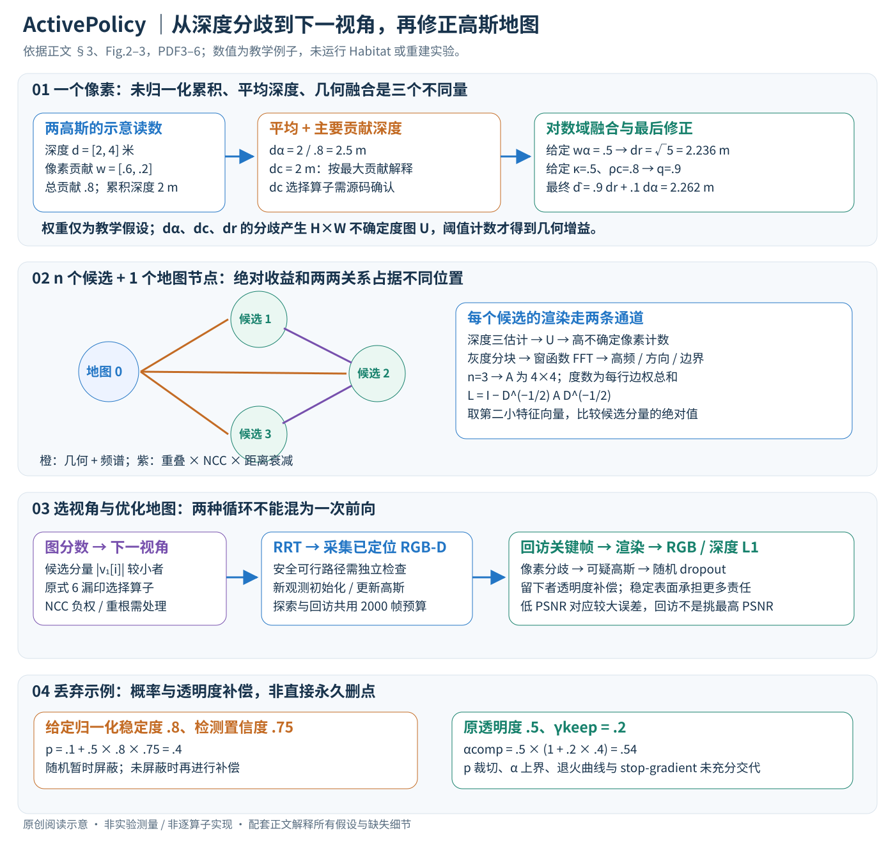

# ActivePolicy: Active Gaussian Reconstruction and Optimization Strategy Based on Global-Local Information Gain

核对日期：2026-10-30。实验数值均为作者报告；本地完成原文阅读与讲解自检，未复现实验。

## 一句话总结

ActivePolicy把高斯地图中的未知区域、渲染细节和候选视角间的关系一起用于下一视角选择，并用深度一致性筛除漂浮高斯；它改善的是预算受限的主动RGB-D重建，而不是被动重建或动态场景建模。（PDF第1–4页）

## 研究背景与动机

主动重建既要让相机去尚未观测的区域，又要回访已经看过但重建不好的表面。只最大化未知体素数量，容易覆盖充分而纹理模糊；只追逐局部渲染质量，又可能漏掉房间。作者把这两类需求称为全局覆盖和局部质量，并通过候选视角构图。这里所谓质量来自当前地图的预测，因此仍受地图自身误差影响。（PDF第1–3页）

## 方法总览

原论文Fig.2，PDF第4页。仅裁切相关图示，保留图内科学标签；著作权属于原作者，用于本篇方法分析，不并入本站原创图授权。[来源与作者](https://openaccess.thecvf.com/content/CVPR2026/html/Li_ActivePolicy_Active_Gaussian_Reconstruction_and_Optimization_Strategy_Based_on_Global-Local_CVPR_2026_paper.html) · [PDF](https://openaccess.thecvf.com/content/CVPR2026/papers/Li_ActivePolicy_Active_Gaussian_Reconstruction_and_Optimization_Strategy_Based_on_Global-Local_CVPR_2026_paper.pdf)。点击可打开高清图。

流程图可按“地图—候选—决策—优化”阅读：已定位RGB-D帧初始化或更新3D高斯；占据地图给出未探索空间；从中采样位置并生成方向；渲染候选RGB-D，计算绝对增益和视角间相对增益；图分析选出下一视角，再由RRT规划移动与采集。探索后还会回访关键帧优化地图。比较使用每序列2,000帧预算，后处理也包含在预算中，不能把后处理当作额外免费采集。（PDF第3–5、7页）

## 核心创新与关键设计

### 1. 先明确闭环接口与数组形状

系统接收带相机位姿的 RGB-D 观测，维护当前场景的高斯集合与占据栅格；输出下一相机位姿以及迭代优化的场景模型。已定位观测是输入假设，不应把本方法当作未知位姿恢复算法。以下用 M 表示高斯数、n 表示候选视角数，避免与原文复用的 N 混淆。[§3.1–3.2，PDF3]

| 变量 | 形状与坐标含义 |
| --- | --- |
| 颜色 I、深度 D、有效掩码 | H×W×3、H×W、H×W；深度沿相机坐标 z |
| 位姿 T 与内参 K | T∈SE(3)，矩阵4×4；K为3×3；T方向需与建图实现统一 |
| 高斯中心、尺度、旋转、透明度 | M×3、M×3、每高斯旋转、M个标量；颜色使用球谐系数，阶数未在方法正文指定 |
| 三种渲染深度与不确定度 U | 每个候选各有 H×W 的 dα、dc、dr 与 U |
| 邻接矩阵 A、度矩阵 Dg、谱向量 v | (n+1)×(n+1)、同形对角矩阵、n+1维；额外节点0代表地图 |
| 检测置信度与丢弃概率 | 每个被检查高斯一个标量，和像素掩码不是同一种对象 |

从深度生成相机点的常规接口为 \(x_c=D(u)K^{-1}[u,v,1]^T\)，再用相机到世界变换放入地图。此式是理解 RGB-D 初始化的阅读补充；作者实际高斯初始化引用既有方法，未在此完整给出尺度、密化与裁剪规则。协方差为 \(\Sigma=R\operatorname{diag}(s)^2R^T\)，单个高斯使用3维中心与各向异性尺度，而非占据栅格的一个硬体素。[式1]

### 2. 地图更新、候选采样与重建优化是不同阶段

每次获得新关键帧后，初始化局部高斯并合入全局地图，用图像和深度优化；再把地图转换为 occupied、free、unexplored 三态栅格。依据新发现区域、高度约束及空间去重产生候选，位置上生成多个朝向。正文写均匀方位角，Fig.2示意 Fibonacci sphere；角度数量、上下视角范围和这两种描述的实现关系未充分交代，不能凭图假定固定全球采样。[§3.2.1、Fig.2，PDF3–4]

候选数据库保存位姿和分数；新候选需与已有条目至少相隔 d_min，低于 \(\tau_{prune}HW\) 的分数被删。式4又将“地图差集”与 free/unexplored 状态放在一起，具体栅格集合语义需代码核实。未知体素不自动等于安全站位，后续还需要可通行性、碰撞检查与 RRT 路径规划。

对候选相机渲染得到 RGB、深度及有效性，计算绝对质量与候选间关系，求图谱分数选下一视角；RRT执行可行路径并采集，再回到建图。探索阶段之后还回访已有关键帧，而非永远只向新区域推进。原Fig.2的橙色箭头表达候选与收益，蓝色分支表达采集后的地图优化；图中“随机关键帧”属于后优化采样，不是随机选择 NBV。

### 3. 透明度合成为什么会制造不一致深度

在像素 u 上将高斯按深度排序，记局部有效不透明度 \(a_i=\alpha_iG_i^{2D}(u)\)，透射率 \(T_i=\prod_{j<i}(1-a_j)\)，贡献 \(w_i=a_iT_i\)。渲染颜色为 \(\sum_iw_ic_i\)，式3的深度累积为 \(\sum_iw_iz_i\)。后续 dα 又按总贡献归一化：
\[
d_\alpha=\frac{\sum_iw_id_i}{\sum_iw_i}.
\]

当总透明度不足1时，“深度累积”与“归一化深度”不同，不能混作同一个张量。一个表面前方的漂浮高斯只要承担颜色，就可能把合成深度拉近，但图像误差仍小。这是同时查看多个深度估计的动机。[式2–3、9，PDF3、5]

C-Depth在式9印为 \(d_c=d_{i_{w_i}}\)，意图是代表主要贡献高斯的深度；该式未完整写清选择算子。以下数值例子明确以“最大 w_i 对应高斯”解释，不声称已经核验作者实现，也不把它改成取加权深度总和。

### 4. 正深度上的融合、修正与不确定度逐项计算

正深度比的对数距离为 \(\delta_g=|\log(d_\alpha/d_c)|\)。它反映相对差异：2米与4米和4米与8米都有 log2，但绝对米差不同。贡献数量参与一致性系数
\[
\kappa=(1+\gamma\delta_g)^{-1}\min(N_g/N_{min},1).
\]

贡献不足会降低 κ；贡献很多并不保证深度真实。原文计算精度权重
\[
\pi_\alpha=\sum_iw_i e^{\beta(w_i-\tau_w)},\quad
\pi_c=\mathcal N\!\left\{\Big[\sum_id_iw_i e^{\beta(w_i-\tau_w)}\Big]N_g\right\},\quad
w_\alpha=\frac{\pi_\alpha}{\pi_\alpha+\pi_c}.
\]

\(\mathcal N\) 仅被称为归一化，范围、维度、常量图处理未完整说明，不能替换成自己选的 min-max 后叫严格复现。对数域插值给
\[
d_r=\exp[w_\alpha\log d_\alpha+(1-w_\alpha)\log d_c].
\]

它是加权几何均值。令 \(\rho_c=\exp[-\xi|d_\alpha-d_c|/(d_\alpha+d_c)]\)，最终另有一次修正
\[
\hat d=q d_r+(1-q)d_\alpha,\qquad q=\kappa+\rho_c(1-\kappa).
\]

这里为避免与其他超参数混淆将原文相关修正ρ记为ρc。κ与ρc在[0,1]时，q也在[0,1]，修正深度位于 dr与dα之间。不能把 dr 和最终 \(\hat d\) 当成同一输出；式11使用的是 dα、dc、dr三者。[式9–10]

教学例：同像素两个高斯深度2、4米，贡献0.6、0.2。则总贡献0.8，累积深度2米，归一化 dα=2.5米；按前述主要贡献解释 dc=2米。若额外给定 wα=0.5，dr=√5≈2.236米；这个权重仅为示意，未从未定义完全的精度归一化中推算。若再假设κ=0.5、ρc=0.8，则q=0.9，最终约2.262米。没有GT时它只能整合当前地图证据，不能保证2.262米就是实际表面。

接着分别计算三张深度图的像素间分歧和经图像 Laplacian 后的分歧，归一化为 \(\tilde\sigma_d^2,\tilde\sigma_s^2\)。原文中心量 \(\bar d=\mathcal N\{d_\alpha,d_c,d_r\}\)、\(\bar S=\mathcal N\{\mathcal Ld_\alpha,\mathcal Ld_c,\mathcal Ld_r\}\) 的归一化细节亦不完整；不擅自当作算术均值。最后
\[
U=\omega_s\operatorname{sigmoid}(\eta_d\tilde\sigma_d^2)+(1-\omega_s)\operatorname{sigmoid}(\eta_s\tilde\sigma_s^2),\quad
\omega_s=\operatorname{sigmoid}(-\nu\sqrt{\sigma_d^2}).
\]

U仍是H×W图，几何增益 \(g_i^{geo}=\sum_u\mathbf1[U_i(u)>\tau_u]\) 是像素计数。它是深度内部不一致的代理，不能等同于真实表面覆盖数或校准后验概率；深度零值、无贡献和掩码外像素必须另定义处理。[式11–12，PDF5]

### 5. 局部频谱项如何进入一个视角分数

把候选渲染灰度图划成自适应块，梯度大处用较小块，邻接无效掩码的块标为边界。对每块乘窗后计算功率谱 \(P_k=|\mathcal F(I_k\odot W_k)|^2\)，提取高频占比与方向性，再加边界指示项：
\[
s_k=\beta_h\rho_k^{high}+\beta_a\rho_k^{aniso}+\beta_b\mathbf1[k\in boundary],\qquad
g_i^{spec}=\frac{\sum_ks_kc_km_k}{\sum_kc_km_k}.
\]

ck为复杂度、mk为有效像素比例；因此一个细节多但有效区域很小的块不必主导整幅图。例：两块分数0.8、0.2，复杂度同为1，有效比例1、0.5，则视角分数(0.8+0.1)/1.5=0.6。窗口形式、频带切分、块大小映射和零分母策略未完整给出。更高频不代表更准确，漂浮高斯造成的伪纹理也能给高分。[式13–14，PDF5–6]

### 6. 候选间关系与谱排序不能省略

对相近候选做深度重投影，计算重叠 oij及图像NCC：
\[
g_{ij}^{rel}=o_{ij}\operatorname{NCC}(I_i,I_j)\exp[-\gamma_d\|t_i-t_j\|/\bar d].
\]

重叠且外观相似的近邻边更强；它描述相似/冗余关系，并非直接等于“新信息越大越好”。构建n+1个节点：地图0到候选i的边为 \(\lambda_g g_i^{geo}+\lambda_sg_i^{spec}\)，候选i到j的边为 \(\lambda_rg_{ij}^{rel}\)，对角0。[式5、15–16]

以n=3为教学例，若地图边权分别2、1、1，候选边仅1–2和2–3各0.5，则
\[
A=\begin{bmatrix}0&2&1&1\\2&0&.5&0\\1&.5&0&.5\\1&0&.5&0\end{bmatrix},\quad
D_g=\operatorname{diag}(4,2.5,2,1.5),\quad
L_g=I-D_g^{-1/2}AD_g^{-1/2}.
\]

本例本地数值求解得特征值约0、0.96128、1.28587、1.75285，对应第二小者的一种单位向量为(0.14376,0.62925,−0.29766,−0.70341)。取ε=10⁻⁶时三个候选分数约1.5892、3.3595、1.4216，选择候选2，即使它的地图直连边权不是最大。这只是构造图的线性代数验证，未验证重建性能。

按特征值从小到大排序，取第二小者的单位特征向量v₁，只在候选分量1…n上比较 \(1/(|v_1[i]|+\epsilon)\)，意图选较小绝对分量者。原式6实际漏印argmax算子，不能把公式当成可直接执行的完整代码。特征向量整体翻号不影响绝对值；重根、图不连通、零度节点的处理会影响选择。NCC可为负，使普通非负图归一化拉普拉斯的前提不自动成立，截断/移位策略需查实现，本文不自行修正。

稠密构图存储O(n²)，全量特征分解典型O(n³)；可用稀疏或迭代方法但本文未核实作者使用哪一种。谱分数是既定候选池上的启发式，不证明下个视角使未来重建误差全局最小。候选渲染和两两重投影也有成本，不能只报告特征求解时间。[§3.2.2，PDF3–4]

### 7. 4D-Reg：像素分歧到高斯丢弃，再回到梯度

三深度的测地分歧
\[
\Delta_{geo}=\sqrt{|\log(d_\alpha/d_c)|^2+|\log(d_\alpha/d_r)|^2+|\log(d_c/d_r)|^2}
\]

先定位不一致像素；在多个这类像素上有高影响的高斯成为可疑点。结合跨尺度一致性与空间邻域一致性得到
\[
\phi_i^{detect}=\mathcal N\{\Delta_{geo,i}\}(1-C_i^{scale})(1-C_i^{nbr}).
\]

同一表面从多尺度和邻域看都一致时，两个补因子会压低置信度，避免把真实边缘全删；具体像素到高斯的汇总、尺度一致性计算及邻域半径数值未完整说明。[式17–18]

再根据不透明度、尺度体积与深度方差构造稳定度
\[
\phi_i^{stab}=o_i\log(1+\prod_{j=1}^3s_{ij})\exp[-\zeta\max_{d\in\{\alpha,c,r\}}\operatorname{Var}(d)],\quad
p_{drop,i}=p_{base}+\lambda_{drop}\mathcal N\{\phi_i^{stab}\}\phi_i^{detect}.
\]

o_i表示该处原文不透明度因子；不能与前节视角重叠混淆。按概率临时丢弃可疑高斯，使被它遮挡的表面高斯承担颜色/深度重建；保留下来的可疑高斯使用 \(\alpha_i^{comp}=\alpha_i(1+\gamma_{keep}p_{drop,i})\)。稳定表面另按邻近漂浮点的平均丢弃概率增强权重。原文把该机制称gradient-driven，但所给表达式调整透明度，未完整说明是否还直接乘梯度、是否stop-gradient、补偿是否写回参数，不能凭措辞补成具体优化器实现。p的[0,1]裁切及透明度上界也未给出。

例：给定pbase=.1、λdrop=.5、归一化稳定度=.8、检测置信度=.75，得到pdrop=.4；若原透明度.5、γkeep=.2，则保留时补偿为.54。丢弃时无需视为从地图永久删除；多次采样会产生随机优化轨迹。时间退火随探索进展改变强度，但具体曲线需核实。此处“4D”是方法名称，不表示加入时间坐标重建动态场景。[§3.4，PDF6]

### 8. 优化、回访与推理的边界

最终优化仍为 \(L=w_{rgb}\|C-C^{ref}\|_1/|P|+w_{depth}\|\hat D-D^{ref}\|_1/|P|\)，没有额外新损失项。新帧提供监督，训练更新的是场景高斯属性；图选择与路径规划通常是外部决策，本论文没有给出对特征分解、RRT及相机运动端到端反向传播的定义。透明度正则改变渲染与梯度分配，图像/深度误差再把信号传回可训练属性。[式20]

关键帧回访使用有效像素内的PSNR与相对深度误差。**低**PSNR意味着较大颜色误差；原文“high discrepancies”不能被解释为选择最高PSNR。两项如何统一排序、无效区域乘mask后PSNR分母如何计算需实现核查。在线重建交替测量与优化，重建完成后新视角渲染直接读取地图；不能把2,000帧预算之外的回访当作免费训练数据。[式7–8、§4.1，PDF4、6]

## 实验与关键结果

作者在RTX4090上评估Replica的8个场景和MP3D的5个场景，均通过Habitat开展主动采集。后者使用真实扫描环境，但不等于物理机器人实测。（PDF第7页）

| 作者报告的均值 | ActiveGAMER | ActivePolicy |
|---|---:|---:|
| Replica准确性误差/cm↓ | 1.28 | 1.03 |
| Replica完整性误差/cm↓ | 1.74 | 1.28 |
| Replica完整率/%↑ | 96.59 | 98.04 |
| Replica PSNR/dB↑ | 30.99 | 31.89 |
| MP3D准确性误差/cm↓ | 1.63 | 1.42 |
| MP3D完整性误差/cm↓ | 2.54 | 1.82 |
| MP3D PSNR/dB↑ | 25.43 | 26.86 |

来源为表1–2（PDF第7–8页）。Replica的SSIM为0.97、LPIPS为0.12，但MonoGS的LPIPS为0.08，因此不能说所有画质指标都最优。MP3D的PSNR提升1.43dB；分贝是对数量，不宜直接换算成“画质提高若干百分比”。

## 消融实验与证据强度

表3只针对Replica Room2。完整方法PSNR为31.29dB、深度RMSE为0.75cm；去GL-Graph后分别为24.20dB和2.82cm；去深度设计后为30.00dB和1.38cm；去4D-Reg后为29.22dB和1.02cm。它支持探索策略与地图正则都有作用，但不是跨全部场景的独立消融均值。（PDF第8页）

需要区分文字与表格：正文称去掉GL-Graph会探索失败，表格仍给出了该变体数值；表中五次尝试均失败的是去掉绝对增益的变体。讲解保留这一差异，不能把两者混为一谈。

## 局限与讨论

图谱分数依赖候选采样和当前地图，真实缺失表面可能在渲染中完全不可见。高频代理会奖励错误纹理，谱向量在特征值重复时也可能不稳定。漂浮点随机丢弃的概率约束、透明度补偿边界及图边负权处理尚需代码核查。正文没有提供足以重建全部候选数量、图求解开销与端到端运行耗时的完整细节，所以目前证据是有限场景的重建指标改善，而非实时部署保证。（PDF第3–8页）

## 复现提示

复现应分别记录RGB-D内参和位姿、可见性判定、候选池、RRT碰撞约束、图权重、随机种子以及2,000帧预算如何分配到探索与回访。首先用小场景验证深度零值、负NCC及无可行候选时是否有定义，再进行完整实验。原文损失使用RGB与深度L1项，不能自行加入损失后仍称严格复现。本文未安装作者代码、下载场景或运行重建；代码固定版本、许可证及补充材料未核查。（PDF第3–8页）

## 相关工作与阅读顺序

先了解3DGS的透明度合成与RGB-D建图，再阅读主动建图中的信息增益和下一最佳视角规划。可对照ActiveGAMER看关键帧回访，对照MonoGS看被动建图指标，但两者的采集策略与预算必须保持可比。最后再看谱图推导，重点检查其作为视角排序启发式的假设，而不是把图论术语直接当作最优性证明。（PDF第2–4页）

## 来源与校验

- [CVF官方论文页](https://openaccess.thecvf.com/content/CVPR2026/html/Li_ActivePolicy_Active_Gaussian_Reconstruction_and_Optimization_Strategy_Based_on_Global-Local_CVPR_2026_paper.html) · [所读PDF](https://openaccess.thecvf.com/content/CVPR2026/papers/Li_ActivePolicy_Active_Gaussian_Reconstruction_and_Optimization_Strategy_Based_on_Global-Local_CVPR_2026_paper.pdf)。页码均为PDF页序。
- 所读版本：2026-10-22从CVF下载的开放接收稿；PDF SHA-256：`f5c5084531e93eed76054a50f3c4e2bb8ab6e276c88ac3a5cb3e5b334c154b54`。
- 阅读范围：正文、方法公式、实验与消融；补充材料、代码及权重未逐项核验。reviewed表示本地讲解自检，不表示独立同行评审或实验复现。
- 方法图与关键公式/表格已渲染核对，所引原图已单独检查；未对新文章进行浏览器交互验收。作者图示与本站原创素材权利分开记录。

- 方法v2重读范围：2026-10-30，PDF3–6方法逐式阅读并渲染4–6页；原Fig.2连同箭头重审。保持上述原PDF哈希；未运行作者重建代码。

- 方法与配图v2联合自检：2026-10-30，原Fig.2与中文SVG逐项重审、Chrome无头浏览器整图截图检查通过；正文35个公式渲染0错误，独立检查深度/丢弃算术及四节点图特征分解；均为静态阅读与教学例验证，未复现重建。
