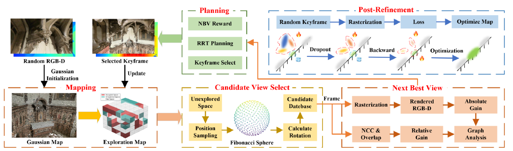

# ActivePolicy: Active Gaussian Reconstruction and Optimization Strategy Based on Global-Local Information Gain

核对日期：2026-10-22。实验数值均为作者报告；本地完成原文阅读与讲解自检，未复现实验。

## 一句话总结

ActivePolicy把高斯地图中的未知区域、渲染细节和候选视角间的关系一起用于下一视角选择，并用深度一致性筛除漂浮高斯；它改善的是预算受限的主动RGB-D重建，而不是被动重建或动态场景建模。（PDF第1–4页）

## 研究背景与动机

主动重建既要让相机去尚未观测的区域，又要回访已经看过但重建不好的表面。只最大化未知体素数量，容易覆盖充分而纹理模糊；只追逐局部渲染质量，又可能漏掉房间。作者把这两类需求称为全局覆盖和局部质量，并通过候选视角构图。这里所谓质量来自当前地图的预测，因此仍受地图自身误差影响。（PDF第1–3页）

## 方法总览

原论文Fig.2，PDF第4页。仅裁切相关图示，保留图内科学标签；著作权属于原作者，用于本篇方法分析，不并入本站原创图授权。[来源与作者](https://openaccess.thecvf.com/content/CVPR2026/html/Li_ActivePolicy_Active_Gaussian_Reconstruction_and_Optimization_Strategy_Based_on_Global-Local_CVPR_2026_paper.html) · [PDF](https://openaccess.thecvf.com/content/CVPR2026/papers/Li_ActivePolicy_Active_Gaussian_Reconstruction_and_Optimization_Strategy_Based_on_Global-Local_CVPR_2026_paper.pdf)。点击可打开高清图。

流程图可按“地图—候选—决策—优化”阅读：已定位RGB-D帧初始化或更新3D高斯；占据地图给出未探索空间；从中采样位置并生成方向；渲染候选RGB-D，计算绝对增益和视角间相对增益；图分析选出下一视角，再由RRT规划移动与采集。探索后还会回访关键帧优化地图。比较使用每序列2,000帧预算，后处理也包含在预算中，不能把后处理当作额外免费采集。（PDF第3–5、7页）

## 核心创新与关键设计

**GL-Graph。** 地图虚拟节点与候选视角相连，权重结合几何覆盖增益和频谱质量增益；候选之间的边结合重叠、NCC和距离衰减。归一化拉普拉斯为 \(L=I-D^{-1/2}AD^{-1/2}\)，作者利用第二小特征值对应向量的分量选择视角。正文把较小绝对分量解释为较有价值的连接位置；式(6)没有完整打印出选择算子，因此应结合算法描述阅读，不能据此声称一般意义上的全局最优。NCC可能为负，边权截断与退化特征空间的处理也需要查实现。（PDF第3–4页）

**深度与正则。** 一种深度是透明度权重归一化均值 \(d_\alpha=\sum_iw_id_i/\sum_iw_i\)，另一种来自主要贡献高斯；作者在正深度的对数空间插值：\(d_r=d_\alpha^{w_\alpha}d_c^{1-w_\alpha}\)。它把表面位置的两种估计折中，但要求零深度、无贡献像素得到单独处理。频谱项用渲染图像的高频、方向性和边界估计细节，高频丰富并不自动意味着真实。所谓4D-Reg依据多种深度分歧及邻域一致性识别漂浮点，配合随机丢弃、透明度补偿和梯度权重；这里的“4D”名称不表示重建动态四维场景。（PDF第4–7页）

## 实验与关键结果

作者在RTX4090上评估Replica的8个场景和MP3D的5个场景，均通过Habitat开展主动采集。后者使用真实扫描环境，但不等于物理机器人实测。（PDF第7页）

| 作者报告的均值 | ActiveGAMER | ActivePolicy |
|---|---:|---:|
| Replica准确性误差/cm↓ | 1.28 | 1.03 |
| Replica完整性误差/cm↓ | 1.74 | 1.28 |
| Replica完整率/%↑ | 96.59 | 98.04 |
| Replica PSNR/dB↑ | 30.99 | 31.89 |
| MP3D准确性误差/cm↓ | 1.63 | 1.42 |
| MP3D完整性误差/cm↓ | 2.54 | 1.82 |
| MP3D PSNR/dB↑ | 25.43 | 26.86 |

来源为表1–2（PDF第7–8页）。Replica的SSIM为0.97、LPIPS为0.12，但MonoGS的LPIPS为0.08，因此不能说所有画质指标都最优。MP3D的PSNR提升1.43dB；分贝是对数量，不宜直接换算成“画质提高若干百分比”。

## 消融实验与证据强度

表3只针对Replica Room2。完整方法PSNR为31.29dB、深度RMSE为0.75cm；去GL-Graph后分别为24.20dB和2.82cm；去深度设计后为30.00dB和1.38cm；去4D-Reg后为29.22dB和1.02cm。它支持探索策略与地图正则都有作用，但不是跨全部场景的独立消融均值。（PDF第8页）

需要区分文字与表格：正文称去掉GL-Graph会探索失败，表格仍给出了该变体数值；表中五次尝试均失败的是去掉绝对增益的变体。讲解保留这一差异，不能把两者混为一谈。

## 局限与讨论

图谱分数依赖候选采样和当前地图，真实缺失表面可能在渲染中完全不可见。高频代理会奖励错误纹理，谱向量在特征值重复时也可能不稳定。漂浮点随机丢弃的概率约束、透明度补偿边界及图边负权处理尚需代码核查。正文没有提供足以重建全部候选数量、图求解开销与端到端运行耗时的完整细节，所以目前证据是有限场景的重建指标改善，而非实时部署保证。（PDF第3–8页）

## 复现提示

复现应分别记录RGB-D内参和位姿、可见性判定、候选池、RRT碰撞约束、图权重、随机种子以及2,000帧预算如何分配到探索与回访。首先用小场景验证深度零值、负NCC及无可行候选时是否有定义，再进行完整实验。原文损失使用RGB与深度L1项，不能自行加入损失后仍称严格复现。本文未安装作者代码、下载场景或运行重建；代码固定版本、许可证及补充材料未核查。（PDF第3–8页）

## 相关工作与阅读顺序

先了解3DGS的透明度合成与RGB-D建图，再阅读主动建图中的信息增益和下一最佳视角规划。可对照ActiveGAMER看关键帧回访，对照MonoGS看被动建图指标，但两者的采集策略与预算必须保持可比。最后再看谱图推导，重点检查其作为视角排序启发式的假设，而不是把图论术语直接当作最优性证明。（PDF第2–4页）

## 来源与校验

- [CVF官方论文页](https://openaccess.thecvf.com/content/CVPR2026/html/Li_ActivePolicy_Active_Gaussian_Reconstruction_and_Optimization_Strategy_Based_on_Global-Local_CVPR_2026_paper.html) · [所读PDF](https://openaccess.thecvf.com/content/CVPR2026/papers/Li_ActivePolicy_Active_Gaussian_Reconstruction_and_Optimization_Strategy_Based_on_Global-Local_CVPR_2026_paper.pdf)。页码均为PDF页序。
- 所读版本：2026-10-22从CVF下载的开放接收稿；PDF SHA-256：`f5c5084531e93eed76054a50f3c4e2bb8ab6e276c88ac3a5cb3e5b334c154b54`。
- 阅读范围：正文、方法公式、实验与消融；补充材料、代码及权重未逐项核验。reviewed表示本地讲解自检，不表示独立同行评审或实验复现。
- 方法图与关键公式/表格已渲染核对，所引原图已单独检查；未对新文章进行浏览器交互验收。作者图示与本站原创素材权利分开记录。
