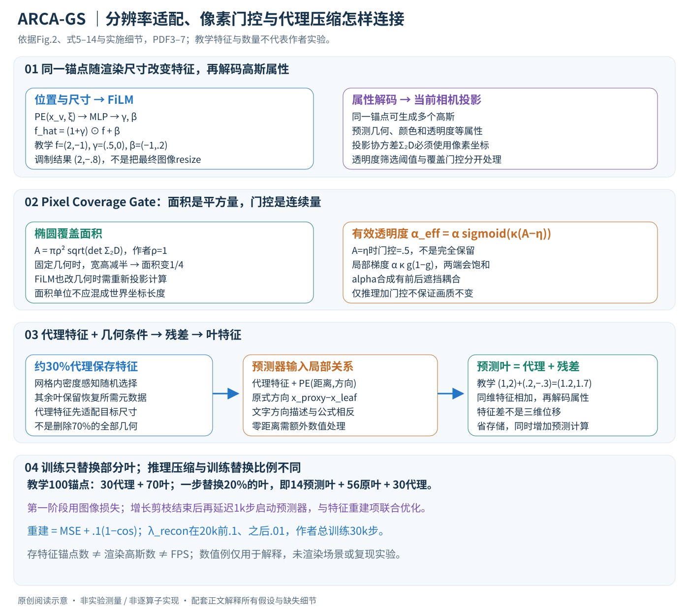

# 3D Gaussian Splatting at Arbitrary Resolutions with Compact Proxy Anchors

作者：Mingyun Jeong, Seongro Yoon, Francois Bremond, Donghyeon Cho。

分类：3d-vision；交付形式：Markdown 中文论文讲解。

核对日期：2026-10-20。以下实验均为作者报告；本地完成原文阅读与讲解自检，未复现实验。

方法与配图详细版返工：2026-10-24。展开FiLM、投影面积、透明度门控、代理预测与两阶段训练。未复现实验。

## 一句话总结

ARCA-GS用分辨率条件化特征、像素覆盖门控与代理锚点压缩，让同一个高斯场适应多种渲染尺寸。

## 研究背景与动机

固定分辨率训练的3DGS在缩小时容易混叠，锚点特征也占存储。单纯在推理时删小高斯可能损坏经过训练形成的透明度组合，因此需要联合训练处理分辨率与压缩（第1–3页）。

## 方法总览

### 一个场景表示同时适应尺寸变化和特征压缩

ARCA-GS的输入是已标定多视角图像、SfM初始化点和目标渲染尺寸；训练得到一个静态场景表示，推理时给定相机与尺寸输出图像。它沿用Scaffold-GS的“锚点特征解码为多个高斯”结构，新增分辨率条件化、像素覆盖门控、代理锚点预测三部分。三者分别回答“特征怎样随尺寸变化”“小于像素的高斯怎样处理”“哪些特征可以不存”。（§3，PDF第3–6页）

原创图依据Fig.2、式5–14。二维特征、投影面积和锚点数量均是教学构造，未渲染实验场景。

| 表示 | 类型/维度 | 角色 |
|---|---|---|
| \(x_v\) | 三维位置 | 锚点位置 |
| \(f_v\) | \(d\)维特征 | Gaussian属性解码的潜在表示 |
| \(\xi\) | 尺寸缩放比例 | 与位置一起生成FiLM参数 |
| \(\gamma_v,\beta_v\) | 与 \(f_v\)兼容的向量 | 特征逐维缩放与平移 |
| \(\Sigma_{2D}^{\xi,v}\) | \(2\times2\)投影协方差 | 计算当前像素坐标下覆盖面积 |
| \(A_{\xi,v},g_{\rm pix}\) | 标量 | 面积与透明度门控 |
| \(\widehat f_i^k,\widetilde f_i^q\) | \(d\)维特征 | 代理特征与预测叶特征 |

锚点不是一个渲染高斯的同义词；一个锚点可解码多个高斯。减少存有完整特征的锚点，不等于按相同比例减少参与渲染的高斯。（§3.1、Table 2）

## 核心创新与关键设计

### FiLM：把尺寸作为条件送到属性解码之前

位置与比例先经位置编码和小MLP：

\[
[\gamma_v,\beta_v]=\operatorname{MLP}(\operatorname{PE}(x_v,\xi)),\qquad
\widehat f_v=(1+\gamma_v)\odot f_v+\beta_v.
\]

缩放系数写成 \(1+\gamma\)，使零调制时能保持原特征。尺寸变化时，特征再进入原有Gaussian属性MLP，预测位置、尺度、旋转、透明度与颜色等属性。因此方法不只是将最终图像resize，也不只是推理时删掉小高斯。（式5–6，PDF第4页）

教学例：\(f=(2,-1)\)，\(\gamma=(0.5,0)\)，\(\beta=(-1,0.2)\)，输出 \((2,-0.8)\)。不同维度独立调节，可以保留某些信息而改变另一些，但这不表示每一维都具有已知、可解释的语义。

Scaffold式透明度筛选仍存在，作者设阈值 \(\tau=1/255\)。FiLM改变属性和透明度，因而不同尺寸可能选择不同高斯子集。它与后面的连续覆盖门控是两个机制，不能把二者合成一个硬面积阈值。（§3.2、§4.1，PDF第4、7页）

### Pixel Coverage Gate：投影椭圆面积决定透明度抑制

投影协方差的主轴标准差为 \(\sigma_1,\sigma_2\)，马氏半径 \(\rho\) 的椭圆面积为：

\[
A_{\xi,v}=\pi\rho^2\sqrt{\det\Sigma_{2D}^{\xi,v}}
=\pi\rho^2\sigma_1\sigma_2.
\]

作者固定 \(\rho=1\)，以阈值 \(\eta\) 调整覆盖要求。若协方差以像素坐标表达，面积单位就是像素平方；不能把世界坐标协方差直接代入并与像素阈值比较。（式7，PDF第4页）

在固定几何与视角、各方向像素坐标按比例 \(\xi\) 缩放的教学条件下，\(\Sigma'_{2D}=\xi^2\Sigma_{2D}\)，行列式变为 \(\xi^4\det\Sigma\)，所以面积缩为 \(\xi^2A\)。宽高均减半时面积为四分之一，而不是二分之一。实际方法的FiLM也可能改变高斯属性，因此这个纯投影推导不能直接替代完整模型预测。

门控与有效透明度为：

\[
g_{\rm pix}(A)=\sigma(\kappa(A-\eta)),\qquad
\widetilde\alpha=\alpha\,g_{\rm pix}(A).
\]

面积等于阈值时门控为0.5，不是完全保留；高于阈值也只是逐渐接近1。较大 \(\kappa\) 使过渡更陡，但远离阈值时梯度更易饱和。阅读补充中，\(\partial\widetilde\alpha/\partial A=\alpha\kappa g(1-g)\)，说明联合训练可以通过投影覆盖影响透明度贡献；本讲解只推导该局部关系，没有声称核验全部渲染反向实现。（式8–9）

高斯alpha合成还含前方透射率乘积。改一个高斯透明度会影响后面高斯的权重，并不等于简单从图像减去一个独立亮点。因此门控最好随训练一起学习，不能假设在任意已训练模型上加入门控都无损。

### 代理锚点：保留部分特征，用局部几何预测其余特征

作者将锚点分入网格，每格按密度感知方式随机选择约30%作为proxy，其余为leaf。代理保存完整特征；叶特征可由邻近代理的分辨率适配特征加残差恢复。不是将70%的几何位置和所有相关元数据一起删除。（§3.3，PDF第4页）

对叶位置 \(x_i^q\) 和对应代理 \(x_i^k\)，原式写：

\[
\Delta x_i=\|x_i^k-x_i^q\|,\qquad
\vec d_i=(x_i^k-x_i^q)/\Delta x_i,
\]

\[
\Delta f_i=F_{\rm pred}([\widehat f_i^k;\operatorname{PE}(\Delta x_i,\vec d_i)]),\qquad
\widetilde f_i^q=\widehat f_i^k+\Delta f_i.
\]

输入既有代理描述，也有叶相对代理的距离和方向，残差承担邻近位置差异。加法要求预测残差与特征同维。论文文字称方向为proxy到leaf，但公式分子 \(x^k-x^q\) 指向leaf到proxy；复现需统一符号，不能混用。零距离也会使单位向量定义失效，需要数值处理。最近代理数量、多个代理如何融合、位置编码频率与预测器层宽在主文中不够完整，不能自行确定。（式10及相邻文字）

教学例：代理特征 \((1,2)\)，预测残差 \((0.2,-0.3)\)，叶特征得到 \((1.2,1.7)\)。这只是特征空间加法，不表示叶高斯中心在三维空间移动了同样的数值；几何属性仍由后续解码产生。

### 两阶段训练：先形成稳定锚点，再让预测特征参与渲染

第一阶段使用全部锚点真实存储的特征，以渲染图像与目标图像的L1及SSIM损失训练。每步随机选择原始尺寸的10%–100%，相机内参与目标图也必须保持一致的缩放坐标关系。作者总训练30k步，锚点增长/剪枝结束后再延迟1k步启动预测器。（§3.4、§4.1，PDF第6–7页）

第二阶段每次均匀抽20%的**叶锚点**，用预测特征替换它们，其余叶仍用原特征，代理也继续参与渲染：

\[
F_{\rm mix}=(\widetilde F_q^{\rm sub}\cup(\widehat F_q\setminus\widehat F_q^{\rm sub}))\cup\widehat F_k.
\]

这个20%不是“整个场景只渲染20%”，也不是“最终压缩只压20%”。教学100锚点中有30代理、70叶，一步预测替换14叶，剩56叶用原特征，加30代理仍有100个锚点特征参与属性生成。迭代随机替换，让预测器逐渐接触不同叶；原叶特征在训练阶段提供重建目标。（式11，PDF第5页）

### 重建项同时约束幅度和方向，渲染项保证最终任务

\[
L_{\rm recon}=\frac1{|F_q^{\rm sub}|}\sum_i
\left(\|\widetilde f_i^q-\widehat f_i^q\|_2^2+
0.1[1-\cos(\widetilde f_i^q,\widehat f_i^q)]\right),
\]

\[
L_{\rm stage2}=L_{\rm base}+\lambda_{\rm recon}L_{\rm recon}.
\]

MSE约束逐维数值，余弦项约束方向。只用余弦会让方向相同但模长不同的特征获得相同相似度，而属性MLP未必对模长不敏感。渲染损失进一步要求预测特征解码出的图像正确，避免只优化潜在空间的相似度。\(\lambda_{\rm recon}\)在20k步前设0.1，之后0.01。正文没有明确所有目标分支是否stop-gradient，不能凭重建符号假设目标绝对冻结。（式12–14，PDF第6–7页）

### 推理与压缩：省存储会引入预测计算

推理给定分辨率后先调制代理特征，再依据叶位置与邻近代理恢复需要的叶特征，解码高斯并应用覆盖门控、透明度筛选与alpha合成。需要保留的除了代理特征，还有预测器以及恢复叶结构所需元数据。若相机或尺寸改变，缓存是否重用取决于条件和实现；主文没有给出可保证的缓存策略。

Table 1中Mip-NeRF360存储41.6MB对Scaffold的78.9MB，但其他压缩方法可到9.3/8.2MB。Table 2的Tanks特征保留锚点67.2K对208K不表示渲染高斯数量也按比例下降；表注说明仍有约700K高斯参与。压缩比、GPU运行内存和FPS必须分别衡量。（PDF第5页）

门控消融中，DeepBlending原Scaffold平均PSNR29.465，仅推理加入门控降到28.147，联合训练为29.905，支持“抑制策略需与表示共同适应”。分辨率消融FiLM平均28.183优于无条件27.199，但这些均为作者报告，不构成任意场景和尺寸的保证。（Table 3及门控消融，PDF第7–8页）

复现需要固定缩放坐标、面积单位、门控参数、代理网格与随机种子、方向约定、增长剪枝时点、20%替换和特征缓存统计。当前完成主文阅读、公式/教学算例检查与配图验收，未运行Scaffold或ARCA-GS、未复现实验。

## 实验与关键结果

30k迭代，随机10%–100%训练分辨率。第5页Mip-NeRF360表中10%尺寸PSNR29.742，对比Scaffold24.681；100%为26.710对26.498。存储41.6MB对78.9MB，但Context-GS9.3MB、TC-GS8.2MB更小，不能称绝对最小。Tanks平均PSNR24.600对24.060、锚点67.2k对208k；NeRF Synthetic的64%尺寸反而30.689低于基线31.562。

## 消融实验与证据强度

第7页FiLM平均PSNR28.183，高于无调制27.199和加法调制28.036。第8页仅推理时加门控的Deep Blending平均PSNR28.147，低于原Scaffold29.465，联合训练29.905；证据说明门控不是可无损即插即用的过滤器。

## 局限与讨论

代理特征预测存在计算开销，朴素实现可能慢于不压缩模型；存储下降不能直接转换成FPS提升。当前主要针对静态场景和已知相机；不同数据、尺寸并非全面领先，动态场景仍待研究。

## 复现提示

先重现Scaffold-GS，再固定训练/测试尺寸和存储统计口径。压缩在锚点增长剪枝后延迟启动，随机20%叶特征由预测替换；特征重建权重20k前0.1、之后0.01。论文给出ARCA-GS仓库入口，但代码、commit和许可证未核验，未在本地运行。

## 相关工作与阅读顺序

按3DGS→Scaffold-GS→多尺度抗混叠与锚点压缩阅读。官方元数据题名使用“at Arbitrary Resolutions”，PDF题名使用“for”，本笔记保留清单题名，避免误作两篇论文。

## 来源与校验

- 已渲染并目视核对 PDF 第5页关键表格/图；其余正文与公式通过原文文本核对。
- [CVF 官方论文页](https://openaccess.thecvf.com/content/CVPR2026/html/Jeong_3D_Gaussian_Splatting_at_Arbitrary_Resolutions_with_Compact_Proxy_Anchors_CVPR_2026_paper.html) · [所读 PDF](https://openaccess.thecvf.com/content/CVPR2026/papers/Jeong_3D_Gaussian_Splatting_at_Arbitrary_Resolutions_with_Compact_Proxy_Anchors_CVPR_2026_paper.pdf)。页码均为该 PDF 的页序。
- 阅读范围：正文、公式与实验表；补充材料、上游代码与权重未逐项核验。许可证和固定代码 commit 尚未确认，不复制原文全文或数据。
- PDF SHA-256：`c29306e7a15679e5c5941b1f7cabfb4289c7bfdee42d02f23e52dbf36945ff84`；版本为本次下载的 CVF 接收稿，核对日期 2026-10-20。
