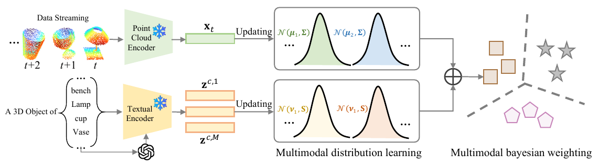

# Adapting Point Cloud Analysis via Multimodal Bayesian Distribution Learning

核对日期：2026-10-22。实验数值均为作者报告；本地完成原文阅读与讲解自检，未复现实验。

## 一句话总结

BayesMM把文本提示与流式点云表示建模为类条件高斯分布，通过在线统计更新和模态融合改善点云识别；骨干冻结且无需梯度训练，但统计状态仍随测试流改变。（PDF第1–4页）

## 研究背景与动机

固定大小的样本缓存会替换旧样本，经验式logit加权也可能依赖调参。作者希望用均值与协方差压缩历史信息，再以文本语义缓解几何特征在分布偏移下的不稳定。高斯统计能保留某些累积矩，但不代表保留了历史分布的全部信息；多峰、重尾与突然变换仍可能不适合该假设。（PDF第1–3页）

## 方法总览

原论文Fig.3，PDF第4页。仅裁切相关图示，保留图内科学标签；著作权属于原作者，用于本篇方法分析，不并入本站原创图授权。[来源与作者](https://openaccess.thecvf.com/content/CVPR2026/html/Zhu_Adapting_Point_Cloud_Analysis_via_Multimodal_Bayesian_Distribution_Learning_CVPR_2026_paper.html) · [PDF](https://openaccess.thecvf.com/content/CVPR2026/papers/Zhu_Adapting_Point_Cloud_Analysis_via_Multimodal_Bayesian_Distribution_Learning_CVPR_2026_paper.pdf)。点击可打开高清图。

图3中，冻结的点云编码器处理逐个到来的物体；文本编码器处理类别名称及LLM改写的提示，建立文本分布。几何分布从文本原型初始化，再随观测递推；两路分类分数通过作者称为Bayesian weighting的机制组合。它评价的是给定类别集合上的物体分类，并非直接对完整自动驾驶场景做检测，也未证明未知类别拒识能力。（PDF第3–4页）

## 核心创新与关键设计

文本统计为提示均值及散度矩阵；式(3)的散度求和没有除以样本数，不能默认为通常无偏样本协方差。几何均值更新采用精度相加：\(\Sigma_t=(\Sigma_{t-1}^{-1}+\Sigma^{-1})^{-1}\)，\(\mu_t=\Sigma_t(\Sigma^{-1}x_t+\Sigma_{t-1}^{-1}\mu_{t-1})\)。这里应区分观测协方差和均值后验不确定性；后者随观测收缩，不是自动学得任意变化的类内散度。（PDF第3–4页）

式(7)的文本MAP表达式与前文以提示均值为先验中心的定义不易直接对应：标准高斯均值后验一般还包含先验精度乘先验均值，以及观测和。式(13)将参数后验记作模态权重，但未完整列出模型证据归一化或对参数积分；若权重依赖类别，融合后也未必自动对类别归一。正文缺少无标签样本如何分配更新类别、置信筛选及协方差正则的完整规则。因此这些是需代码/补充推导核实的地方，本笔记不把印刷式视为可直接运行的完整算法。（PDF第3–4页）

## 实验与关键结果

四个冻结骨干为ULIP、ULIP-2、OpenShape和Uni3D。ModelNet-C表1使用1024点、腐蚀强度2，七类腐蚀外另列干净数据；表中Avg实际包含干净列。不同协议点数不能混用：表2包括2048/10000及多种Omni3D点数，表3模拟到真实使用2048点，而正文又笼统说统一1024点，复现应按协议核查。（PDF第5–6页）

| ModelNet-C表1平均准确率/% | 原模型 | 分层Point-Cache | BayesMM |
|---|---:|---:|---:|
| ULIP | 48.60 | 55.02 | 59.42 |
| ULIP-2 | 59.61 | 64.25 | 65.21 |
| OpenShape | 74.87 | 77.52 | 78.61 |
| Uni3D | 69.69 | 74.63 | 76.56 |

不能声称逐格最好：ULIP-2的jitter为29.01，低于缓存29.50；表2 OpenShape在O-LVIS为43.93，低于原模型46.78；表3 Uni3D模拟到真实均值70.94略低于Global缓存71.01。（PDF第5–6页）

RTX3090、batch1吞吐表6分别为ULIP11.35→10.99、ULIP-2 12.82→12.45、OpenShape8.68→8.29、Uni3D7.77→7.45样本/秒。后两者保留约95.5%与95.9%原速度，正文“超过97%”并非全部成立。（PDF第8页）

## 消融实验与证据强度

表4在ULIP-2上：固定文本原型S-OBJ/Omni3D为42.00/26.58，只有几何分布46.47/26.63，只有文本分布52.50/30.79，完整融合53.02/31.12。文本提示统计贡献较大，但缺少“几何+文本且不用Bayesian weighting”的同配置行，不能独立归因融合权重的全部增益。图4显示所测先验方差范围内变化较小，不代表无超参数。（PDF第7页）

表5 Uni3D在40类/1156类上BayesMM总显存5076/5080MB，原模型5062/5062MB，支持统计头额外开销较小；这些总量受骨干主导，不能据此证明任意维度、任意类别数下开销恒定。（PDF第8页）

## 局限与讨论

持续精度累积若没有遗忘机制，遇到类别频率或条件分布突然改变可能反应缓慢。伪标签误更新可自我强化，高维协方差在提示数量少时也可能奇异。原文在性能讨论中混用缓存与分布学习术语，部分增益数字与表格不完全一致，本文优先保留表格和可重算比较。t-SNE更分离不等于概率已校准；文中没有充分的不确定性校准与未知类检验。（PDF第3–8页）

## 复现提示

本轮阅读正文与关键图表，未阅读补充材料、核查代码commit/许可证或运行识别。后续应固定类别提示、提示改写来源、点数/归一化、测试顺序、状态重置、伪标签门槛和协方差收缩，明确先预测后更新还是先更新后预测。先在合成低维数据核对式(7)/(12)/(13)与概率归一，再跑官方协议；没有这些核查不能称为严格复现。未调用付费LLM生成提示，也未下载数据集或权重。（PDF第3–8页）

## 相关工作与阅读顺序

先理解ULIP/OpenShape的点云文本对齐，再对照Point-Cache的历史样本检索和GDA分类。随后学习高斯均值的共轭更新与Bayesian model averaging，带着观测噪声、参数不确定性和模型证据三者的区别读公式。最后检查各表的点数与反例，避免把平均提升当成每种分布偏移下都稳定有效。（PDF第2–8页）

## 来源与校验

- [CVF官方论文页](https://openaccess.thecvf.com/content/CVPR2026/html/Zhu_Adapting_Point_Cloud_Analysis_via_Multimodal_Bayesian_Distribution_Learning_CVPR_2026_paper.html) · [所读PDF](https://openaccess.thecvf.com/content/CVPR2026/papers/Zhu_Adapting_Point_Cloud_Analysis_via_Multimodal_Bayesian_Distribution_Learning_CVPR_2026_paper.pdf)。页码均为PDF页序。
- 所读版本：2026-10-22从CVF下载的开放接收稿；PDF SHA-256：`b4c510366726763891512f15e7c3fc119d60e09ccdfecebe8cf34011138858c7`。
- 阅读范围：正文、方法公式、实验与消融；补充材料、代码及权重未逐项核验。reviewed表示本地讲解自检，不表示独立同行评审或实验复现。
- 方法图与关键公式/表格已渲染核对，所引原图已单独检查；未对新文章进行浏览器交互验收。作者图示与本站原创素材权利分开记录。
