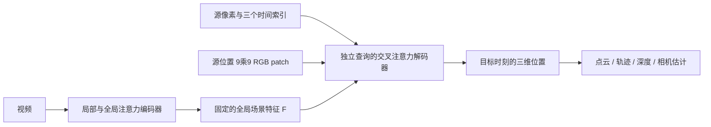

# D4RT：用统一点查询重建动态世界

论文：**Efficiently Reconstructing Dynamic Scenes One D4RT at a Time**，Chuhan Zhang、Guillaume Le Moing、Skanda Koppula 等，CVPR 2026，7382–7392 页。完整作者名单见官方页与本合集 manifest。

[官方论文页](https://openaccess.thecvf.com/content/CVPR2026/html/Zhang_Efficiently_Reconstructing_Dynamic_Scenes_One_D4RT_at_a_Time_CVPR_2026_paper.html) · [原文 PDF](https://openaccess.thecvf.com/content/CVPR2026/papers/Zhang_Efficiently_Reconstructing_Dynamic_Scenes_One_D4RT_at_a_Time_CVPR_2026_paper.pdf) · [论文列出的项目页](https://d4rt-paper.github.io/)

分类：3D 视觉 / 动态重建 / 点追踪。最后核对：2026-10-19。状态：正文阅读与讲解自检完成，未运行代码、未复现实验。页码均为 PDF 页码。该论文获最佳论文奖，依据[大会官方公告](https://cvpr.thecvf.com/Conferences/2026/News/Closing)。

## 一句话总结

把深度、三维点轨迹和相机参数统一成“某个源像素对应的物理点，在某个时刻、某台相机坐标系中在哪里”，用一次视频编码加独立点查询解码，减少多任务解码与重复追踪的开销。

## 研究背景与动机

动态重建要区分两种变化：物体自己移动，以及相机移动。只把每一帧的点云累积到一起，可能得到一只沿途被重复放置的天鹅；只跟踪第一帧可见的点，又会漏掉后来才露出的物体表面。论文 Fig.4 用这类情形说明几何重建与动态对应关系需要联合处理。[§1、§4.1，PDF 1、5–6]

传统组合流程可能依赖多个深度、运动和相机估计模块；直接设计多个输出头也会增加训练和推理成本。D4RT 的关键问题是：这些任务能否通过同一种输出接口表达，而不必每次完整解码每一帧？

## 方法总览

根据 Fig.2 重绘。这里的“独立”仅指解码 query 之间不做自注意力；视频编码器已经进行了跨帧的信息融合，不能理解成各点完全没有共享场景上下文。

## 核心创新与关键设计

### 1. 三个时间索引分别控制什么

视频特征为 \(F=E(V)\)，查询与输出为：

\[
q=(u,v,t_{src},t_{tgt},t_{cam}),\qquad P=D(q,F)\in\mathbb R^3.
\]

\((u,v,t_{src})\) 确定要追踪的是哪个源像素；\(t_{tgt}\) 指定物体所处时刻；\(t_{cam}\) 指定表达结果用的相机坐标系。比如追踪第 1 帧某个球在第 5 帧的位置、但始终用第 1 帧相机坐标表达，就设源时间 1、目标时间 5、相机时间 1。[§2.1，PDF 2]

这使“时间变化”和“坐标系变化”可以分开控制：

| 输出任务 | 查询设置 |
| --- | --- |
| 一帧深度 | 三个时间相同，遍历像素，取输出 Z |
| 共同坐标系中的轨迹 | 固定源像素与相机时间，遍历目标时间 |
| 每帧相机坐标中的轨迹 | 固定源像素，目标时间与相机时间一起遍历 |
| 多帧点云 | 遍历源像素与源帧，令目标时间等于源时间，固定相机时间 |

表为依据 §2.1 与 Table 1 的解释性整理。不同坐标系的轨迹不能混合评估。

### 2. 相机参数由同一批三维点推导

对同一时刻、同一组源点，只改变参考相机，可以得到两组对应三维点，再用 Umeyama 刚性对齐求相对位姿。内参估计则在针孔模型、主点位于归一化图像中心的假设下，利用投影关系：

\[
f_x=\frac{p_z(u-0.5)}{p_x},\qquad f_y=\frac{p_z(v-0.5)}{p_y}.
\]

对多个点的估计取中位数增强鲁棒性。[§2.1，PDF 3] 这是带假设的推导，不是无条件支持任意畸变模型；论文称畸变相机可以另加非线性细化，本轮未验证该扩展。

### 3. 轻量解码器不让 query 互相注意

query 由位置 Fourier 特征、三个离散时间嵌入以及源位置 **9×9 RGB patch** 的嵌入相加组成。每个 query 只通过 cross-attention 读取全局特征，解码器没有 query 间 self-attention。[§2.2，PDF 3]

因此训练时可以只采样少量点，推理时任意按需增减点数；也避免 query 分布变化直接改变 query 间交互。其代价是跨点一致性主要依赖编码特征和训练约束，不能从结构上宣称严格满足几何一致性。

### 4. 稠密追踪避免反复处理已覆盖像素

朴素方法从每帧每像素发起全片轨迹，需要 \(O(T^2HW)\) 个查询。论文 Algorithm 1 维护时空像素访问网格：先从未访问像素发起轨迹，把轨迹可见位置标为已访问，然后再补尚未覆盖的位置。作者实测按场景运动复杂度获得约 5–15 倍加速。[§2.3，PDF 3–4]

这是经验加速，不是把所有场景的最坏复杂度都证明降为线性。一次视频编码与随查询数增长的解码成本也应分开看。

## 实验与关键结果

TAPVid-3D 用 AJ（综合定位与可见性）、APD3D（落在误差阈值内的点比例）、OA（遮挡分类准确率）评价。下表摘自 **Table 4，PDF 6，无真值内参、相机坐标系**设置，已对照渲染页核对。

| 子集 | 方法 | AJ↑ | APD3D↑ | OA↑ |
| --- | --- | ---: | ---: | ---: |
| DriveTrack | SpatialTrackerV2 | 0.064 | 0.100 | 0.865 |
| DriveTrack | D4RT | 0.257 | 0.345 | 0.875 |
| ADT | SpatialTrackerV2 | 0.260 | 0.342 | 0.936 |
| ADT | D4RT | 0.240 | 0.319 | 0.926 |
| PStudio | SpatialTrackerV2 | 0.097 | 0.152 | 0.805 |
| PStudio | D4RT | 0.138 | 0.186 | 0.897 |

DriveTrack 与 PStudio 有明显优势，但 ADT 这一设置下没有超过 SpatialTrackerV2。提供真值内参后，D4RT 的 ADT AJ 为 0.307，SpatialTrackerV2 为 0.303；不能把这两种设置的最好数字拼成单一“全面领先”结论。

效率方面，Table 3（PDF 5）在单 A100 上报告维持 24 FPS 时可输出的全视频三维轨迹数：D4RT 为 1,570，SpatialTrackerV2 为 84，DELTA 为 5。这里比较的是**固定吞吐门槛下的轨迹容量**，不是任意分辨率下完整重建都能以这个速度运行。相机估计的 200+ FPS 是另一任务的配置，不能替代稠密动态追踪耗时。

几何评估使用了与真值对齐后的误差，包括深度的 scale-only / scale-and-shift 对齐和位姿的 Sim(3) 对齐。[§4.3，PDF 7] 因而结果支持对齐后的重建能力，不直接证明无需标定即可获得绝对米制尺度。

## 消融实验与证据强度

Table 7（PDF 8）在较小的 ViT-L 配置下，加入局部 RGB patch 使 Sintel 深度 AbsRel(S) 从 0.366 降到 0.302，位姿 ATE 从 0.173 降到 0.091。局部外观帮助边界与细节，但不能拿这个消融配置和最终 ViT-g 的结果直接比较增幅。

Table 8 显示扩大编码器总体有利，但部分指标并非单调变好；例如 ATE 从 ViT-H 的 0.070 到 ViT-g 的 0.078。Table 9 的辅助损失存在深度与相机估计权衡，去掉可见性或置信度损失可以让部分深度数值下降，却损害部分位姿指标。结论应是联合目标的取舍，而不是每个损失单独提升所有任务。

作者还报告预训练初始化的重要性以及仅公开数据的消融，但详细结果位于补充材料；本轮未读取，不能给出其未核对数字。[§4.4，PDF 8]

## 局限与讨论

以下为根据正文设计与实验的分析，非作者单独列出的正式 limitations：模型仍需昂贵的视频编码器；“轻量解码”不等于整个模型小。query 数可扩展不等于无限视频长度，训练使用 48 帧片段，超长视频的内存和分段一致性需另外验证。针孔主点假设、相机模型扩展、对齐评估的尺度解释都影响实际使用。

完整训练混合了内部数据。作者提供公开数据变体的论证是积极信号，但没有核对补充材料和权重前，不能声称训练全流程可公开复现。

## 复现提示

最终模型编码器为 40 层 ViT-g，时空 patch 为 2×16×16，约 10 亿参数；8 层 cross-attention 解码器约 1.44 亿参数。训练 48 帧、256×256 视频，每片段解码 2048 个采样 query；64 个 TPU 芯片，local batch 1，AdamW 500K 步，作者称耗时略多于两天。[§4，PDF 5–6]

训练的主要损失是对按平均深度归一化、经带符号 log 压缩后的三维点做 L1，并增加二维坐标、法线、可见性、运动和置信度相关监督。[§2.3，PDF 3–4] 不能简单用原始 XYZ 的 L1 替代后称为论文同配置。

本轮没有审查项目页代码、许可、权重与依赖；未执行训练或推理，commit 未知。若开展复现，应先确认数据许可、内部数据替代方案、坐标约定和帧长度，再验证小片段，避免直接按宣传 FPS 估算全流程预算。

## 相关工作与阅读顺序

DUSt3R / VGGT 帮助理解图像到点图的前馈重建；SpatialTrackerV2 帮助理解三维轨迹与动态对象；Scene Representation Transformer 提供“先编码，再查询”的架构背景。D4RT 关注从视频推断几何和对应关系，与 TokenGS 的“已知相机下输出可渲染高斯”不能直接按同一任务比较。

建议读 Fig.2 和查询定义 → Table 1 → Algorithm 1 → Table 4 的两组内参设置 → §4.3 对齐协议 → §4.4 消融。

## 来源与校验

原文正文 1–8 页已阅读；关键 Table 4 所在第 6 页已渲染核对。参考文献供阅读线索，补充材料未读。PDF SHA-256：`b88222682a2007f797d83bd891165a9dbb997cc5a7d3ab5a0d426e767861c5be`，仅为本地文件摘要。主来源为上方 CVF 公开接收版，不转载全文和作者图片。本讲解为 AI 辅助独立撰写、自检，尚无独立专家复核；复现实验状态与笔记状态分别记录。
