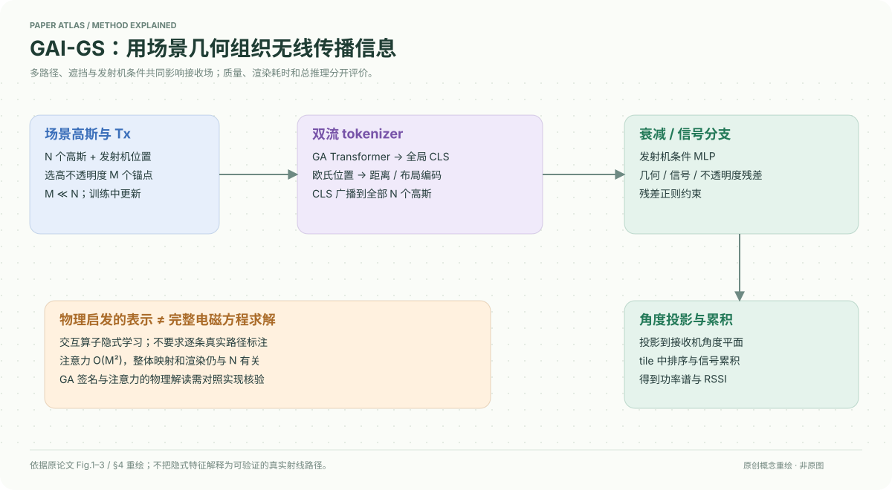

# A Geometric Algebra-Informed 3DGS Framework for Wireless Channel Prediction

核对日期：2026-10-20。以下实验均为作者报告；本地完成原文阅读与讲解自检，未复现实验。

## 一句话总结

GAI-GS以3D高斯表达无线环境，用几何代数与欧氏位置双分支汇聚场景，再按发射机条件调整高斯属性并渲染角度功率谱/RSSI；它是数据监督模型，不是完整电磁求解器。

## 研究背景与动机

RSSI不只由距离决定，还受反射、绕射、遮挡和材料影响。NeRF式无线场计算贵，纯回归3DGS又可能忽略几何交互。作者试图在可微高斯表示中加入几何代数注意力，以更紧凑方式组织多路径上下文。[§1–3，PDF1–4]

“物理启发”并不表示模型显式知道每个真实反射点，也不说明已严格满足Maxwell方程。

## 方法总览

从高不透明度高斯选少量锚点，与发射机上下文进入GA Transformer得到全局CLS；并行保留欧氏位置编码。两个MLP分支预测衰减与信号，再给旋转、尺度、SH信号和不透明度施加残差。高斯投影至接收机角度平面并累积信号，产生空间谱和RSSI。[Fig.1–3、§4，PDF3–6]

## 核心创新与关键设计

几何代数用乘积统一内积与外积，文中用夹心变换\(V^\prime=IVI^{-1}\)解释多次路径交互组合。这里I主要由网络隐式学习；绕射还会改变振幅、相位和能量分布，作者明确其不可能仅靠几何映射完整表达。[式5–9，PDF2–4]

从N个高斯只选M个高不透明度锚点，注意力代价由O(N²)降到O(M²)，但CLS还要广播到N个高斯，映射与渲染依然有N相关成本。不能说整个系统与高斯总数无关。[§4.2]

残差不透明度\(\tilde\alpha_i=\alpha_i+d_{attn,i}\)，用L2限制调整；信号和几何也由条件残差更新。投影使用
\[u=\lambda,\quad v=c\log\tan(\pi/4+\varphi/2),\]
再在tile中深度排序和累积。[式10–16]

**定义核对点：**正文把代数记为G_{3,0,1}，又描述时间基平方−1的Minkowski签名，二者的常用签名含义不一致；注意力从加权和到夹心算子的解释也不等于已证明任意注意力就是精确物理算子。复现需核验实际库与基选择，本笔记不将其写成无条件电磁定理。

## 实验与关键结果

自建约35m²室内、18天采样，2.4/5GHz两频段，两房间，TurtleBot4+Pi4+USB无线网卡；每点每频5次、间隔1s且五次成功才保留。公共BLE为4.2k训练、1.8k测试，50维RSSI；RFID角度谱360×90。[§5.1]

| 作者Table1 | WRF-GS | GAI-GS |
| --- | --- | --- |
| Room1，2.4GHz MAE↓ dB | 3.1 | 1.9 |
| Room1，5GHz MAE↓ dB | 2.4 | 1.6 |
| Room2，2.4GHz MAE↓ dB | 3.1 | 2.7 |
| Room2，5GHz MAE↓ dB | 1.9 | 1.8 |
| BLE MAE↓ dB | 2.8 | 2.3 |
| Spectrum SSIM↑ | 0.82 | 0.91 |

BLE剔除了远距离−100dBm退化读数，且文中MAE为接收器误差的中位聚合，需保留筛选协议。[PDF7–8]

单A100 Spectrum子集，本文训练203min、Inference17.37ms、Render0.91ms；WRF-GS+为101.06min、4.78ms、1.43ms。本文渲染更快，但总推理更慢，不能只取0.91ms宣传全部实时流程最快。[Table2，PDF8]

## 消融实验与证据强度

正文没有给出独立移除GA编码、去掉欧氏分支、改变M锚点数、关闭残差等受控消融表。与多种基线的总体优势和可视化可支持方法整体有效，但不足以分别证明每个物理解释和模块都不可替代。[§5，PDF7–8]

同理，房间2的5GHz仅改善0.1dB，没有方差或置信区间时，不应把微小差异描述为已证实的强统计优势。

## 局限与讨论

模型依赖场景几何、姿态和无线测量，跨房间零样本泛化、移动障碍物、不同硬件校准未由正文充分量化。GA签名与物理算子解释需进一步核验；没有原生完整波动方程求解或可认证物理一致性证据。

剔除无效RSSI读数会改变评价覆盖范围；光线追踪对照还依赖CAD与材料建模质量，不能只凭其高误差宣布传统方法在所有场景无效。

## 复现提示

原文数据入口 `https://huggingface.co/datasets/NorahCS/GAT-series_Dataset`，本次仅记录，尚未核对许可、总容量、固定revision或下载文件，不能当作已完成下载指南。建议 `data/wireless/gat-series/`。

先核对代数库签名、锚点数量与更新、残差范围约束、发射机/接收机坐标、RSSI筛选与空间划分；报告空间邻近采样泄漏风险。本文只读原文与表格，未运行模型或搭建无线采集平台。

## 相关工作与阅读顺序

先理解复数多径叠加与RSSI，再读3DGS投影累积和WRF-GS；几何代数部分应结合GA Transformer的实际定义，不能只看射线示意。最后对照Table1与Table2，把预测质量、渲染速度与整体推理成本分开。

## 来源与校验

- [CVF 官方论文页](https://openaccess.thecvf.com/content/CVPR2026/html/Shen_A_Geometric_Algebra-Informed_3DGS_Framework_for_Wireless_Channel_Prediction_CVPR_2026_paper.html) · [所读 PDF](https://openaccess.thecvf.com/content/CVPR2026/papers/Shen_A_Geometric_Algebra-Informed_3DGS_Framework_for_Wireless_Channel_Prediction_CVPR_2026_paper.pdf)。页码均为该 PDF 的页序。
- 阅读范围：正文、公式与实验表；补充材料、上游代码与权重未逐项核验。许可证和固定代码 commit 尚未确认，不复制原文全文或数据。
- PDF SHA-256：`b90e4fc9fc235417670bf13d29334b97923969aadae902d4019ffa1069af55a6`；版本为本次下载的 CVF 接收稿，核对日期 2026-10-20。

- 视觉核对：已渲染查看 PDF 第8页，检查关键实验表、公式或局限；正文读到结论，独立补充材料未读。
