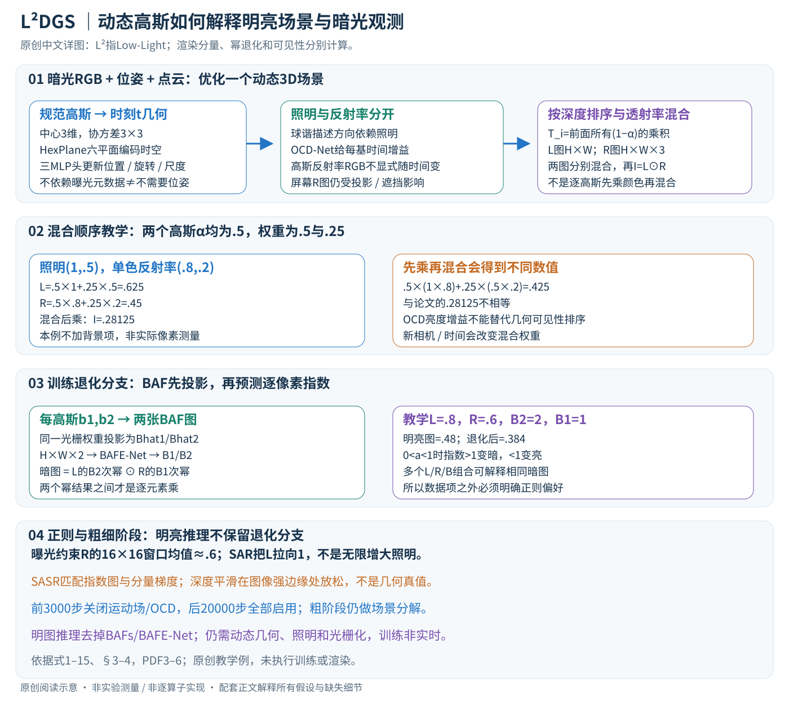

# L²DGS：从暗光动态视频恢复可渲染的明亮场景

论文：**$L^{2}DGS$: Low-Light Dynamic Gaussian Splatting**，Ashish Kumar、Rajagopalan N Ambasamduram，CVPR2026，19096–19106页。

[官方页](https://openaccess.thecvf.com/content/CVPR2026/html/Kumar_L2DGS_Low-Light_Dynamic_Gaussian_Splatting_CVPR_2026_paper.html) · [PDF](https://openaccess.thecvf.com/content/CVPR2026/papers/Kumar_L2DGS_Low-Light_Dynamic_Gaussian_Splatting_CVPR_2026_paper.pdf) · [论文所列项目](https://github.com/akumar005/L2DGS)

分类：3D视觉／动态高斯／暗光增强。核对：2026-10-20。正文阅读自检完成，未复现实验；页码为PDF页码。

方法与配图详细版返工：2026-10-25。细化动态高斯、分量渲染、逐元素幂退化和正则作用；未复现实验。

## 一句话总结

将动态高斯场景的颜色拆成反射率和随视角时间变化的照明，再学习把潜在明亮渲染退化回暗光观测，以无需明亮真值的方式优化动态重建。

## 研究背景与动机

直接逐帧提亮会放大噪声，且运动带来的阴影、遮挡与背景显露难以跨帧一致。静态暗光重建又无法解释动态对象。本文把增强和动态重建放进同一场景优化过程。[PDF 1–3]

## 方法总览

原创图依据§3、式1–15；像素数值为教学例。L²指Low-Light，场景表示是3D动态高斯，不是把高斯限制为二维表面。

### 输入与待优化变量

输入为N帧暗光RGB、每帧相机外参、相机内参K及稀疏点云。每个规范高斯具有中心 \(\mu_i\in\mathbb R^3\)、协方差 \(\Sigma_i\in\mathbb R^{3\times3}\)、不透明度、RGB反射率、球谐照明系数，以及两个标量亮度退化特征。没有明亮目标图监督，不等于没有相机位姿和场景初始化。（§3，PDF第3页）

这是每场景优化：场景高斯、时空特征场和相关网络共同拟合该视频。训练后才用新相机/时间查询渲染，不能与单张输入前馈增强的部署方式混为一谈。极暗图像估不准位姿或点云时，后续优化可能从一开始就不可靠。

## 核心创新与关键设计

### 动态几何：HexPlane编码空间与时间，三头更新高斯状态

协方差分解为 \(\Sigma=QSS^TQ^T\)，Q为旋转、S为对角尺度，保证半正定。HexPlane包含XY、Zt、YZ、Xt、ZX、Yt六个平面，查询空间位置和时间并组合：

\[
f=g(F(X,Y)F(Z,t)+F(Y,Z)F(X,t)+F(Z,X)F(Y,t)).
\]

该式来自论文式1；特征通道维度与聚合网络g细节主文未展开。三个MLP头据此估计时刻t的位置、旋转和尺度，得到变形后的3D高斯。论文采用4DGS式动态几何，不是把每帧独立训练为互不对应的点云。

### 照明随视角和时间变化，反射率作为高斯固有属性

设L=(k+1)²个球谐基，则高斯i的照明为

\[
l_i(v,t)=\sum_{j=1}^{L}a_{ij}(t)b_{ij}B_j(v).
\]

b是可学习球谐系数，B_j由观察方向决定，OCD-Net从该高斯时空特征输出时间增益a。若按每基一增益理解，接口每高斯有L个系数/增益；k的实际选择和网络层宽需查配置。（式2–4，PDF第4页）

OCD-Net用动态特征隐式学习遮挡/显露相关亮度变化，并不显式枚举所有高斯之间的光线传输。几何遮挡仍由光栅化深度排序和透射率处理；照明增益补充外观变化，不能代替真正的可见性排序。系数的正值参数化、球谐结果如何限制到允许强度范围，在主文未充分交代。

高斯反射率r_i不显式依赖时间/视角，但它渲染到哪一个像素及混合权重会随几何和相机变化。因此正文省略R_w的(v,t)下标，不意味着移动相机后反射率屏幕图每个像素不变。

### 分别光栅化L和R，再相乘：顺序不可交换

投影到像素p的覆盖率为 \(\alpha_i=o_i\exp[-\frac12(p-\mu_{2D})^T\Sigma_{2D}^{-1}(p-\mu_{2D})]\)。按前到后排序，透射率 \(T_i=\prod_{j<i}(1-\alpha_j)\)，则

\[
L_w(p)=\sum_iT_i\alpha_i l_i,\quad
R_w(p)=\sum_iT_i\alpha_i r_i,\quad
I_w=L_w\odot R_w.
\]

L为H×W标量图，R为H×W×3，乘法沿RGB通道广播。r_i是RGB，但每像素只有一个照明强度，不能随意改成三通道独立照明而声称同一模型。（式5–7）

教学两个前后高斯alpha分别.5、.5，则混合权重为.5、.25；后者不是.5，因为前一个挡掉一半。若照明1、.5，单颜色通道反射率.8、.2，则L=.625、R=.45，最后I=.28125。若先乘每高斯照明和反射率再混合，会得到.425；这说明“混合后乘”和“乘后混合”并不相同。本例按论文列出的前景求和，不加背景项；实际背景、alpha裁剪与排序细节需对照光栅器。

### 退化分支：明亮解释如何被暗光观测约束

每高斯两个BAF标量b1、b2，也用同样T_i alpha_i投影成 \(\widehat B_1,\widehat B_2\in\mathbb R^{H\times W}\)。拼成H×W×2输入卷积BAFE-Net，输出两张指数图B1和B2。不是把一帧简单乘同一个曝光系数。（式8）

\[
\widehat I_d=L_w^{\odot B_2}\odot R_w^{\odot B_1}.
\]

上标表示逐元素幂，两个结果之间才是逐元素乘。对0<a<1，指数大于1会变暗，小于1反而变亮；仅知道B为正不能证明任何参数配置都衰减。教学L=.8、R=.6、B2=2、B1=1，则明亮I=.48，退化后为.384。该例展示可学习gamma式映射，不是物理相机响应的唯一标定。（式9，PDF第5页）

退化参数和潜在L/R一起优化，多个组合可解释同一暗图，因此仅重投影误差不足以确定“真正明亮场景”。需要下面的正则选择较合理解；恢复结果不应解释为测得的绝对反照率或辐照度。

### 数据项与正则分别约束什么

数据项将退化图与原暗图做L1，加上两者经 \((I+\epsilon)^\eta\)变换后的1−SSIM。eta从.95衰减到.5，强调结构比较；不能把SSIM项误写为与不存在的明亮真值比较。原文epsilon记号及具体数值实现还应核对配置。（式10）

曝光项约束R图16×16非重叠窗口的平均强度接近.6；它并非把每个像素设为.6。照明SAR为平均|1−L_w|，把照明拉向1而非无限增大。若L_w本来大于1，它同样会往下降，所以“最大化照明”必须结合目标值理解。（式11、13）

深度正则 \(|\partial_xD|e^{-|\partial_xI_w|}+|\partial_yD|e^{-|\partial_yI_w|}\)在图像平坦处更抑制深度跳变，在明显边缘处允许变化。图像边缘不必全部对应真实深度不连续，正则是偏好，不是几何真值监督。（式12）

SASR约束 \(\|\beta_1\nabla B_1-\nabla R_w\|_1\) 与 \(\|\beta_2\nabla B_2-\nabla L_w\|_1\)，促进指数图与其作用分量的结构相适应。标量B1与RGB R的梯度如何广播或汇总、差分边界处理，需要核对实现；不自行添加灰度变换后称原算法。作者beta1=beta2=.5。（式14）

总目标为数据项加曝光、SAR、两项SASR、深度项，后五项权重依次.01、.05、1、1、.001。不同项归约和梯度尺度不同，不能只按权重数字断定哪个正则贡献最大。（式15、§4，PDF第6页）

### 粗细两阶段与推理删去的部分

前3000步粗优化关闭运动场和OCD-Net，但场景分解仍启用；后20000步细优化激活所有组件。反射率、BAFs随机初始化，各网络学习率不同。原文给BAFE-Net与OCD-Net起止学习率都是十倍变化，同时文字写decay factor .01，调度含义需查实现，不能直接把这个factor当起止比。

训练每个batch查询相机和时间→更新高斯动态状态及照明→光栅化L/R/BAFs→产生明图→退化回暗图→计算数据和正则→反传优化场景与网络。推理只要明亮输出，可去掉BAFs/BAFE-Net退化分支，但还需要动态几何、OCD照明及光栅器。训练约90分钟与推理大于30fps分别是不同阶段，不能合并成实时完成建模。

### 能力边界与成本

优化成本取决于高斯数、图像覆盖、排序与网络前向，BAFE-Net训练阶段还需整图卷积；六平面压缩时空表示不代表优化零成本。动态光照、反光材质、严重噪声可能被多个分量互相吸收。合成暗光有明亮参照可算PSNR，真实L2DyV没有明亮真值；真实好看与物理分解正确仍是不同证据。当前未执行场景训练、渲染或数据下载。

## 实验与关键结果

使用7段合成暗光视频和12段真实L2DyV；统一450×800。真实数据没有明亮真值，因此量化PSNR主要来自合成数据，真实场景用定性结果与用户研究。[§4]

Table 1（PDF 7，已渲染核对）整体图像指标：

| 合成场景／方法 | PSNR↑ | SSIM↑ | LPIPS↓ |
| --- | ---: | ---: | ---: |
| Apple，Luminance-GS | 12.50 | 0.43 | 0.44 |
| Apple，L²DGS | 13.31 | 0.63 | 0.24 |
| Handwavy，LLNeRF | 12.78 | 0.52 | 0.29 |
| Handwavy，L²DGS | 11.72 | 0.58 | 0.26 |

Handwavy的整体PSNR不是最好，不能把动态区域优势扩大为所有区域所有指标领先。真实场景两种用户研究共62位参与者、群体并不完全相同，不是实际测得明亮真值误差。[PDF 7–8]

## 消融实验与证据强度

Table 3在四段视频平均：完整模型整体PSNR14.68，去掉BAFE-Net为6.14，去掉照明增强为6.99，去掉OCD-Net为13.36。[PDF 8] 支持退化建模与亮度约束重要，但网络组件交互复杂，不能把每个分数差理解成独立可叠加增益。

## 局限与讨论

作者明确指出极暗条件下相机位姿和点云难以估计，这会阻塞整个方法。照明／反射／退化分解本身欠定，输出是正则选择的合理重建，不是绝对物理反照率测量。每场景优化与新场景前馈预测应区分；也不能把训练后的实时渲染当成实时完成重建。

## 复现提示

基于4DGS，先3000步粗优化，再20000步细优化；batch2、Adam、RTX3090，作者称450×800约90分钟训练。照明、反射、BAFs和两个网络采用不同学习率，应查对应配置。[§4，PDF 6] 先核验位姿质量与未增强暗光重投影，再比较明亮渲染，防止仅凭“变亮”判断几何成功。

项目commit、许可、数据格式体积与校验尚未核验，补充网络结构未读；未下载数据或执行代码，本文不构成已验证数据下载指南。

## 相关工作与阅读顺序

4DGS解释动态形变，Retinex帮助理解反射与照明，但本文增加视角时间依赖。建议§3输入→Fig.2→式7–10→正则→Table 1与局限，尤其检查“无元数据”的具体含义。

## 来源与校验

正文1–8页已读，第7页表格渲染查看。PDF SHA-256：`1bb84dbd71b76eb8346eb90a6681ac8ec243390cd52dfc052c0a229c2c3bcbce`。AI辅助讲解自检，无独立专家审稿，未复现实验；补充材料与代码未读。不转载作者图或全文。

2026-10-25详细版：重读PDF第3–6页并渲染第5页；原创详图上下半部及正文检查通过，16个公式无错误、坏图或横向溢出；未复现。
