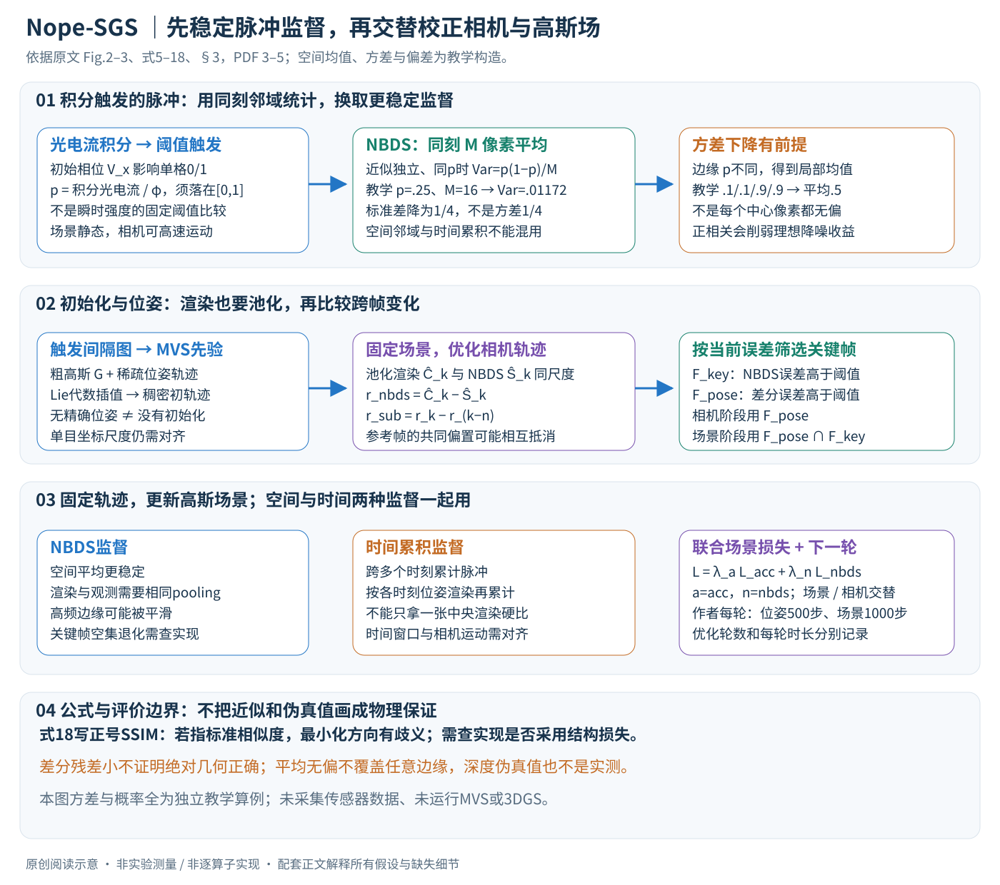

# 3D Gaussian Splatting from Unposed Spike Stream

作者：Yijia Guo, Tong Hu, Liwen Hu, Lei Ma, Tiejun Huang。

分类：3d-vision；交付形式：Markdown 中文论文讲解。

核对日期：2026-10-20。以下实验均为作者报告；本地完成原文阅读与讲解自检，未复现实验。

方法与配图详细版返工：2026-10-23。重读§3–4、Fig.2–3与式5–18，展开统计假设、交替变量、关键帧集合及结构损失符号；未复现。

## 一句话总结

Nope-SGS从没有精确相机位姿的脉冲流中交替估计相机轨迹与静态3D高斯场，以邻域平均降低脉冲随机性。

## 研究背景与动机

高速运动下传统图像模糊，脉冲相机虽有高时间分辨率，但单像素触发受初始电压和采样随机性影响；直接用噪声观测优化位姿容易陷入错误几何。本文主要针对运动相机观察静态场景，而非通用动态4D场景（第1–3页）。

## 方法总览

### 输出静态高斯场与相机轨迹，不是任意动态场景的4D重建

Nope-SGS输入运动相机采到的时空二值脉冲流\(S\in\{0,1\}^{H\times W\times N}\)，不要求先提供精确逐帧相机位姿，输出静态3D高斯场\(\mathcal G\)及相机轨迹\(\mathcal T\)。它先初始化粗场景与位姿，再交替改进两者。（§3，PDF第2–5页）

“unposed”指缺少精确外部位姿，不表示没有学习先验、相机成像信息或初始化。本文使用MVS初始化；单目尺度、坐标系与评价对齐也不能从题目中省掉。场景由静态高斯表达，主要解决高速相机运动，并未给出任意运动物体的独立形变场。

原创图依据Fig.2–3、式5–18，PDF第3–5页。方差、局部边缘偏差与误差差分为独立教学例子，不是实际采集结果。

| 状态或数据 | 作用 | 更新/使用位置 |
|---|---|---|
| 脉冲流\(S\) | 每像素每时间格是否触发 | 原始观测，不由优化器改写 |
| NBDS\(\hat S\) | 同时刻邻域归一平均形成较稳定监督 | 位姿误差及场景误差 |
| spike interval图 | 由触发间隔构造粗强度 | MVS初始化 |
| \(\mathcal G\) | 高斯位置、形状、颜色、不透明度等 | 场景优化阶段 |
| \(P_k\in SE(3)\) | 各时刻相机位姿 | 位姿优化阶段，稀疏节点间插值 |
| 累积脉冲\(I_{\rm acc}\) | 时间窗口统计 | 与同窗口渲染累积对齐的场景监督 |

## 核心创新与关键设计

### 脉冲相机不是“瞬时亮度超过阈值就输出1”

传感器将与入射光成比例的电流随时间积分，达到阈值\(\phi\)触发，再重置/保留模阈值状态。原式5写累积状态为

\[
A(x,t)=\left(\int_0^tL_C(x,\tau)\,d\tau+V_x\right)\bmod\phi.
\]

\(V_x\)为初始电压/积分相位。相同光强也可能因不同相位在某个短时间格输出不同的0/1，解释了单帧脉冲纹理不稳定。它与前一篇单比特比较器视频的瞬时强度测量机理不同，不能仅因二者都输出二值就共用同一观测公式。（§3.2、Fig.2，PDF第3页）

作者假设\(V_x\sim U[0,\phi]\)，将单格输出建模为Bernoulli变量，触发概率

\[
p(x,k)=\frac1\phi\int_t^{t+\Delta t}L_C(x,\tau)\,d\tau.
\]

这首先是概率模型，不是每个随机脉冲都等于亮度。概率必须落在\([0,1]\)，因此该写法需要对应采样/电流范围内的单格触发假设；若积分可超过阈值多次，不能无处理地让\(p>1\)还称其Bernoulli概率。初始相位均匀、独立与真实器件噪声、饱和、重置规律的关系，需结合附录与标定核对，正文模型不保证所有实拍条件自动满足。

### NBDS：平均降低方差，但保留的是局部平均，不总是中心像素

取同一时间格附近\(M\)个像素，若近似独立且触发概率相同\(p\)，令

\[
\hat S=\frac1M\sum_{i=1}^M S_i,
\quad \mathbb E[\hat S]=p,
\quad \operatorname{Var}(\hat S)=\frac{p(1-p)}M.
\]

这就是归一二项统计的核心。原文在此交替使用\(M,n,N\)等计数记号，笔记统一用\(M\)表示空间采样像素数，避免与后面的时间间隔\(n\)混用。实际pooling核形状、步幅和边界处理仍需代码确认。（式7–9，PDF第3–4页）

独立例子：\(p=.25,M=16\)，单像素方差\(.1875\)，均值方差\(.01171875\)，标准差下降为1/4。不是方差只下降1/4，也不是把16个时间格当作16个同刻空间像素。

若相邻概率不同，则\(\mathbb E[\hat S]=\frac1M\sum p_i\)，不必等于中心\(p\)。边缘上四个像素概率为\((.1,.1,.9,.9)\)，均值为\(.5\)；拿它监督中心为\(.1\)的位置就有\(.4\)偏差。若像素相关，还多出

\[
\operatorname{Var}(\hat S)=\frac1{M^2}
\left(\sum_i\operatorname{Var}(S_i)+2\sum_{i<j}\operatorname{Cov}(S_i,S_j)\right).
\]

正相关会削弱理想的降噪收益。原文说NBDS避免引入偏差，应理解为其局部近似和监督尺度匹配下的陈述，不能推广到任意纹理边缘。概率与物理电流的比例还依赖\(\phi,\Delta t\)，不直接等于有绝对亮度单位的图像。

### 初始化：先有粗估计，才有可微渲染的优化起点

作者利用触发间隔构造\(I_{\rm in}=\phi/(t_1-t_2)\)形式的强度代理，再交给与InstantSplat类似的MVS初始化，产生稀疏相机轨迹与高斯。此处时间差需要按正间隔解释，两个触发时间的先后约定不能导致负强度；正文没有完整展开所有无触发/截断间隔处理。（式10、§3.3，PDF第4页）

由稀疏位姿在Lie代数中线性插值得到稠密初轨迹。单帧脉冲本身欠缺稳定纹理，所以不是把每个0/1平面直接当普通清晰照片跑传统SfM。初始化仍可能受MVS域差、间隔估计和弱纹理影响；“约1分钟初始化”为作者配置下报告，不是任何硬件保证。

高斯场的渲染把三维原语投影为二维椭圆并按深度alpha合成；相机改变会同时改变投影位置、形状与可见性。场景参数和相机位姿均可影响同一张渲染图，因此仅靠一类光度误差很难知道是哪一部分错了。这也是交替优化与分开选择关键帧的动机。

### 位姿误差：池化渲染必须与NBDS处在同一尺度

若直接比较单次二值脉冲与高斯连续强度渲染，随机触发可能被误当相机移动。作者先对渲染\(C(P_k)\)平均池化，使\(\hat C(P_k)\)与NBDS监督对齐：

\[
L_{\rm nbds}^k=\left|\hat C(P_k)-\hat S_k\right|.
\]

空间平均观测与全分辨率中心渲染不匹配时，会把平滑偏差送给位姿优化器。具体归约、通道顺序和强度尺度也要一致，不能只说“给数据去噪后做L1”而略过渲染端相同处理。（式13–14，PDF第4–5页）

更进一步，作者使用与前面已优化参考帧\(k-n\)的差分：

\[
L_{\rm sub}^k=
\left|[\hat C(P_k)-\hat C(P_{k-n})]
-[\hat S_k-\hat S_{k-n}]\right|.
\]

其目标是用参考轨迹校准当前估计、强调时序变化。它不是图像上简单做光流，也不是直接惩罚相机平移/旋转距离。（式15，PDF第5页）

令两帧光度残差为\(e_k=\hat C(P_k)-\hat S_k\)，则差分残差等于\(e_k-e_{k-n}\)。若两个渲染都有共同偏置\(.2\)，差分可将其抵消；但如果二者都错且错误近似相同，差分也可能很小。因此小\(L_{\rm sub}\)不证明绝对场景正确。独立例子\(e_k=.3,e_{k-n}=.2\)，差分仅\(.1\)，而不是0.5；这只是检查公式。

作者选择足够时间间隔来减弱脉冲相关，并使用\(n=32\)。这不表示仅由“初始电压随机”就能推出任意时间、任意像素完全独立；实际传感器时间单位和噪声模型也需确认。

### 位姿参数化：在刚体运动群上更新，别直接加4×4矩阵

\(P_k\in SE(3)\)包含旋转和平移，旋转需保持正交等约束。作者利用Lie代数的最小6自由度雅可比进行优化，减少冗余参数。（§3.4，PDF第5页）可以用局部增量\(\delta\xi\in\mathbb R^6\)、指数映射\(\exp(\widehat{\delta\xi})\)理解为什么它仍是合法刚体变换；左乘还是右乘、坐标系和插值对数分支，应按代码核对，不能把教学记号当成作者完整实现。

Lie代数插值提供连续轨迹模型，却不能保证真实高速运动在稀疏节点之间完全遵循该近似，也不是物理加速度约束。单目坐标尺度与原点选择仍有自由度；作者对轨迹做对齐后评价ATE，不能据一个小ATE宣称相机得到未对齐的绝对米制定位。

### 关键帧分两套：不是把所有大误差帧同时优化一切

先按NBDS误差筛

\[
F_{\rm key}=\{k:L_{\rm nbds}^k>\delta\,\operatorname{mean}(L_{\rm nbds})\},
\]

再按差分误差筛\(F_{\rm pose}\)，即\(L_{\rm sub}^k>\delta\operatorname{mean}(L_{\rm sub})\)。**位姿优化用\(F_{\rm pose}\)，场景优化用\(F_{\rm scene}=F_{\rm pose}\cap F_{\rm key}\)**。（§3.4，PDF第5页）

这两个集合的交集关系不能画反。阈值依据当前损失均值，实验\(\delta=1\)；它选择的是相对高误差，不是外部真值确认的“相机必然错了”。场景错误、噪声、遮挡或曝光变化也可能让损失高。全部误差为零或近似相等时如何避免空集合，是否有最低覆盖/强制帧，正文没有完整说明，复现必须核对。

### 场景阶段：空间统计与时间累积互补

只用NBDS会牺牲局部高频纹理。作者再使用一段时间内的脉冲累积，式16概括为\(I_{\rm acc}=(\phi/N)\sum_i S_i\)。由于相机在时间窗口内移动，必须在相应位姿渲染多个合成帧，构造同时间统计的\(C_{\rm acc}\)，而不是把累积观测与单个中央位姿渲染直接硬比。（§3.5，PDF第5页）

综合目标为

\[
L_{\rm final}=\lambda_{\rm acc}L_{\rm acc}
+\lambda_{\rm nbds}L_{\rm nbds}.
\]

原式18写每项含\((1-\lambda_1)\|C_*-I_*\|_2+\lambda_1\operatorname{SSIM}(C_*,I_*)\)。这里必须保留歧义：**若SSIM指标准越大越好的相似度，最小化正号SSIM会奖励较低相似度；实现通常需要某种结构差异定义，但正文未明确这一符号是否代表SSIM loss**。本笔记不擅自把原式改为\(1-\mathrm{SSIM}\)，也不把范数无说明改成平方MSE。

损失权重、时间累积窗口、渲染归约、densification/裁剪日程等需查附录/实现；正文说其他参数沿用3DGS不等于每个版本默认配置都一样。它报告每轮位姿500步、场景1000步，交替改善轨迹与场景。不是把所有变量每步同时更新，也不是一次前向就完成新场景重建。

### 本次方法自检与复现边界

独立核对了Bernoulli概率范围、空间平均方差与协方差项、边缘偏差、差分误差和关键帧交集。重新绘图区分了静态场景、相机运动、空间NBDS与时间累积；保留式18的结构损失符号问题。未运行MVS、3DGS或传感器采集。

复现需要明确相机内参/时间标定、脉冲饱和和色彩采样、MVS权重、间隔图构造、pooling、Lie更新约定、关键帧退化处理与总优化轮数。实拍数据无图像/轨迹真值，NIQE改善不能独自证明几何更准；伪深度对齐评价也不能冒充物理深度测量。

## 实验与关键结果

第7页表1，Tanks上PSNR30.184、SSIM0.911、LPIPS0.122、ATE0.003，对比SpikeRecon+CF的22.375/0.695/0.380/0.039；Deblur为PSNR28.058、ATE0.030。A800、n=32、M=16、δ=1，每轮位姿500步、场景1000步。实拍Nope含8场景、1000²分辨率、每段不足1秒，无真实图像GT，仅NIQE等无参考评价。

## 消融实验与证据强度

第8页表4中关键帧把位姿优化每轮45.3分钟减至3.0分钟，ATE均0.003；此处不是完整重建总时长。去NBDS场景项PSNR29.16，去累积项26.44，全模型30.184。第7页深度AbsRel0.31优于InstantSplat0.79，但参照来自DepthAnythingV2伪真值及对齐，不能当物理传感深度精度。

## 局限与讨论

初始化仍依赖学习型MVS先验；“无位姿”不等于无外部模型知识。弱纹理、局部统计失配、初始化失败可能破坏优化。实拍没有GT，漂亮渲染和无参考指标不足以证明几何准确，亦未证明运动物体的独立重建能力。

## 复现提示

应记录脉冲时间标定、邻域大小、初始化权重与关键帧阈值，分别测每轮和总耗时。真实数据需要额外几何或轨迹GT才能验证绝对精度。此次只阅读原文与表格，没有传感器采集、权重运行或本地复现。

## 相关工作与阅读顺序

先学习脉冲成像，再读SpikeGS、基于预训练MVS的InstantSplat和可微位姿优化。官方清单题名单数Stream、PDF出现Streams，应依据官方ID去重；不要因此重复收录。

## 来源与校验

- 已渲染并目视核对 PDF 第7页关键表格/图；其余正文与公式通过原文文本核对。
- [CVF 官方论文页](https://openaccess.thecvf.com/content/CVPR2026/html/Guo_3D_Gaussian_Splatting_from_Unposed_Spike_Stream_CVPR_2026_paper.html) · [所读 PDF](https://openaccess.thecvf.com/content/CVPR2026/papers/Guo_3D_Gaussian_Splatting_from_Unposed_Spike_Stream_CVPR_2026_paper.pdf)。页码均为该 PDF 的页序。
- 阅读范围：正文、公式与实验表；补充材料、上游代码与权重未逐项核验。许可证和固定代码 commit 尚未确认，不复制原文全文或数据。
- PDF SHA-256：`703d5e69b6c7ffdeab7569b840f6ee6d67c69845aaf6badcd5af0c08dc5faac8`；版本为本次下载的 CVF 接收稿，核对日期 2026-10-20。
