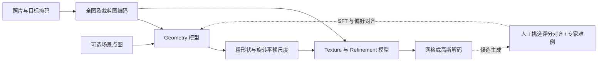

# SAM 3D：从真实照片中的目标恢复三维对象

论文：**SAM 3D: 3Dfy Anything in Images**，Xingyu Chen、Fu-Jen Chu、Pierre Gleize 等，CVPR 2026，7220–7232 页。完整作者见官方页与 manifest。

[官方论文页](https://openaccess.thecvf.com/content/CVPR2026/html/Chen_SAM_3D_3Dfy_Anything_in_Images_CVPR_2026_paper.html) · [原文 PDF](https://openaccess.thecvf.com/content/CVPR2026/papers/Chen_SAM_3D_3Dfy_Anything_in_Images_CVPR_2026_paper.pdf) · [论文列出的项目页](https://ai.meta.com/sam3d)

分类：3D 视觉 / 单图重建 / 数据引擎 / 偏好对齐。最后核对：2026-10-20。正文阅读与讲解自检完成，未执行代码或复现实验；页码为 PDF 页码。最佳论文荣誉提名依据[官方大会公告](https://cvpr.thecvf.com/Conferences/2026/News/Closing)。

## 一句话总结

用“合成预训练 → 半合成场景训练 → 真实图片的人与模型协同标注及偏好对齐”，让单图三维生成从干净的孤立物体扩展到有遮挡、杂乱背景的真实对象，同时预测几何、纹理和相机坐标中的布局。

## 研究背景与动机

单图三维生成常见的训练样本是居中、背景干净的渲染物体。真实照片里的对象却可能被挡住、很小、与周围物体重叠。单纯扩大合成数据，未必能让模型学会识别目标究竟是谁、怎样补全遮挡形状，以及它在场景中的位置。[§1，PDF 1–2]

困难尤其在真实数据标注：普通人能画掩码，却很难亲手做三维网格。SAM 3D 把“从零建模”改成“从多个候选中挑选、评定并对齐”，难例再交给三维艺术家。其核心不只是一种网络结构，也是一套数据生产与训练循环。

## 方法总览

根据 Fig.2、Fig.5 重绘。单个目标由掩码指定，多个对象可分别恢复后按布局组合；这不同于无需目标选择就自动理解整张照片的所有对象。

## 核心创新与关键设计

### 1. 用概率生成处理单图的不确定性

输入为图像 \(I\) 与目标掩码 \(M\)，输出建模为：

\[
q(S,T,R,t,s\mid I,M),
\]

其中 \(S,T\) 是形状与纹理，\(R,t,s\) 是相机坐标系中的旋转、平移与尺度。[§2.1，PDF 2] 之所以使用分布，是因为同一张照片可能对应多个合理三维物体；背面的恢复依赖先验，不能说模型从单张图“测量出了”全部真实表面。

### 2. 同时看目标局部与全图上下文

DINOv2 编码四组条件：裁剪目标图、裁剪掩码、完整图、完整掩码。局部图提供高分辨率细节，全图提供语境与识别线索。可选点图可来自硬件深度或单目估计。[§2.2，PDF 2–3]

这不是只把物体抠出来送给旧的 image-to-3D 模型；上下文和布局是明确建模的部分。但掩码质量与点图质量仍会影响恢复结果。

### 3. 两阶段模型分别承担粗几何布局与细节纹理

Geometry 模型是约1.2B参数的 flow transformer，用 Mixture-of-Transformers 结构联合建模64³粗形状与布局。旋转使用6D表示，平移和尺度各3维。约600M参数的稀疏 latent flow transformer 再细化几何并生成纹理；共享潜空间可接不同VAE解码器，生成mesh或3D Gaussian splats。[§2.2，PDF 3]

“生成三维模型”和“在相机坐标系放对位置”联合训练，避免把形状先独立生成、再由另一个系统估计位姿时的误差简单叠加。

### 4. 数据引擎把人工选择变成三维监督

预训练使用约270万网格、24视角渲染，建立形状纹理先验；中期训练把渲染物体贴进自然图片，引入遮挡与目标掩码，RP-3DO约6100万样本、280万唯一网格。[§3.1，PDF 4–5]

真实数据阶段分为：选目标 → 在候选中选最佳并评分 → 相对于点图调整姿态。常用8个候选，质量不过关可拒绝；模型候选全部失败的部分难例交给专业艺术家。[§3.2.1，PDF 5–6]

获选且高于质量阈值的样本用于SFT，较差候选形成偏好对；之后进行DPO以减少漂浮、缺底、缺乏对称等人类不喜欢的结果。更新后的模型再进入标注流程。普通标注者不需要直接创建网格，模型也不能仅凭自己偏好的样本就自动确认正确，循环中始终有人提供判断。

这条路线有“候选全错就无从选择”的风险；专家难例分流正是为补这个缺口。重复循环并不自动消除候选模型的盲点。

## 实验与关键结果

SA-3DAO包含1000个由专业艺术家根据真实图片创建的三维网格；ISO3D缺少几何真值，使用感知相似性；ADT用于布局评价。[§4，PDF 7] SA-3DAO是视觉匹配的专家建模参考，不应误写成对所有物体做物理扫描得到的真值。

下表摘自 Table 2（PDF 6），对应SA-3DAO几何评估，已对照渲染页核对：

| 方法 | F1@0.01↑ | vIoU↑ | Chamfer↓ | EMD↓ |
| --- | ---: | ---: | ---: | ---: |
| TRELLIS | 0.1475 | 0.1392 | 0.0902 | 0.2131 |
| Hunyuan3D-2.0 | 0.1574 | 0.1504 | 0.0866 | 0.2049 |
| Hi3DGen | 0.1629 | 0.1531 | 0.0937 | 0.2134 |
| SAM 3D | 0.2344 | 0.2311 | 0.0400 | 0.1211 |

SAM 3D 在这些真实图片对应的几何指标有明显优势；但ISO3D的ULIP是0.1488，TripoSG为0.1529，因此不能写成所有基准所有指标第一。

布局 Table 3（PDF 7）中，SA-3DAO的3D IoU为0.4254，ADT为0.4970。**这组平移／尺度评估使用真值深度或点图作为参考**。[§4 Settings] 实际无深度输入时可接单目估计，但不能把表中全部数值标成纯RGB、无需外部深度的部署结果。

人类偏好研究中，作者报告真实对象重建约5:1、场景约6:1优于比较方法。[Fig.7，PDF 7] 这不是“5倍几何精度”或“6倍成功率”。纹理比较还统一使用SAM 3D的形状再给各方法生成纹理，应与各自完整链路的比较分开解释。[Fig.8]

## 消融实验与证据强度

Table 4（PDF 8）按累积阶段报告SA-3DAO F1：仅预训练0.1349，加入中期训练0.1705，加入MITL SFT为0.2027，最终0.2344。它说明真实场景训练和后训练总体重要，但累积实验未把每一步训练数据、计算量与训练时间完全控制成单因素，不能将每个增量都解释成算法本身的纯收益。

最终艺术家DPO阶段，Chamfer从0.0445降至0.0400，而vIoU从0.2337降到0.2311，说明也存在指标取舍。Fig.9显示仅扩大MITL数据的收益逐渐递减；历史模型曲线还同时涉及其他阶段扩大，不能把整个进步归因于一个数据量变量。[§4.2，PDF 8]

蒸馏把Geometry推理函数评估次数从25降至4，作者称可做到亚秒级形状布局。[§3.2.2，PDF 6–7] 这只针对该阶段，不是带高精纹理、网格导出和全部预处理的整套耗时。本轮没有实测。

## 局限与讨论

以下为本讲解分析，正文未单独列出完整limitations小节。单视图遮挡区不可唯一确定；生成先验更合理不等于真实隐藏结构完全正确。人类偏好可推动对称、闭合和外观完整，但这些美学偏好不必然符合物体实际的非对称或开放结构。

数据引擎需要人工筛选与艺术家修正，并包含授权数据；公开权重与论文不代表完整训练数据可自由取得。模型输出可组合为场景，也不能据此宣称已经保证对象间无碰撞、物理接触准确或适合直接用于机器人动作规划。

## 复现提示

首先确认输入掩码、点图坐标系、相机归一化、旋转和平移尺度的约定；评价时分别测试RGB加估计点图与真值点图，避免混用设置。形状、布局、纹理应分别检查，不能仅凭新视角渲染好看判断三者都正确。

正文给出约2.5万亿预训练token、2.7万亿中期训练token、最后后训练轮约0.5万亿token。[§3，PDF 4–6] 这些是作者训练规模，不是建议本地从头运行的预算。具体超参数、DPO细节、蒸馏和额外消融都在补充材料，本轮未读；代码仓库、commit、权重许可证与实际显存也未核验，不提供未经验证的一键命令。

本轮未下载数据集、未执行项目代码、未运行真实图片推理。后续若封装实用工具，应把公开可用模型的许可与资源核验作为独立任务。

## 相关工作与阅读顺序

TRELLIS提供稀疏潜空间与两阶段生成背景；单图深度估计解释可选pointmap来源；DPO提供偏好优化概念，但不能把语言模型中的损失实现原样当成此处flow模型的实现。与多视图几何测量相比，本论文更依赖识别先验与现实图片对齐。

建议 Fig.2 → §2条件分布 → Fig.5数据引擎 → Table 1训练阶段 → Table 2形状 → §4 Settings及Table 3布局 → Table 4消融。重点辨认“哪部分用了哪类监督、评估时额外提供了什么”。

## 来源与校验

依据CVF公开接收版正文1–8页，Table 2所在第6页已渲染查看；参考文献用于阅读线索，补充材料未读。PDF SHA-256：`f284446e3f3346f5d11fe2608251c91a5b5c4ec92a130a66dcea7e8013300c6f`，为本次本地文件摘要。概念图为笔记重绘，不转载论文全文和作者图片。AI辅助独立撰写并自检，尚无独立专家复核，未复现实验。
