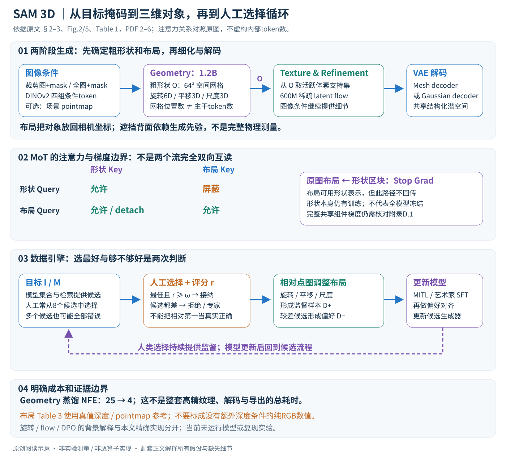

# SAM 3D：从真实照片中的目标恢复三维对象

论文：**SAM 3D: 3Dfy Anything in Images**，Xingyu Chen、Fu-Jen Chu、Pierre Gleize 等，CVPR 2026，7220–7232 页。完整作者见官方页与 manifest。

[官方论文页](https://openaccess.thecvf.com/content/CVPR2026/html/Chen_SAM_3D_3Dfy_Anything_in_Images_CVPR_2026_paper.html) · [原文 PDF](https://openaccess.thecvf.com/content/CVPR2026/papers/Chen_SAM_3D_3Dfy_Anything_in_Images_CVPR_2026_paper.pdf) · [论文列出的项目页](https://ai.meta.com/sam3d)

分类：3D 视觉 / 单图重建 / 数据引擎 / 偏好对齐。最后核对：2026-10-20。正文阅读与讲解自检完成，未执行代码或复现实验；页码为 PDF 页码。最佳论文荣誉提名依据[官方大会公告](https://cvpr.thecvf.com/Conferences/2026/News/Closing)。

方法与配图详细版返工：2026-10-23。重读§2–4，核对Fig.2与Fig.5；展开两阶段张量、MoT单向mask、数据引擎与训练边界，未复现。

## 一句话总结

用“合成预训练 → 半合成场景训练 → 真实图片的人与模型协同标注及偏好对齐”，让单图三维生成从干净的孤立物体扩展到有遮挡、杂乱背景的真实对象，同时预测几何、纹理和相机坐标中的布局。

## 研究背景与动机

单图三维生成常见的训练样本是居中、背景干净的渲染物体。真实照片里的对象却可能被挡住、很小、与周围物体重叠。单纯扩大合成数据，未必能让模型学会识别目标究竟是谁、怎样补全遮挡形状，以及它在场景中的位置。[§1，PDF 1–2]

困难尤其在真实数据标注：普通人能画掩码，却很难亲手做三维网格。SAM 3D 把“从零建模”改成“从多个候选中挑选、评定并对齐”，难例再交给三维艺术家。其核心不只是一种网络结构，也是一套数据生产与训练循环。

## 方法总览

### 先把目标说完整：生成对象，也把它放回相机坐标

SAM 3D输入一张照片I和指定目标的二值掩码M，输出对象形状S、纹理T，以及旋转R、平移t和三轴尺度s。它可以另接场景pointmap作为条件；不应把“点图可选”与“布局定量评价没有额外深度条件”混为一谈。（§2.1–2.2，PDF第2–3页）

照片把三维表面压成二维观测，隐藏背面、真实厚度和遮挡部分通常无法唯一确定。因此作者拟合条件分布\(q(S,T,R,t,s\mid I,M)\)，而不是声称从一张图测出唯一真实完整物体。生成多个候选是任务不确定性的体现，也是后面人工选择数据引擎的基础。

原创图依据Fig.2、Fig.5、Table 1及§2–3，PDF第2–6页。注意力关系对应原图的分支mask，stop-gradient仅指所示跨分支路径；候选评分、体素数量和变换解释不是新增测量或复现实验。

| 量 | 角色 | 容易混淆的边界 |
|---|---|---|
| I、M | 全图及目标掩码 | 单目标由掩码指定，不是自动恢复照片里所有对象 |
| 图像条件token | 目标裁剪图、裁剪mask、全图、全图mask四组编码 | 同时利用局部细节与全局语境 |
| P | 可选粗场景pointmap | 是三维位置线索，不是目标完整网格 |
| O | 64×64×64粗形状场 | 网格位置数不等于Transformer token数 |
| R、t、s | 6D旋转表示、3D平移、3D尺度 | 旋转表示的6个数不是6个独立物理旋转自由度 |
| 稀疏形状/纹理latent | 第二阶段细化对象 | 在粗几何选定的活跃位置上建模 |
| \(D_m,D_g\) | 网格/高斯解码器 | 两种输出接口，不是同一个文件格式改扩展名 |

### 一次推理的顺序

先用DINOv2提取四组图像与mask条件；Geometry模型联合生成粗形状和布局；按粗形状找活跃体素，再由Texture & Refinement模型细化几何、生成纹理；最后选相应VAE解码器输出mesh或Gaussian splats。多对象可逐个指定掩码恢复，再依据预测布局组合进场景。（Fig.2、§2.2，PDF第3页）

第二阶段的条件包含I、M、O，不是从零重新生成一个与粗形状无关的物体；粗阶段漏掉的细小部件或错误拓扑，可能限制后续细化。局部渲染好看也不等于布局坐标、相对尺寸和对象接触已经正确。

## 核心创新与关键设计

### 1. 为什么目标裁剪与完整图都需要？

裁剪图把目标放大，给模型更多可见纹理和轮廓像素；对应裁剪mask告诉模型哪些像素属于对象。完整图保留桌面、周围物体、遮挡和场景类别等识别线索，完整mask仍指向同一目标。否则一张局部小块可能让模型分不清“凳腿的一段”与“整根杆”。（Input encoding，PDF第2–3页）

这里的“上下文有用”不等于背景一定真实约束了隐藏几何。模型可能依赖场景先验补全，遇到反常组合时仍会错；掩码也只描述可见目标区域或提供的分割，不直接提供背面表面。

pointmap可由硬件深度或单目估计得到，经点编码器输入Geometry。硬件点图和估计点图的尺度/误差不同，图像裁剪后还需保持坐标关系。正文没有逐项展开点图归一化与相机变换的全部实现，本讲解不凭名称推断其单位必然是米，或直接把任意深度图当作已对齐的三维坐标输入。

### 2. 第一阶段联合建模粗形状和布局

约1.2B参数的Geometry flow transformer学习\(p(O,R,t,s\mid I,M)\)。其MoT（Mixture-of-Transformers）为形状token和布局token保留不同处理流：原图分别画出Q/K/V、FFN和cross-attention，再在多模态self-attention中按mask共享信息。它不是“从多个完整模型中随机选一个专家输出”，也不能仅凭名字认作常见稀疏MoE路由。（Fig.2，PDF第3页）

O的64³表示粗形状空间网格，共262,144个网格位置。正文没有在此给出足够信息把该数量直接等同于主干注意力序列长度；实际潜编码/解码细节在附录D.1。把网格分辨率直接代入token平方复杂度，会得出未经支持的显存估算。

布局由旋转、平移和三轴尺度组成。为了理解作用，可用一种常见对象到相机约定写成

\[x_{cam}=R_{mat}(s\odot x_{obj})+t.\]

这只是解释性变换记号：s控制对象各轴尺度，R控制朝向，t控制位置。本文实际规范化相机坐标、轴方向和缩放顺序仍需核对实现，不能把这行背景公式当成作者已公开的精确导出协议。

6D旋转表示可理解为用两根3D向量再构造正交旋转基。常见背景做法是\(b_1=a_1/\|a_1\|\)，去掉\(a_2\)在\(b_1\)上的投影后归一化得\(b_2\)，再令\(b_3=b_1\times b_2\)。这是对“6D表示如何变成3D旋转”的通用说明，不是本文逐行代码；退化向量处理和本文具体旋转消歧方案在补充材料中，当前未核验。

### 3. 注意力不是完全双向：布局读形状，形状不读布局

Fig.2右下的mask以行为Query、列为Key。形状Query只读取形状Key，布局Query可读取形状和布局Key；布局读取形状的区块标有Stop Grad。这比一句“两个流联合建模”更具体：形状流不在该self-attention里读取布局token，布局却可以借助粗形状判断位置、方向和尺度。（原图视觉核对，PDF第3页）

沿这条带detach的跨分支路径，布局损失不会再经形状K/V回传到形状表示；但这不意味着整个Geometry被冻结，也不意味着形状分支没有自己的训练损失。图像条件和其他共享组件的完整梯度规则还需看D.1，不能把一个mask扩展成全系统的冻结结论。

这种结构表达了一种建模方向：先有对象结构，布局利用结构和场景条件确定怎样摆放；同时两种输出仍在一个Geometry阶段生成，而非拿一个完全独立的重建器再交给外部姿态估计。论文的联合结果与后处理pipeline比较支持其价值，但并没有在正文单独给出每个mask方向的受控消融。

### 4. flow matching到底学习什么？

正文说明预训练/中期训练采用rectified conditional flow matching，具体损失在D.2。为了理解，可用标准背景形式：令目标latent为z、噪声为\(\epsilon\)，在连续时间\(\tau\in[0,1]\)上构造

\[x_\tau=(1-\tau)\epsilon+\tau z,\quad
v^*=z-\epsilon,\]
\[L_{FM}^{background}=\mathbb E\|v_\theta(x_\tau,\tau,c)-v^*\|_2^2.\]

网络不是直接背诵一张网格，而是预测怎样把当前噪声状态沿向量场推向数据latent；c为图像、mask及可选点图条件。推理求解\(dx/d\tau=v_\theta(x,\tau,c)\)，逐次更新样本。这里的\(\tau\)是生成流时间，不是照片拍摄时间；t仍留给布局平移。

这组公式仅说明流匹配原理。SAM 3D的各模态权重、噪声规范、路径参数化、布局损失和采样器细节不能由正文一句“rectified”唯一确定；当前未读D.2，故不把背景公式称作精确复现目标。尤其形状与布局量纲不同，不能擅自假定一个未加权欧氏损失就覆盖所有输出。

### 5. 第二阶段为什么改用稀疏latent？

粗形状O先给出活跃体素位置，约600M参数的稀疏latent flow transformer在这些位置上细化几何和纹理。直观上不必为整块空空间都生成同样密集的高分辨表示，结构容量可以集中到对象附近；它仍受到粗支持集质量影响，并非无限细节补全器。（Texture & Refinement Model，PDF第3页）

纹理和形状不是两张独立二维图：latent绑定三维位置，解码器再生成具体三维表示。两套VAE decoder共享同一个VAE encoder和结构化潜空间，所以同一类latent可以分别送给mesh或Gaussian splat解码接口。网格更直接给出表面拓扑，高斯适合可微渲染；二者的碰撞、闭合、材质编辑和文件导出性质不同，不能把视觉近似当作完全相同的几何对象。

### 6. 预训练与中期训练学的是不同能力

Iso-3DO包含约270万网格，来自公开和授权数据，各渲染24视角，首先训练孤立对象的形状/纹理先验。24视角是训练数据渲染来源，不代表推理时需要输入24张图片，也不保证每个网格的24张都属于独立对象。（§3.1.1，PDF第4页）

中期训练RP-3DO把渲染对象贴入自然图片，利用人为遮挡和对象替换构造目标mask与布局监督：一类训练“选中谁、被挡住也要补全”，另一类用相似位置和尺度替换真实对象，学习场景中的布局。数据规模约6100万样本、280万唯一网格，两个数量不能互换。（§3.1.2，PDF第4–5页）

Table 1还区分模态：Geometry预训练主要形状/旋转，后续再引入全图、平移/尺度和可选pointmap；Texture & Refinement也有自己的预训练/中期训练和真实数据阶段。不是一开始就拿全部真实模态端到端训练，也不能把三维训练token总量当作图片数量。

合成贴图能提供可控真值，但自然背景里的接触、反射、复杂遮挡和真实物体外观不一定匹配，因此仍需真实图片后训练。作者的方法不是“合成数据足够多就自动解决真实场景”，而是先获得可用候选生成能力，再用真实标注纠偏。

### 7. 数据引擎把“人不会建模”变成“人会比较”

真实后训练数据不是全靠模型自我打分。Stage 1选图片和目标mask；Stage 2展示候选三维模型，让普通标注者选最像的一个并评分；Stage 3让标注者相对于pointmap调整旋转、平移和尺度。形状选择和场景摆放分开，降低普通人一次处理全部自由度的难度。（Fig.5、§3.2.1，PDF第5–6页）

常用8个候选，来自模型集合与检索模块。初期自身模型候选不够好，外部集合帮助冷启动；随着模型提升，自身候选逐渐占多数，最终约占注释数据的80%。这是候选/标注来源占比，不是80%物体真实还原成功率。

“选最好”与“够不够好”分两关：即使8个中有相对第一名，也可能全部不合格。质量\(r<\omega\)时拒绝，不强行当监督。部分所有模型均失败的难例进入Stage 2.5，由专业3D艺术家直接建模，形成Art-3DO，补足普通选择流程无法修复的盲点。

一个只用于概率直觉的例子：若每个候选独立以概率p达标，N个候选至少一个达标的概率为\(1-(1-p)^N\)。但实际模型候选高度相关，所以不能拿该公式预测8候选真实通过率；它只解释候选数可能有帮助，以及“共同盲点”为什么不能靠增加同类候选完全消除。

### 8. 同一次标注产生监督样本，也产生偏好对

数据接口返回达标候选\(D^+\)、质量评分r和较不偏好的\(D^-\)。达标三维模型经过布局对齐，成为I/M到S/T/R/t/s的监督样本；同一输入下较好与较差候选形成偏好关系。被拒绝的最优候选若不够好，也不应不加区分进入正样本训练。（§3.2.1–3.2.2，PDF第6页）

每轮后训练聚合以前收集的数据，保留超过质量门槛的正样本；门槛可随模型提升而提高。模型更新后重新进入候选流程，但人类的选择和拒绝仍是外部监督。这个循环可以提高标注效率，也可能保留现有候选集合的偏差，艺术家分流和数据多样性因此重要。

SFT先用规模较大但较噪的普通标注，再用较小、质量较高的艺术家数据；DPO进一步利用偏好对，减少漂浮碎片、缺底与缺乏对称等人类不喜欢的结果。Table 4将MITL和艺术家阶段的SFT/DPO依次累加，不能混成一次无监督自训练。（PDF第6、8页）

### 9. 偏好优化不能直接照搬语言模型token损失

对离散语言模型，DPO常用获胜/失败响应相对参考模型的对数概率差；但这里是连续latent flow。正文把具体DPO实现放在D.3，没有足够信息确定其密度、噪声与训练代理目标。直接写一段语言模型token级DPO代码作为SAM 3D实现，会丢失关键差异。

本篇因此解释偏好监督的数据来源与优化方向，不虚构精确DPO损失。偏好提升也有目标边界：对称与闭合通常更好看，但实际物体可能不对称或开放；真实背面不可见时，评分者也无法验证全部隐藏几何。偏好模型更讨喜，不等于得到物理扫描真值。

### 10. 蒸馏加速的是Geometry，不是整个输出链路

最后用短蒸馏阶段将Geometry的NFE从25降到4。NFE表示向量场网络评估次数，不是训练epoch，也不是“所有模块总共4个算子”。作者报告亚秒级形状/布局，具体方法适配既有蒸馏工作，细节在D.4。（§3.2.2，PDF第6–7页）

第二阶段纹理细化、VAE解码、图像/点图预处理和导出仍有成本。多个对象逐个恢复还会重复相关计算，不能把Geometry单目标速度称为整场景高精网格生成速度；本地未运行，不报告自测吞吐、显存或硬件最低要求。

### 11. 布局评价里的深度条件不能省略

§4 Settings说明所评Geometry模型训练带pointmap条件，无点图时可用单目估计；Table 3的平移/尺度评价需要真值depth/pointmap参考。不同点图输入、物体坐标归一化与尺度约定会直接影响布局结果，因此应分别报告纯RGB加估计点图和真值点图条件。（PDF第7页）

SA-3DAO的1000个网格由艺术家依据自然图片创建，适合作为视觉重建参考，但不是对每个真实物体进行完整物理扫描。ISO3D缺少几何真值，使用感知匹配；人类偏好又是第三类证据。指标互补，不能拿一类结果替另一类背书。

### 12. 复现应按模块检查，而不是只看一张渲染

先检查目标mask与裁剪关系，再检查粗形状、布局坐标和可选pointmap；随后看稀疏细化与两种解码输出；最后分别评价可见轮廓、遮挡补全、纹理、位置和尺度。对多对象还需另测相互穿插、支撑接触与比例，不能因为输出能拼成场景就默认物理一致。

当前原文重读覆盖正文模型和数据引擎，Fig.2、Fig.5已渲染核对。D.1–D.7中的具体超参数、flow/DPO/蒸馏实现及额外消融尚未逐项阅读，代码和权重许可未核验。本篇补充的旋转、流匹配和候选概率公式均显式标为背景解释，**未执行作者代码、未推理真实图片或复现实验**。

## 实验与关键结果

SA-3DAO包含1000个由专业艺术家根据真实图片创建的三维网格；ISO3D缺少几何真值，使用感知相似性；ADT用于布局评价。[§4，PDF 7] SA-3DAO是视觉匹配的专家建模参考，不应误写成对所有物体做物理扫描得到的真值。

下表摘自 Table 2（PDF 6），对应SA-3DAO几何评估，已对照渲染页核对：

| 方法 | F1@0.01↑ | vIoU↑ | Chamfer↓ | EMD↓ |
| --- | ---: | ---: | ---: | ---: |
| TRELLIS | 0.1475 | 0.1392 | 0.0902 | 0.2131 |
| Hunyuan3D-2.0 | 0.1574 | 0.1504 | 0.0866 | 0.2049 |
| Hi3DGen | 0.1629 | 0.1531 | 0.0937 | 0.2134 |
| SAM 3D | 0.2344 | 0.2311 | 0.0400 | 0.1211 |

SAM 3D 在这些真实图片对应的几何指标有明显优势；但ISO3D的ULIP是0.1488，TripoSG为0.1529，因此不能写成所有基准所有指标第一。

布局 Table 3（PDF 7）中，SA-3DAO的3D IoU为0.4254，ADT为0.4970。**这组平移／尺度评估使用真值深度或点图作为参考**。[§4 Settings] 实际无深度输入时可接单目估计，但不能把表中全部数值标成纯RGB、无需外部深度的部署结果。

人类偏好研究中，作者报告真实对象重建约5:1、场景约6:1优于比较方法。[Fig.7，PDF 7] 这不是“5倍几何精度”或“6倍成功率”。纹理比较还统一使用SAM 3D的形状再给各方法生成纹理，应与各自完整链路的比较分开解释。[Fig.8]

## 消融实验与证据强度

Table 4（PDF 8）按累积阶段报告SA-3DAO F1：仅预训练0.1349，加入中期训练0.1705，加入MITL SFT为0.2027，最终0.2344。它说明真实场景训练和后训练总体重要，但累积实验未把每一步训练数据、计算量与训练时间完全控制成单因素，不能将每个增量都解释成算法本身的纯收益。

最终艺术家DPO阶段，Chamfer从0.0445降至0.0400，而vIoU从0.2337降到0.2311，说明也存在指标取舍。Fig.9显示仅扩大MITL数据的收益逐渐递减；历史模型曲线还同时涉及其他阶段扩大，不能把整个进步归因于一个数据量变量。[§4.2，PDF 8]

蒸馏把Geometry推理函数评估次数从25降至4，作者称可做到亚秒级形状布局。[§3.2.2，PDF 6–7] 这只针对该阶段，不是带高精纹理、网格导出和全部预处理的整套耗时。本轮没有实测。

## 局限与讨论

以下为本讲解分析，正文未单独列出完整limitations小节。单视图遮挡区不可唯一确定；生成先验更合理不等于真实隐藏结构完全正确。人类偏好可推动对称、闭合和外观完整，但这些美学偏好不必然符合物体实际的非对称或开放结构。

数据引擎需要人工筛选与艺术家修正，并包含授权数据；公开权重与论文不代表完整训练数据可自由取得。模型输出可组合为场景，也不能据此宣称已经保证对象间无碰撞、物理接触准确或适合直接用于机器人动作规划。

## 复现提示

首先确认输入掩码、点图坐标系、相机归一化、旋转和平移尺度的约定；评价时分别测试RGB加估计点图与真值点图，避免混用设置。形状、布局、纹理应分别检查，不能仅凭新视角渲染好看判断三者都正确。

正文给出约2.5万亿预训练token、2.7万亿中期训练token、最后后训练轮约0.5万亿token。[§3，PDF 4–6] 这些是作者训练规模，不是建议本地从头运行的预算。具体超参数、DPO细节、蒸馏和额外消融都在补充材料，本轮未读；代码仓库、commit、权重许可证与实际显存也未核验，不提供未经验证的一键命令。

本轮未下载数据集、未执行项目代码、未运行真实图片推理。后续若封装实用工具，应把公开可用模型的许可与资源核验作为独立任务。

## 相关工作与阅读顺序

TRELLIS提供稀疏潜空间与两阶段生成背景；单图深度估计解释可选pointmap来源；DPO提供偏好优化概念，但不能把语言模型中的损失实现原样当成此处flow模型的实现。与多视图几何测量相比，本论文更依赖识别先验与现实图片对齐。

建议 Fig.2 → §2条件分布 → Fig.5数据引擎 → Table 1训练阶段 → Table 2形状 → §4 Settings及Table 3布局 → Table 4消融。重点辨认“哪部分用了哪类监督、评估时额外提供了什么”。

## 来源与校验

依据CVF公开接收版正文1–8页，Table 2所在第6页已渲染查看；参考文献用于阅读线索，补充材料未读。PDF SHA-256：`f284446e3f3346f5d11fe2608251c91a5b5c4ec92a130a66dcea7e8013300c6f`，为本次本地文件摘要。概念图为笔记重绘，不转载论文全文和作者图片。AI辅助独立撰写并自检，尚无独立专家复核，未复现实验。
