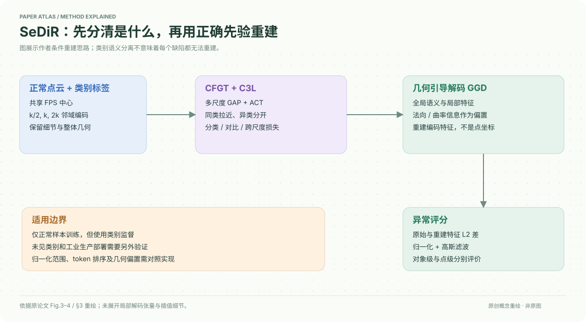

# A Semantically Disentangled Unified Model for Multi-category 3D Anomaly Detection

核对日期：2026-10-20。以下实验均为作者报告；本地完成原文阅读与讲解自检，未复现实验。

## 一句话总结

SeDiR用多尺度全局token和类别监督把不同正常物体分开，再用几何偏置引导特征重建，减少多类统一异常检测把错误类别先验当缺陷的问题。

## 研究背景与动机

每类独立模型难维护，统一模型却可能把鸡、鸭或相似形状的特征混合，正常物体也重建错误。作者把语义身份作为重建条件，训练只需要正常样本，但仍使用物体类别标签。[§1–3，PDF1–4]

正常样本训练不等于完全无监督类别学习，也不等于能够识别任意未见类别。

## 方法总览

FPS共享中心上取k/2、k、2k邻域，经PointMAE式局部编码和共享Transformer，拼接多尺度GAP与ACT得到全局描述。C3L按类别对比与分类对齐，解码器结合语义query、局部特征和法向/曲率几何偏置重建，最后用原始与重建特征差定位异常。[Fig.3–4、§3]

## 核心创新与关键设计

全局特征包含三尺度GAP与ACT，不是只用CLS。C3L由监督对比、类别交叉熵和跨尺度余弦损失构成；对比缓存64个描述，同类别为正、异类别为负。[式4–9，PDF4–5]

几何引导注意力为
\[\operatorname{Attn}(Q,K,V)=\operatorname{softmax}(QK^\top/\sqrt d+\beta B_{geo})V.\]
Q来自全局语义，K/V来自局部特征；重建目标是编码特征而非直接恢复点坐标。异常差异按特征L2计算、实例内minmax后沿token作1D高斯滤波，物体分数取最大。[式10–13]

实例内归一化会改变跨物体误差尺度，且单全局query如何形成多局部token的张量细节、B_geo与token排序/插值在正文未完全展开；精确评分必须核验补充实现，不能凭式13直接写出已验证检测器。

## 实验与关键结果

Real3D-AD12类、每类4正常训练和100测试，训练完整360°、测试单视角；AnomalyShapeNet40类1600样本、每类4正常训练。[§4.1，PDF6]

| 作者平均AUROC%，越高越好 | MC3D-AD | SeDiR |
| --- | --- | --- |
| Real3D对象级 | 78.2 | 81.0 |
| ShapeNet对象级 | 84.2 | 93.3 |
| Real3D点级 | 76.8 | 80.6 |
| ShapeNet点级 | 75.8 | 81.0 |

Table1–3，PDF6–7。点级最佳仍分别为单类ISMP83.6和PO3AD89.8；不能说所有任务都SotA。Real3D的Candybar、Diamond、Seahorse、Shell等类别也不都超过统一基线。AUROC不是部署缺陷阈值准确率。

## 消融实验与证据强度

Table4对象/点AUROC：基础75.1/78.1，加CFGT76.4/78.4，再C3L79.2/79.0，完整81.0/80.6。Table5仅对比79.1/78.8，加分类80.0/79.3，再跨尺度余弦81.0/80.6。[PDF7]

几何mask/gating/bias的对象AUROC79.8/79.7/81.0；全局仅ACT78.5、mean78.2、完整81.0，支持语义与几何组合。逐项添加的累积对照不是完整因子实验，交互影响仍可能存在。[Table6–7，PDF8]

## 局限与讨论

四个正常训练样本对扫描覆盖、姿态和噪声敏感；类别监督可能排斥跨类共享正常形状。缺陷如果仍可被重建，重建误差会漏报。真实开放类别、动态扫描与生产线速度不是正文已完成的验证。

缺少正文中完整B_geo、评分归一化和训练超参细节，限制直接复现；本地未检查权重或运行异常检测。

## 复现提示

项目页 `https://spoiuy3.github.io/SeDiR/`，具体代码许可和commit待核。先固定数据集官方拆分、单位尺度、点采样、中心与邻域、类别标签、预训练PointMAE；确认归一化范围和全局/局部分数对应。部署前另测固定真实误报率与缺陷检出率。

建议 `data/3d-anomaly/sedir/`；不提交扫描或权重，实验均为作者报告。

## 相关工作与阅读顺序

先理解正常样本重建型异常检测，再看MC3D-AD的统一多类设置，随后看CFGT/C3L与几何偏置。把类别识别、点级定位和对象级判异常三个层面分开，避免只看整体AUROC掩盖局部能力下降。

## 来源与校验

- [CVF 官方论文页](https://openaccess.thecvf.com/content/CVPR2026/html/Kim_A_Semantically_Disentangled_Unified_Model_for_Multi-category_3D_Anomaly_Detection_CVPR_2026_paper.html) · [所读 PDF](https://openaccess.thecvf.com/content/CVPR2026/papers/Kim_A_Semantically_Disentangled_Unified_Model_for_Multi-category_3D_Anomaly_Detection_CVPR_2026_paper.pdf)。页码均为该 PDF 的页序。
- 阅读范围：正文、公式与实验表；补充材料、上游代码与权重未逐项核验。许可证和固定代码 commit 尚未确认，不复制原文全文或数据。
- PDF SHA-256：`ef7b7cd5786c562aa977ea0a4d10a43336be685461533ad5822f10e27d9e8d0b`；版本为本次下载的 CVF 接收稿，核对日期 2026-10-20。

- 视觉核对：已渲染查看 PDF第7页并核对原表、算法或公式；独立补充材料未读，实验未复现。
