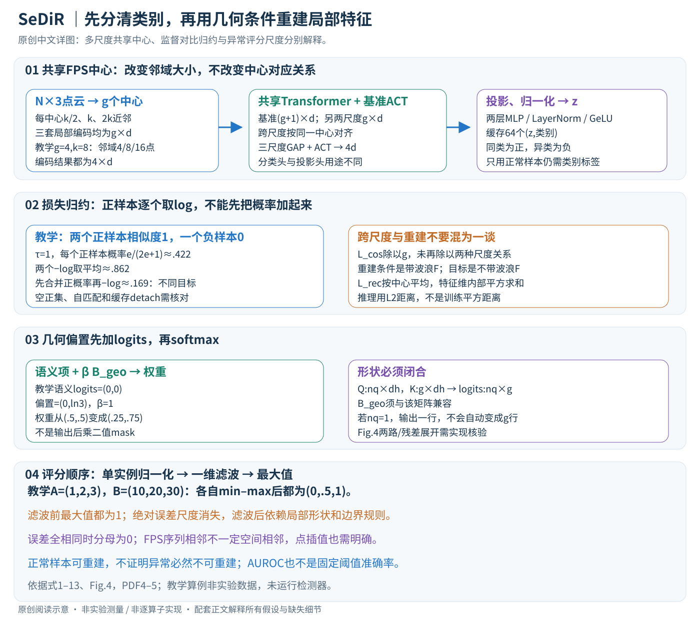

# A Semantically Disentangled Unified Model for Multi-category 3D Anomaly Detection

核对日期：2026-10-20。以下实验均为作者报告；本地完成原文阅读与讲解自检，未复现实验。

方法与配图详细版返工：2026-10-25。补充多尺度张量、缓存对比、几何注意力与归一化评分算例；未复现实验。

## 一句话总结

SeDiR用多尺度全局token和类别监督把不同正常物体分开，再用几何偏置引导特征重建，减少多类统一异常检测把错误类别先验当缺陷的问题。

## 研究背景与动机

每类独立模型难维护，统一模型却可能把鸡、鸭或相似形状的特征混合，正常物体也重建错误。作者把语义身份作为重建条件，训练只需要正常样本，但仍使用物体类别标签。[§1–3，PDF1–4]

正常样本训练不等于完全无监督类别学习，也不等于能够识别任意未见类别。

## 方法总览

原创图中的维度使用论文符号，邻域数量及评分数组为教学例。未实现论文检测器，未把缺失算子补猜成作者实现。

### 输入与训练监督：只用正常样本，但需要类别标签

输入点云 \(P\in\mathbb R^{N\times3}\)，来自多个已定义物体类别。训练集合只包含正常对象，同时保留类别c用于分类与监督对比；测试需要输出对象异常分数和局部异常分数。缺陷标注不参与这种正常样本训练，不代表类别监督也不存在。模型不应被解释为开放世界任意类别检测器。（§3，PDF第4页）

核心假设是：先分清正常物体属于哪种语义，再用相应条件重建正常特征，避免不同类别的正常结构相互混淆。它重建的是编码特征，不是直接补全或生成三维坐标；类别识别正确也不能保证缺陷一定被发现。

## 核心创新与关键设计

### 共享FPS中心：三种邻域的第m项才有共同位置

先用FPS选g个中心 \(S=\{s_m\}\)。对同一个中心分别取k/2、k、2k个欧氏近邻，局部预训练编码器E输出d维向量，构成三套 \(F^{(r)}\in\mathbb R^{g\times d}\)。三尺度改变每个token看的邻域大小，不改变token中心数量。（式1–2）

教学g=4、k=8：三套邻域每中心分别含4/8/16点，编码后都为4×d，不是4×4d、4×8d和4×16d。若各尺度独立FPS，第m个token不一定对应同一空间区域，后续逐中心对齐就失去明确含义。k过大、点数不足或重复采样时的处理主文未给，需要实现核查。

### ACT加到基准尺度，再把四种全局摘要拼接

基准k尺度前加入可学习ACT，形成(g+1)×d序列；共享Transformer处理该序列，以及另外两套g×d序列。输出基准序列去掉ACT后为 \(\widetilde F^{(k)}\)，ACT输出单独保留。三尺度各做GAP得到三个d维向量，再与ACT的d维向量拼接：

\[
f_{global}=[g^{(k)},g^{(2k)},g^{(k/2)},t^{enc}_{act}]\in\mathbb R^{4d}.
\]

GAP是对g个中心求平均，不是对不同尺度取平均后只剩一个d维向量。ACT通过注意力聚合实例上下文，GAP提供各尺度整体结构，二者互补。分类头读取4d描述预测C类；另一两层MLP含LayerNorm与GeLU，将其投影为dz维并L2归一化成z，供对比与解码使用。（式3、5–7）

### 跨尺度余弦按共享中心计算

\[
L_{cos}=\frac1g\sum_{m=1}^g\sum_{r\in\{k/2,2k\}}
[1-\cos(\widetilde f_m^{(k)},\widetilde f_m^{(r)})].
\]

基准尺度分别对细尺度、粗尺度，不是三个全局向量两两任意匹配。该式除以g，未再除以两种对齐关系的数量；若两项在每个中心都为.2，则Lcos=.4而非.2。余弦约束方向相近，不要求不同大小邻域逐维幅值一致，也不抹去真实几何差异。（式4）

### C3L：缓存里同类别都是正样本，不限同一个实例

动态缓存保存64个(z,c)。对查询zi，同类集合P(i)为正，异类为负；分母A(i)包含两者，损失对所有正样本逐项取负log后平均：

\[
L_{scl}(i)=\frac1{|P(i)|}\sum_{p\in P(i)}
-\log\frac{\exp(z_i^Tz_p/\tau)}{\sum_{a\in A(i)}\exp(z_i^Tz_a/\tau)}.
\]

这不是先把所有正样本概率相加再取一次log；后者只需一个正样本足够相似就可能拿到高总概率。教学缓存仅有两个相似度1的正样本和一个相似度0的负样本，tau=1，则每个正样本概率e/(2e+1)≈.422，平均损失≈.862；正概率相加再取log约.169，两种目标明显不同。tau和缓存规模会影响训练，64不是类别总数。（式8）

当前查询是否写入缓存、是否排除自身、缓存特征是否detach、没有同类正样本时怎么办，主文未完整列出。若P为空，上式除零，不能无条件直接运行。训练标签仍用于辅助交叉熵，三项合成 \(L_{C3L}=\lambda_{scl}L_{scl}+\lambda_{cls}L_{cls}+\lambda_{cos}L_{cos}\)，再与重建损失相加。各权重与预训练局部编码器是否冻结，需补充实现确认；不擅自宣称所有模块全量更新。（式9、12）

### 几何偏置加在注意力logits，不是输出后乘一个mask

正文说明全局z提供语义query，基准局部序列提供K/V，法向和曲率变化形成几何偏置：

\[
A=\operatorname{softmax}(QK^T/\sqrt d+\beta B_{geo}),\qquad O=AV.
\]

语义相似项与几何项先在同一logit矩阵相加，再归一化。教学两个键语义logit均0，几何偏置为(0,ln3)、beta=1，则权重由(.5,.5)变为(.25,.75)。偏置方向与幅度决定偏好，并不能仅凭“几何引导”就判断它总在抑制异常区域。（式10）

对于Q形状nq×dh、K形状g×dh，logit与Bgeo应兼容nq×g，输出nq×dv。若只把一个全局向量投影成单query，输出是一行，不能直接得到g行重建token。Fig.4还画出局部/前层状态参与的两路模块、拼接、FFN与残差；主文没有完全给出z的广播/展开和每路QKV形状。因此单条公式足以说明偏置机制，却不足以唯一复现完整解码器，不能把这项缺口悄悄补成g份重复query。

### 重建对象要区分带波浪与不带波浪的F

编码后的 \(\widetilde F^{(k)}\)用于解码条件，而式11重建目标写原始局部编码 \(F^{(k)}\)，不带波浪：

\[
L_{rec}=\frac1g\sum_j\|\widehat f_j^{(k)}-f_j^{(k)}\|_2^2.
\]

重建损失按g个中心平均，特征维d内部是平方和；不能未经核对又除以d并当同一权重。训练使正常样本重建更好，推理希望异常特征难以恢复；但解码器若也学会复制异常输入，误差可能很小，正常样本训练并没有自动给出异常可分离定理。（式11–12）

### 异常评分：归一化与平滑的顺序会改变对象排名

先按每个token计算L2距离 \(e_j=\|\widehat f_j-f_j\|_2\)，注意这里不是训练的平方距离；再在单个实例内min–max归一化，沿token维做一维高斯滤波，最后取最大值作为对象分数：

\[
S_p=Gauss_{k_g,\sigma}(Norm(e)),\qquad S_{obj}=\max_j S_{p,j}.
\]

教学实例A原始误差(1,2,3)，B误差(10,20,30)，分别归一化都成为(0,.5,1)，因此绝对误差十倍并不会在此后自动保留。非恒定序列在滤波前的最大归一化值恒为1；对象差异此时更多依赖滤波后的局部形状、序列长度与边界规则。若所有误差相同，分母为0，需要明确保护规则。（式13）

一维滤波默认token相邻有意义，但FPS输出顺序不是天然的空间邻接；随意重排同一组点可能改变平滑结果。g个中心分数又如何插值回N个原始点，主文没有给足细节。应核查Bgeo构造、token排序、滤波边界、归一化epsilon与点插值后再复现实验，不能把这些细节全部省略仍声称得到了论文检测器。

### 一次训练与测试的全链条

训练正常点云并带类别标签→共享FPS/kNN多尺度局部编码→共享Transformer/ACT→4d摘要与归一化z→缓存监督对比、分类和逐中心跨尺度损失→几何引导重建→重建误差联合优化。推理不借助异常标签或真类别来判缺陷，由输入产生语义条件并重建，按照评分链定位与聚合。

局部编码计算随邻域点数与g增长，三尺度每中心总邻域条目约3.5k但有重复点；三条Transformer序列的注意力与g²相关。缓存对比每查询需和64个描述匹配。这里是结构级开销说明，未测运行速度。少量正常样本、测试单视角缺失、法向估计噪声和未知类别均可能影响结果，需独立部署验证。

## 实验与关键结果

Real3D-AD12类、每类4正常训练和100测试，训练完整360°、测试单视角；AnomalyShapeNet40类1600样本、每类4正常训练。[§4.1，PDF6]

| 作者平均AUROC%，越高越好 | MC3D-AD | SeDiR |
| --- | --- | --- |
| Real3D对象级 | 78.2 | 81.0 |
| ShapeNet对象级 | 84.2 | 93.3 |
| Real3D点级 | 76.8 | 80.6 |
| ShapeNet点级 | 75.8 | 81.0 |

Table1–3，PDF6–7。点级最佳仍分别为单类ISMP83.6和PO3AD89.8；不能说所有任务都SotA。Real3D的Candybar、Diamond、Seahorse、Shell等类别也不都超过统一基线。AUROC不是部署缺陷阈值准确率。

## 消融实验与证据强度

Table4对象/点AUROC：基础75.1/78.1，加CFGT76.4/78.4，再C3L79.2/79.0，完整81.0/80.6。Table5仅对比79.1/78.8，加分类80.0/79.3，再跨尺度余弦81.0/80.6。[PDF7]

几何mask/gating/bias的对象AUROC79.8/79.7/81.0；全局仅ACT78.5、mean78.2、完整81.0，支持语义与几何组合。逐项添加的累积对照不是完整因子实验，交互影响仍可能存在。[Table6–7，PDF8]

## 局限与讨论

四个正常训练样本对扫描覆盖、姿态和噪声敏感；类别监督可能排斥跨类共享正常形状。缺陷如果仍可被重建，重建误差会漏报。真实开放类别、动态扫描与生产线速度不是正文已完成的验证。

缺少正文中完整B_geo、评分归一化和训练超参细节，限制直接复现；本地未检查权重或运行异常检测。

## 复现提示

项目页 `https://spoiuy3.github.io/SeDiR/`，具体代码许可和commit待核。先固定数据集官方拆分、单位尺度、点采样、中心与邻域、类别标签、预训练PointMAE；确认归一化范围和全局/局部分数对应。部署前另测固定真实误报率与缺陷检出率。

建议 `data/3d-anomaly/sedir/`；不提交扫描或权重，实验均为作者报告。

## 相关工作与阅读顺序

先理解正常样本重建型异常检测，再看MC3D-AD的统一多类设置，随后看CFGT/C3L与几何偏置。把类别识别、点级定位和对象级判异常三个层面分开，避免只看整体AUROC掩盖局部能力下降。

## 来源与校验

- [CVF 官方论文页](https://openaccess.thecvf.com/content/CVPR2026/html/Kim_A_Semantically_Disentangled_Unified_Model_for_Multi-category_3D_Anomaly_Detection_CVPR_2026_paper.html) · [所读 PDF](https://openaccess.thecvf.com/content/CVPR2026/papers/Kim_A_Semantically_Disentangled_Unified_Model_for_Multi-category_3D_Anomaly_Detection_CVPR_2026_paper.pdf)。页码均为该 PDF 的页序。
- 阅读范围：正文、公式与实验表；补充材料、上游代码与权重未逐项核验。许可证和固定代码 commit 尚未确认，不复制原文全文或数据。
- PDF SHA-256：`ef7b7cd5786c562aa977ea0a4d10a43336be685461533ad5822f10e27d9e8d0b`；版本为本次下载的 CVF 接收稿，核对日期 2026-10-20。

- 2026-10-25详细版：重读PDF第4–6页，渲染第5页；原创图上下半部及文章检查通过，14个公式无错误、坏图或横向溢出。
