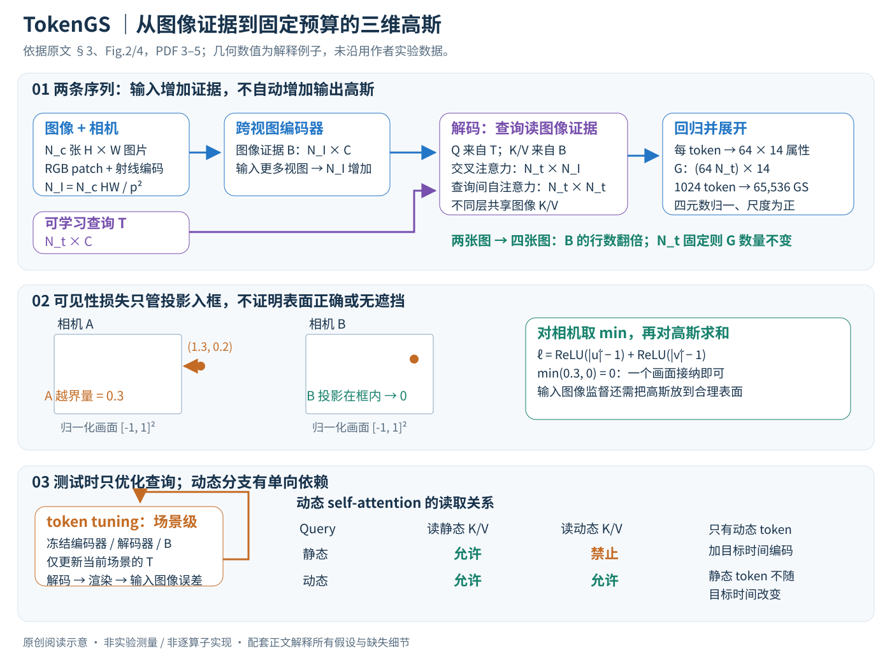

# TokenGS：让高斯表示摆脱像素网格

论文：**TokenGS: Decoupling 3D Gaussian Prediction from Pixels with Learnable Tokens**。Jiawei Ren、Michal Jan Tyszkiewicz、Jiahui Huang、Zan Gojcic，NVIDIA，CVPR 2026，15365–15375 页。

[官方论文页](https://openaccess.thecvf.com/content/CVPR2026/html/Ren_TokenGS_Decoupling_3D_Gaussian_Prediction_from_Pixels_with_Learnable_Tokens_CVPR_2026_paper.html) · [原文 PDF](https://openaccess.thecvf.com/content/CVPR2026/papers/Ren_TokenGS_Decoupling_3D_Gaussian_Prediction_from_Pixels_with_Learnable_Tokens_CVPR_2026_paper.pdf)

分类：3D 视觉 / 前馈重建 / Gaussian Splatting。最后核对：2026-10-19。状态：原文阅读与讲解自检完成，**未运行作者代码或复现实验**。以下页码使用 PDF 页码，正式出版页码另见上方。

方法详细版返工：2026-10-22。重新核对原文§3–4，展开输入输出、张量、计算路径、公式解释、训练/推理和动态mask；未复现实验。

配图详细版返工：2026-10-23。原创SVG经浏览器逐张检查，核对连线、标注与数值例子；原文图仅作为带出处的对照。

## 一句话总结

把“每个像素沿相机射线预测高斯”改成“固定数量的可学习 token 从多视图特征中组织高斯”，使高斯数量可以独立设置，并允许在测试时只调整 token 来细化重建。

## 研究背景与动机

3D Gaussian Splatting 用一组带位置、形状、颜色、不透明度的椭球表示场景。前馈模型直接从图片预测这些参数，比每个场景从头优化更快。常见方案却把输出绑在输入像素上：每个像素预测沿自身射线的深度，再还原出高斯中心。

这种绑定有三个代价。相机方向错了，深度再准确也只能在错误射线上选位置；多输入一张图片就多一批高斯，即使内容重复；遮挡后的结构难以离开已见射线补全。论文给出的数量例子是 32 张 512×512 输入，在每像素一个高斯的设置下超过八百万个高斯。[§1，PDF 2]

这里的“解耦”有两个层面：**中心坐标不受输入射线限制；输出数量不由像素数决定**。输入仍需要相机内外参，因此不是免位姿重建。

## 方法总览

### 先明确：它接收什么，最后交付什么？

TokenGS的输入是同一个场景的多张RGB图片，以及每张图片的相机内参和外参。它不是先估计相机位姿再重建的完整SfM系统；相机信息是已知条件。输出不是深度图，而是一组可从新相机视角渲染的三维高斯。静态模型输出一次场景表示，动态模型则还接收要重建的目标时刻。（§3，PDF第2–3页）

下面统一使用这些符号，避免原文中输入视图数、token数和高斯数混淆：

| 符号 | 含义与形状 | 从哪里来 |
|---|---|---|
| \(N_c,H,W\) | 输入视图数、每图高宽 | 输入图片 |
| \(p\) | 方形patch边长 | 网络配置；下文例子不擅自指定 |
| \(N_I=N_cHW/p^2\) | 所有视图的图像token总数 | 图片patch化 |
| \(C\) | 隐藏通道数，主设置为1024 | 网络配置 |
| \(B\in\mathbb R^{N_I\times C}\) | 编码后的多视图图像证据 | 图像编码器 |
| \(T_{in}\in\mathbb R^{N_t\times C}\) | 可学习的高斯查询槽位 | 跨场景训练的参数；TT时场景级更新 |
| \(N_g=64\) | 每个槽位最终展开的高斯数 | 回归头的固定设计 |
| \(M=N_tN_g\) | 输出高斯总数 | 与输入像素数独立 |
| \(G\in\mathbb R^{M\times14}\) | 每行是一枚高斯的完整属性 | 解码器与回归头 |

**贯穿例子。** 对两张256×256图片，图像侧有 \(N_I=131072/p^2\) 个token。若用1024个高斯token，输出始终是65,536枚高斯；改成四张同分辨率图，只会使图像侧token加倍，输出仍是65,536枚。若改用4096个高斯token，则输出262,144枚。这是“更多证据”和“更多表示容量”两条独立调节轴；四张图并不会免费增加输出容量。（§3.2，PDF第4页）



图从三条独立路径阅读：上部区分图像证据长度与高斯查询预算；中部用两个相机说明可见性损失的最小值不等于遮挡判断；下部区分测试时查询优化和动态注意力依赖。坐标与数量是解释性推算，非新增实验。依据§3、Fig.2/4，PDF第3–5页。

图中可以沿两条流阅读。**证据流**把RGB和相机射线变成图像特征B；**查询流**从高斯token开始，通过交叉注意力读取B，再通过token间自注意力协调，最后预测G。渲染器把G投影成监督图片，图像误差反向影响网络。可选TT把同一渲染闭环用于单场景，但只更新查询token。原图依据Fig.2，当前SVG是概念简化，未逐层画出归一化、残差与动态mask。（PDF第3页）

## 核心创新与关键设计

### 1. 先理解一枚高斯怎样参与成像

每枚高斯包含中心 \(\mu\in\mathbb R^3\)、RGB颜色 \(c\in[0,1]^3\)、三轴尺度 \(s\in\mathbb R_+^3\)、不透明度 \(\sigma\in[0,1]\)和四元数旋转 \(q\in\mathbb R^4\)，一共14个数。尺度与旋转决定三维椭球的形状，中心决定放在哪里，颜色与透明度决定它在图像里如何贡献。（§3，PDF第3页）

为帮助理解梯度，补充标准3DGS成像背景：旋转矩阵R(q)与尺度可构造协方差 \(\Sigma=R\,\mathrm{diag}(s^2)R^T\)。把三维椭球投影到相机后得到二维足迹；按深度排列的足迹用透明度合成，可概括为 \(\hat I(u)=\sum_m c_m\alpha_m(u)\prod_{j<m}(1-\alpha_j(u))\)。其中 \(\alpha_m(u)\)同时受预测不透明度及像素u到投影椭圆的距离影响。这段是通用渲染知识补充，不是TokenGS新增公式，也不代替作者光栅化实现。

这解释了一个训练事实：高斯只有影响某些渲染像素，图像误差才能告诉它应该怎样移动或变色。如果所有监督相机都看不到它，渲染损失可能完全无法约束它。后面的可见性损失正是围绕这个问题设计。

### 2. 从“在某条射线上找深度”改成“在公共三维空间找位置”

像素对齐方法通常先选中输入像素对应的相机射线，再预测深度d。以相机中心o、射线方向r表示，其中心只能落在 \(\mu=o+dr\) 上。即使d自由变化，移动方向仍被r固定。相机旋转有误时，沿错误射线调深度不一定能回到正确表面；多张图也可能对同一表面重复生成高斯。（§1、§3.1，PDF第2–3页）

TokenGS直接预测共同坐标系中的XYZ。输出槽位没有指定输入像素身份，因此它可以把高斯放到离开某条输入射线的位置。这里的“共同”来自输入相机外参定义的参考坐标系，不是任意场景间通用的绝对世界坐标。实现会把参考相机设为单位位姿，并给XYZ激活加z轴偏移，使初始化更倾向落在参考相机前方。（§3.1、§4，PDF第3、6页）

自由度增加也带来困难：网络初期可能把中心放到所有视野之外。像素对齐天然把点绑在一条可见射线上；直接XYZ放松了这个约束，就需要额外提供“至少进入一个监督画面”的学习信号。**不能只讲直接坐标更灵活，而省掉它为什么难训练。**

### 3. 可见性损失：逐点、逐相机计算，最后对相机取最小值

对第m枚中心，在监督相机i下做透视投影，得到像素坐标 \((u_m^i,v_m^i)\)。以下投影是几何背景：先用外参变换到相机坐标，再用内参乘法并除以深度；外参是world-to-camera还是相反方向需依实际数据定义，不能混用。原文接着把像素坐标归一化：（式1，PDF第4页）

\[
\tilde u_m^i=2u_m^i/W-1,\qquad \tilde v_m^i=2v_m^i/H-1.
\]

于是图像矩形变成[-1,1]²。对某一相机，定义越界量

\[
\ell_m^i=\operatorname{ReLU}(|\tilde u_m^i|-1)+\operatorname{ReLU}(|\tilde v_m^i|-1),\qquad
L_{vis}=\sum_m\min_{i\in I_{sup}}\ell_m^i.
\]

逐项看：绝对值让左右或上下越界用同一规则；减1测量是否越过边框；ReLU让没有越界的方向贡献零。对相机取**最小值**意味着“至少一个画面接纳即可”，不是要求所有相机都看到该高斯。对高斯求和让每个槽位展开的粒子都受约束。（式2，PDF第4页）

**数值例子（解释用，非论文实验）。** 相机A的归一化投影为(1.3,0.2)，则越界量0.3；相机B为(-1.1,1.4)，越界量0.1+0.4=0.5；这个点的惩罚取0.3。如果它移动后在A中变成(0.9,0.2)，该点惩罚就为零，即使B仍越界也不受罚。它提供的梯度目标是进入一个画面，而不是直接找到真实表面。

原文说实际将损失值截断到1.0以抑制异常梯度，但没有在正文写清截断是在逐点聚合前还是之后；若使用硬clamp，饱和区梯度也须结合实现理解。该二维投影约束不等于遮挡判定：一个点投影在画面里，仍可能被墙挡住，甚至涉及相机后方深度处理。正深度判定和可见性裁剪不应从这一个公式自行补猜。特别的视角外推微调还会关闭此损失。（§3.1、§4.2，PDF第4、6页）

### 4. 把图片与射线一起变成可读取的证据

对每个视图，把RGB切成p×p×3的patch，并线性投影成C维。相同位置的射线Plücker编码具有每像素6维，patch形状p×p×6，再经另一个线性投影。两个C维向量相加，得到该位置的输入token \(a_{vk}=x_{vk}+s_{vk}\)。（§3.2.1，PDF第4页）

作为几何直觉补充，Plücker表示通常把射线方向d与由原点和方向组成的矩向量联系起来，例如 \((d,o\times d)\)；具体分量顺序、符号及归一化需查实现。它让同一颜色patch携带“来自哪台相机、朝向哪里”的信息。单有RGB时，两个看起来一样的patch很难判断空间关系；射线条件让后续注意力同时访问外观和几何线索。

所有视图token拼为 \(A\in\mathbb R^{N_I\times C}\)，送入ViT编码器。这里的自注意力跨视图而不只在单图内进行，所以某一patch可以读取另一视图的证据；这不是硬匹配或显式三角化，而是学习到的特征交互。编码器末端LayerNorm给出B，供每一层解码器读取。

### 5. 查询token如何变成场景：读证据、互相协调、再输出参数

初始高斯token是训练得到的 \(T_{in}\)，不是从输入图片抽出的像素，也不是已经知道位置的三维点。每个decoder block依次做三类操作：（§3.2.1，PDF第4页）

1. **交叉注意力。** token生成query，图像特征B生成key/value。忽略多头与QK-normalization等细节，概念式为 \(U=\mathrm{softmax}(Q_TK_B^T/\sqrt d)V_B\)。注意力矩阵形状是 \(N_t\times N_I\)，每一行表示一个槽位如何从所有视图读取证据。图像数增加改变列数，不改变输出槽位行数。
2. **高斯token自注意力。** 槽位之间互读，概念上产生 \(N_t\times N_t\) 的交互；这使多个槽位能共同组织一个场景，而非独立地把同一块高纹理区域重复解释。它提供协调能力，但不构成严格的去重或空间均匀覆盖保证。
3. **逐token MLP。** 对每个槽位的特征做非线性变换，为下一层的查询与最终回归准备表示。实际block还含残差、LayerScale及QK-normalization；上述三步是数据流说明，不是省略这些算子后的精确代码。

最终每个C维槽位被线性映射为64×14=896个实数，再reshape为64枚高斯。将所有槽位展开，得到 \((N_t,64,14)\to(M,14)\)。一个token因此更像一小组高斯的共同潜变量，而不是“一枚高斯”或“一个语义物体”。原文末尾张量形状用了与此前不一致的视图数记号，本文采用与设计相符的 \(M=64N_t\)，并明确这是一处记号核对。（PDF第4页）

回归值还必须变成合法属性：颜色和透明度使用缩放tanh，尺度使用截断指数，旋转向量归一化成单位四元数。XYZ使用原文所列的符号—指数映射并加前述z偏移；原文写 \(\mathrm{sign}(x)(\exp(x)-1)\)，若按带符号x直读，负半轴行为值得核实，正文未完整说明是否对指数输入取幅值。此处不擅自修公式，复现应查实现。最终回归头之前还特意省掉LayerNorm，不能因为编码器用过归一化就给输出头自行加回。（PDF第4、6页）

### 6. 为什么解码器能更深：共享的是图像K/V，不是整个注意力

每层交叉注意力都要用B生成图像K/V；若为D层各存一套与图像序列长度成正比的投影，相关存储会随 \(N_ID\) 增长。论文让所有decoder层共享这套投影，在解码开始时只算一次，从而把这一部分变成随 \(N_I\) 增长的单份缓存。（PDF第4页）

但每层token的query仍不同，每次读图像证据仍要计算注意力。因此，不计实现优化的概念复杂度仍包含交叉注意力的 \(O(DN_tN_IC)\) 和token自注意力的 \(O(DN_t^2C)\)；多视图编码也有自身开销。减少的是特定K/V投影存储，不能解释为整个模型复杂度与图片数量无关。论文采用6层编码器、24层解码器；较多输入与高分辨率DL3DV设置改为3/12层。（PDF第4–6页）

### 7. 训练闭环与测试时token tuning，更新的对象不同

**跨场景训练。** 多视图编码得到B，学习token经decoder变成G，再在监督相机处渲染 \(\hat I\)。损失为 \(L=L_{MSE}+0.2L_{SSIM}+1.0L_{vis}\)。MSE比较预测像素与真实像素，SSIM损失补充局部结构约束，可见性项帮助约束不参与渲染的点。正文没有给SSIM损失归一化、patch边界等全部实现细节，不把某个常见实现自动当作本文实现。（§3.1、§4，PDF第4、6页）

图像损失先对渲染中的位置、尺度、颜色等产生梯度，再经回归头传回decoder与token，也传回图像编码器。这使token不是手工分配到某块表面的，而是由重建监督学习怎样组织场景。训练不需要逐高斯真值、深度真值或点图对应，但仍需要多视图RGB和相机条件；“自监督渲染”不能误读成没有图像监督。

**常规推理。** 加载训练好的token和网络，对新场景一次编码与解码，即输出G；随后可渲染多种新视角。没有必要为每个目标视角重新预测全部静态场景。

**TT推理。** 将训练后的初始token复制成该场景的可优化变量，固定网络参数和已经算好的B。每步从当前token重新解码G，渲染输入相机处的图像，用输入RGB做自监督，再仅更新token；默认50步、学习率10⁻⁴。下列是概念伪代码，损失开关、优化器细节应按实际实验核查：（§3.3、§4，PDF第5–6页）

```text
B = 编码器(输入图片, 相机)           # TT过程中固定
T = 复制训练好的高斯token             # 当前场景变量
重复若干步:
    G = 固定解码器与回归头(T, B)
    预测图片 = 可微渲染(G, 输入相机)
    loss = 输入图片上的重建目标
    仅对T求梯度并更新T
返回 固定解码器与回归头(T, B)
```

为何不直接优化M×14个高斯参数？直接优化允许每枚高斯独立地迎合少数输入图，可能得到更高输入视角PSNR却破坏几何；token tuning让表示经过训练好的decoder，保留一定输出结构先验。它仍可能过拟合，也没有数学保证：原文Fig.13承认直接高斯优化在部分设置下更快、PSNR更高，TT的取舍在于几何与先验约束。增加输入视图和增加TT步数也有不同成本，不把两者当成同一策略。（PDF第5、8页）

### 8. 动态扩展：时间进入哪一支，mask阻断哪条路径？

动态版本把查询拆成静态 \(T_S\in\mathbb R^{N_s\times C}\) 与动态 \(T_D\in\mathbb R^{N_d\times C}\)。给目标时刻t做正弦编码并线性映射，只加到动态token：\(\tilde T_{D,j}(t)=T_{D,j}+\mathrm{Linear}(\tau(t))\)。静态token不加这一项。（式3–4，PDF第5页）

在高斯token自注意力中，**静态query可读静态K/V，不可读动态K/V；动态query可读静态与动态K/V**。因此静态分支不会沿这条路径收到目标时刻条件，动态分支却能利用背景结构。这里“causal”是分支间依赖方向，不应自动理解为时间序列自回归、只能读过去帧。原文Fig.4横轴是query、纵轴是K/V，读反坐标轴会把mask含义颠倒。

动态token在不同目标时刻沿用同一槽位索引，只改变时间条件并重新解码。以同一索引比较高斯位置，可以形成场景流的定性展示；然而槽位一致不是有真值监督的物体身份追踪，也不保证所有粒子始终对应真实同一点。动态实验在静态基础上加256个动态token并微调50K步，评估仅16个留出场景；这是特定扩展的证据边界。（§4.4，PDF第7页）

### 9. 读完方法后应能回答的三个问题

**输入图翻倍，为什么高斯不翻倍？** 图片patch属于证据序列B，输出粒子来自另一套固定数量的查询，回归头只展开这些查询。

**中心没有绑在像素上，怎么知道放在哪里？** 相机条件和跨视图注意力提供定位线索，渲染监督提供可微误差信号，可见性项帮助把失活中心拉进至少一个监督画面；没有一项单独保证真实表面正确。

**TT为什么算测试时训练？** 它在当前场景用梯度更新token，尽管基础网络冻结；它增加延迟，也不能把优化后画质与优化前耗时混为同一配置。

## 实验与关键结果

下面只摘选支撑判断的行，数值为作者报告；PSNR、SSIM 越高越好，LPIPS 越低越好。

| 实验 | 方法 | PSNR | SSIM | LPIPS | 高斯数量 |
| --- | --- | ---: | ---: | ---: | ---: |
| RE10K，双视图，256×256 | GS-LRM | 28.10 | 0.892 | 0.114 | 131K |
| 同上 | TokenGS，1024 token | 28.02 | 0.896 | 0.147 | 66K |
| 同上 | TokenGS，4096 token + TT | 28.82 | 0.910 | 0.130 | 262K |
| DL3DV，六视图，448×256 | DepthSplat | 24.19 | 0.823 | 0.147 | 688K |
| 同上 | TokenGS + TT | 24.51 | 0.792 | 0.295 | 262K |
| Kubric 4D，四视图 | BTimer | 24.45 | 0.835 | 0.162 | 未在该表报告 |
| 同上 | TokenGS | 24.84 | 0.821 | 0.287 | 未在该表报告 |

来源：Table 1–2，PDF 5；Table 4，PDF 6，已对照页面图像核对。K 是论文取整写法。

**结果应怎样读：**TokenGS 在这些比较中体现了表示预算和 PSNR 的优势，但并非所有指标领先。RE10K 的 LPIPS 仍差于 GS-LRM；动态实验的 SSIM、LPIPS 均差于 BTimer。不能将论文摘要中的性能表述直接扩成“画质、几何、感知指标全面最好”。

还应把耗时算进去：DL3DV 六视图的 TokenGS 前馈为 0.085 秒，加 TT 后为 5.61 秒；DepthSplat 为 0.132 秒。[Table 2] TT 用计算换质量，不能把 TT 的质量和纯前馈的时间拼成同一配置。相对 688K，262K 大约减少 **62%**；原文正文写 72%，与表中数量算术不一致，本讲解按表计算。

## 消融实验与证据强度

- **可见性损失：**四视图 RE10K，Fig.11 报告 28.4→28.8 PSNR，并展示漂浮高斯减少。[PDF 7–8]
- **更多视图、更多 TT 步数：**Fig.12 中均能带来提升但逐渐饱和；该图的 50 个评估视图包含输入视图，因此不能把曲线无条件当成纯未见视角泛化证据。[PDF 8]
- **直接优化高斯还是优化 token：**作者承认直接优化高斯在部分设置下有更高 PSNR、收敛更快，但 Fig.13 显示几何可能退化。token tuning 的价值是先验约束与几何表现，不是任何情况下数值都更高。[PDF 8]
- **token 预算：**Fig.14 将 1024-token 基础模型以不同 token 数微调后比较。它支持可调预算，但不证明随意更改 token 数就能零训练获得同样效果。[PDF 8]

## 局限与讨论

作者明确指出大场景和精细几何仍困难，TT 需要数十步，开销较高。[§5，PDF 8] 从实验表还可看到感知距离上的短板；如果任务更关注纹理感知质量，不能只依据 PSNR 选型。这是本讲解基于表格的判断，而非作者额外声称的结论。

另一个实用问题是槽位预算：固定高斯数量让存储可控，却未自动解决复杂场景容量不足。值得进一步研究的是按场景难度分配预算，以及联合优化 token 和高斯时如何防止过拟合；这些是研究问题，不是本文已经验证的功能。

## 复现提示

作者报告：基础网络 6 层编码器、24 层解码器、通道 1024；DL3DV 高分辨率设置改为 3/12 层。8 张 A100、总 batch 64；1024-token 训练 150K 步，再以 4096 token 微调 10K 步。基础学习率 \(4\times10^{-4}\)，微调 \(4\times10^{-5}\)；动态实验另加 256 个动态 token、微调 50K 步。[§4，PDF 5–7]

这些配置说明完整从头训练的成本较高。本次只核对论文，未核验作者仓库、模型权重、代码许可证、依赖版本和实际显存，不提供未经执行的“一键复现成功”承诺。代码 commit 记为未知；论文采用 CVF 公开接收版，不能把论文可阅读等同于代码可自由再许可。

## 相关工作与阅读顺序

先读 3DGS 的椭球投影和 alpha 合成，再理解 pixelSplat / MVSplat / GS-LRM 的像素对齐输出，最后回到本论文的可学习查询与测试时调优。论文参考文献中的 DETR 有助于理解 query 槽位，但本文输出的是连续三维表示而非目标检测框。

阅读原文建议：Fig.2 → §3.1 → §3.2 → Table 1–4 → Fig.12–14。先看结构与反例，再核对表格，能避免把“解耦”的优点误读为全面指标提升。

## 来源与校验

- 主要依据：CVF 原文 PDF 正文 1–8 页；参考文献 9–11 页用于核对相关工作。关键实验表页 5–6 已渲染查看；补充材料未读。
- PDF SHA-256：`681029eda11f118e065bfdac2fcb88615938aabc14fabd1984558417a8be4772`。这是本次下载的本地摘要，不是作者签名。
- 结构参考用户提供的 [Paper Notes 页面](https://m0rtzz.github.io/paper-notes/CVPR2026/3d_vision/tokengs_decoupling_3d_gaussian_prediction_from_pixels_with_learnable_tokens/)，讲解依据原文独立撰写，未复制其段落或图片。
- 未附原论文全文或作者图片；概念图为本笔记重绘。AI 辅助讲解经本轮自检，不等于独立专家审稿；发现问题应以原文和勘误为准。
