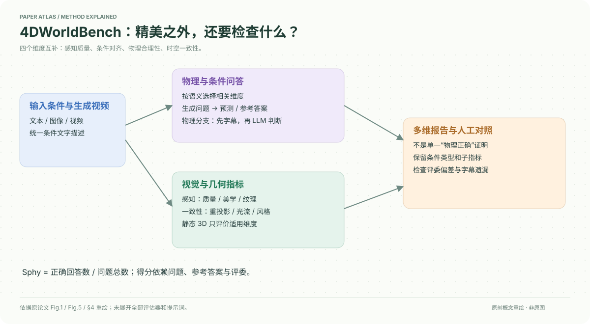

# 4DWorldBench: A Comprehensive Evaluation Framework for 3D/4D World Generation Models

核对日期：2026-10-20。以下实验均为作者报告；本地完成原文阅读与讲解自检，未复现实验。

## 一句话总结

4DWorldBench把世界生成的评估拆成感知质量、条件对齐、物理合理性和时空一致性，并结合传统视觉指标与语言模型问答；它评估生成结果，不是生成世界的新网络。

## 研究背景与动机

视频看起来精美，并不意味着物体运动、相机变换和物理过程都正确。只用图文相似度，还可能偏好几乎不运动的输出。WorldScore、VBench和物理专项基准各有覆盖盲区，因此作者希望用同一套多维框架检查文本、图像和视频条件的3D/4D生成。[§1–3，PDF 1–4]

这里的“世界”主要通过生成视频及其派生几何观察来评估，不应理解成对完整可交互物理模拟器的严格验证。

## 方法总览

输入条件先统一为文字描述；物理分支让视觉模型描述生成视频，再由LLM依据相关物理维度生成问题、回答并比对参考答案。其他分支还使用视觉质量、SLAM重投影、风格和运动指标。不同输入任务仅计算适用维度，例如静态3D不评运动与物理事件。[Fig.1、5，§4，PDF 4–6]

## 核心创新与关键设计

### 自适应问题，而非固定问卷
物理评价先用Keye-VL 1.5把视觉输入与输出转为描述，再选择相关物理维度并生成诊断问题，例如抽气后的密封易拉罐是否发生应有变形。得分为
\[S_{phy}=\frac1N\sum_i\mathbf1[\hat A_i=A_i^*].\]
它衡量问答命中率，而非物理方程残差；描述遗漏、参考答案错误会直接影响结果。[§4.1，PDF 5]

条件对齐也采用均值正确率，检查属性、关系、场景、运动与事件。正文对LLM/MLLM及caption路径的叙述并非处处同样具体，完整提示词在未读补充材料中，不能仅凭正文重建全部调用链。[§4.2]

一致性分支用短片段SLAM重投影检查几何，用光流与MLLM问答共同检查运动，用深特征Gram矩阵检查风格；感知分支包含CLIPIQA+、CLIP-Aesthetic、FastVQA与mPLUG-Owl3。混合评分减少单指标盲点，但也引入多个评估器的偏差。[§4.3–4.4，PDF 6]

## 实验与关键结果

作者报告：文本条件包含50个物理、76个非物理样本；图像包含48个物理、63个非物理场景样本，另为物体3D采样25张Objaverse-XL图像；视频的物理和非物理子集各48个。不要把这些不同用途的子集直接当作每个生成器都用同样数量输入。[§3，PDF 3–4]

| 同类任务的Overall，越高越好 | 模型 | 分数 |
| --- | --- | --- |
| Image-to-4D | CamI2V / DiffusionAsShader | 0.697 / 0.763 |
| Video-to-4D | ReCamMaster / TrajectoryCrafter | 0.685 / 0.670 |
| Text-to-4D | 4Dfy / dreamin4D | 0.535 / 0.439 |

来源为Table2，PDF5；不同条件的信息量不同，不能据此声称图像输入天然优于文本的普遍因果结论。Table4的VideoPhy2-test中，本方法Min(PC,SA)的PLCC/SRCC为0.408/0.409，VideoPhy2为0.394/0.385；但Joint分类准确率本方法0.677低于VideoPhy2的0.770，不能概括为所有指标第一。[PDF7]

## 消融实验与证据强度

约15人对100个视频进行主观物理评估。固定维度、10问的GPT-5→GPT-5为0.351/0.402（PLCC/SRCC），自适应维度提高到0.452/0.461；自适应但改为GPT-5→Qwen2.5-VL为0.247/0.237。该对照支持此配置中的维度选择和评委路径有效，并不证明任何LLM都比任何MLLM强。[Table5，PDF8]

Table6运动控制相关性从0.250/0.209到0.546/0.564；风格SRCC则同为0.457。因此改善并非每个维度、每项指标都严格增加。

## 局限与讨论

文字中介可能把错误视频解释成合理过程；评委与字幕模型的版本漂移会改变排行榜。人类样本规模有限，问题数量、聚合权重和多次运行方差需进一步核验。SLAM在复杂动态画面上自身也可能失败。作者计划扩大场景与降低评估成本；这些不是当前已经完成的能力。[§5–6，PDF8]

本地未复现任何生成或评委调用，尤其未调用论文中的付费模型。

## 复现提示

先固定条件子集、生成器版本、随机种子、渲染视角、帧率和视频长度，再保存字幕、问题、参考答案与评委原始回答。至少先做小规模人工对照，检查字幕是否遗漏关键物理事件；明确静态与动态任务哪些维度不适用。

数据只从原数据集官方入口按许可申请，建议保存于 `data/4dworldbench/`，不把视频、模型权重和商业API密钥放进仓库。项目页在原文给出，但代码commit、数据许可与完整提示词本次未核验。

## 相关工作与阅读顺序

先读VBench了解视觉质量分解，再读WorldScore理解世界生成的控制与一致性；物理部分结合PhyGenBench与VideoPhy2。阅读本论文时先看Fig.1/5，再看Table5的评委消融，最后看排行榜，避免把Overall当作完整物理正确性的证明。

## 来源与校验

- [CVF 官方论文页](https://openaccess.thecvf.com/content/CVPR2026/html/Lu_4DWorldBench_A_Comprehensive_Evaluation_Framework_for_3D4D_World_Generation_Models_CVPR_2026_paper.html) · [所读 PDF](https://openaccess.thecvf.com/content/CVPR2026/papers/Lu_4DWorldBench_A_Comprehensive_Evaluation_Framework_for_3D4D_World_Generation_Models_CVPR_2026_paper.pdf)。页码均为该 PDF 的页序。
- 阅读范围：正文、公式与实验表；补充材料、上游代码与权重未逐项核验。许可证和固定代码 commit 尚未确认，不复制原文全文或数据。
- PDF SHA-256：`2c939abc1148b8097df770500ca75734bdaac4eb38d2c87838a7743443680d11`；版本为本次下载的 CVF 接收稿，核对日期 2026-10-20。

- 视觉核对：已渲染查看 PDF 第8页，核对关键公式或实验表；正文阅读到结论与局限，未读独立补充材料。
