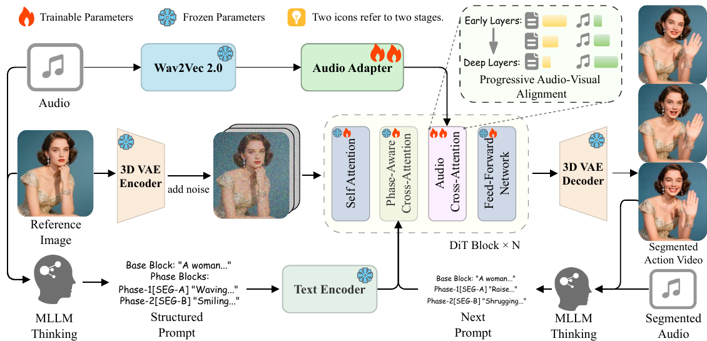

# ActAvatar: Temporally-Aware Precise Action Control for Talking Avatars

核对日期：2026-10-21。实验数值均为作者报告；本地完成原文阅读与讲解自检，未复现实验。

## 一句话总结

ActAvatar把数字人提示拆成带时间窗的动作阶段，并让音频在更深的Transformer层影响更强，以兼顾按时动作与口型。

## 研究背景与动机

全局提示把场景、人物与动作放在同一段文字，模型可能做出动作却出现在错误时间；强化音频条件又可能压过肢体动作。作者将动作语义与时间阶段绑定，再区分文本与音频在网络深度上的作用。[§1，PDF2]

目标是阶段级动作控制，不是逐关节的精确运动轨迹。模型在推理时不需要骨架条件，但训练数据筛选使用DWPose，不能说整个流程完全不使用姿态工具。

## 方法总览

原论文Fig.2，PDF第3页。仅裁切相关图示，保留图内科学标签；著作权属于原作者，用于本篇方法分析，不并入本站原创图授权。[来源与作者](https://openaccess.thecvf.com/content/CVPR2026/html/Peng_ActAvatar_Temporally-Aware_Precise_Action_Control_for_Talking_Avatars_CVPR_2026_paper.html) · [PDF](https://openaccess.thecvf.com/content/CVPR2026/papers/Peng_ActAvatar_Temporally-Aware_Precise_Action_Control_for_Talking_Avatars_CVPR_2026_paper.pdf)。点击可打开高清图。

MLLM根据参考图与音频生成基础描述及多个时间窗动作段，umT5-XXL编码结构化文本；Wan2.2-TI2V-5B骨干通过PACA接收阶段文本，并通过Wav2Vec2音频适配器接收语音。30层DiT里音频残差逐层增强，再由3D VAE解码视频。[Fig.2、§3，PDF3–5]

阶段一冻结骨干、只训练音频适配器；阶段二从图生视频骨干注入该适配器，同时训练骨干、适配器与PACA。阶段二是全量微调，不能把阶段一的冻结策略沿用到整套训练。

## 核心创新与关键设计

每个阶段k的文本token加可学习且零初始化的e_k，随后仍做普通交叉注意力：
\[c_i'=c_i+e_k,\qquad \operatorname{Attn}(Q_f,K,V)=\operatorname{softmax}(Q_fK^T/\sqrt D)V.\]
时间锚与阶段位置通过训练学会对应；公式中没有按时间窗硬屏蔽其他阶段的mask，因此不能承诺窗外动作概率严格为零。[式1–3，PDF4]

深度ℓ的音频残差为：
\[x_\ell\leftarrow x_\ell+(\ell/30)^{1.5}r^{audio}_\ell.\]
ℓ表示网络层号，不是扩散采样步或视频帧时刻。两阶段都用flow matching：x_t=(1-t)x_0+tx_1，预测目标x_1-x_0；推理沿噪声到数据方向积分，不能把训练目标符号直接当成正向生成方向。[式4–10，PDF4–5]

## 实验与关键结果

40张H20训练，阶段一500K说话视频、20K步，阶段二100K结构化动作样本、14K步；batch40、AdamW、学习率5×10⁻⁶。生成125帧、25fps、5秒、704×1280，40采样步，文本及音频CFG均5.0。[§4.1，PDF5]

| 作者报告 | 对照 | ActAvatar |
| --- | --- | --- |
| HDTF FID↓ | Wan-S2V 23.850 | 23.471 |
| HDTF FVD↓ | Wan-S2V 299.491 | 301.064 |
| HDTF Sync-C↑ | OmniAvatar 7.986 | 7.663 |
| Action Bench阶段命中率 | OmniAvatar 0.818 | 0.854 |
| Action Bench AA / TC | OmniAvatar 5.505 / 7.032 | 5.971 / 7.353 |

来源Table1–2，PDF6。HDTF100条只侧重上半身口型，Action Bench200条包含TTS和经人工核验的MLLM提示；两个测试集分工不同。FVD与Sync-C并非都第一。Action Bench的动作指标由Gemini对每视频评5次取均值，不是人工逐帧动作准确率；0.854表示阶段命中85.4%。

单H20生成5秒需16分钟，8卡约2分钟；不是实时生成。比Wan-S2V68分钟快，但比EchoMimic v3的7分钟慢。[§4.2，PDF6–7]

## 消融实验与证据强度

基线、加PACA、再加渐进音频、最后两阶段完整训练的H@S为0.725/0.829/0.831/0.854，Sync-C为6.37/6.39/6.57/6.89。支持PACA主要帮助动作、渐进音频帮助口型，但中间AA5.78→5.75、TC7.12→7.10略降，并非每项单调。[Table4，PDF8]

正文把PACA后TC写为7.48，与表中TC7.12不一致；7.48实际是AQ，本篇按已渲染表格记录。45位参与者每人评30个随机排序视频，0–5分量表上本文APA4.03、总体质量4.18；这些主观评分不与0–10的Gemini指标混用。[Table3、§4.4]

## 局限与讨论

软注意力有时间漂移，结构化提示与MLLM自动标注的错误会传到生成结果；复杂手部、遮挡、多阶段冲突和长时序接续未由5秒主实验充分覆盖。主文时间坐标同时出现“归一化”与秒数描述，复现应统一实际编码方式。

自动评审受评审模型与提示影响，五次平均不等于人工共识或统计显著性。两阶段设计的能力保留来自基准观察，不构成保证任何原始能力不遗忘的定理；训练数据量与40卡配置也不能推算普通个人设备可承担完整训练。

## 复现提示

从[作者项目页](https://ziqiaopeng.github.io/ActAvatar/)确认代码、模型、许可证和发布版本，本次未核实固定commit或权重可用性。建议 `experiments/generation/actavatar/`，记录音频/参考图授权、时间窗单位、阶段token分配、音频帧对齐和两阶段参数冻结清单。

先用少量合法样例分别检查动作出现、时间窗命中、口型与身份稳定，再统一分辨率、采样步数和硬件比较时延。本次未训练或生成数字人，未调用Gemini评分；所有实验值为作者报告。

## 相关工作与阅读顺序

先读flow matching、Wan图生视频与音频交叉注意力，再看MultiTalk、HunyuanVideo-Avatar、OmniAvatar的条件接口。阅读顺序以Fig.2→PACA公式→阶段冻结清单→Table4为主，理解阶段文本、层深缩放与训练策略分别改变了什么。

## 来源与校验

- [CVF官方论文页](https://openaccess.thecvf.com/content/CVPR2026/html/Peng_ActAvatar_Temporally-Aware_Precise_Action_Control_for_Talking_Avatars_CVPR_2026_paper.html) · [所读PDF](https://openaccess.thecvf.com/content/CVPR2026/papers/Peng_ActAvatar_Temporally-Aware_Precise_Action_Control_for_Talking_Avatars_CVPR_2026_paper.pdf)。页码均为PDF页序。
- 所读版本：2026-10-21从CVF下载的开放接收稿；PDF SHA-256：`314427c9a95af703bf3cf850ed0006b59854f713bdefad457327b52c56c8d46c`。
- 阅读范围：正文、方法公式、实验与消融；补充材料、代码及权重未逐项核验。reviewed表示本地讲解自检，不表示独立同行评审或实验复现。
- 方法图与关键公式/表格已渲染核对，所引原图已单独检查；未对新文章进行浏览器交互验收。作者图示与本站原创素材权利分开记录。
