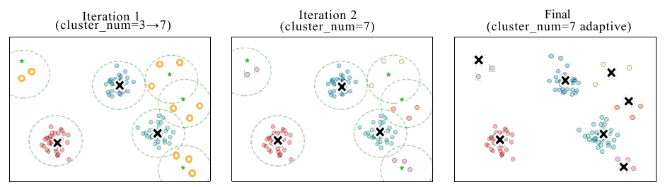

# AdaCluster: Adaptive Query-Key Clustering for Sparse Attention in Video Generation

核对日期：2026-10-22。实验数值均为作者报告；本地完成原文阅读与讲解自检，未复现实验。

## 一句话总结

AdaCluster按query与key的不同角色设计聚类，再选择少量关键簇做视频DiT注意力，在无需重训模型的条件下取得加速；它是有质量与实现条件的近似计算，不能当作全注意力的严格等价替换。（PDF第1–6页）

## 研究背景与动机

视频token数同时随帧数和分辨率增长，全注意力的二次开销成为生成瓶颈。连续token分块未必语义相似，固定簇数量也难适应各层不同的分布。作者提出query按方向聚类、key按欧氏紧密程度自适应聚类，让不适合压缩的层保留全注意力。（PDF第1–4页）

## 方法总览

原论文Fig.5，PDF第5页。仅裁切相关图示，保留图内科学标签；著作权属于原作者，用于本篇方法分析，不并入本站原创图授权。[来源与作者](https://openaccess.thecvf.com/content/CVPR2026/html/Tan_AdaCluster_Adaptive_Query-Key_Clustering_for_Sparse_Attention_in_Video_Generation_CVPR_2026_paper.html) · [PDF](https://openaccess.thecvf.com/content/CVPR2026/papers/Tan_AdaCluster_Adaptive_Query-Key_Clustering_for_Sparse_Attention_in_Video_Generation_CVPR_2026_paper.pdf)。点击可打开高清图。

图5展示key聚类：先用适量中心聚类，距离中心超阈值的离群token进入下一轮，形成更细簇；达到簇数量上限仍难压缩则回退全注意力。首个去噪步确定各层簇数量，后续步保持数量、用前一步中心初始化并更新中心。query先单位化再聚类为65组；选簇后取对应KV进行注意力，最终计算应保留原query的数值信息。（PDF第4–6页）

## 核心创新与关键设计

**角色差异。** 固定非零q乘正数不会改变q与各key的点积分数排序，因此方向可用于候选筛选；但缩放会改变softmax温度及概率分布，不能由此推出完整注意力不变。key范数则会改变同一q下的排序，需保留欧氏距离信息。由Cauchy–Schwarz可得 \(|q^T(k-c)|\le\|q\|\|k-c\|\)，紧簇中心能近似分数，但误差受query范数影响。（PDF第3–4页）

**关键簇评分。** Quest对一簇的逐维min/max计算点积上界。作者的TensorQuest意在利用正负分解和矩阵乘法发挥Tensor Core效率。然而算法2直接把原K截成正负部分，没有明确列出簇内min/max规约；算法3也未完整体现簇代表与分配索引如何使用。按印刷公式直读，二者并不自动等价。例如单维q=1、簇K={1,2}时，Quest上界为2，原K逐token正负乘法产生[1,2]，还缺一次簇内处理。此处是复现待核对点，不能凭正文的“等价”一句跳过实现审查。（PDF第5–6页）

## 实验与关键结果

作者用PenguinVideoBenchmark提示词，在单A40 48GB上比较CogVideoX-2B、Wan-2.1-1.3B和HunyuanVideo。Hunyuan用30步，其余50步；τ设为首步平均token到中心距离的1.5倍，约15%的层保留全注意力。相似度参考是同模型全注意力生成视频，不是真实视频标注。（PDF第6–7页）

| 模型与分辨率 | PSNR/dB↑ | SSIM↑ | LPIPS↓ | 端到端加速 |
|---|---:|---:|---:|---:|
| CogVideoX 720×480 | 30.989 | 0.767 | 0.231 | 1.67× |
| Wan 832×480 | 29.083 | 0.571 | 0.393 | 1.85× |
| Hunyuan 1280×720 | 30.580 | 0.835 | 0.203 | 1.68× |

表1（PDF第7页）。CogVideoX的VBench图像质量61.15→56.76%、主体一致性92.71→89.26%，存在可见量化退化，不能笼统称为无质量损失。固定81帧、176.4K token的高分辨率配置最高4.31×；不是表中所有分辨率都达到这一速度。（PDF第7–8页）

## 消融实验与证据强度

相同平均412个簇时，层自适应分配相对平均分配PSNR29.007→30.580dB，SSIM0.724→0.835，LPIPS0.378→0.203。使用TensorQuest评分相对均值评分，PSNR28.941→30.580dB，LPIPS0.410→0.203，支持候选筛选设计在该Hunyuan配置中的价值。（表3–4，PDF第8页）

图8还报告关键候选选择算子最高约5×加速，这是算子层结果；端到端生成最高4.31×是另一实验，不应合并。query聚类及其他组件的完整消融、H100与超参数分析位于附录，本轮没有核查。（PDF第8页）

## 局限与讨论

首步固定簇数依赖跨去噪步分布平缓的经验观察，复杂提示词或后续剧烈变化可能削弱近似。全文没有提供对所有模型、所有提示词的质量界。PSNR高只说明接近全注意力输出，不证明视频更符合真实物理或用户指令。算法伪代码省略的簇规约、回退与重排细节，以及实际稀疏kernel效率都可能决定复现表现。（PDF第4–8页）

## 复现提示

[作者仓库](https://github.com/USTC-MLSys-Team/Adacluster)待核对commit、许可与kernel依赖，本轮未执行。复现须固定原始模型、提示词、种子、帧数、分辨率、去噪步、dtype以及预热与计时边界，先验证Quest上界与TensorQuest簇评分的一致性，再测全管线速度。Triton/FlashInfer与GPU硬件不同，不能直接承诺本机相同加速；模型权重、生成视频及原论文PDF均不上传。（PDF第5–8页）

## 相关工作与阅读顺序

先读标准注意力与FlashAttention，再理解SpargeAttn分块和SVG2聚类。随后阅读Quest的簇或页级上界，带着这一数学定义检查TensorQuest。量化方法降低每次计算的数值成本，AdaCluster减少参与计算的token，两者可能互补，但本文未证明任意组合都保留同等质量。（PDF第2–8页）

## 来源与校验

- [CVF官方论文页](https://openaccess.thecvf.com/content/CVPR2026/html/Tan_AdaCluster_Adaptive_Query-Key_Clustering_for_Sparse_Attention_in_Video_Generation_CVPR_2026_paper.html) · [所读PDF](https://openaccess.thecvf.com/content/CVPR2026/papers/Tan_AdaCluster_Adaptive_Query-Key_Clustering_for_Sparse_Attention_in_Video_Generation_CVPR_2026_paper.pdf)。页码均为PDF页序。
- 所读版本：2026-10-22从CVF下载的开放接收稿；PDF SHA-256：`6fdb1f5ec3e2bc214e4786d8e8d9f2703a582a1a00d2923fb5ee6e73a0f91816`。
- 阅读范围：正文、方法公式、实验与消融；补充材料、代码及权重未逐项核验。reviewed表示本地讲解自检，不表示独立同行评审或实验复现。
- 方法图与关键公式/表格已渲染核对，所引原图已单独检查；未对新文章进行浏览器交互验收。作者图示与本站原创素材权利分开记录。
