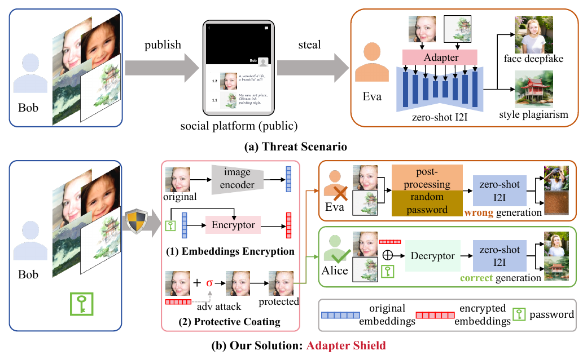

# Adapter Shield: A Unified Framework with Built-in Authentication for Preventing Unauthorized Zero-Shot Image-to-Image Generation

核对日期：2026-10-22。实验数值均为作者报告；本地完成原文阅读与讲解自检，未复现实验。

## 一句话总结

Adapter Shield把图像编码特征推向密钥条件的替代表征，允许正确密钥配合解码器近似恢复原特征，从而研究兼顾限制未授权生成与授权使用的保护；其神经网络“加解密”尚不能当作标准密码学访问控制。（PDF第1–5页）

## 研究背景与动机

IP-Adapter等方法无需对某个人或作品重新训练，只需一张参考图就可条件生成，因此只针对微调训练的数据保护未必有效。本文尝试让公开图像的编码特征失真，同时为许可使用者保留恢复路径。它保护的是指定生成模型读取图像的过程，不阻止人观看、复制图片，也不能保证所有未来编码器都受影响。（PDF第1–3页）

## 方法总览

原论文Fig.2，PDF第2页。仅裁切相关图示，保留图内科学标签；著作权属于原作者，用于本篇方法分析，不并入本站原创图授权。[来源与作者](https://openaccess.thecvf.com/content/CVPR2026/html/Jia_Adapter_Shield_A_Unified_Framework_with_Built-in_Authentication_for_Preventing_CVPR_2026_paper.html) · [PDF](https://openaccess.thecvf.com/content/CVPR2026/papers/Jia_Adapter_Shield_A_Unified_Framework_with_Built-in_Authentication_for_Preventing_CVPR_2026_paper.pdf)。点击可打开高清图。

图2包括两阶段：为各图像编码器训练密钥条件的编码/解码网络；随后在有界像素扰动内优化公开图像，使多个编码器输出接近对应密钥的目标表征。授权用户将保护图像的特征送入解码器并提供正确密钥后再用于生成。网络含self-attention、cross-attention和线性层，密钥维度与待保护表征相同，正文没有给出标准口令派生或密码学安全协议。（PDF第3–5页）

## 核心创新与关键设计

表征变换写为 \(E_{enc}=Enc(E_{ori},P)\)、\(E_{dec}=Dec(E_{enc},P)\)。训练目标鼓励密文远离原特征、正确解码接近原特征、错误密钥解码远离原特征，并用不同样本/密钥间的多样性损失减少输出塌缩。恢复以余弦相似度评价，不是逐比特可逆。（PDF第4–5页）

像素保护阶段最小化多个编码器到各自目标的距离，并加入可微失真增强；最终扰动限制在预算内。正文称FGSM，但式(11)打印的是普通梯度更新而非sign梯度；算法1的while“相似度大于阈值”与文字“直到超过阈值停止”方向不一致，初始化也未完整定义。实现复核时必须查清这些差异，不能直接复制伪代码后声称复现。第4.4节把加密目标写成最大化与原特征相似，也与前文和表3方向矛盾，应以前文目标及实验定义区分。（PDF第4–7页）

## 实验与关键结果

人脸用CelebA训练、FFHQ200张测试并对齐112²；艺术用Wikiart25,769张训练、50张未见图测试。人脸比较FaceID/InstantID，艺术比较IP-Adapter/Plus；在两张4090上开展实验。像素预算分别11/255与21/255，测试规模有限。（PDF第5–6页）

| 表1 general保护模式 | 主要相似度↓ | 保护图PSNR/dB↑ |
|---|---:|---:|
| FaceID生成身份相似度 | 0.1422 | 32.10 |
| InstantID生成身份相似度 | 0.0685 | 32.10 |
| IP-Adapter作品表征相似度 | 0.1175 | 30.81 |
| IP-Adapter Plus作品表征相似度 | 0.2713 | 30.81 |

身份与艺术表征指标定义不同，不能跨任务直接比较。未保护行相似度归一为1；表3正确密钥解码相似度FaceID0.9927、InstantID0.9725、IP-Adapter0.9312、Plus0.9217，说明近似恢复。JPEG后艺术特征相似度升至0.6870/0.6675，明显削弱保护；不能笼统说对压缩鲁棒。（PDF第6–7页）

## 消融实验与证据强度

表4去多样性约束时，不同密钥输出高度相似；加约束改善多样性，但错误密钥恢复率升至人脸0.015、艺术0.05，即1.5%与5%，恢复阈值为余弦相似度0.8。作者称风险较小，本笔记不把此结果解释成密码学安全。（PDF第8页）

多目标保护改善跨编码器指标，也增加耗时：人脸25.13→40.03秒，艺术220.90→480.55秒；相应配置和PSNR也变化，因此不是单一变量的公平延迟比较。所谓unseen编码器在多目标条件下已经加入优化，不能作为对任意未参与编码器的迁移证明。（PDF第8页）

## 局限与讨论

正确解码只是经验近似，随机错误密钥测试不等于针对性恢复、密钥搜索或已知样本攻击分析。JPEG敏感、少量测试图和所选编码器限制了“通用保护”的范围。该方案不能从技术指标推出版权或肖像权的法律结论，也不应向图片所有者承诺上传后绝不会被模仿。保护图可见质量、生成质量及恢复安全需分别评价。（PDF第5–8页）

## 复现提示

本轮未核查代码版本、许可证、权重或补充材料，未对个人照片或作品施加扰动。复现可从已授权临时样例开始，分别记录编码器版本、像素预处理、扰动预算、失真配置、正确/错误密钥恢复与保护耗时。必须先解决循环终止条件、梯度形式和余弦范围的实现歧义；目前没有本地实测，不能视作可直接部署的加密工具。（PDF第4–8页）

## 相关工作与阅读顺序

先了解IP-Adapter图像条件与ArcFace/CLIP表征，再对照IDProtector这类零样本保护和针对微调的Mist/ACE。阅读本文时把像素扰动、特征变换与密码学认证分开。跨少量指定模型有效的防护实验，是研究进展的证据，尚不是广泛访问控制保证。（PDF第2–8页）

## 来源与校验

- [CVF官方论文页](https://openaccess.thecvf.com/content/CVPR2026/html/Jia_Adapter_Shield_A_Unified_Framework_with_Built-in_Authentication_for_Preventing_CVPR_2026_paper.html) · [所读PDF](https://openaccess.thecvf.com/content/CVPR2026/papers/Jia_Adapter_Shield_A_Unified_Framework_with_Built-in_Authentication_for_Preventing_CVPR_2026_paper.pdf)。页码均为PDF页序。
- 所读版本：2026-10-22从CVF下载的开放接收稿；PDF SHA-256：`3a04e8293d4fc95557eae90a0cb5f0eadbd57c518851ee4e455e51c81c075431`。
- 阅读范围：正文、方法公式、实验与消融；补充材料、代码及权重未逐项核验。reviewed表示本地讲解自检，不表示独立同行评审或实验复现。
- 方法图与关键公式/表格已渲染核对，所引原图已单独检查；未对新文章进行浏览器交互验收。作者图示与本站原创素材权利分开记录。
