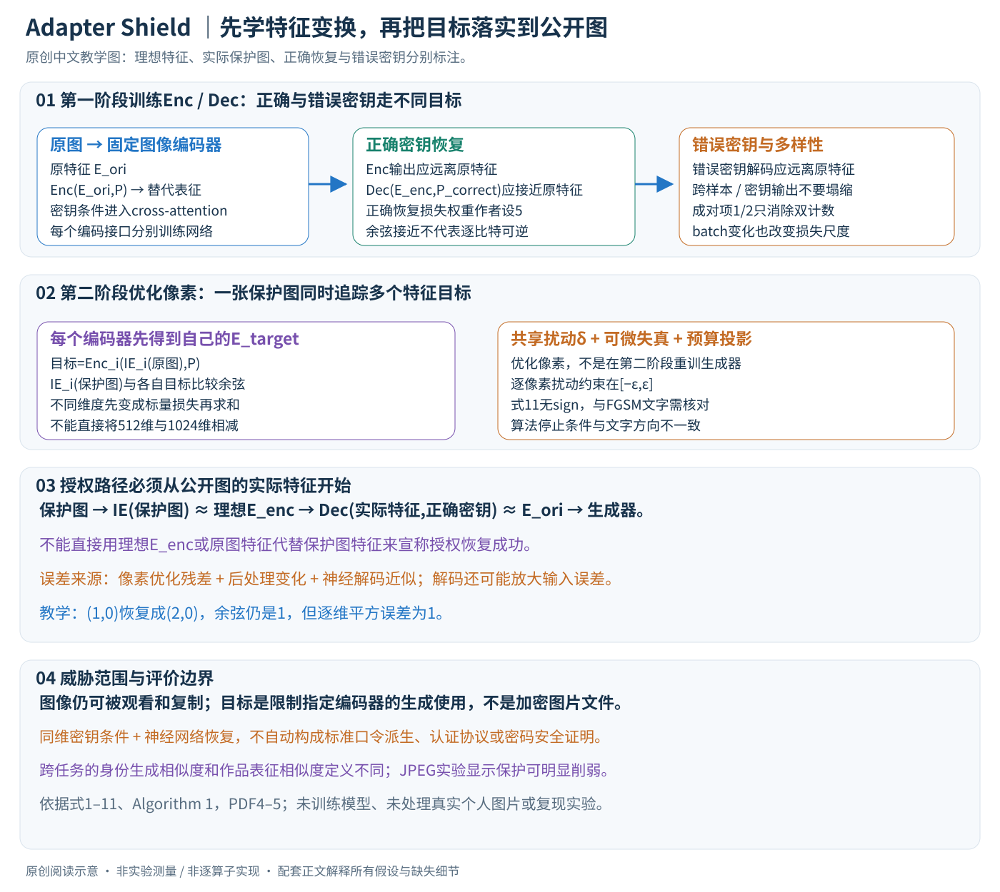

# Adapter Shield: A Unified Framework with Built-in Authentication for Preventing Unauthorized Zero-Shot Image-to-Image Generation

核对日期：2026-10-22。实验数值均为作者报告；本地完成原文阅读与讲解自检，未复现实验。

方法与配图详细版返工：2026-10-24。展开五项特征损失、多编码器像素目标与授权恢复误差。未复现实验。

## 一句话总结

Adapter Shield把图像编码特征推向密钥条件的替代表征，允许正确密钥配合解码器近似恢复原特征，从而研究兼顾限制未授权生成与授权使用的保护；其神经网络“加解密”尚不能当作标准密码学访问控制。（PDF第1–5页）

## 研究背景与动机

IP-Adapter等方法无需对某个人或作品重新训练，只需一张参考图就可条件生成，因此只针对微调训练的数据保护未必有效。本文尝试让公开图像的编码特征失真，同时为许可使用者保留恢复路径。它保护的是指定生成模型读取图像的过程，不阻止人观看、复制图片，也不能保证所有未来编码器都受影响。（PDF第1–3页）

## 方法总览

### 保护的对象是编码器特征，而不是图像文件的访问权限

Adapter Shield把公开图像做小幅像素修改，使指定图像编码器输出远离原始语义、接近一个密钥条件的替代特征；授权用户再用匹配解码器与正确密钥近似恢复特征，供零样本图像条件生成使用。用户仍能看到和复制保护图，方法没有加密图片文件，也没有阻止未知编码器或任意处理方式。（§3.1–3.2，PDF第3–5页）

原创图按式1–11绘制。示意向量用于说明余弦与恢复误差，不是模型训练结果或密码安全证明。

| 对象 | 含义 | 形状/更新对象 |
|---|---|---|
| \(I_{\rm ori},\delta,I_{\rm pro}\) | 原图、扰动、公开保护图 | 图像同形；第二阶段优化扰动 |
| \(IE_i\) | 第i个目标图像编码器 | 提供特征与像素梯度 |
| \(E_{\rm ori},E_{\rm enc},E_{\rm dec}\) | 原始、替代、恢复特征 | 对指定编码器接口保持兼容 |
| \(P\) | 密钥条件 | 正文称与待保护特征同维 |
| \(Enc_i,Dec_i\) | 学习到的特征变换网络 | 第一阶段按编码器分别训练 |

作者人脸编码器输出1×512，IP-Adapter使用1×1024，Plus使用257×1280的隐藏状态。Plus训练为节约计算随机抽1280维行向量；这不自动解释完整257个token如何配密钥、聚合和恢复，相关接口仍需代码核查。（§4.1，PDF第5–6页）

## 核心创新与关键设计

### 第一阶段：训练可用正确密钥恢复的替代表征

先提取 \(E_{\rm ori}=IE(I_{\rm ori})\)，再计算：

\[
E_{\rm enc}=Enc(E_{\rm ori},P_{\rm crt}),\qquad
E_{\rm dec}=Dec(E_{\rm enc},P_{\rm crt}).
\]

Enc和Dec结构相同、参数不同，包含self-attention、cross-attention和线性层；cross-attention使变换依赖密钥。主文没有给出足以唯一重建的层宽、头数、token组织或标准口令派生协议，不能用网络示意图替代完整规格。（式1–2、Fig.3，PDF第4页）

每个样本随机生成一个正确密钥与n个错误密钥。加密损失对这些密钥产生的替代特征与原特征的相似度求和，使它们远离原始表征；正确恢复损失为 \(1-\operatorname{CosSim}(E_{\rm dec},E_{\rm ori})\)，鼓励接近。错误密钥损失则把正确密钥生成的替代特征交给错误密钥解码，并最小化恢复结果与原始特征的相似度。（式3–5）

注意三条路径不同：Enc使用错误密钥仍应生成不同于原特征的输出；Dec配正确密钥应恢复；Dec配错误密钥不应恢复。把所有密钥输出都拉远或都拉近，都不能同时完成目标。

### 多样性项防止网络学会固定输出

如果Enc不管输入都输出同一向量，它也可能满足“与多数原特征相似度低”；因此仅有远离原特征的约束不足。作者将一个batch中加密输出和错误解码输出组成集合，惩罚不同输出之间的相似度：

\[
L_{\rm div}=\tfrac12\sum_{k\ne j}\operatorname{CosSim}(E_k,E_j).
\]

每个原样本有n+1个加密输出和n个错误解码输出，batch大小b时共有 \(b(2n+1)\) 个向量。前面的1/2抵消有序双计数，不是按样本数归一化。增加b或n会改变成对项数量与损失尺度，因此不能直接照搬权重而忽略batch配置。另一个 \(L_{\rm div\_s}\) 使用相同固定密钥比较不同原样本输出，避免同一密钥把所有样本压到同一个表示。（式6–7，PDF第4–5页）

总损失为五项加权和，作者 \((\lambda_1,\ldots,\lambda_5)=(1,5,1,1,1)\)，其中正确恢复项权重为5。此设计是在学习目标上权衡扰乱、恢复与多样性，并没有自动给出密钥不可猜测的密码学保证。（式8、§4.1）

### 余弦恢复不等于逐维或逐比特恢复

正文称训练用余弦被限制到[0,1]，但未完整说明是裁剪、映射还是其他实现；实验表中还出现负的评价余弦。应区分训练相似度处理与原始评价余弦，不能把负数擅自删除。（PDF第4、6–7页）

教学原特征 \((1,0)\)，恢复为 \((2,0)\)，余弦仍为1，但逐维误差平方为1。这说明相似度很高不保证精确数值相等；下游网络是否归一化、是否对特征幅度敏感，还影响最终生成。神经恢复目标也不是标准加密的逐比特可逆性。

### 第二阶段：把替代表征落实到可发布图像

对每个目标编码器预先构造：

\[
E_{{\rm tar},i}=Enc_i(IE_i(I_{\rm ori}),P).
\]

然后优化共享像素扰动，让所有编码器的保护图特征接近各自目标：

\[
I_{\rm pro}=I_{\rm ori}+\delta,\qquad
L_{\rm mt}=\sum_{i=0}^{m-1}[1-\operatorname{CosSim}(IE_i(I_{\rm pro}),E_{{\rm tar},i})],
\quad |\delta|\le\epsilon.
\]

多个编码器目标共同作用于同一张图，并非输出m张互不相干的保护图。不同特征维度通过各自的相似度标量汇总，不能直接把512维和1024维向量相减。跨编码器梯度可能冲突，求和不保证所有目标都能在有限扰动下达到指定阈值。（式9–10，PDF第5页）

每轮加入可微图像失真，意在让优化后的特征在部分后处理下仍接近目标。这是增强训练的经验机制，不保证对任意JPEG、重绘或未知编码器都有效。像素更新后裁剪到 \([-\epsilon,\epsilon]\)，保持幅值预算；合法图像取值范围的处理也应核对实现。

### 更新公式与停止条件不能直接照抄

正文称基于FGSM，但式11写 \(\delta\leftarrow\delta-\sigma\nabla L_{\rm mt}\)，没有sign；普通梯度与sign梯度在步长尺度和方向分量上不同。算法1的while条件写相似度大于阈值时继续，文字却说达到/超过阈值后停止；初始化时尚未计算 \(E_{{\rm pro},i}\)，损失求和还混用了n与m。应将这些视为需要实现复核的伪代码问题，不默默修成某个算法后声称复现。（式11、Algorithm 1）

因此本讲解只给出可核实的优化意图：固定特征变换网络与目标，计算保护图到多目标的相似度损失，经图像编码器反传更新扰动并约束预算。迭代上限、多个编码器怎样共同判定停止、梯度是否取sign均待核对。没有执行这段保护优化。

### 授权生成读取保护图的实际特征，恢复误差会累积

公开图编码得到的是 \(IE(I_{\rm pro})\)，通常只近似等于第一阶段的理想 \(E_{\rm enc}\)。授权路径应为 \(Dec(IE(I_{\rm pro}),P_{\rm crt})\)，再送入匹配生成器；不能在评测授权效果时直接偷换为理想加密特征或原图特征。

误差包含像素优化没完全达标、后处理改变表征和Dec自身近似恢复等部分。若解码器在目标邻域很敏感，即使特征扰动小也可能放大；本文没有给出全局稳定性界或标准密钥安全协议。拥有正确密钥还需匹配解码器与编码接口，并不是任意生成服务输入口令就自动解锁。

### 实验与复现要保持相同口径

人脸保护使用200张FFHQ测试，作品用50张未见Wikiart图；预算分别11/255和21/255。每任务general模式联合两个编码接口，人脸虽同属ArcFace架构但预训练版本不同。正确密钥余弦恢复较高是作者有限测试证据，不代表未知攻击下的认证安全。（§4.1–4.4，PDF第5–7页）

JPEG后作品相似度升到0.6870/0.6675，说明保护明显受损。Table 1的身份相似度来自生成脸与原脸，作品表征相似度则比较图像编码，二者不能跨任务当同一量表排名。复现需固定相似度映射、密钥采样、编码器版本、行token处理、优化步长与预算、后处理及授权恢复接口；当前未训练网络、未处理真实个人图像、未复现实验。

## 实验与关键结果

人脸用CelebA训练、FFHQ200张测试并对齐112²；艺术用Wikiart25,769张训练、50张未见图测试。人脸比较FaceID/InstantID，艺术比较IP-Adapter/Plus；在两张4090上开展实验。像素预算分别11/255与21/255，测试规模有限。（PDF第5–6页）

| 表1 general保护模式 | 主要相似度↓ | 保护图PSNR/dB↑ |
|---|---:|---:|
| FaceID生成身份相似度 | 0.1422 | 32.10 |
| InstantID生成身份相似度 | 0.0685 | 32.10 |
| IP-Adapter作品表征相似度 | 0.1175 | 30.81 |
| IP-Adapter Plus作品表征相似度 | 0.2713 | 30.81 |

身份与艺术表征指标定义不同，不能跨任务直接比较。未保护行相似度归一为1；表3正确密钥解码相似度FaceID0.9927、InstantID0.9725、IP-Adapter0.9312、Plus0.9217，说明近似恢复。JPEG后艺术特征相似度升至0.6870/0.6675，明显削弱保护；不能笼统说对压缩鲁棒。（PDF第6–7页）

## 消融实验与证据强度

表4去多样性约束时，不同密钥输出高度相似；加约束改善多样性，但错误密钥恢复率升至人脸0.015、艺术0.05，即1.5%与5%，恢复阈值为余弦相似度0.8。作者称风险较小，本笔记不把此结果解释成密码学安全。（PDF第8页）

多目标保护改善跨编码器指标，也增加耗时：人脸25.13→40.03秒，艺术220.90→480.55秒；相应配置和PSNR也变化，因此不是单一变量的公平延迟比较。所谓unseen编码器在多目标条件下已经加入优化，不能作为对任意未参与编码器的迁移证明。（PDF第8页）

## 局限与讨论

正确解码只是经验近似，随机错误密钥测试不等于针对性恢复、密钥搜索或已知样本攻击分析。JPEG敏感、少量测试图和所选编码器限制了“通用保护”的范围。该方案不能从技术指标推出版权或肖像权的法律结论，也不应向图片所有者承诺上传后绝不会被模仿。保护图可见质量、生成质量及恢复安全需分别评价。（PDF第5–8页）

## 复现提示

本轮未核查代码版本、许可证、权重或补充材料，未对个人照片或作品施加扰动。复现可从已授权临时样例开始，分别记录编码器版本、像素预处理、扰动预算、失真配置、正确/错误密钥恢复与保护耗时。必须先解决循环终止条件、梯度形式和余弦范围的实现歧义；目前没有本地实测，不能视作可直接部署的加密工具。（PDF第4–8页）

## 相关工作与阅读顺序

先了解IP-Adapter图像条件与ArcFace/CLIP表征，再对照IDProtector这类零样本保护和针对微调的Mist/ACE。阅读本文时把像素扰动、特征变换与密码学认证分开。跨少量指定模型有效的防护实验，是研究进展的证据，尚不是广泛访问控制保证。（PDF第2–8页）

## 来源与校验

- [CVF官方论文页](https://openaccess.thecvf.com/content/CVPR2026/html/Jia_Adapter_Shield_A_Unified_Framework_with_Built-in_Authentication_for_Preventing_CVPR_2026_paper.html) · [所读PDF](https://openaccess.thecvf.com/content/CVPR2026/papers/Jia_Adapter_Shield_A_Unified_Framework_with_Built-in_Authentication_for_Preventing_CVPR_2026_paper.pdf)。页码均为PDF页序。
- 所读版本：2026-10-22从CVF下载的开放接收稿；PDF SHA-256：`3a04e8293d4fc95557eae90a0cb5f0eadbd57c518851ee4e455e51c81c075431`。
- 阅读范围：正文、方法公式、实验与消融；补充材料、代码及权重未逐项核验。reviewed表示本地讲解自检，不表示独立同行评审或实验复现。
- 方法图与关键公式/表格已渲染核对，所引原图已单独检查；详细版已于2026-10-24完成浏览器配图与文章排版检查（22个公式，无公式错误、损坏图片或横向溢出）；2026-10-25登记联合自检。作者图示与本站原创素材权利分开记录。
