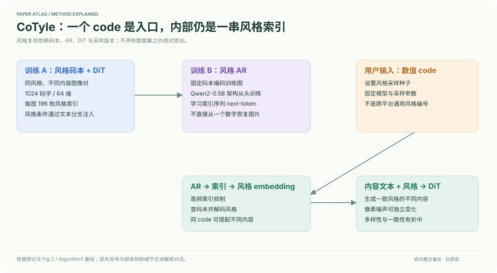

# A Style is Worth One Code: Unlocking Code-to-Style Image Generation with Discrete Style Space

核对日期：2026-10-20。以下实验均为作者报告；本地完成原文阅读与讲解自检，未复现实验。

## 一句话总结

CoTyle把数值code作为随机种子生成一串离散风格索引，再经风格码本引导文生图模型，在同风格下改变内容；单个code不是独立于模型的通用风格标准。

## 研究背景与动机

长风格提示、参考图或LoRA分享不够紧凑，同提示也可能风格不稳。作者希望一个可重复数值标识映射到风格条件，既支持跨内容一致，又能采样未直接使用参考图的新组合。[§1，PDF2]

“新风格”是学习分布中的生成组合，不等于已证明艺术原创性或与训练作品绝无相似。

## 方法总览

训练码本抽取同风格不同内容的特征，训练DiT接受风格embedding与内容文本，再以码本索引序列训练自回归风格生成器。推理code设置种子，生成索引序列并查码本解码，随后引导内容生成。[Fig.3、Algorithm1，PDF4–5]

## 核心创新与关键设计

风格码本1024个向量、每向量64维，每张参考图产生196个索引；所以“一code”是用户接口，不是内部只用一个token。风格生成器为Qwen2-0.5B架构从头训练，不加载预训练权重。[§4.1]

风格对比损失令同风格相似、异风格超过margin者受罚，再加重建与VQ项。**式3核对问题：**正文所谓重建项写为余弦相似度的平方；若直接以正权重最小化，会趋向正交，而非正文宣称的靠近原ViT特征。可能存在遗漏或记号问题，必须对照代码，不在本笔记静默改成1−cos。[PDF4]

采样时抑制高频索引，s(i)=exp[−k(f(i)−τ)]用于f≥τ，其余1。乘负logit可能反而令其变大，具体是乘logit、概率还是加log偏置需核验实现，不能仅靠文字给出保证。[式5]

相同code需固定模型、码本、采样参数和软件版本才可复现风格；图像噪声可独立变化，因此同code不意味着输出像素相同。

## 实验与关键结果

码本20k步、batch128、1e−5；DiT从预训练T2I模型初始化60k步、batch64、4e−6；AR100k步、batch64、1e−5。Code任务500码×4图=2000，图像参考任务500提示/参考对。[§4，PDF5]

| 作者Table1 code任务，越高越好 | Midjourney | CoTyle |
| --- | --- | --- |
| 风格多样性 | 0.8088 | 0.7764 |
| Aesthetics | 0.5948 | 0.7173 |
| CLIP-T | 0.3090 | 0.3119 |
| Consistency | 0.4734 | 0.6007 |

一致性更高但多样性更低。Midjourney样本为人工从网站收集，版本、提示和筛选可比性要进一步核验；不能当作所有产品能力的固定排名。图像条件CoTyle一致性0.5791，评的是输出与参考；code条件评同码输出间，两种分数定义不同，不能直接混排。

## 消融实验与证据强度

图像条件消融：完整一致性0.5791，去负样本0.4890，去重建0.4102，支持这些实际训练配置有用，但不解决式3写法歧义。[Table2，PDF7]

code任务去频率抑制，一致性0.6007→0.5301、多样性0.7764→0.7488，但CLIP-T0.3119→0.3210，说明风格与内容对齐可能有折中。将不同风格索引按比例混合可插值，是离散索引拼合，不保证线性比例对应感知风格强度。[Table3、§4.6]

## 局限与讨论

风格分布受训练集覆盖限制，CSD或QualityCLIP不等于人类艺术判断。数字标识依赖特定模型版本，不能跨平台直接共享同一含义；不同code也未保证无碰撞或严格一一对应。训练数据来源/许可和记忆复现风险还需独立核验。

正文重建项、VQ梯度写法和频率抑制实现存在需确认细节，本地未训练或生成实验。

## 复现提示

项目页 `https://kwai-kolors.github.io/CoTyle/`，上游commit、权重许可与训练数据权利待核。保存style code、图像seed、AR温度/采样、频率表、码本版本与DiT权重。先确认式3和抑制规则，再做少量授权参考图上的跨内容一致性与多样性验证。

建议 `data/style/cotyle/`，不上传无授权参考图或模型权重。本站配图为原创流程解释，不使用生成图冒充论文实验。

## 相关工作与阅读顺序

先读VQ码本与自回归next-token prediction，再理解风格条件如何经文本分支进入DiT；最后看Table1的一致性/多样性折中。避免把紧凑code等同为风格本身与模型无关的压缩文件。

## 来源与校验

- [CVF 官方论文页](https://openaccess.thecvf.com/content/CVPR2026/html/Liu_A_Style_is_Worth_One_Code_Unlocking_Code-to-Style_Image_Generation_CVPR_2026_paper.html) · [所读 PDF](https://openaccess.thecvf.com/content/CVPR2026/papers/Liu_A_Style_is_Worth_One_Code_Unlocking_Code-to-Style_Image_Generation_CVPR_2026_paper.pdf)。页码均为该 PDF 的页序。
- 阅读范围：正文、公式与实验表；补充材料、上游代码与权重未逐项核验。许可证和固定代码 commit 尚未确认，不复制原文全文或数据。
- PDF SHA-256：`7a6956942c55185c2b58699febdaaad0a83d05c40c7831a2bb0dca32453b7135`；版本为本次下载的 CVF 接收稿，核对日期 2026-10-20。
