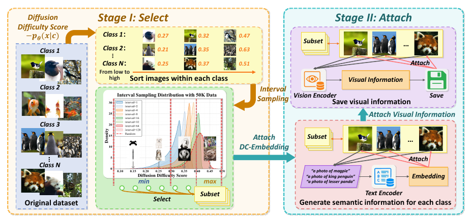

# Accelerating Diffusion Model Training under Minimal Budgets: A Condensation-Based Perspective

核对日期：2026-10-20。以下实验均为作者报告；本地完成原文阅读与讲解自检，未复现实验。

## 一句话总结

D²C先按扩散难度选择真实图像子集，再附加预训练文本与视觉表征，让从头训练的扩散模型在较少图像和更新步内获得更好结果。

## 研究背景与动机

分类数据凝练常生成强调类别判别性的合成图片，却可能损害生成模型需要的自然图像分布。作者选择真实图像的筛选与信息增强，而非直接优化像素合成训练集。[§1–3，PDF1–3]

目标扩散模型从头训练，但筛选器、T5、DINOv2和潜变量编码器等可来自预训练，因此“只用0.8%图像”不意味着整个系统只见过0.8%的知识或没有外部模型成本。

## 方法总览

Select按类给真实图像排序并间隔取样，兼顾易学与覆盖度；Attach为类别文本预存T5 embedding/mask，为图像预存DINOv2 patch特征。DC-Embedding融合文本与可学习类别条件，视觉表征作为REPA式中间层对齐目标。[Fig.2–4、§3，PDF4–6]

训练完成后生成依赖类别/文本条件；每张真实图像的视觉embedding用于训练对齐，不应在无目标图的推理中偷偷输入目标视觉特征。

图：原论文 Fig.2，PDF第4页。仅裁去页边及无关正文，图内内容未改；著作权属于原作者，用于本篇方法分析，不按本站原创图重新授权。[原文与作者信息](https://openaccess.thecvf.com/content/CVPR2026/html/Huang_Accelerating_Diffusion_Model_Training_under_Minimal_Budgets_A_Condensation-Based_Perspective_CVPR_2026_paper.html) · [PDF](https://openaccess.thecvf.com/content/CVPR2026/papers/Huang_Accelerating_Diffusion_Model_Training_under_Minimal_Budgets_A_Condensation-Based_Perspective_CVPR_2026_paper.pdf)。点击可查看高清图。

## 核心创新与关键设计

文本条件\(\widetilde t_c=Conv1d(t_c\times t_{mask})\)，\(y_{text}=MLP(\widetilde t_c)+\widetilde t_c+e_c\)。视觉对齐为
\[L_{proj}=-\frac1h\sum_i\left\langle\frac{\phi(h_i)}{\|\phi(h_i)\|},\frac{v_i}{\|v_i\|}\right\rangle,\quad L=L_{diff}+0.5L_{proj}.\]
这是训练期鼓励扩散中间token接近视觉教师特征。[式9–12，PDF5–6]

**难度分数须实现复核**：式7把负条件概率写成负噪声MSE，同时正文称低loss容易、高分困难，两者符号不一致；概率也不能直接等同未归一化MSE。基于扩散损失排序的思路可以解释，但不能把该等式当严格似然推导。[PDF4]

每类按i=0,k,2k取样，同时固定总预算时需要明确何时截断；否则小k不会自然只取“易样本”。附录采样细节未读，不能据简写公式唯一重建数据。

## 实验与关键结果

ImageNet1K取10K/50K/100K（约0.8/4/8%），256²和512²，DiT/SiT的L/2、XL/2，报告gFID等。[§4，PDF6–8]

| 作者报告 | Random | D²C |
| --- | --- | --- |
| DiT-L/2 256² 10K 100k，gFID↓ | 35.86 | 4.20 |
| DiT-L/2 同设置300k，gFID↓ | 4.19 | 4.13 |
| SiT-L/2 256² 50K 300k，gFID↓ | 14.18 | 5.66 |
| DiT-L/2 512² 10K 300k，gFID↓ | 17.1 | 5.8 |

来源Table1–2，PDF7。早期收敛收益不等于最终差距同样巨大；512² DiT300k时sFID反而12.8→15.1，SiT300k的IS316.9→289.7，也不是所有指标变好。

SiT-XL/2 10K40k步gFID4.3；Table3原SiT7M步8.3、REPA4M步5.9。7M/40k=175、4M/40k=100，正文“233×”不能由这些步数直接推出，且不是同一FID的精确达标比较。

## 消融实验与证据强度

Table5去选择和附加的基线gFID37.07，仅Select14.96，仅Attach8.79，全部7.62；视觉或DC单项10.37/9.01。[PDF8] 该消融gFID-10K与主表gFID-50K不同，勿直接串成同一曲线。

完整计时Table6：预训练筛选器评分2.1h+目标训练7.4h=9.5h，相对REPA750h约79×；自训筛选器再计26.2h，总35.5h，约21×。仅Attach7.4h、gFID5.6约101×，与完整4.3不是同一配置。T5/DINO等已有预训练成本仍应在部署预算中说明。

## 局限与讨论

小训练集上的低FID不自动排除记忆和近邻复制，应看训练/验证近邻、召回和多样性。筛选器可能偏向常见语义，长尾类别与罕见场景覆盖需另测。缓存视觉特征节省编码时间但增存储，不能把图像数量压缩率当全部数据体积压缩率。

“Minimal budgets”是相对大型扩散训练，不表示Plus会员即可本地训练这些模型；正文计时配置及全部预计算阶段还需源码核验。

## 复现提示

建议 `data/diffusion/d2c/`，先按ImageNet访问条件取得数据，不镜像。保存每类选样ID、排序分数、噪声/时间采样seed、k与预算截断规则；固定教师权重哈希、text mask、patch对应顺序与潜变量编码器。

[作者代码入口](https://github.com/xie-lab-ml/Diffusion-Dataset-Condensation)来自正文，未核验commit、许可证或运行。首先用小型获许可样例检查分数符号和索引，再考虑昂贵训练；本地只完成原文讲解和图示核对。

## 相关工作与阅读顺序

先读扩散训练目标与REPA表征对齐，再看数据pruning/condensation差别。本篇重点是Select和Attach贡献拆分，以及全流程计时；不要只记摘要的100–233×。

## 来源与校验

- [CVF 官方论文页](https://openaccess.thecvf.com/content/CVPR2026/html/Huang_Accelerating_Diffusion_Model_Training_under_Minimal_Budgets_A_Condensation-Based_Perspective_CVPR_2026_paper.html) · [所读 PDF](https://openaccess.thecvf.com/content/CVPR2026/papers/Huang_Accelerating_Diffusion_Model_Training_under_Minimal_Budgets_A_Condensation-Based_Perspective_CVPR_2026_paper.pdf)。页码均为该 PDF 的页序。
- 阅读范围：正文、公式与实验表；补充材料、上游代码与权重未逐项核验。许可证和固定代码 commit 尚未确认，不复制原文全文或数据。
- PDF SHA-256：`22b998a7949cd30b936184895fb475ad4ac3a67b2927c9c4a4eb0812fcde0d0a`；版本为本次下载的 CVF 接收稿，核对日期 2026-10-20。
- 视觉核对：PDF第4页及所引流程图已渲染检查；本地未复现实验。
