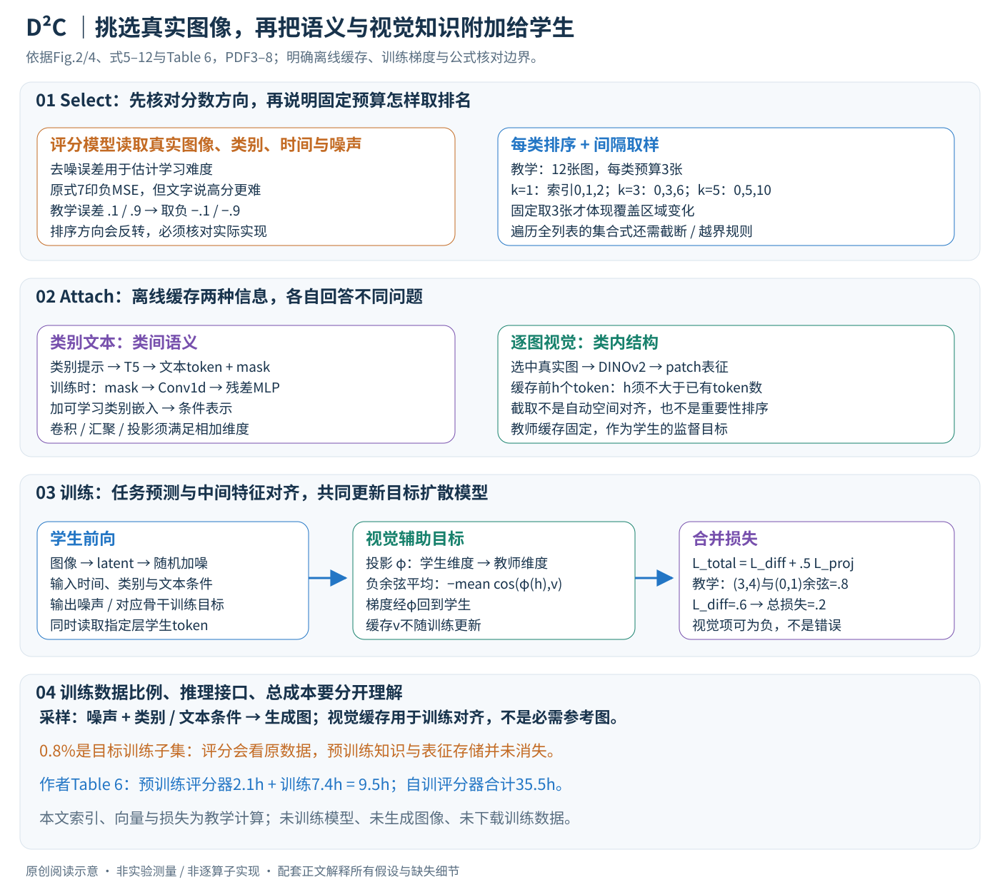

# Accelerating Diffusion Model Training under Minimal Budgets: A Condensation-Based Perspective

核对日期：2026-10-20。以下实验均为作者报告；本地完成原文阅读与讲解自检，未复现实验。

方法与配图详细版返工：2026-10-23。重读§3–4与式5–12，核对评分公式页面；扩展筛选、缓存、条件融合及梯度路径。未复现实验。

## 一句话总结

D²C先按扩散难度选择真实图像子集，再附加预训练文本与视觉表征，让从头训练的扩散模型在较少图像和更新步内获得更好结果。

## 研究背景与动机

分类数据凝练常生成强调类别判别性的合成图片，却可能损害生成模型需要的自然图像分布。作者选择真实图像的筛选与信息增强，而非直接优化像素合成训练集。[§1–3，PDF1–3]

目标扩散模型从头训练，但筛选器、T5、DINOv2和潜变量编码器等可来自预训练，因此“只用0.8%图像”不意味着整个系统只见过0.8%的知识或没有外部模型成本。

## 方法总览

### 三个阶段的角色：筛选器、离线表征、从头训练的目标模型

D²C处理的主任务是类别条件图像生成。输入完整带类别图像集 \(D\)，先用扩散模型为真实图像估计难度，再每类选取子集；为子集附加文本与视觉表征，最后从头训练目标DiT或SiT。输出不是新的合成训练图片，而是“真实子集＋缓存表征”及训练后的生成模型。（§3，PDF第3–6页）

原创图依据Fig.2、4与式5–12。排名、维度和余弦算例均用于教学，未训练扩散模型。

| 组件 | 输入与输出 | 时间位置与参数角色 |
|---|---|---|
| 扩散评分模型 | 图像、类别、噪声、时间 → 误差/排序分数 | 离线筛选；可预训练，也有单独从头训练评分器的实验 |
| T5类文本编码器 | 类别提示 → token与mask | 离线编码、缓存；不同类别共享同一编码器 |
| DINOv2类视觉编码器 | 每张选中图像 → patch表征 | 离线缓存、作为后续对齐目标 |
| DC-Embedding | 文本token＋mask＋可学习类别嵌入 → 条件表示 | 目标模型训练期间学习融合 |
| 目标DiT/SiT及投影头 | 带噪latent＋时间＋条件 → 预测与中间token | 从头优化目标模型，不等于所有外部模型从头训练 |

“0.8%图像”描述目标训练集的大小。评分需要访问原始数据，表征包含预训练知识，缓存占用空间，不能据此声称总知识、总计算或总存储都降至0.8%。

## 核心创新与关键设计

### Select第一步：用去噪任务衡量样本，而非只用分类特征距离

作者先从贝叶斯公式出发：

\[
p_\theta(c\mid x)=\frac{p_\theta(x\mid c)p(c)}{\sum_{\widehat c}p_\theta(x\mid\widehat c)p(\widehat c)}.
\]

若类别先验均匀，且分母随样本变化足够小，则可近似用类条件似然比较分类后验。这个近似需要额外的数据假设，均匀采样类别本身并不能保证分母恒定。不同样本总似然差异大时，省略分母可能改变排序。（式5–6，PDF第3–4页）

实际评分借助扩散模型的去噪误差。为了理解如何计算，可以将一次评分写成以下**教学估计式**：

\[
\widehat L(x,c)=\frac1K\sum_{j=1}^K
\|\epsilon_j-\epsilon_\theta(x_{t_j},t_j,c)\|_2^2.
\]

取若干时间与高斯噪声，将图像/latent加噪，由固定评分器预测噪声，再平均误差。\(K\)越小计算便宜但估计波动可能更大；时间、种子、分辨率、归一化均会影响分数。正文未充分列出实际 \(K\) 与完整评分配置，这里不擅自赋值。

**需要保留原文的符号问题。**式7印为负后验、负似然并进一步等于负的噪声均方误差，而文字又说“高分更难”且Fig.3使用低loss表示容易。对于普通正MSE，误差0.1与0.9取负后变成−0.1与−0.9，升序会先选误差0.9的图，这与“升序从容易开始”相反。此外似然、对数似然界与未经加权的去噪MSE也不是严格相等。本文据正文意图解释“按去噪难度排序”，但不默默把印刷等式改成已经验证的实现；复现必须核对实际评分函数和排序方向。（式7原PDF第4页已视觉核对）

### Select第二步：按类别排名隔开取样，平衡易学性与覆盖

原文对每类 \(D_y\) 排序，再以索引 \(0,k,2k,\ldots\) 取样。只取最容易的图，常集中于背景干净、主体清晰的样本；只取最难的图，则可能偏向杂乱或模糊样本。间隔取样意在覆盖更多难度区域。它是排名轴上的覆盖，不是对视觉语义多样性的数学保证。（§3.1、Fig.3，PDF第4–5页）

固定预算时必须同时说明每类取多少张。教学例：某类12张图按难度排序，预算3张；若从头按步长取3个索引，\(k=1\)得到0、1、2，\(k=3\)得到0、3、6，\(k=5\)得到0、5、10。这样步长越大，覆盖到越难的排名区域。反之，若不限制数量，遍历全列表每隔1张取样就得到全部12张，无法解释“k=1偏向最容易的固定预算子集”。

因此本文区分原文写出的集合公式与固定预算实验的直觉解释；每类预算分配、索引越界、舍入及截断的实际规则应核对实现/补充材料。主文没有完整给出，不能把上述教学例冒充作者算法。实验在10K预算报告最佳k=96、50K预算k=16，也不能泛化为任意数据集的固定推荐值。（Fig.6、§4.3，PDF第7–8页）

### Attach文本分支：固定语义与可学习类别表示一起使用

每个类别生成简短提示，例如“a photo of a cat”，由预训练文本编码器得到 \(t_c,t_{\rm mask}\)，缓存到磁盘。训练时作者使用：

\[
\widetilde t_c=\operatorname{Conv1d}(t_c\odot t_{\rm mask}),\qquad
 y_{\rm text}=\operatorname{MLP}(\widetilde t_c)+\widetilde t_c+e_c.
\]

\(t_{\rm mask}\)遮掉无效/补齐token，Conv1d将文本表示处理到后续条件接口，MLP做可学习变换，残差保留文本通路，\(e_c\)为从头学习的类别嵌入。文本先验帮助类别之间建立已有语义结构，类别嵌入仍可适应目标训练数据。二者不是把类别号直接拼成一句自然语言。（式8–9、Fig.4，PDF第5页）

如果教学文本张量是 \(L\times d_{\rm text}\)，mask可按 \(L\times1\) 广播；相加的三个分支必须落到兼容形状。作者图里还显示projector，但正文没有完整写出卷积通道顺序、序列汇聚及每层宽度。因此不应只看到Conv1d就断言它自动将任意 \(L\times d\) 变成一个固定长度向量，也不补猜所有参数。

每类提示相同意味着文本缓存主要提供类间语义，而不能独自区分同类图像中不同背景、姿态与布局。这正是另设视觉分支的原因。

### Attach视觉分支：教师patch表征作为训练目标，不是采样时必需的参考图

对于真实选中图像 \(x\in\mathbb R^{3\times H\times W}\)，视觉编码器给出：

\[
y_{\rm vis}=f_{\rm vis}(x)\in\mathbb R^{N\times d_{\rm vis}},
\qquad y_{\rm vis}\leftarrow y_{\rm vis}[:h,:].
\]

正文保留前 \(h\) 个token，\(h\)对应扩散Transformer的token数量。要使截取成立至少需要 \(N\ge h\)，但截取不会自动保证两个模型patch网格在空间上一一对齐。输入缩放、patch大小、CLS是否计入及对齐规则都应核对，不能把“取前h个”描述为已学习的最重要区域选择。（式10，PDF第5页）

例如**教学尺寸**中教师有256个patch，每个768维，而扩散特征有256个token、每个1024维，则缓存是 \(256\times768\)，投影头将每个学生token从1024维映射到768维，之后逐token比较。若教师只有196个token，直接截取前256个不会凭空产生256个；需要另行明确处理，主文不能提供这个缺失步骤的唯一答案。

### 两项训练目标怎样共同更新学生

目标扩散模型从选中图像采样带噪latent，用类别与文本条件预测噪声：

\[
L_{\rm diff}=\mathbb E\|\epsilon-\epsilon_\theta(x_t,t,y,y_{\rm text})\|_2^2.
\]

这是§3.3以噪声预测举的例子。SiT的flow/velocity预测不能不加区分地声称与这个噪声目标逐字相同；具体目标须随骨干训练方式核对。

视觉项从一个指定中间层提取学生token \(h_i\)，用投影头 \(\phi\)映射到教师维度：

\[
L_{\rm proj}=-\frac1h\sum_{i=1}^{h}
\frac{\phi(h_i)^\top v_i}{\|\phi(h_i)\|_2\|v_i\|_2},
\qquad L_{\rm total}=L_{\rm diff}+0.5\,\mathbb E[L_{\rm proj}].
\]

最小化负余弦等价于鼓励特征方向一致。教师缓存是固定目标，梯度通过投影头回传学生中间层；不会通过磁盘中的教师向量去更新离线视觉编码器。去噪项继续约束生成任务，避免把目标误解为只模仿DINO特征。投影层选在哪、归一化遇零范数如何处理都需要实现细节，正文公式没有提供全部答案。（式11–12，PDF第6页）

教学例：投影后学生向量 \((3,4)\)，教师 \((0,1)\)，余弦为0.8，视觉项为−0.8。如果去噪损失是0.6，加权总损失为0.2。学生方向完全一致时视觉项可到−1，总损失甚至可能为负；这不表示损失实现错误。该项主要约束方向，不单独惩罚向量模长。

### 一次训练步和一次生成分别需要什么

离线先得到子集、类别文本缓存、逐图视觉缓存。训练时取图像与类别，读取对应缓存，编码latent并随机加噪；DC-Embedding构造条件，学生前向同时产生任务预测与中间token；计算去噪损失和对齐损失后更新学生、条件融合模块及投影头。教师编码无需每步重新运行，这是Attach缓存的实际价值。

生成时从噪声出发，由类别及对应文本条件迭代采样，再解码图像。本文视觉缓存是在训练时当对齐目标，式11不能被解释成生成每张图还必须提供训练图的DINO特征。正文未完整列出投影头推理时的执行安排；应核对实现是否移除无用辅助分支，而不是臆造推理加速数据。

### 成本、消融与效果的适用范围

Table 5中仅Select将gFID从37.07改善为14.96；在Select基础上，附加视觉为10.37，附加DC-Embedding为9.01，两者为7.62。只Attach、不Select为8.79，说明收益不能全部归因于“挑好图”。这些是同一消融设置的作者报告，不应与不同CFG、分辨率或评估样本数的主表直接拼接。（PDF第8页）

Table 6把成本拆开：预训练评分器时2.1小时评分＋7.4小时目标训练＝9.5小时，相对750小时基线约79倍；自训评分器时还需26.2小时，总35.5小时，约21倍。底座预训练与表征缓存等成本的核算边界也应说明，不能把单纯目标训练步数比直接称作全部成本节省。Table 3的7M/40K为175，而不是233；对宣传倍率应保留比较对象和分母，不能用标题数字覆盖表格算术。（§4.2–4.3、Table 3、6，PDF第7–8页）

复现首先应核对评分符号、每类截断规则、教师token与学生网格对应、缓存精度、条件融合形状、完整训练/评估预算。当前只重读主文并核对关键页面；文中引用的附录未作为已读实现证据，没有运行训练、生成图像或下载数据。

## 实验与关键结果

ImageNet1K取10K/50K/100K（约0.8/4/8%），256²和512²，DiT/SiT的L/2、XL/2，报告gFID等。[§4，PDF6–8]

| 作者报告 | Random | D²C |
| --- | --- | --- |
| DiT-L/2 256² 10K 100k，gFID↓ | 35.86 | 4.20 |
| DiT-L/2 同设置300k，gFID↓ | 4.19 | 4.13 |
| SiT-L/2 256² 50K 300k，gFID↓ | 14.18 | 5.66 |
| DiT-L/2 512² 10K 300k，gFID↓ | 17.1 | 5.8 |

来源Table1–2，PDF7。早期收敛收益不等于最终差距同样巨大；512² DiT300k时sFID反而12.8→15.1，SiT300k的IS316.9→289.7，也不是所有指标变好。

SiT-XL/2 10K40k步gFID4.3；Table3原SiT7M步8.3、REPA4M步5.9。7M/40k=175、4M/40k=100，正文“233×”不能由这些步数直接推出，且不是同一FID的精确达标比较。

## 消融实验与证据强度

Table5去选择和附加的基线gFID37.07，仅Select14.96，仅Attach8.79，全部7.62；视觉或DC单项10.37/9.01。[PDF8] 该消融gFID-10K与主表gFID-50K不同，勿直接串成同一曲线。

完整计时Table6：预训练筛选器评分2.1h+目标训练7.4h=9.5h，相对REPA750h约79×；自训筛选器再计26.2h，总35.5h，约21×。仅Attach7.4h、gFID5.6约101×，与完整4.3不是同一配置。T5/DINO等已有预训练成本仍应在部署预算中说明。

## 局限与讨论

小训练集上的低FID不自动排除记忆和近邻复制，应看训练/验证近邻、召回和多样性。筛选器可能偏向常见语义，长尾类别与罕见场景覆盖需另测。缓存视觉特征节省编码时间但增存储，不能把图像数量压缩率当全部数据体积压缩率。

“Minimal budgets”是相对大型扩散训练，不表示Plus会员即可本地训练这些模型；正文计时配置及全部预计算阶段还需源码核验。

## 复现提示

建议 `data/diffusion/d2c/`，先按ImageNet访问条件取得数据，不镜像。保存每类选样ID、排序分数、噪声/时间采样seed、k与预算截断规则；固定教师权重哈希、text mask、patch对应顺序与潜变量编码器。

[作者代码入口](https://github.com/xie-lab-ml/Diffusion-Dataset-Condensation)来自正文，未核验commit、许可证或运行。首先用小型获许可样例检查分数符号和索引，再考虑昂贵训练；本地只完成原文讲解和图示核对。

## 相关工作与阅读顺序

先读扩散训练目标与REPA表征对齐，再看数据pruning/condensation差别。本篇重点是Select和Attach贡献拆分，以及全流程计时；不要只记摘要的100–233×。

## 来源与校验

- [CVF 官方论文页](https://openaccess.thecvf.com/content/CVPR2026/html/Huang_Accelerating_Diffusion_Model_Training_under_Minimal_Budgets_A_Condensation-Based_Perspective_CVPR_2026_paper.html) · [所读 PDF](https://openaccess.thecvf.com/content/CVPR2026/papers/Huang_Accelerating_Diffusion_Model_Training_under_Minimal_Budgets_A_Condensation-Based_Perspective_CVPR_2026_paper.pdf)。页码均为该 PDF 的页序。
- 阅读范围：正文、公式与实验表；补充材料、上游代码与权重未逐项核验。许可证和固定代码 commit 尚未确认，不复制原文全文或数据。
- PDF SHA-256：`22b998a7949cd30b936184895fb475ad4ac3a67b2927c9c4a4eb0812fcde0d0a`；版本为本次下载的 CVF 接收稿，核对日期 2026-10-20。
- 视觉核对：PDF第4页及所引流程图已渲染检查；本地未复现实验。
