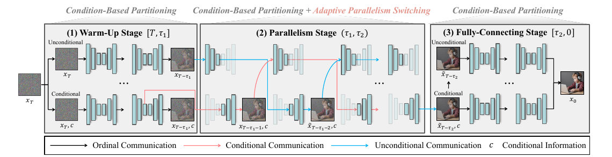
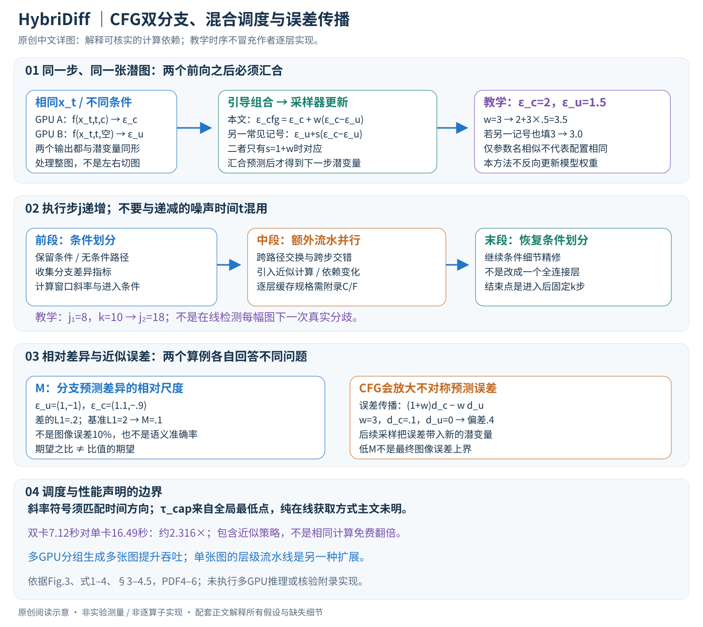

# Accelerating Diffusion via Hybrid Data-Pipeline Parallelism Based on Conditional Guidance Scheduling

核对日期：2026-10-21。实验数值均为作者报告；本地完成原文阅读与讲解自检，未复现实验。

方法与配图详细版返工：2026-10-25。展开CFG记号、分支汇合、调度判据与误差传播；未复现实验。

## 一句话总结

Hybridiff把CFG的条件与无条件分支分给不同GPU，并在去噪中段切换到近似异步流水线，减少单张条件扩散生成的延迟。

## 研究背景与动机

常规图像切块并行需要跨patch通信，异步逐层计算又可能传播陈旧特征误差。CFG天然包含覆盖整幅图像的两个预测分支，因此作者以条件分支代替空间patch作为划分单位，再利用两分支差异较小的中段减少依赖等待。[§1–2，PDF1–3]

“两卡超过两倍”不是相同精确计算的免费超线性扩展：中段采用近似调度，生成结果会偏离原单卡输出，必须连同保真与硬件条件评价。

## 方法总览

原论文 Fig.3，PDF第4页。仅裁切相关图示，保留图内科学标签，著作权属于原作者；用于本篇方法分析，不并入本站原创图授权。[来源与作者](https://openaccess.thecvf.com/content/CVPR2026/html/Jung_Accelerating_Diffusion_via_Hybrid_Data-Pipeline_Parallelism_Based_on_Conditional_Guidance_CVPR_2026_paper.html) · [PDF](https://openaccess.thecvf.com/content/CVPR2026/papers/Jung_Accelerating_Diffusion_via_Hybrid_Data-Pipeline_Parallelism_Based_on_Conditional_Guidance_CVPR_2026_paper.pdf)。点击可打开高清图。

### 先明确计算单位：同一潜变量的两个条件分支

输入是初始噪声潜变量xT、文本条件c、预训练去噪模型、采样器以及若干GPU；输出仍是一张生成图。以通用批维B、潜通道C、空间h×w表示，\(x_t\in\mathbb R^{B\times C\times h\times w}\)，条件与无条件预测均与x同形。这里不能把SDXL和SD3的潜通道数、图像到潜空间缩放、文本token接口混写成统一常数，主文没有给出完整部署张量规格。（§3–4.1，PDF第4–5页）

两分支可共享相同的模型权重定义，却读取不同条件。它们都处理整幅潜图；按条件拆分不同于一张卡只读左半图、另一张卡只读右半图。本文是预训练模型的推理调度，不需要通过本方法重新训练骨干，采样时也没有反向传播更新模型权重。

原创图只表达主文可核实的分支依赖和调度边界；中段每层缓存、通信时序和张量对应关系未在主文完整给出，不把示意图冒充可执行流水线。

## 核心创新与关键设计

### 精确CFG分支并行：并发前向后仍有汇合点

同一步t读取同一个x_t，分别得到 \(\epsilon_c=f_\theta(x_t,t,c)\) 和 \(\epsilon_u=f_\theta(x_t,t,\varnothing)\)。论文采用的CFG记号是

\[
\epsilon_{cfg}=\epsilon_c+w(\epsilon_c-\epsilon_u)=(1+w)\epsilon_c-w\epsilon_u.
\]

很多实现写 \(\epsilon_u+s(\epsilon_c-\epsilon_u)\)，二者需令s=1+w才相同；不能把数值相同的w和s直接代入两个公式比较质量。本文公式中无引导的条件预测对应w=0。（§3，PDF第4页）

教学单元素例：条件预测2、无条件预测1.5，取w=3，则CFG为3.5；若套另一记号并仍填3，结果为3，已改变生成轨迹。真实计算对整个张量逐元素执行。

精确两卡版本可并发执行两个前向，但形成下一潜变量前仍要汇合两份预测，再由同一采样器更新x。主文给DDPM形式的均值

\[
\mu_{cfg}=\frac1{\sqrt{\alpha_t}}\left(x_t-\frac{\beta_t}{\sqrt{1-\bar\alpha_t}}\epsilon_{cfg}\right).
\]

该式说明噪声预测如何影响更新，不等于本文所有SDXL/SD3实验都采用这个DDPM更新。具体求解器、随机噪声和步长另需配置核对。仅拆CFG分支不应凭空引入算法近似，但不同数值实现、采样状态或实验配置也可能造成差别；Table2“仅条件划分”与单卡仍有非零FID，不能用理论上的精确分支并行替论文实验宣称逐位一致。

### 为什么再加流水线：吞吐与单步依赖不是一回事

单卡串行两前向若各耗时C，理想计算部分约2C；两卡同时计算约C，还要加交换/同步开销。真实单卡可能把两分支合批运行，其成本不一定是2C，因此这个表达只是解释上限来源，不是测量模型。

中段启用额外并行切换，原图用跨条件路径的信息传递和跨步交错减少等待；与前后段仅按条件划分的策略不同。网络分层后设备各持部分参数，跨层激活和不同去噪步的依赖共同决定流水线。本文把实现结构及算法留在附录C/F；主文没有充分展开某设备在某时刻到底读取当前步还是旧步的哪一层缓存。因此可以解释采用近似调度降低依赖等待的目的，但不能编出一套逐层伪代码当作者算法。（Fig.3、§4.1、§4.5）

### 分支差异指标：比的是预测，不是图像语义评分

\[
M_t=\frac{\mathbb E\|\epsilon_c(x_t,t)-\epsilon_u(x_t,t)\|_1}
{\mathbb E\|\epsilon_u(x_t,t)\|_1}.
\]

分子衡量两分支差，分母用无条件预测尺度归一化。它是“期望之比”，一般不等于“逐样本比值的平均”；式1中的期望如何在单样本在线推理里估计，主文未给完整归约与稳定常数规则。无条件预测范数很小时，比例会敏感，不能悄悄添加某个epsilon后声称完全照论文。

教学二元素例：\(\epsilon_u=(1,-1)\)、\(\epsilon_c=(1.1,-0.9)\)，差的L1和为0.2、基准为2，因此单样本对应比例0.1；若两边都取元素均值，比例不变。这里的0.1既不是图像误差10%，也不是条件信息有10%的概率正确。Flow matching可把噪声预测替换为同形速度预测，仍须使用对应流模型的采样更新，不能套DDPM均值。（式1、§4.3，PDF第5–6页）

### 三阶段时间轴：进入点自适应，退出点固定时长

前段Warm-Up建立粗结构，中段Parallelism启用更强并行，末段Fully-Connecting回到条件划分做细节精修。末段名称不是把网络替换成全连接层，也不意味着只剩一个普通线性层。作者对5000条COCO提示观察到两分支差异大致呈U形，是所测设置下的经验，不是所有提示和模型的必然规律。（Fig.4、§4.2）

进入点使用最近L步的平均斜率：

\[
G_t=(M_t-M_{t-L})/L,\quad
\tau'_1=\min\{t:0\le G_t<g_{slope}\},\quad
\tau_1=\min(\tau'_1,\tau_{cap}).
\]

主文同时以T→0表示扩散时间，却以\(\tau_2=\tau_1+k\)表示向后推进k步。实现应先区分递减噪声时间t与递增执行步j。若在递增步j上曲线从0.4降到0.2，L=2时斜率是−0.1，不满足文中非负判据；因此不能把这条不等式直接解释成“检测到下降变缓”。时间方向、符号和判断顺序需要附录/代码确认，本文保留原式并指出歧义。

\(\tau_{cap}\)被定义为整条差异曲线的全局最低点。若要对当前样本完全在线选择，在未来还未计算前不能直接知道全局最低点；是否预校准、用参考曲线或别的估计，主文没有讲清。将cap写作已知输入是一个额外前提，不能作为在线能力已被证明的依据。（式2、PDF第6页）

中段作者称两分支趋为相同值，原差异统计失去意义，因此退出不再检测真实分歧，而是设为进入后固定k步。用教学执行步j描述：若j1=8、k=10，则第18步附近返回末段，具体边界是否含端点需统一实现；不是每幅图自动找到最优中段长度。k越大通常更快但更偏离参考输出。（式3、Fig.6）

### 小分支差不等于小生成误差：引导尺度会放大近似

设某次近似只使条件预测增加扰动d，而无条件预测不变，则CFG误差是\((1+w)d\)。教学w=3、d=0.1，单元素引导预测已经偏0.4；若两分支误差分别为dc、du，则为\((1+w)dc-wdu\)，可能相消也可能相加。后续采样器还会把这份误差带入下一步x，改变之后全部预测。因此低M只是一项调度线索，不是最终图像误差上界。

式4通过贝叶斯分数分解解释条件影响：\(\nabla_x\log p(x|c)=\nabla_x\log p(x)+\nabla_x\log p(c|x)\)。在对应噪声与score尺度转换假设下，分支差可联系条件梯度。这个分解有助于理解比例，但“两个范数相近”本身不推出它们的比值时间导数为零；主文的中段解释应视为启发式，不是完整稳定性定理。（§4.4，PDF第6页）

### 实际复现流程与多卡边界

先固定模型、文本编码、VAE、种子、采样器和CFG记号；建立单卡参考，再做精确双分支并行基线，最后才启用混合切换。记录进入点、cap来源、L、斜率阈值、k、每阶段执行步、通信字节、端到端延迟及与参考的偏差。本文没有执行多GPU生成，也未核对附录中的逐层缓存算法，不能提供经过验证的启动参数。

多卡有两种不同扩展：N张卡分成N/2对并行生成多张图，主要提升吞吐；或者把单图任务分成更多层级流水段，才涉及单样本延迟。前者不能用于声称单图随GPU数线性加速。模型权重、激活缓存和通信缓冲占显存，主文未给足以据此推算所有设备峰值显存的细节。（§4.5）

教学资源核算：Table1单卡SDXL16.49秒、两卡7.12秒，墙钟加速约2.316倍；若粗略按占用GPU数×墙钟计算，分别16.49与14.24 GPU秒，但这既不是实测能耗，也不含利用率和功率。两卡超过两倍来自包含近似计算与调度变化的整体方案，不能解释成完全相同计算免费获得超线性硬件收益。

## 实验与关键结果

MS-COCO2014验证集5000提示，SDXL与SD3；摘要主要计时为RTX3090，多分辨率另用两张H200。更多采样与通信设置在未读附录G。[§5，PDF7–8]

| 作者报告 | 单卡秒 | 本文两卡秒/加速 | 本文四卡秒/加速 |
| --- | --- | --- | --- |
| SDXL | 16.49 | 7.12 / 2.31× | 4.83 / 3.41× |
| SD3 | 19.36 | 9.33 / 2.07× | 5.53 / 3.50× |

来源Table1，PDF7。两卡SDXL相对原输出FID4.100、LPIPS0.107、PSNR26.640；这些衡量接近原模型，不是直接衡量图像真实正确性。与真实COCO图像的FID则23.977→23.831，两个FID口径不能混用。

四卡SD3的AsyncDiff stride2为3.98×，高于本文3.50×，但相对原输出FID8.939也差于本文2.109；本文不是所有配置绝对最快。通信量0.189GB低于AsyncDiff1.290GB，但高于Parastep0.032GB，也非所有方法最少通信。

## 消融实验与证据强度

两卡SDXL仅条件划分9.24秒、1.78×、相对原输出FID3.623；加入混合调度7.12秒、2.31×、FID4.100。[Table2，PDF7] 更快的代价是偏离原模型略大。

k=5/10/20/30对应速度与质量折中；自动进入点不消除固定k的调参。高分辨率H200实验正文报告1024²/2048²/2560²加速2.72/1.54/1.62×，硬件和分辨率不同，不能从3090结果承诺任意分辨率都超两倍。[Fig.6–7，PDF8]

## 局限与讨论

两条件分支适用于CFG类管线；无CFG、单次预测蒸馏模型或分支代价明显不对称时需重设计。通信拓扑、GPU显存、层切分和同步开销决定收益，增加设备也增加总体资源投入。

局部分数解释没有给出任意模型、提示和采样器的误差上界；分支低差异也不保证后续误差不会放大。正文未充分交代在线τcap、精确中段算子和后验数据校准边界，本地不宣称实现可直接复现。

## 复现提示

先固定[作者代码入口](https://github.com/kaist-dmlab/Hybridiff)的版本与许可证，确认τcap来源、k、CFG尺度、采样步数、随机seed与两卡互联。对相同输入分别测单卡、精确CFG分支并行、近似混合并行，报告时延、通信、总GPU秒及相对原输出的差异。

建议 `experiments/diffusion/hybridiff/`；论文权重与COCO图像不纳入仓库。本次未核验上游commit、附录或执行多GPU推理，表中结果全部为作者报告。

## 相关工作与阅读顺序

先读CFG的双分支预测，再看DistriFusion、AsyncDiff以及“吞吐量”和“单样本延迟”的区别，最后核对§4.3的实际调度与Table2。不要只根据“adaptive”把整个调度描述成免超参在线算法。

## 来源与校验

- [CVF官方论文页](https://openaccess.thecvf.com/content/CVPR2026/html/Jung_Accelerating_Diffusion_via_Hybrid_Data-Pipeline_Parallelism_Based_on_Conditional_Guidance_CVPR_2026_paper.html) · [所读PDF](https://openaccess.thecvf.com/content/CVPR2026/papers/Jung_Accelerating_Diffusion_via_Hybrid_Data-Pipeline_Parallelism_Based_on_Conditional_Guidance_CVPR_2026_paper.pdf)。页码均为PDF页序。
- 所读版本：2026-10-21从CVF下载的开放接收稿；PDF SHA-256：`2340159ec2f5bc3409e046f3a2d68a39402e11130db8cd16cb551c37d7684a36`。
- 阅读范围：正文、方法公式、实验与消融；补充材料、代码及权重未逐项核验。reviewed表示本地讲解自检，不表示独立同行评审或实验复现。
- 关键公式/算法/表格页面已渲染核对，所引原图已单独检查；作者图示与本站原创素材权利分开记录。

- 2026-10-25详细版：重读PDF第4–6页并渲染Fig.3/CFG公式；原创图上下半部与文章浏览器检查通过，15个公式，无渲染错误、坏图或横向溢出。
