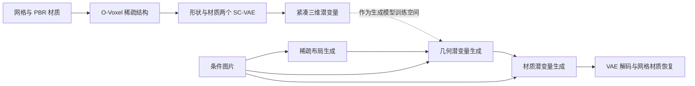

# Native and Compact Structured Latents：直接压缩三维资产

论文：**Native and Compact Structured Latents for 3D Generation**，Jianfeng Xiang、Xiaoxue Chen、Sicheng Xu 等，CVPR 2026，14419–14429 页。完整作者见官方页及 manifest。

[官方论文页](https://openaccess.thecvf.com/content/CVPR2026/html/Xiang_Native_and_Compact_Structured_Latents_for_3D_Generation_CVPR_2026_paper.html) · [原文 PDF](https://openaccess.thecvf.com/content/CVPR2026/papers/Xiang_Native_and_Compact_Structured_Latents_for_3D_Generation_CVPR_2026_paper.pdf)

分类：生成模型 / 3D 资产 / 稀疏体素 / PBR 材质。最后核对：2026-10-19。正文阅读与讲解自检完成，未运行代码、未复现实验。页码使用 PDF 页码。最佳学生论文奖依据[大会官方公告](https://cvpr.thecvf.com/Conferences/2026/News/Closing)。

## 一句话总结

先把网格几何与材质直接编码为 O-Voxel 稀疏三维结构，再用高压缩 VAE 学习紧凑潜变量，使图像到三维生成能同时处理复杂拓扑与 PBR 材质，并减少生成模型需要处理的 token。

## 研究背景与动机

漂亮的多视图渲染不等于完整三维资产：开放薄片、非流形交叉结构、封闭物体内部，以及金属度、粗糙度等材质参数，可能在外观上被掩盖。依赖符号场提取等值面的方法，通常还会给表面拓扑附加限制；从多张图片提取潜变量又可能丢掉从外面看不到的结构。[§1–2，PDF 1–3]

这篇论文尝试同时改善两个问题：**表示能保留什么信息，潜变量要花多少计算表示它**。这里的 native 指直接来自三维几何与材质的编码，不意味着训练中完全不使用二维渲染监督；第二阶段 VAE 训练明确加入渲染损失。

## 方法总览

依据 Fig.2 与 §3 重绘，图区分资产编码路径和条件生成路径，不表示推理时需要输入目标网格。给定已有形状时，材质生成阶段也能独立使用。

## 核心创新与关键设计

### 1. O-Voxel 不要求先构建符号距离场

O-Voxel 在稀疏体素中保存几何特征、材质特征和网格坐标：

\[
f=\{(f_i^{shape},f_i^{mat},p_i)\}_{i=1}^{L}.
\]

只有与表面相关的体素激活。几何使用 Flexible Dual Grid：体素内放置 dual vertex，原始网格边与表面的相交标记决定相邻 dual vertex 是否连成面，再通过权重拆分四边形。[§3.1，PDF 3–4]

与依赖符号变化的 Dual Contouring 相比，这里直接从输入网格三角面计算交点与法线，不先要求一个全局内外符号场。这解释了为什么开放面和内部结构更容易被保留。它并非无限分辨率的无损编码；细于体素尺度的结构仍可能受到离散化影响。

dual vertex 的求解包含三类误差：到交点切平面的距离、到网格边界边的距离，以及到交点平均位置的正则。可写成解释性的形式：

\[
E(v)=\sum_i[n_i^\top(v-q_i)]^2
+\lambda_{bound}\sum_j d(v,\ell_j)^2
+\lambda_{reg}\|v-\bar q\|^2.
\]

第一项贴合表面，第二项照顾开放边界，第三项稳定病态情形。该式对应原文式2，细节与权重需以实现和补充材料为准，不能仅靠这段解释重建完整转换器。

### 2. 材质与几何处于同一个三维空间

每个激活体素的材质是六通道：RGB 基色、金属度、粗糙度、不透明度。输入时从相交面的纹理采样，输出时在表面位置对邻近体素属性做三线性插值。[§3.1.2，PDF 4]

保存材质参数有助于重新打光，区别于只存一张已带阴影的颜色图。但包含 alpha 不等于已经恢复任意真实介质的完整光学模型，复杂折射、散射仍不能由六个通道自动保证。

### 3. Sparse Compression VAE 压缩空间并保留稀疏结构

SC-VAE 使用稀疏卷积，而非让大量体素全部参与全局 Transformer。降采样捷径将子体素特征搬到通道、分组平均；上采样做对应的通道复制与空间重排。学习分支再修正这种粗估计，减轻高压缩下的优化困难。[§3.2，PDF 4–5]

上采样前先预测哪些子体素有效，以跳过空区域；残差块减少卷积，加入逐点 MLP。**16× 是每个空间轴的降采样倍率，不等于 token 总数或文件体积一定减少16倍**。表面稀疏性与通道宽度都会影响实际存储。1024³ 配置约 9.6K token、每 token 32 维；不能只比较 token 数而忽略每 token 维度。

VAE 分两阶段训练：先直接重建 O-Voxel 并施加 KL 正则，再加 mask、深度、法线和材质渲染监督。摄像机浅近裁剪面会切进表面，用于监督内部结构。形状与材质使用解耦 VAE，材质解码的细分结构受形状解码约束。[§3.2.2，PDF 5]

### 4. 三阶段生成而非单模型一次吐出全部资产

流程为稀疏布局 → 几何潜变量 → 材质潜变量，使用 flow matching DiT；材质阶段同时以图像与几何潜变量为条件。图像特征来自 DINOv3-L。三个 DiT 各约 1.3B 参数，合计约 4B。[§3.3、§4，PDF 5–6]

这里“统一三维潜变量域”不表示所有阶段没有分工，也不等于整套系统只有一个 1.3B 模型。

## 实验与关键结果

Table 1（PDF 8）分别评价包含内部结构的双向 point-to-mesh 距离 MD，以及只从可见外表面采样的 CD，并用法线渲染评价表面质量。下表摘选 Toys4K 的重建结果；MD 数值按论文表头乘 \(10^6\) 显示，越低越好。

| 方法 | token（总维数） | 解码秒↓ | MD↓ | 法线 PSNR↑ | 法线 LPIPS↓ |
| --- | ---: | ---: | ---: | ---: | ---: |
| TRELLIS | 9.6K（77K） | 0.108 | 85.07 | 30.29 | 0.067 |
| SparseFlex 1024 | 225K（1799K） | 3.21 | 0.3132 | 37.34 | 0.042 |
| 本文 1024 | 9.6K（306K） | 0.301 | 0.0042 | 43.11 | 0.005 |

它比 SparseFlex 更紧凑且更快，但相对 TRELLIS，token 数相同而通道总维数更高、解码也更慢，换来了更好的重建。**VAE 解码时间不是完整图像到三维生成耗时**。

生成评估使用 100 张 AI 生成图像作为提示，并进行了约 40 人的偏好研究。Table 2（PDF 8）报告本文 CLIP 0.894、ULIP-2 0.477、Uni3D 0.436；Hunyuan3D 2.1 分别为 0.869、0.474、0.427。本文在该用户研究中的 Pref 为 66.5%，其余为其他模型的选择份额。[§4.2，PDF 6–8]

这支持这些提示和评价条件下的优势，但不是任意输入都成功的概率，也不是对真实工业资产可编辑性、物理精度的直接测量。材质重建的 PSNR / LPIPS 只报告本文，没有对应基线，不能虚构比较增益。[§4.1，PDF 6]

## 消融实验与证据强度

Table 3 在 **256³ 的精选 Sketchfab 资产**上比较架构，不能和上表的 1024 配置直接混合：

- 16× 压缩，去掉 Residual AE，MD 从 1.032 升到 1.747，法线 PSNR 从 27.26 降到 26.73。
- 32× 压缩，去掉 Residual AE，MD 从 1.405 升到 7.394，说明更强空间瓶颈下该设计尤其重要。
- 改回标准残差块，MD 从 1.032 升到 1.198，解码约从 28.6 ms 到 29.6 ms，支持质量改善并未明显增加该设置下的延迟。

递归增加测试时计算量和分辨率的效果主要见 Fig.8 的定性结果。[§4.5，PDF 8] 不应把它扩大为超出训练范围后所有资产都稳定提升的保证。

## 局限与讨论

正文没有独立 limitations 小节，以下为本讲解分析。体素离散化、薄结构与一个单元内多层表面的表达能力仍需按实际分辨率验证；“任意拓扑”描述表示方式的适用范围，不等于所有复杂输入都能精确重建。单图生成无法观测的背面和内部结构仍由先验补全，不能当作测量得到的真值。

评估包含 Toys4K、90 个复杂材质测试资产和100张生成提示；这些规模与分布不足以替代全面部署测试。论文前文的 H100 生成速度举例，与实验章节称所有 runtime 使用 A100 存在上下文差异，比较速度必须保留设备、分辨率和阶段。本笔记不把这些数字合并成统一硬件性能承诺。

## 复现提示

SC-VAE 数据采用过滤掉无 PBR 材质资产的 Trellis-500K 设置，来自 Objaverse-XL、ABO、HSSD；VAE 使用16张 H100，batch128。生成训练扩展至约80万资产，加入 TexVerse；每个资产用 Blender 渲染16个随机视角/光照条件。DiT 训练使用32张 H100、batch256，AdamW 学习率 \(10^{-4}\)、weight decay0.01、条件丢弃率0.1。[§4，PDF 6]

输入资产能公开下载不等于可统一再分发，应逐项核查许可证。本文首页称项目开源，但本轮未核验代码仓库、权重、许可证、commit、转换器实现和实际显存，均不标记运行通过。若准备复现，先在少量开放面、封闭内层、薄片和透明材质样例上分别验证 O-Voxel 往返，再测试 VAE 与完整生成链路。

## 相关工作与阅读顺序

Dual Contouring 帮助理解 dual vertex 与 Hermite 数据；FlexiCubes 帮助理解灵活拆分；TRELLIS 帮助理解稀疏三维潜变量的生成流程；DC-AE 帮助理解高压缩残差自编码思想。本文贡献不是简单把它们串起来，而是围绕 native 几何与材质设计表示，再匹配压缩器和生成器。

建议 Fig.3 → §3.1 → Fig.4 与 §3.2 → §3.3 → Table 1 的距离定义 → Table 2 的样本与评价范围。阅读时分清**资产表示误差、VAE 重建误差、条件生成误差**，它们属于三个不同环节。

## 来源与校验

主要依据原文正文 1–8 页；第8页 Table 1–3 已渲染并查看核对，补充材料未读。PDF SHA-256：`de9996f3e05b3621c4617786011495e1e600d0ef7058adb06329b537c39e59d8`，为本次本地摘要。版本为 CVF 公开接收版；原文与图片不再发布，概念图为本笔记重绘。AI 辅助讲解已自检，未经过独立专家审稿，未复现实验。
