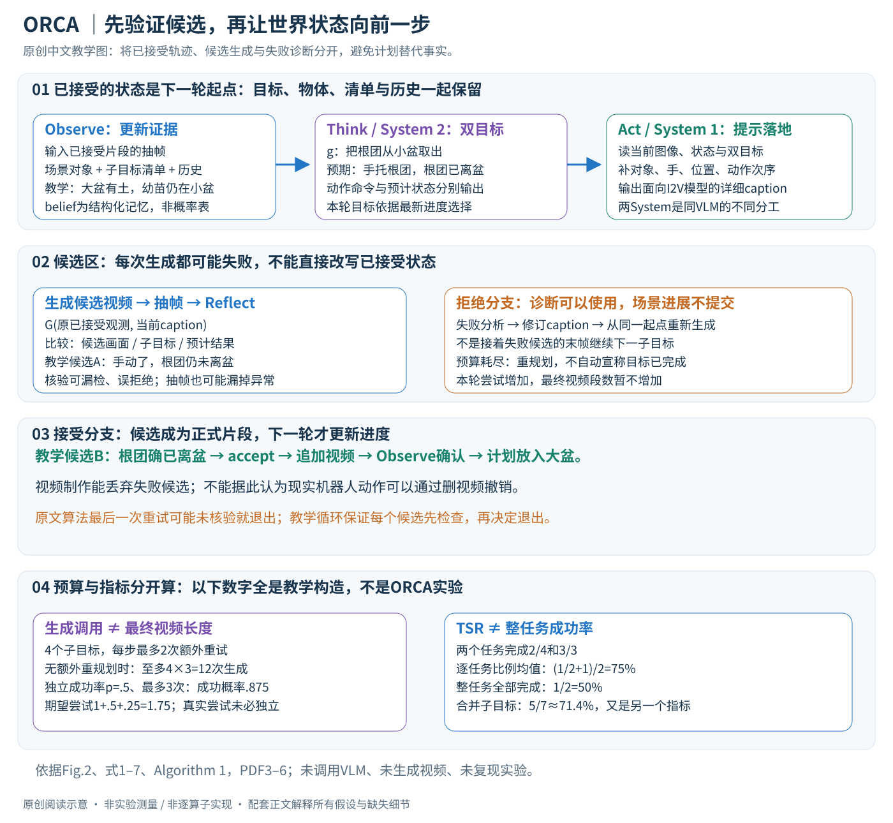

# Active Intelligence in Video Avatars via Closed-loop World Modeling

核对日期：2026-10-22。实验数值均为作者报告；本地完成原文阅读与讲解自检，未复现实验。

方法与配图详细版返工：2026-10-23。重读§3–5，核对算法页；展开状态提交、双系统接口、重试语义及成本边界。未复现实验。

## 一句话总结

ORCA让VLM维护视频物体状态和子目标，生成短片后检查并重试，以闭环形成较连贯的目标导向数字人视频。

## 研究背景与动机

逐片生成长视频会把前一片错误带进下一片，预写全部提示无法确认物体是否真被拿起、移动。作者把图生视频当作随机环境，将状态跟踪、计划和结果核验连接起来。[§1，PDF1–2]

任务完成表示生成视频中呈现相应步骤，不是物理物体真的被操作。机器人环境也可能随机，不能将文中“物理环境确定”的对照当一般事实。

## 方法总览

### 先分清任务目标、生成的视频与系统相信的状态

ORCA的输入是初始场景图像 \(o_0\) 和自然语言意图 \(I\)，输出是依次通过核验的短视频序列 \(V=[v_1,\ldots,v_T]\)。例如“把幼苗移植到大花盆”要经过加土、取苗、放入、填土等步骤。每一步需要上一段末尾呈现正确的物体关系，否则后续生成会沿着错误画面继续。这里的成功指视频呈现任务过程，不等于真实机器人完成操作。（§3.1–3.2，PDF第3–5页）



原创图依据Fig.2、式1–6与Algorithm 1。移植步骤、重试次数示例为教学构造；没有调用VLM或生成视频。

| 符号 | 含义 | 在系统中如何使用 |
|---|---|---|
| \(I\) | 全局意图 | 跨轮保留，约束下一步计划 |
| \(o_t\) | 当前已接受视频的视觉观测；初始为图像 | 提供场景证据与下一次生成条件 |
| \(\widehat s_t\) | 场景、物体、清单、历史组成的内部状态 | 支撑任务进度与依赖判断 |
| \(g_t\) | 下一子目标的文字命令 | 决定这一段要完成什么 |
| \(g_{\widehat s}\) | 预期下一状态的结构化描述 | 让核验有可以对照的目标 |
| \(a_t\) | 面向视频模型的详细动作提示 | 控制具体动作、对象和空间关系 |
| \(v_{t+1},o_{t+1}\) | 候选视频及从中抽取的帧 | 先核验，再决定是否进入最终轨迹 |
| \(\delta_t\) | accept/reject | 控制提交、修订或重规划 |

这些主要是文本、结构化记录与图像接口。正文没有给出统一固定长度的状态向量、神经网络隐藏维度或抽帧数量，因此不能把状态表写成作者已经定义的固定张量。若以教学记号描述抽出的 \(F\) 帧，其图像数组可写为 \(F\times H\times W\times3\)，但 \(F,H,W\) 不是本文核实的运行配置。

## 核心创新与关键设计

### POMDP解释为什么需要记忆，但没有额外训练一个状态转移网络

论文用 \((\mathcal S,\mathcal A,\mathcal T,\mathcal R,\Omega,\mathcal O)\) 表达部分可观测决策过程：完整状态不可直接获得，动作是开放式文字描述，视觉观测只能揭示部分信息，视频生成器具有随机性。给定相同当前图像与提示，也可能生成不同的物体运动。目标是提高最终满足意图的概率。（§3.1，PDF第3页）

实际可调用的是预训练视频模型 \(G_\theta\)，而不是显式已知的物理转移表 \(\mathcal T(s'\mid s,a)\)。实际的belief是VLM维护的场景/清单/历史记录，正文没有列出 \(b_t(s)\) 的归一化概率分布或贝叶斯滤波更新。因此“内部世界模型”在这里应理解为推理和状态维护能力的组织方式，不应误解为新训练的可微物理模拟器，也没有证据说明规划使用了树搜索或价值网络。

例如，幼苗被手遮住时，“幼苗已被取出”可能只是模型推断。保留历史有助于补足单帧缺失的信息，但记忆并不会自动把这个推断变成真值。后续Reflect仍依赖可见证据与VLM判断。

### Observe：把视觉证据写入对象状态与任务清单

初始化为：

\[
\widehat s_0=(s_{\rm scene},C_{\rm plan},h_{\emptyset}).
\]

\(s_{\rm scene}\)记录可交互物体与属性，\(C_{\rm plan}\)将意图拆成子目标，\(h_{\emptyset}\)是空历史。后续Observe使用

\[
\widehat s_t=f_{\rm observe}(o_t,\widehat s_{t-1})
\]

更新场景变化、对象状态与已完成步骤。（式3、§3.2.3，PDF第5页）

贯穿教学例：初始记录“小盆中有苗、大盆为空”。第一段通过核验后更新为“大盆已有底土”，下一步才选择“从小盆取苗”。如果只看当前动作提示而不维护清单，系统可能反复生成加土；如果直接把预期状态当作事实，取苗失败后也可能错误开始“放入大盆”。Observe解决的是依据历史与新证据维护进度，而不是重新背诵最初的计划。

状态中的“物体位置”“任务是否完成”“历史失败原因”在实现中应有不同语义。论文没有提供完整字段schema和冲突合并规则；这些属于复现需要补齐的接口，不能伪称为作者已发布的精确格式。

### Think：同时产出要做的动作和预计做完后的状态

System 2的核心输出是一个二元组：

\[
(g_t,g_{\widehat s})=\pi_{\rm Sys2}(\widehat s_t,I).
\]

式4进一步将当前观测写入 \(f_{\rm think}(\widehat s_t,I,o_t)\)。这两个表述可理解为强调状态接口和强调视觉输入的不同层次；不能据此推断其中某条实现通路不读取图像。（式1、4，PDF第4–5页）

在取苗例中，\(g_t\)可以是“将幼苗连同根团从小盆取出”，而 \(g_{\widehat s}\)应描述“根团已离开小盆并由手支撑，小盆不再容纳该根团”。后者让Reflect检查结果关系，而不只检查画面中是否出现了伸手动作。命令与预期状态分离，是连接规划和结果核验的关键。

System 2参与Observe、Think和Reflect；这不是仅在开始运行一次的全局脚本编写器。每次接受新片段后，它都重新读取进度，再决定下一子目标。失败多次后可以改变计划，但原文没有给出重规划的精确搜索策略、候选数或最优性保证。

### Act：System 1把抽象动作翻译成生成器可用的提示

\[
a_t=\pi_{\rm Sys1}(g_t,g_{\widehat s},o_t,\widehat s_t),
\qquad v_{t+1}\sim G_\theta(o_t,a_t).
\]

System 1同时读取目标、预计结果、当前图像与状态，补全对象指代、手的位置、空间关系和动作次序。论文Fig.2的示例会明确画面左侧/右侧的手，而不是仅用容易歧义的人体左右方位。（式2、5、Fig.2，PDF第4–5页）

例如抽象指令“取苗”可被细化为双手接近小盆、托住根团并逐步抬离盆口。这个中文例子用于说明接口，不是作者提示词的逐字翻译。详细提示减少欠约束，但生成器仍可能让根团穿过盆壁、漏掉取出动作或改变物体身份，因此详细描述不能替代核验。

两个System在实验里都使用Gemini-2.5-Flash，通过不同结构化提示分工；不是分别训练出的快慢神经网络。视频后端为作者所述Wanx2.2加蒸馏LoRA，论文称ORCA本身training-free。这里表示无需为该控制架构专门训练，不表示底座模型或LoRA从未训练，也不表示推理没有调用成本。（§5.2，PDF第6页）

### Reflect：候选视频先检查，接受后才推进最终序列

从候选视频抽帧得到 \(o_{t+1}\)，System 2计算：

\[
(\delta_t,\mathrm{analysis})=f_{\rm reflect}(o_{t+1},g_t,g_{\widehat s}).
\]

若accept，候选片段进入 \(V\)，进入下一轮状态更新。若reject，失败分析连同候选观察用于修订提示：

\[
a_t^{\rm new}=f_{\rm revise}(a_t,o_{t+1},\mathrm{analysis}).
\]

随后重新以原来的 \(o_t\) 为生成条件尝试。这一点非常重要：失败片段提供诊断信息，但不应被当成已接受的世界进展；否则下一步会继承失败的图像。重试用的是 \(G_\theta(o_t,a_t^{\rm new})\)，而不是从失败候选末帧无限向前接。（式6、Algorithm 1第15–26行，PDF第5页）

因此有两个信息通道：成功片段推进场景与完成清单；失败片段帮助修改动作提示/计划。视频制作可以丢弃候选而重新生成，现实中的机器人却不能通过丢弃录像撤销一次真实移动。该机制的价值应在内容生成任务内理解。

核验器也会犯错。漏检可能接受物体消失或穿透，误拒绝则浪费生成预算。抽帧还可能错过中间发生的异常。正文未完整公布抽帧密度、判定阈值和校准方法，因此不能保证“反思开启后错误一定被挡住”。

### 走通一次失败后成功的过程，并澄清重试循环

教学轨迹如下：

1. 当前已接受状态：大盆有底土，幼苗仍在小盆；最终视频已有1段。
2. Think选择“取出根团”，预测手托根团且根团离盆。
3. Act生成候选A。抽帧发现手移动了，但根团仍在小盆，Reflect拒绝。
4. 修订提示以强调托住根团和离开盆口；从同一个已接受条件生成候选B。
5. B通过核验，最终视频从1段变为2段；下一轮Observe更新“根团已取出”，再计划放入大盆。

候选A不增加已完成子目标，也不占据最终序列的位置，但消耗了推理预算。以下是强调边界的**教学伪代码，不是作者可执行代码**：

```text
state = initialize(initial_observation, intention)
while remaining_goals(state) and total_budget_available():
    goal, expected = think(state, intention, accepted_observation)
    caption = ground(goal, expected, state, accepted_observation)
    accepted = false
    for attempt in 0..max_retries:       # 含首次，至多1+max_retries次
        candidate = generate(accepted_observation, caption)
        frames = sample(candidate)
        decision, reason = reflect(frames, goal, expected)
        if decision == accept:
            append(candidate)
            accepted_observation = frames
            state = observe(frames, state)
            accepted = true
            break
        if attempt < max_retries:
            caption = revise(caption, frames, reason)
    if not accepted:
        state = replan_without_committing_failed_scene(state)
```

其中总预算保护、初始化后直接使用state、每个候选都先核验再决定是否退出，是本讲解为厘清语义增加的工程表达。原文Algorithm 1在 \(t=0\) 时引用 \(\widehat s_{-1}\)，初始化接口需澄清；第18–22行生成最后一次重试后，可能因计数到上限立即退出，保留上一个候选的reject判断。因此照字面实现时最后候选可能没经过Reflect。这里指出原文伪代码边界，不据此断言作者实际系统一定有同样错误。（PDF第5页算法原图已核对）

### 推理成本与指标：闭环的收益必须和预算一起看

设当前有 \(M\) 个子目标，每个最多额外重试 \(R\) 次，且假设没有重规划增加目标，则生成次数上界为 \(M(1+R)\)。例如教学配置 \(M=4,R=2\) 最多12次生成，最终接受的视频通常仍只需对应4个步骤。若不断重规划，原文外层循环没有给出全局有限上界，不能套用12次作为整个系统的无条件保证。每次生成还伴随VLM核验，失败会增加修订调用；不应只报告成功视频长度来代表成本。

在独立同分布且每次成功概率恒为 \(p\) 的**理想教学模型**下，最多 \(K=R+1\) 次尝试至少一次成功的概率为 \(1-(1-p)^K\)，期望尝试次数为 \(\sum_{j=0}^{K-1}(1-p)^j\)。取 \(p=0.5,K=3\)，分别为0.875和1.75。真实ORCA会修订提示，尝试相关且核验不完美，不能用这组数预测其真实成功率。

论文TSR为 \(N^{-1}\sum_i k_i/M_i\)，是逐任务子目标完成比例的平均，不是整项任务完全成功率。教学例中两个任务分别完成2/4和3/3，TSR是75%，完整成功任务比例是50%，合并所有子目标的完成比例则为5/7约71.4%；三者回答不同问题。（式7，PDF第6页）

正文Table 1报告ORCA平均TSR71.0%，但Livestream为58.4%，低于Open-Loop的72.3%；作者解释重试可能消耗简单任务的固定步数预算。Workshop消融中完整模型0.77、无System 1为0.74、无Reflect为0.72、无belief为0.67；该消融重新评估，不应与Table 1的Workshop80.4%混为同一运行。（§5.3–5.4、Table 1–2，PDF第7–8页）

### 复现时应核对什么

需要固定初始图、任务清单、模型与LoRA版本、两System提示、抽帧规则、接受规则、单步与总预算，以及所有失败候选的日志。只有这样才能区分“计划更好”“多试几次”和“核验更宽松”带来的变化。本文未提供足够细节来从正文唯一恢复这些配置；没有补充成未经核实的默认值。本地只验证教学算例、阅读逻辑与页面，未调用Gemini、未生成视频、未训练或复现模型。


## 实验与关键结果

L-IVA100任务、5场景，92张合成初始图和8张真实图，每任务3–8子目标、固定视角单房间，每场景5个双人协作任务。[§4、Fig.3，PDF6]

\[\mathrm{TSR}=\frac1N\sum_i\frac{k_i}{M_i}.\]
这里TSR是人工核验的**逐任务子目标完成比例均值**，不是完整成功任务比例。[式7]

| 作者报告平均 | Reactive | Open-loop | VAGEN式 | ORCA |
| --- | --- | --- | --- | --- |
| TSR | 50.9% | 62.3% | 61.2% | 71.0% |
| 人工物理合理性1–5 | 3.11 | 3.17 | 3.22 | 3.72 |
| 动作保真0–1 | 0.55 | 0.62 | 0.62 | 0.64 |
| 主体一致性 | 0.92 | 0.90 | 0.92 | 0.93 |

来源Table1，PDF7。Livestream本文58.4低于Open-loop72.3，美学平均0.58低于Reactive0.59；重试消耗步骤预算，不是各场景全胜。动作保真、人工物理合理性与人类偏好各有评价方式，不混算。

## 消融实验与证据强度

Workshop重评完整TSR0.77，去System1为0.74，去Reflect0.72，去belief0.67；主体一致性0.94/0.93/0.92/0.93。该表说明人工重评随机性造成与主表Workshop80.4%不同，勿当成同试验精确差值。[Table2，PDF8]

BWS完整28.7%、Reactive-18.0%；表头↓与高值加粗、正文正值更受偏好的解释冲突，方向需查问卷。本篇保留作者偏好结论，不按低值更优误差解读。

## 局限与讨论

生成器与评审VLM可能共享幻觉，一致画面不保证物理因果真实；Reflect也可能看漏错误。双系统是架构类比，不证明一般自主智能或人类认知等价性。

主文未完整报告重试上限、全流程成本与延迟、评测人数及置信区间，难区分架构和额外生成预算的全部贡献。固定视角单房间不覆盖镜头切换与真实开放环境；71%仅是子目标进度。

## 复现提示

从[项目页](https://xuanhuahe.github.io/ORCA/)核验代码、提示、数据与许可证，当前未核验commit和可下载内容。建议 `experiments/generation/orca/`，保留每个接受/拒绝片段、抽帧、修订与调用数。

本次未调用Gemini或付费视频生成器，未重建100任务实验。先用已有获许可短片静态检查状态表和判定格式，真正复现需另行确定模型与计算条件；本地仅原文阅读和图表核对。

## 相关工作与阅读顺序

先区分生成反馈与真实环境控制，再读POMDP的belief概念和提示式实现。重点看Algorithm1、式7与Table1场景差异，分开衡量反馈收益、重试成本和完整任务完成。

## 来源与校验

- [CVF官方论文页](https://openaccess.thecvf.com/content/CVPR2026/html/He_Active_Intelligence_in_Video_Avatars_via_Closed-loop_World_Modeling_CVPR_2026_paper.html) · [所读PDF](https://openaccess.thecvf.com/content/CVPR2026/papers/He_Active_Intelligence_in_Video_Avatars_via_Closed-loop_World_Modeling_CVPR_2026_paper.pdf)。页码均为PDF页序。
- 所读版本：2026-10-21从CVF下载的开放接收稿；PDF SHA-256：`f7799a0df14efdf65bc416437cfbea23a3477de963a80e9978c981ecc5884fba`。
- 阅读范围：正文、方法公式、实验与消融；补充材料、代码及权重未逐项核验。reviewed表示本地讲解自检，不表示独立同行评审或实验复现。
- 方法图与关键公式/表格已渲染核对，所引原图已单独检查；未对新文章进行浏览器交互验收。作者图示与本站原创素材权利分开记录。
