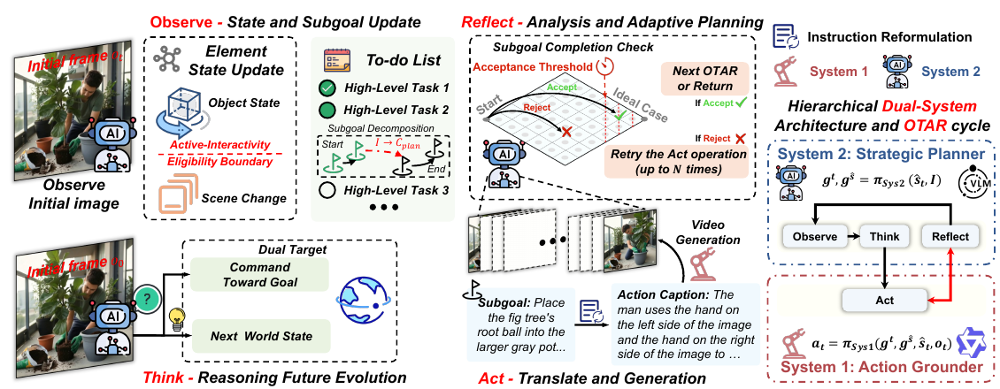

# Active Intelligence in Video Avatars via Closed-loop World Modeling

核对日期：2026-10-22。实验数值均为作者报告；本地完成原文阅读与讲解自检，未复现实验。

## 一句话总结

ORCA让VLM维护视频物体状态和子目标，生成短片后检查并重试，以闭环形成较连贯的目标导向数字人视频。

## 研究背景与动机

逐片生成长视频会把前一片错误带进下一片，预写全部提示无法确认物体是否真被拿起、移动。作者把图生视频当作随机环境，将状态跟踪、计划和结果核验连接起来。[§1，PDF1–2]

任务完成表示生成视频中呈现相应步骤，不是物理物体真的被操作。机器人环境也可能随机，不能将文中“物理环境确定”的对照当一般事实。

## 方法总览

原论文Fig.2，PDF第4页。仅裁切相关图示，保留图内科学标签；著作权属于原作者，用于本篇方法分析，不并入本站原创图授权。[来源与作者](https://openaccess.thecvf.com/content/CVPR2026/html/He_Active_Intelligence_in_Video_Avatars_via_Closed-loop_World_Modeling_CVPR_2026_paper.html) · [PDF](https://openaccess.thecvf.com/content/CVPR2026/papers/He_Active_Intelligence_in_Video_Avatars_via_Closed-loop_World_Modeling_CVPR_2026_paper.pdf)。点击可打开高清图。

Observe更新物体与任务清单，Think由System2生成子目标和预期状态，Act由System1改写为适配生成器的详细提示，Reflect比较实际画面与预期，接受才追加最终序列，否则修订重试/重规划。[Fig.2、§3.2，PDF4–5]

两System都用Gemini2.5Flash结构化提示、无专门训练；视频后端Wanx2.2配蒸馏LoRA。belief state是结构化/文本记忆，并非显式概率贝叶斯滤波。[§5.2，PDF6]

## 核心创新与关键设计

信息流为：
\[(g_t,g_{\widehat s})=\pi_{Sys2}(\widehat s_t,I),\quad a_t=\pi_{Sys1}(g_t,g_{\widehat s},o_t,\widehat s_t),\quad v_{t+1}\sim G_\theta(o_t,a_t).\]
抽帧后由f_reflect给accept/reject，失败分析用于修订提示。[式1–6，PDF4–5]

丢弃失败片段再从原条件生成是内容制作的可回退性质，不是机器人执行失败后的物理回滚。Algorithm1在t=0引用ŝ_-1，最后一次重试可能因计数上限先退出、没再检查新片；初始化与循环边界需实现复核，不直接照抄程序。

## 实验与关键结果

L-IVA100任务、5场景，92张合成初始图和8张真实图，每任务3–8子目标、固定视角单房间，每场景5个双人协作任务。[§4、Fig.3，PDF6]

\[\mathrm{TSR}=\frac1N\sum_i\frac{k_i}{M_i}.\]
这里TSR是人工核验的**逐任务子目标完成比例均值**，不是完整成功任务比例。[式7]

| 作者报告平均 | Reactive | Open-loop | VAGEN式 | ORCA |
| --- | --- | --- | --- | --- |
| TSR | 50.9% | 62.3% | 61.2% | 71.0% |
| 人工物理合理性1–5 | 3.11 | 3.17 | 3.22 | 3.72 |
| 动作保真0–1 | 0.55 | 0.62 | 0.62 | 0.64 |
| 主体一致性 | 0.92 | 0.90 | 0.92 | 0.93 |

来源Table1，PDF7。Livestream本文58.4低于Open-loop72.3，美学平均0.58低于Reactive0.59；重试消耗步骤预算，不是各场景全胜。动作保真、人工物理合理性与人类偏好各有评价方式，不混算。

## 消融实验与证据强度

Workshop重评完整TSR0.77，去System1为0.74，去Reflect0.72，去belief0.67；主体一致性0.94/0.93/0.92/0.93。该表说明人工重评随机性造成与主表Workshop80.4%不同，勿当成同试验精确差值。[Table2，PDF8]

BWS完整28.7%、Reactive-18.0%；表头↓与高值加粗、正文正值更受偏好的解释冲突，方向需查问卷。本篇保留作者偏好结论，不按低值更优误差解读。

## 局限与讨论

生成器与评审VLM可能共享幻觉，一致画面不保证物理因果真实；Reflect也可能看漏错误。双系统是架构类比，不证明一般自主智能或人类认知等价性。

主文未完整报告重试上限、全流程成本与延迟、评测人数及置信区间，难区分架构和额外生成预算的全部贡献。固定视角单房间不覆盖镜头切换与真实开放环境；71%仅是子目标进度。

## 复现提示

从[项目页](https://xuanhuahe.github.io/ORCA/)核验代码、提示、数据与许可证，当前未核验commit和可下载内容。建议 `experiments/generation/orca/`，保留每个接受/拒绝片段、抽帧、修订与调用数。

本次未调用Gemini或付费视频生成器，未重建100任务实验。先用已有获许可短片静态检查状态表和判定格式，真正复现需另行确定模型与计算条件；本地仅原文阅读和图表核对。

## 相关工作与阅读顺序

先区分生成反馈与真实环境控制，再读POMDP的belief概念和提示式实现。重点看Algorithm1、式7与Table1场景差异，分开衡量反馈收益、重试成本和完整任务完成。

## 来源与校验

- [CVF官方论文页](https://openaccess.thecvf.com/content/CVPR2026/html/He_Active_Intelligence_in_Video_Avatars_via_Closed-loop_World_Modeling_CVPR_2026_paper.html) · [所读PDF](https://openaccess.thecvf.com/content/CVPR2026/papers/He_Active_Intelligence_in_Video_Avatars_via_Closed-loop_World_Modeling_CVPR_2026_paper.pdf)。页码均为PDF页序。
- 所读版本：2026-10-21从CVF下载的开放接收稿；PDF SHA-256：`f7799a0df14efdf65bc416437cfbea23a3477de963a80e9978c981ecc5884fba`。
- 阅读范围：正文、方法公式、实验与消融；补充材料、代码及权重未逐项核验。reviewed表示本地讲解自检，不表示独立同行评审或实验复现。
- 方法图与关键公式/表格已渲染核对，所引原图已单独检查；未对新文章进行浏览器交互验收。作者图示与本站原创素材权利分开记录。
