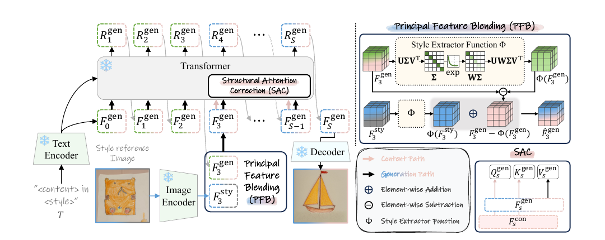

# A Training-Free Style-Personalization via SVD-Based Feature Decomposition

核对日期：2026-10-25。以下实验均为作者报告；本地完成原文阅读与讲解自检，未复现实验。

## 一句话总结

在冻结Infinity的第三尺度，用SVD重加权替换主要风格分量，再借原始内容分支的Q/K约束结构，实现无需逐风格训练的单参考风格生成。

## 研究背景与动机

复制完整参考特征容易连参考物体一起复制，逐风格微调又有时间成本。作者先做尺度干预分析，发现早期特征影响内容和颜色，再尝试只转移主奇异分量。这里的主要机制证据来自100对物体/颜色提示，颜色并不覆盖构图、笔触等全部风格属性。[§4，PDF3–4]

## 方法总览

同一文本驱动内容分支与生成分支；参考图经过Infinity图像编码器取得多尺度特征。第三尺度PFB抽取参考风格主分量并替换生成分支对应部分；s=3到12的SAC复制内容分支的注意力Q/K，保留生成分支V，继续细化后解码。[Fig.4、§5，PDF5–6]

这是双流推理，冻结权重不意味着没有额外计算或完全不依赖已训练大模型。

### 对照原文流程图

原论文 Fig.4，PDF第5页。仅裁去页边与其他正文，保留图内文字与结构；图片著作权属于原作者，作为本篇方法分析的有限引图，**不属于本站原创SVG的授权范围**。[原文与作者信息](https://openaccess.thecvf.com/content/CVPR2026/html/Lee_A_Training-Free_Style-Personalization_via_SVD-Based_Feature_Decomposition_CVPR_2026_paper.html) · [PDF](https://openaccess.thecvf.com/content/CVPR2026/papers/Lee_A_Training-Free_Style-Personalization_via_SVD-Based_Feature_Decomposition_CVPR_2026_paper.pdf)。上方中文图为简化重绘，本图用于核对被省略的细节。

## 核心创新与关键设计

### 1. 先区分残差、累积特征和三条信息来源

任务输入是一段描述目标内容和风格的文本$T$，以及一张参考风格图$I^{sty}$；输出是符合文本内容、借用参考外观的新图$I^{gen}$，不是重建参考图里的同一个物体。方法不需要每种风格重新拟合参数，底座则是已经训练好的Infinity2B。[PDF3、5–6]

| 符号 | 含义与接口 |
| --- | --- |
| $E_T(T)$ | Flan-T5文本编码，同一个提示同时提供给内容与生成分支 |
| $R_s$ | 第$s$尺度的量化残差，原文形状$c\times h_s\times w_s$ |
| $F_s$ | 将此前残差上采样到共同空间后累加的特征，原式2为$c\times H\times W$ |
| $F_s^{con}$ | 正常Infinity内容分支的特征，不注入参考图 |
| $F_s^{gen}$ | 最终要解码的分支，会受PFB与SAC干预 |
| $F_s^{sty}$ | 参考图通过预训练多尺度图像编码器得到的特征 |
| $\Phi(F)$ | 对某个特征矩阵单独做SVD并按奇异值顺序衰减的结果 |

原文报告量化特征分辨率$64\times64\times32$、12个尺度、最终1024²图像。**64×64不是最终RGB分辨率，也不代表第3尺度原始残差就是64×64。**式2用共同分辨率表示累积结果，但实际送入下一尺度Transformer的重采样、token化和hook位置需要核验实现。[PDF3、6]

正常分支先预测尺度残差，再累积：
\[
R_s=M(F_{s-1},E_T(T)),\qquad
F_s=\sum_{i=1}^{s}\operatorname{up}_{H\times W}(R_i),\qquad
I=D(F_S).
\]
不是每一尺度直接预测一幅独立RGB图。内容分支沿这条基线更新；生成分支沿相同框架更新，但在第三特征处做风格替换。参考图编码只提供风格特征，不是另一条由文本逐尺度生成的内容路径。[PDF3，式1–4]

### 2. 为什么干预第三特征：观察与因果结论的边界

作者每次只在一个尺度改变提示，比较最终图对新物体/新颜色的CLIP相似度。两类各100对提示的实验指向step2影响突出，正文随后把“该步之后的第三特征”称为$F_3$。式1以$F_{s-1}$预测$R_s$，式2又以$F_s$累积残差，因此读者不能只凭自然语言的“第几步”猜代码数组下标。复现应对照实际前向图标注“哪次残差预测之前/之后”，确保两分支与参考图的特征接口一致。[PDF3–5，Fig.2–4]

接着作者在分析实验中只保留最大奇异值，将参考的第一主分量替换进另一图的特征，看到颜色转移明显、物体转移相对弱。这支持选择性替换的动机，**不构成所有艺术风格都集中在第一分量的定理**。最终PFB也并非硬截成rank1，而是下面的软谱衰减。

### 3. SVD究竟分解什么：先声明矩阵化约定

SVD输入必须是矩阵。为讲清代数，设将某层特征矩阵化为$F\in\mathbb R^{m\times n}$，秩$r\le\min(m,n)$，薄SVD为：
\[
F=U\Sigma V^\top=\sum_{j=0}^{r-1}\sigma_j u_jv_j^\top,
\quad U\in\mathbb R^{m\times r},\quad
\Sigma\in\mathbb R^{r\times r},\quad V\in\mathbb R^{n\times r},
\quad\sigma_0\ge\cdots\ge\sigma_{r-1}>0.
\]
例如把通道放行、空间位置展平放列，是$c\times(HW)$的**一种解释性约定**；正文未明确实际reshape、批维或逐通道分解方式，不能把这一约定登记成作者实现。参考与生成特征只有在同样坐标、通道及矩阵化约定下才能相加。

每个$\sigma_j u_jv_j^\top$是一个rank1矩阵：它同时包含空间/通道方向及能量，不能把$\sigma_j$这个标量本身当成可独立移植的“风格”。参考图与生成图分别分解，通常得到各自不同的$U,V$；PFB加的是重构后的矩阵，不是用参考奇异值直接替换生成奇异值。[PDF6，式5–6]

### 4. PFB逐项计算：替换软主分量，保留补集

令$\alpha>0$，按**排序索引**而不是奇异值大小本身加权：
\[
w_j=e^{-j\alpha},\qquad
\Phi(F)=UW\Sigma V^\top
=\sum_{j=0}^{r-1}w_j\sigma_j u_jv_j^\top.
\]
默认$\alpha=1$时，前几个系数为$1,0.3679,0.1353,\ldots$。第一分量保持原幅度，后续减弱；“增强主分量影响”指相对占比提高，不是把第一奇异值乘以大于1的数。接着：
\[
\widehat F_3^{gen}=\Phi(F_3^{sty})+
\big(F_3^{gen}-\Phi(F_3^{gen})\big).
\]
括号内是生成特征的软残差，系数为$1-w_j$：第一分量被完全扣除，第二分量保留约63.21%，第三保留约86.47%。因此既不是完整复制参考，也不是“参考第一分量 + 生成的所有其他分量”这种硬rank1拼接。[PDF6，式5–6]

**完整标量矩阵教学例，非模型测量：**取$F^{gen}=\operatorname{diag}(4,2)$、$F^{sty}=\operatorname{diag}(6,1)$，两者在本例恰好共享单位奇异向量。$\alpha=1$时：
\[
\Phi(F^{gen})=\operatorname{diag}(4,0.7358),\quad
\Phi(F^{sty})=\operatorname{diag}(6,0.3679),
\]
\[
F^{gen}-\Phi(F^{gen})=\operatorname{diag}(0,1.2642),\quad
\widehat F^{gen}=\operatorname{diag}(6,1.6321).
\]
完整替换会得到$\operatorname{diag}(6,1)$，硬rank1替换会得到$\operatorname{diag}(6,2)$，都不是本方法结果。实际两分支奇异向量通常不同，不能把本例的对角元素逐项相加习惯推广到真实奇异谱。

极限也能帮助理解设计：$\alpha\to0^+$时所有$w_j\to1$，PFB趋向完整参考特征替换；$\alpha\to\infty$时仅首分量保留，趋向rank1替换。若某矩阵恰好rank1，软残差为零，该矩阵的生成内容会被完全拿掉。若奇异值并列，SVD基底在对应子空间内不唯一，而按索引赋不同权重可能让$\Phi$依赖所选基底；正文没有给出专门处理规则。这些是代数边界分析，不是作者报告的失败率。

### 5. SAC逐项计算：复制关系权重，不复制生成value

PFB可能把布局也扰动，因此作者在$s\in\{3,4,\ldots,12\}$替换生成路径自注意力的Q/K：
\[
Q_s^{gen}\leftarrow Q_s^{con},\qquad
K_s^{gen}\leftarrow K_s^{con},\qquad
V_s^{gen}\text{ 保留生成分支的值。}
\]
以单头标准缩放点积注意力作**阅读补充**，令该层token数$L$、头维$d$：
\[
A^{con}=\operatorname{softmax}\!\left(
Q^{con}(K^{con})^\top/\sqrt d+M\right)\in\mathbb R^{L\times L},
\qquad O^{gen}=A^{con}V^{gen}.
\]
这里softmax沿key位置，$M$表示底座采用的mask；这是解释式7作用的通用写法，非论文额外公布的完整层实现。它把“哪个位置读取哪些位置”的关系交给内容分支，而“读出什么特征”仍取生成分支。不能替换V后还声称原公式保持不变，也不能把这个操作说成直接复制内容分支的整个输出。[PDF6，式7]

假设两位置的关系矩阵为$A^{con}=\left[\begin{smallmatrix}.8&.2\\.1&.9\end{smallmatrix}\right]$，生成value为$\left[\begin{smallmatrix}2&0\\0&4\end{smallmatrix}\right]$，则输出两行是$(1.6,.8)$和$(.2,3.6)$。矩阵行和为1，结构相同但value不同仍会产生不同输出；后面的输出投影、残差连接等也没有因此自动等同。该例与上面的SVD矩阵例分别说明两个模块，未冒充一次实际Infinity前向。

两分支使用相同文本，减少内容目标不匹配；这不等于随机采样结果或所有中间特征天然相同。具体每层hook、位置编码的先后、KV缓存以及随机种子同步方式，当前正文未明确，必须用实现补核。复制Q/K也不是几何不变性的证明，参考风格若本来包含特殊构图，内容引导可能压制它。

### 6. 一次推理怎样串起来，哪些参数更新

1. 编码文本$T$和参考图$I^{sty}$；对参考第三特征按确定的reshape求$\Phi(F_3^{sty})$。
2. 运行正常内容分支，并同步运行生成分支。两条路径遵循底座的多尺度残差预测与累积，不把不同尺度当作独立图像。
3. 到论文标注的第三特征接口，用式6替换生成特征；后续生成必须从被修改的状态继续，不能下一步又恢复未修改缓存。
4. 在第3–12尺度相应自注意力位置，把内容Q/K注入生成路径，保留生成V，产生后续残差并累积。
5. 解码生成分支的最终特征，得到1024²图像；内容分支提供结构信号，不是最终图。

以上是概念执行顺序，具体第3尺度内“PFB—投影—SAC”的hook需要结合前述索引核验。所有预训练参数冻结，包括用于生成的Infinity模型；没有逐参考风格的损失优化、梯度下降或新增可训练风格向量。SVD和注意力只是推理计算，不能因存在可微线性代数就把它描述成训练步骤。[PDF5–6，§5、§6.1]

### 7. 复杂度与替代设计

一个$m\times n$矩阵的常规稠密薄SVD约需$O(mn\min(m,n))$计算，具体开销取决于未明确的reshape；PFB在目标尺度做参考与生成分解，不能拿最终图像像素数直接代入。固定参考图、编码和设置时，参考侧的确定性分解具备缓存可能，这是工程推论，非论文给出的已测缓存加速。

双流需要额外内容路径计算及注意力信号保存/传递。共享冻结权重不意味着两个前向免费；3.58秒是特定A6000、Infinity2B和尺度日程的作者报告。完整特征替换更直接但容易带入参考物体，硬rank1替换更强地截断高阶信息，软谱替换在二者间调节；SAC补结构但也增加耦合。这些选择应结合Table2的内容与风格指标，而非把“训练免费”等同于无算力或无数据成本。

## 实验与关键结果

冻结Infinity2B，12尺度，1024²输出，单A6000作者测3.58秒。评估190个Parti筛选提示×10种风格，CLIP文本与图像相似度，并报告调和平均。[§6，PDF6–7]

| 作者报告 | 本文 | StyleAligned | IP-Adapter |
| --- | --- | --- | --- |
| 文本相似度↑ | 0.334 | 0.315 | 0.302 |
| 图像相似度↑ | 0.630 | 0.716 | 0.763 |
| 调和平均↑ | 0.437 | 0.438 | 0.433 |
| 表列时间秒↓ | 3.58 | 64.58 | 10.13 |

来源Table1，PDF7。本文调和指标略低于StyleAligned，不是所有指标第一。表中需调优方法的时间包含一次风格训练和一次生成，“最高195×”来自698.98/3.58，不能当成长批量每张推理都快195倍；已训练基座成本不在这里。

## 消融实验与证据强度

Infinity基线文本/图像/调和为0.348/0.559/0.429；完整替换0.279/0.696/0.398；仅PFB0.321/0.631/0.426；PFB+SAC0.334/0.630/0.437。[Table2，PDF8]

PFB单独虽改善风格，但调和指标低于基线；SAC恢复部分文本一致性，仍未恢复基线0.348。30人偏好研究正文报本文文本35.3%、风格32.0%，小样本偏好不等价于全人群一致结论。高图像相似度可能是内容泄漏，因此必须连同文本和视觉例子看。

## 局限与讨论

奇异分量按数值能量排序，不保证天然对应语义风格；颜色提示分析对多层次艺术风格的外推有限。双流Q/K替换可能约束掉参考风格中的构图特征。未报告所有硬件或高分辨率峰值显存，不能承诺普通笔记本实时运行。

冻结基座仍继承训练数据偏差；参考图需有适当使用权，结果不构成艺术原创性或版权判定。

## 复现提示

建议 `data/style-personalization/svd/` 保存获授权参考图和提示清单；固定Infinity2B权重版本、12尺度日程、SVD张量reshape、α、PFB插入位置和SAC层范围，分别测试单张延迟及同风格批量摊销成本。

所读正文未给可核验的本方法代码commit/许可证，本地未下载模型或执行生成；本文公式解释与关键页核对不等于实现复现。

## 相关工作与阅读顺序

先看Infinity的next-scale残差累积，再看AdaIN/WCT与基于注意力的风格控制，最后读PFB与SAC消融。与CoTyle比较：本篇依赖参考图且不逐风格训练，CoTyle另外训练风格码本与AR，评价协议不同。

## 来源与校验

- [CVF 官方论文页](https://openaccess.thecvf.com/content/CVPR2026/html/Lee_A_Training-Free_Style-Personalization_via_SVD-Based_Feature_Decomposition_CVPR_2026_paper.html) · [所读 PDF](https://openaccess.thecvf.com/content/CVPR2026/papers/Lee_A_Training-Free_Style-Personalization_via_SVD-Based_Feature_Decomposition_CVPR_2026_paper.pdf)。页码均为该 PDF 的页序。
- 阅读范围：正文、公式与实验表；补充材料、上游代码与权重未逐项核验。许可证和固定代码 commit 尚未确认，不复制原文全文或数据。
- PDF SHA-256：`026403d6c1d0ca4eb4e2a319b761e88db000c9bed65c872ea77b58c6d9612b04`；版本为本次下载的 CVF 接收稿，核对日期 2026-10-20。
- 视觉核对：原PDF第5页已渲染检查，核对关键图表及公式排版。原创方法图为概念重绘，细节以原文为准。

- 2026-10-25方法与配图联合返工：重读PDF3–6并渲染第6页公式，复核原Fig.4与署名；新增中文软谱计算图。浏览器上下图验收，58处公式渲染、0错误、0失效图片、无横向溢出；教学数值已核算，未执行生成。PDF版本哈希同上。
