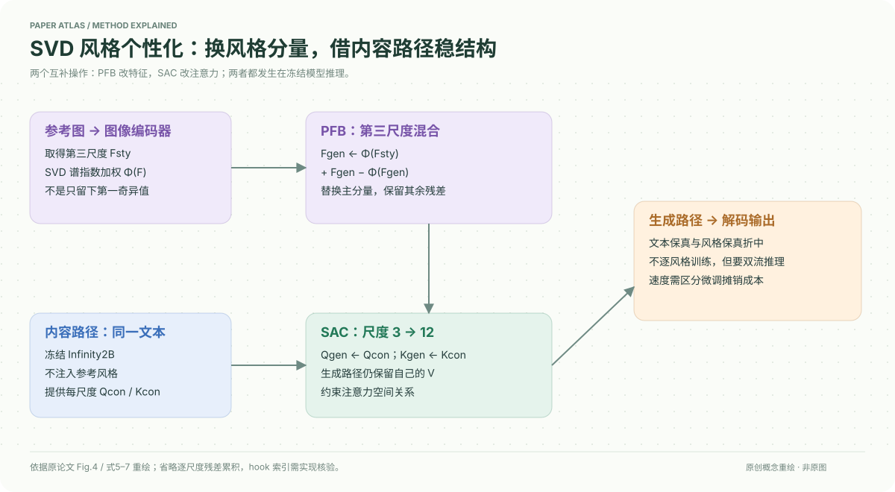

# A Training-Free Style-Personalization via SVD-Based Feature Decomposition

核对日期：2026-10-20。以下实验均为作者报告；本地完成原文阅读与讲解自检，未复现实验。

## 一句话总结

在冻结Infinity的第三尺度，用SVD重加权替换主要风格分量，再借原始内容分支的Q/K约束结构，实现无需逐风格训练的单参考风格生成。

## 研究背景与动机

复制完整参考特征容易连参考物体一起复制，逐风格微调又有时间成本。作者先做尺度干预分析，发现早期特征影响内容和颜色，再尝试只转移主奇异分量。这里的主要机制证据来自100对物体/颜色提示，颜色并不覆盖构图、笔触等全部风格属性。[§4，PDF3–4]

## 方法总览

同一文本驱动内容分支与生成分支；参考图经过Infinity图像编码器取得多尺度特征。第三尺度PFB抽取参考风格主分量并替换生成分支对应部分；s=3到12的SAC复制内容分支的注意力Q/K，保留生成分支V，继续细化后解码。[Fig.4、§5，PDF5–6]

这是双流推理，冻结权重不意味着没有额外计算或完全不依赖已训练大模型。

### 对照原文流程图

原论文 Fig.4，PDF第5页。仅裁去页边与其他正文，保留图内文字与结构；图片著作权属于原作者，作为本篇方法分析的有限引图，**不属于本站原创SVG的授权范围**。[原文与作者信息](https://openaccess.thecvf.com/content/CVPR2026/html/Lee_A_Training-Free_Style-Personalization_via_SVD-Based_Feature_Decomposition_CVPR_2026_paper.html) · [PDF](https://openaccess.thecvf.com/content/CVPR2026/papers/Lee_A_Training-Free_Style-Personalization_via_SVD-Based_Feature_Decomposition_CVPR_2026_paper.pdf)。上方中文图为简化重绘，本图用于核对被省略的细节。

## 核心创新与关键设计

定义\(F=U\Sigma V^\top\)及\(W=\operatorname{diag}(e^{-j\alpha})_{j=0}^{r-1}\)，风格提取\(\Phi(F)=UW\Sigma V^\top\)。PFB为
\[\widehat F_3^{gen}=\Phi(F_3^{sty})+F_3^{gen}-\Phi(F_3^{gen}).\]
将原生成特征中按谱排序加权的部分替换为参考部分，保留其余残差。实际方法并非仅保留rank1；其余奇异值指数衰减，默认α=1。[式5–6，PDF6]

SAC将\(Q_s^{gen}\leftarrow Q_s^{con}, K_s^{gen}\leftarrow K_s^{con}\)，使注意力空间关系更接近文本内容路径，而V仍携带生成风格。[式7]

原文把step2最关键与“after this step”的F3联系，式1–2索引读起来不完全直观；具体hook应按实现核验。不同模型/尺度计划不能直接套用“永远第三步”。

## 实验与关键结果

冻结Infinity2B，12尺度，1024²输出，单A6000作者测3.58秒。评估190个Parti筛选提示×10种风格，CLIP文本与图像相似度，并报告调和平均。[§6，PDF6–7]

| 作者报告 | 本文 | StyleAligned | IP-Adapter |
| --- | --- | --- | --- |
| 文本相似度↑ | 0.334 | 0.315 | 0.302 |
| 图像相似度↑ | 0.630 | 0.716 | 0.763 |
| 调和平均↑ | 0.437 | 0.438 | 0.433 |
| 表列时间秒↓ | 3.58 | 64.58 | 10.13 |

来源Table1，PDF7。本文调和指标略低于StyleAligned，不是所有指标第一。表中需调优方法的时间包含一次风格训练和一次生成，“最高195×”来自698.98/3.58，不能当成长批量每张推理都快195倍；已训练基座成本不在这里。

## 消融实验与证据强度

Infinity基线文本/图像/调和为0.348/0.559/0.429；完整替换0.279/0.696/0.398；仅PFB0.321/0.631/0.426；PFB+SAC0.334/0.630/0.437。[Table2，PDF8]

PFB单独虽改善风格，但调和指标低于基线；SAC恢复部分文本一致性，仍未恢复基线0.348。30人偏好研究正文报本文文本35.3%、风格32.0%，小样本偏好不等价于全人群一致结论。高图像相似度可能是内容泄漏，因此必须连同文本和视觉例子看。

## 局限与讨论

奇异分量按数值能量排序，不保证天然对应语义风格；颜色提示分析对多层次艺术风格的外推有限。双流Q/K替换可能约束掉参考风格中的构图特征。未报告所有硬件或高分辨率峰值显存，不能承诺普通笔记本实时运行。

冻结基座仍继承训练数据偏差；参考图需有适当使用权，结果不构成艺术原创性或版权判定。

## 复现提示

建议 `data/style-personalization/svd/` 保存获授权参考图和提示清单；固定Infinity2B权重版本、12尺度日程、SVD张量reshape、α、PFB插入位置和SAC层范围，分别测试单张延迟及同风格批量摊销成本。

所读正文未给可核验的本方法代码commit/许可证，本地未下载模型或执行生成；本文公式解释与关键页核对不等于实现复现。

## 相关工作与阅读顺序

先看Infinity的next-scale残差累积，再看AdaIN/WCT与基于注意力的风格控制，最后读PFB与SAC消融。与CoTyle比较：本篇依赖参考图且不逐风格训练，CoTyle另外训练风格码本与AR，评价协议不同。

## 来源与校验

- [CVF 官方论文页](https://openaccess.thecvf.com/content/CVPR2026/html/Lee_A_Training-Free_Style-Personalization_via_SVD-Based_Feature_Decomposition_CVPR_2026_paper.html) · [所读 PDF](https://openaccess.thecvf.com/content/CVPR2026/papers/Lee_A_Training-Free_Style-Personalization_via_SVD-Based_Feature_Decomposition_CVPR_2026_paper.pdf)。页码均为该 PDF 的页序。
- 阅读范围：正文、公式与实验表；补充材料、上游代码与权重未逐项核验。许可证和固定代码 commit 尚未确认，不复制原文全文或数据。
- PDF SHA-256：`026403d6c1d0ca4eb4e2a319b761e88db000c9bed65c872ea77b58c6d9612b04`；版本为本次下载的 CVF 接收稿，核对日期 2026-10-20。
- 视觉核对：原PDF第5页已渲染检查，核对关键图表及公式排版。原创方法图为概念重绘，细节以原文为准。
