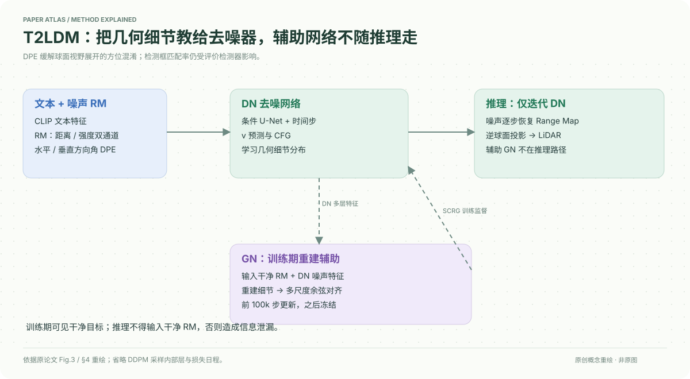

# A Self-Conditioned Representation Guided Diffusion Model for Realistic Text-to-LiDAR Scene Generation

核对日期：2026-10-20。以下实验均为作者报告；本地完成原文阅读与讲解自检，未复现实验。

## 一句话总结

T2LDM用训练期重建引导网络和方向角编码增强LiDAR扩散模型，并用3D框构造可组合文本描述；推理只保留去噪网络。

## 研究背景与动机

文本-LiDAR配对数据比文本图片少，模型容易生成平滑、缺细节的点云。文本越精细又会把有限数据切成稀疏组合，因此复杂描述未必更可控。Range Map把球面铺平，还可能使街道方位与接缝混淆。[§1–3，PDF1–4]

## 方法总览

点云投影为距离+强度Range Map，冻结CLIP编码文本，U-Net去噪器接收时间与方向编码。训练时GN看干净RM与DN多层噪声特征，重建几何并为DN提供特征对齐；GN前100k步更新，之后冻结，推理移除。[Fig.3、§4，PDF4–5]

## 核心创新与关键设计

条件扩散采用v预测与CFG；辅助项把DN噪声特征与GN重建特征作余弦对齐，总目标
\[L=L_{DN}+L_{GN}+\lambda L_{SCRG}.\]
GN训练可见干净目标，不能在推理也喂真值，否则信息泄漏。GN移除只表示辅助网络不增加推理开销，并非扩散采样不需计算。[式2–4、8]

DPE给每个RM位置编码水平角θ和垂直角φ，再作多频Fourier特征与可学习门控注入，减少把环形视野当普通矩形造成的方向错误。[式5–6]

T2nuScenes由34149样本的3D框构造目标car数量/位置/朝向和天气时间描述。TBR由检测器输出框与文本匹配率衡量可控性，因此依赖检测器准确率，不能作为完美几何真值评价。[§3]

## 实验与关键结果

nuScenes32线RM为32×1024×2，KITTI36064线为64×1024×2。每种方法生成10000样本，真实分布用全部34149或76165样本；必须统一FID参考集，不能与随机子集统计混用。[§5，PDF5–8]

| 作者结果，越低越好 | R2DM | T2LDM |
| --- | --- | --- |
| KITTI360无条件 FSVD/FPVD | 31.82/35.94 | 21.12/25.39 |
| nuScenes无条件 FSVD/FPVD | 86.54/83.97 | 64.21/62.85 |
| nuScenes文本 FSVD/FPVD | 91.15/88.55 | 66.93/65.84 |

文本可控率TBR/TBK原文记号混用，Table4本文23.44%，Text2LiDAR17.15%。有改善但离完全匹配仍远，不能写成任意文本精确控制。[PDF7]

物体位置细描述匹配率12.23%，调整为较粗的around描述后23.42%；这是任务变粗与数据分布变化后的结果，不能当相同约束下精确定位加倍。

## 消融实验与证据强度

Table7文本生成，无DPE/SCRG为FSVD73.64、匹配19.32%；仅DPE71.32/20.95，仅SCRG68.45/22.15，完整66.93/23.44。两项在该设置互补。[PDF8]

30k步KITTI360，完整FSVD47.29、仅DPE91.32，支持早期收敛收益；两者推理参数30.4M和1024步相同。Table9预训练GN为68.77，无SCRG68.11，端到端64.21，说明不是随便加一个冻结教师就有效。

## 局限与讨论

文本模板以car为主要目标，复杂关系与稀有天气场景仍受训练分布限制。RM投影只部分可逆，碰撞、缺失点与传感器线束差异需处理。生成分布指标变好不直接证明自动驾驶下游安全或真实传感物理准确。

其他条件任务需额外训练条件编码器，不能宣传全部任务零训练。补充材料中的训练权重日程与详细检测器协议未核验。

## 复现提示

源码 `https://github.com/QWTforGithub/T2LDM`，许可与固定commit待核。先固定原数据集访问条件、投影FOV/距离范围/无效值、文本模板与拆分，确认推理不含干净RM或GN。对比统一真实分布与采样数，记录1024采样步的实际延迟。

建议 `data/lidar/t2ldm/`，数据和生成点云不纳入仓库。本地未训练或运行模型。

## 相关工作与阅读顺序

先读LiDAR球面Range Map，再理解条件DDPM与v预测，最后看SCRG对照与DPE。将文本可控性与生成质量分开：看起来像街景，不代表满足“哪辆车在谁右边”等精确条件。

## 来源与校验

- [CVF 官方论文页](https://openaccess.thecvf.com/content/CVPR2026/html/Qu_A_Self-Conditioned_Representation_Guided_Diffusion_Model_for_Realistic_Text-to-LiDAR_Scene_CVPR_2026_paper.html) · [所读 PDF](https://openaccess.thecvf.com/content/CVPR2026/papers/Qu_A_Self-Conditioned_Representation_Guided_Diffusion_Model_for_Realistic_Text-to-LiDAR_Scene_CVPR_2026_paper.pdf)。页码均为该 PDF 的页序。
- 阅读范围：正文、公式与实验表；补充材料、上游代码与权重未逐项核验。许可证和固定代码 commit 尚未确认，不复制原文全文或数据。
- PDF SHA-256：`09f7e5c9408f6a0436bc42c12fc5ddb914c354c1506d2fa44f599037b71a3b89`；版本为本次下载的 CVF 接收稿，核对日期 2026-10-20。

- 视觉核对：已渲染查看 PDF第8页并核对原表、算法或公式；独立补充材料未读，实验未复现。
