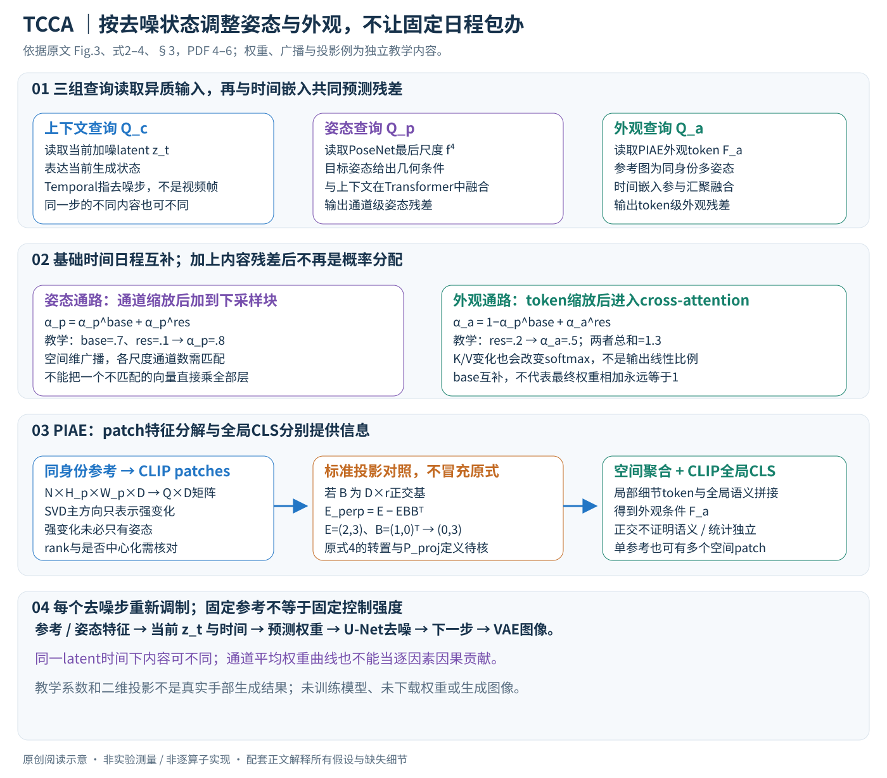

# A Temporal and Content Co-Awareness Latent Diffusion for Controllable Hand Image Generation

核对日期：2026-10-20。以下实验均为作者报告；本地完成原文阅读与讲解自检，未复现实验。

方法与配图详细版返工：2026-10-23。重读§3–4与Fig.3，展开查询读取、时间/内容权重、注入接口和SVD投影维度；未生成图像或复现实验。

## 一句话总结

TCCA根据当前去噪状态、目标手势和参考外观动态调整控制强度，并用多姿态参考编码减少外观中的姿势干扰。

## 研究背景与动机

手部关节多、自遮挡强，参考图的纹理、阴影和姿势容易纠缠。固定注入强度难同时照顾早期结构形成和后期纹理细化；作者通过分时间段移除条件，发现复杂手势在后期仍依赖姿态信号，不能只用固定的“先姿态后外观”日程。[Fig.2、§1，PDF1–2]

## 方法总览

### 条件是目标姿态与同身份参考图，时间指去噪时间

TCCA根据目标手势条件生成一张手部图像，同时尽量保留参考身份的肤色、纹理等外观。训练时给定同身份、多姿态参考图、参考姿态、目标姿态及目标真图，学习重建目标；推理时用目标姿态和参考图控制从噪声到图像的生成。（§3.2，PDF第3页）

这里的Temporal不是视频时间一致性，而是扩散过程的去噪时间步。方法以Stable Diffusion 1.5的latent U-Net为主干：PoseNet提取多尺度姿态特征，PIAE编码参考外观，TCCA为当前去噪状态预测如何调制两类条件。（§3.1–3.3、§4.1，PDF第3–7页）

原创图依据Fig.3与式2–4，PDF第4–6页。权重和投影小例子为独立教学计算，未生成手部图片或运行模型。

| 表示 | 角色 | 形状/注入位置 |
|---|---|---|
| \(z_t\) | 当前加噪latent，携带当前生成状态 | 进入U-Net，也为上下文查询提供内容 |
| \(F_p=[f^1,f^2,f^3,f^4]\) | PoseNet多尺度姿态条件 | 调制后加到U-Net各下采样块末端 |
| \(F_a\) | PIAE外观语义token | 调制后通过各U-Net块cross-attention注入 |
| \(Q_p,Q_a,Q_c\) | 姿态、外观、上下文三组查询表示 | 通过Transformer解码读取异质输入 |
| \(t_{\rm emb}\) | 时间嵌入 | 预测基础日程，并参与查询融合 |

论文未完整列出所有查询数量、隐藏宽度和逐尺度通道映射，不能从架构图自行补成一个已核查的可执行网络。

## 核心创新与关键设计

### 为什么固定“早姿态、晚外观”还不够

高噪声阶段通常更需要建立结构，低噪声阶段更关注纹理，但复杂手势或严重遮挡在后期仍可能依赖姿态信号；参考图的阴影、皱褶又与原姿势耦合。作者通过分阶段移除条件观察这种依赖，提出同时看时间先验和当前内容，而不是直接手工设一条固定控制曲线。（Fig.2、§3.3，PDF第2、4页）

“去噪早期”通常对应较大的扩散噪声时间\(t\)，随着采样向0走才是后期；不能把图的横轴从小到大就自动说成生成从早到晚。方法是二维图像生成，不据Temporal一词宣称已测试视频帧间稳定性。

### 三组查询各自读什么，然后怎样相互作用

异质条件不能靠元素相加就获得可靠语义对齐。作者用三组可学习查询，分别通过Transformer decoder读取：上下文组读\(z_t\)，姿态组读PoseNet最后尺度\(f^4\)展平后的token，外观组读\(F_a\)。查询参数在训练中学习，但解码后的查询表示会随每次输入和去噪步改变；不是训练后所有图像都用同一组常量权重。（§3.3、Fig.3，PDF第4页）

以标准cross-attention解释其中一个读取接口：查询长度\(L_q\)、条件长度\(L_s\)时，\(QW_Q(KW_K)^\top\)形成\(L_q\times L_s\)的相关矩阵，经softmax组合条件值。这个形状说明查询压缩语义，不要求参考外观patch和目标像素一一对齐；不是原文披露的具体头数或实际token数量。

之后姿态/外观内容因素与上下文因素在Transformer encoder中融合，时间嵌入承担类似CLS的汇聚角色，形成预测残差权重的表示。上下文因此不只是时间编号：同一个\(t\)下，当前latent结构和目标条件复杂度不同，也可能给出不同残差。原文没有证明这些查询只能表示其命名的语义，需通过消融和进一步探针验证。

### 基础日程互补，最终两路权重不必互补

基础姿态权重由时间嵌入经过MLP产生，外观基础权重定义为其补数：\(\alpha_a^{\rm base}=1-\alpha_p^{\rm base}\)。融合查询预测两种不同粒度的残差：姿态为通道级，外观为token级。原式2–3为

\[
F_p^t=(\alpha_p^{\rm base}+\alpha_p^{\rm res})\odot F_p,
\]
\[
F_a^t=(1-\alpha_p^{\rm base}+\alpha_a^{\rm res})\odot F_a.
\]

只有base互补。教学例子取base姿态\(.7\)、姿态残差\(.1\)、外观残差\(.2\)，最终系数为\(.8\)与\(.5\)，和为1.3。实际两路粒度还不同，不应把每个姿态通道与每个外观token当作共享一个归一概率预算。正文未完整说明输出激活、裁剪范围与所有尺度映射，不保证最终权重一定落在\([0,1]\)。（PDF第5页）

通道权重需要沿空间维广播到相应姿态特征图；token权重沿特征维广播。四个姿态尺度有不同通道宽度，如何由融合表示为各尺度生成权重需要实现核对，不能把同一个不匹配长度向量强乘所有层。

### 两路条件在U-Net中走不同接口

姿态特征调制后以加法进入下采样块末端，强调几何空间约束；外观特征调制后成为各块cross-attention条件，使目标latent位置读取参考语义。（§3.3，PDF第5页）

对外观token做缩放通常会同时改变其K/V投影：不仅改变值的幅度，还可能改变注意力logit及softmax分配。因此“外观权重翻倍”不等于输出图的肤色/纹理贡献严格线性翻倍，权重轨迹也不是可直接解释成因果贡献比例的测量。

图9显示不同采样步数下的平均姿态权重日程相近，是作者所测条件下的汇总观察；通道平均会隐藏通道差异，不能据一条平均曲线宣称所有图像、每根手指或每个尺度都采取相同控制策略。（PDF第8页）

### PIAE先用局部CLIP特征，再处理跨姿态纠缠

同身份参考图可提供互补视角与纹理，但每张图也带着姿态相关阴影和皱褶。PIAE从CLIP图像编码器取patch特征，组织为\(N\times H_p\times W_p\times D\)，展平为\(M\in\mathbb R^{Q\times D}\)、\(Q=NH_pW_p\)，再做SVD。这里\(H_pW_p\)是patch token数，不是原始图像像素数。（§3.4，PDF第5–6页）

\(M=U\Sigma V^\top\)中的主要方向被用来表示强变化子空间，并尝试去除其中姿态相关因素。主文没有明确全部中心化、rank和patch对应规则，不能将它无说明地叫作“已中心化PCA去姿态”。跨不同参考、不同空间patch的方差也可能包含肤色、背景、饰物或真实纹理，并非天然只对应姿态。

### 投影公式的维度问题不能通过讲解悄悄掩盖

原式4印为\(e_p'=e_p-e_p^\top P_{\rm proj}\)，但\(e_p\)此前是四维tensor，\(P_{\rm proj}\)是否指正交基还是完整投影矩阵没有充分展开，转置后的乘积也不足以直接实现。（PDF第6页）

为解释**通常的行向量正交残差**，若\(E\in\mathbb R^{Q\times D}\)、正交基\(B\in\mathbb R^{D\times r}\)、\(B^\top B=I_r\)，则可写

\[
E_\perp=E-EBB^\top,\qquad E_\perp B=0.
\]

这是本笔记的标准线性代数对照，**不是声称作者代码已采用该修正式**。教学例子\(E=(2,3)\)、\(B=(1,0)^\top\)，残差为\((0,3)\)：去掉第一坐标只能证明与所选基正交，不能证明第一坐标仅包含姿态、第二坐标仅包含身份。rank取0则什么也不去，取满维则残差可全部为零，rank是重要取舍。

即使只有一张参考图，仍可有多个空间patch，因此矩阵SVD并不自动退化为一个样本向量；但也不能从单张参考中分离出由真实跨姿态变化支持的语义子空间。正文把单参考数量分析放在补充材料，本次未核验，不补造其rank或统计解释。

### 从残差patch到紧凑外观token

分解后用空间注意力聚合局部patch，得到较紧凑语义token，再拼接CLIP的全局CLS以增强总体外观一致性。局部通路保留细节，CLS补充整体语义；PAT、CLS和不做SVD的ENG消融支持所选组合在实验中的作用。（§3.4、§4.5，PDF第6–8页）

这并不是先对所有patch求平均再把一个CLS当整套纹理，也不意味着CLS完全不含姿态。参考数量、采样身份/视角、SVD投影定义和空间聚合权重都影响信息保留；可用结果并不等同于严格统计独立证明。

### 训练、采样与尚待核对的实现

训练将目标真图经VAE编码、按扩散时间加噪，U-Net在姿态/外观控制下预测去噪量。正文介绍DDPM噪声预测，但没有完整列出所有训练目标、冻结模块范围和损失系数；不能把通用噪声MSE的常见形式冒充其已核查完整训练配置。它报告SD1.5、AdamW、学习率\(10^{-5}\)、RTX4090，参考外观与姿态条件按10%概率丢弃。（§3.1、§4.1，PDF第3、7页）

推理先编码固定参考和目标姿态，再从噪声latent迭代。每步以当前\(z_t\)、时间和条件重新计算TCCA权重，注入U-Net，最后VAE解码成图。姿态/身份CFG均2.0是作者设置，但两种条件的无条件分支组合公式与额外前向次数需查实现，不能仅据两个2.0断言与标准单条件CFG完全相同。

需要进一步核对的还有查询数、分层映射、SVD rank/中心化/梯度、参考抽样、条件丢弃是联合还是独立、噪声调度、采样器、步数、权重边界和模型许可。身份划分及近重复帧也影响评价；HaMer再重投影的PCK/MPE衡量估计器相关几何一致性，不是每个生成关节的独立三维真值验证。

本次仅重读主文、检查调制广播与投影维度、绘制原创详图。权重相加与二维投影例均为代数自检，未下载权重、训练或生成图像，不将“姿态不变编码器”的名称当成已证明的语义独立定理。

## 实验与关键结果

基于SD1.5、AdamW学习率1e-5、单RTX4090；采样姿态/身份CFG均2.0，训练条件丢弃概率10%。主要使用FoundHand-10M的四个子集，正文主要展示InterHand2.6M。[§4.1，PDF6–7]

| 作者报告：InterHand2.6M | FoundHand | TCCA |
| --- | --- | --- |
| FID↓ | 10.462 | 9.046 |
| LPIPS↓ | 0.4390 | 0.4078 |
| SSIM↑ | 0.5374 | 0.5714 |
| PCK@0.05↑ | 83.93 | 87.34 |
| MPE↓ | 8.76 | 7.81 |

来源Table1–2，PDF6。原表PCK标↓，与指标定义和最佳结果方向矛盾，此处按正确关键点比例解释为↑。HaMer估计后做2D重投影评价，不等于独立3D结构真值测量。FoundHand使用更大原训练集的公开checkpoint，其他方法在同子集训练，训练预算不完全相同。

## 消融实验与证据强度

无TCCA时PIAE完整版本FID11.089；不用SVD的ENG为12.946。TCCA仅内容感知CA为9.804、仅时间TA为9.652，完整9.046；完整LPIPS0.4078，也优于CA0.4572和TA0.4299。[Table4，PDF7–8]

全FoundHand-10M实验FID9.981→8.183，不能与子集消融的11.089混成同一设置。Fig.9呈现50步和1000步平均权重轨迹相近，只说明该条件下日程相近，不能证明所有图像都学到同样的因果机制。

## 局限与讨论

姿态标注来自现成管线，其误差可能传递到训练和评价。多参考假定同身份并包含互补视角，真实遮挡和配饰变化仍难；SVD残差可能去掉有用纹理。正文未充分量化所有推理时延与显存，4090训练成功不意味着任意本地设备都可运行。

论文“严格独立”表述比实验支持更强，正交子空间不能自动证明姿态与外观在统计或语义上独立。

## 复现提示

建议 `data/hand-generation/tcca/`，先核对FoundHand及其子集、身份划分和许可，避免同身份近重复帧泄漏。记录参考图数量、SVD rank、projection定义、每尺度权重及CFG实现。

正文提供[作者代码入口](https://github.com/samukahs/TCCA)，未检查commit、许可证、权重或实际执行。本地未生成个人手部数据，所有数值来自作者报告。

## 相关工作与阅读顺序

先读LDM和姿态条件注入，再看FoundHand、CLIP patch与全局特征的区别，最后读TCCA时间/内容消融。与SVD风格个性化论文对照时，注意两者的分解目的、张量和训练要求完全不同。

## 来源与校验

- [CVF 官方论文页](https://openaccess.thecvf.com/content/CVPR2026/html/Hao_A_Temporal_and_Content_Co-Awareness_Latent_Diffusion_for_Controllable_Hand_CVPR_2026_paper.html) · [所读 PDF](https://openaccess.thecvf.com/content/CVPR2026/papers/Hao_A_Temporal_and_Content_Co-Awareness_Latent_Diffusion_for_Controllable_Hand_CVPR_2026_paper.pdf)。页码均为该 PDF 的页序。
- 阅读范围：正文、公式与实验表；补充材料、上游代码与权重未逐项核验。许可证和固定代码 commit 尚未确认，不复制原文全文或数据。
- PDF SHA-256：`e2506a7235ef7ca66d9f17b35defe1f60dee4c4cac0fab738c0c177f234f98e6`；版本为本次下载的 CVF 接收稿，核对日期 2026-10-20。
- 视觉核对：原PDF第6页已渲染检查，核对关键图表及公式排版。原创方法图为概念重绘，细节以原文为准。
