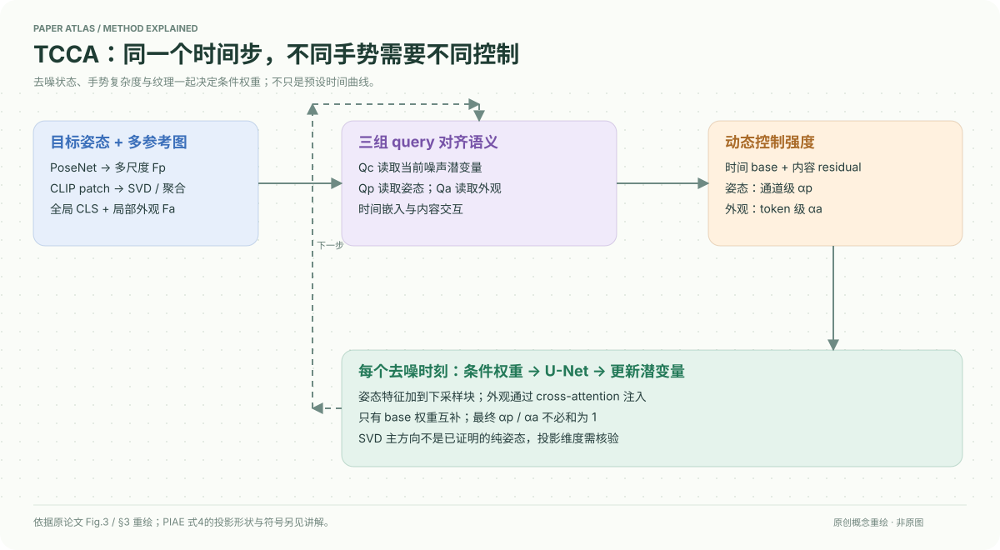

# A Temporal and Content Co-Awareness Latent Diffusion for Controllable Hand Image Generation

核对日期：2026-10-20。以下实验均为作者报告；本地完成原文阅读与讲解自检，未复现实验。

## 一句话总结

TCCA根据当前去噪状态、目标手势和参考外观动态调整控制强度，并用多姿态参考编码减少外观中的姿势干扰。

## 研究背景与动机

手部关节多、自遮挡强，参考图的纹理、阴影和姿势容易纠缠。固定注入强度难同时照顾早期结构形成和后期纹理细化；作者通过分时间段移除条件，发现复杂手势在后期仍依赖姿态信号，不能只用固定的“先姿态后外观”日程。[Fig.2、§1，PDF1–2]

## 方法总览

PoseNet产生多尺度姿态特征，PIAE从同身份多张参考图提取外观；三组可学习query分别读取当前潜变量、姿态和外观。它们与时间嵌入交互，产生通道级姿态权重和token级外观权重，注入Stable Diffusion U-Net。[Fig.3、§3，PDF3–6]

PIAE以CLIP patch特征为基础，做SVD相关的正交去除、空间聚合，再拼接全局CLS。示意图表达信息路径，不将正交操作等同于已证明的语义独立。

## 核心创新与关键设计

作者将时间先验作为base，将内容相关部分作为residual：
\[F_p^t=(\alpha_p^{base}+\alpha_p^{res})\odot F_p,\qquad F_a^t=(1-\alpha_p^{base}+\alpha_a^{res})\odot F_a.\]
姿态加在U-Net下采样块末端，外观通过各块cross-attention注入。只有base互补，加入两个不同残差后，最终权重不必和为1，也不能直接理解成概率。[式2–3，PDF5]

SVD段写\(M=U\Sigma V^\top\)，以主方向表示姿态变化，但式4印为\(e_p^{new}=e_p-e_p^\top P_{proj}\)。转置及Pproj的形状定义不足以直接实现：标准正交投影常需要明确正交基及其乘积，必须对照代码确认，笔记不擅自把纠正后的式子当成作者原式。主方差方向也未必只包含姿势，语义去纠缠属于经验假设。[PDF6]

## 实验与关键结果

基于SD1.5、AdamW学习率1e-5、单RTX4090；采样姿态/身份CFG均2.0，训练条件丢弃概率10%。主要使用FoundHand-10M的四个子集，正文主要展示InterHand2.6M。[§4.1，PDF6–7]

| 作者报告：InterHand2.6M | FoundHand | TCCA |
| --- | --- | --- |
| FID↓ | 10.462 | 9.046 |
| LPIPS↓ | 0.4390 | 0.4078 |
| SSIM↑ | 0.5374 | 0.5714 |
| PCK@0.05↑ | 83.93 | 87.34 |
| MPE↓ | 8.76 | 7.81 |

来源Table1–2，PDF6。原表PCK标↓，与指标定义和最佳结果方向矛盾，此处按正确关键点比例解释为↑。HaMer估计后做2D重投影评价，不等于独立3D结构真值测量。FoundHand使用更大原训练集的公开checkpoint，其他方法在同子集训练，训练预算不完全相同。

## 消融实验与证据强度

无TCCA时PIAE完整版本FID11.089；不用SVD的ENG为12.946。TCCA仅内容感知CA为9.804、仅时间TA为9.652，完整9.046；完整LPIPS0.4078，也优于CA0.4572和TA0.4299。[Table4，PDF7–8]

全FoundHand-10M实验FID9.981→8.183，不能与子集消融的11.089混成同一设置。Fig.9呈现50步和1000步平均权重轨迹相近，只说明该条件下日程相近，不能证明所有图像都学到同样的因果机制。

## 局限与讨论

姿态标注来自现成管线，其误差可能传递到训练和评价。多参考假定同身份并包含互补视角，真实遮挡和配饰变化仍难；SVD残差可能去掉有用纹理。正文未充分量化所有推理时延与显存，4090训练成功不意味着任意本地设备都可运行。

论文“严格独立”表述比实验支持更强，正交子空间不能自动证明姿态与外观在统计或语义上独立。

## 复现提示

建议 `data/hand-generation/tcca/`，先核对FoundHand及其子集、身份划分和许可，避免同身份近重复帧泄漏。记录参考图数量、SVD rank、projection定义、每尺度权重及CFG实现。

正文提供[作者代码入口](https://github.com/samukahs/TCCA)，未检查commit、许可证、权重或实际执行。本地未生成个人手部数据，所有数值来自作者报告。

## 相关工作与阅读顺序

先读LDM和姿态条件注入，再看FoundHand、CLIP patch与全局特征的区别，最后读TCCA时间/内容消融。与SVD风格个性化论文对照时，注意两者的分解目的、张量和训练要求完全不同。

## 来源与校验

- [CVF 官方论文页](https://openaccess.thecvf.com/content/CVPR2026/html/Hao_A_Temporal_and_Content_Co-Awareness_Latent_Diffusion_for_Controllable_Hand_CVPR_2026_paper.html) · [所读 PDF](https://openaccess.thecvf.com/content/CVPR2026/papers/Hao_A_Temporal_and_Content_Co-Awareness_Latent_Diffusion_for_Controllable_Hand_CVPR_2026_paper.pdf)。页码均为该 PDF 的页序。
- 阅读范围：正文、公式与实验表；补充材料、上游代码与权重未逐项核验。许可证和固定代码 commit 尚未确认，不复制原文全文或数据。
- PDF SHA-256：`e2506a7235ef7ca66d9f17b35defe1f60dee4c4cac0fab738c0c177f234f98e6`；版本为本次下载的 CVF 接收稿，核对日期 2026-10-20。
- 视觉核对：原PDF第6页已渲染检查，核对关键图表及公式排版。原创方法图为概念重绘，细节以原文为准。
