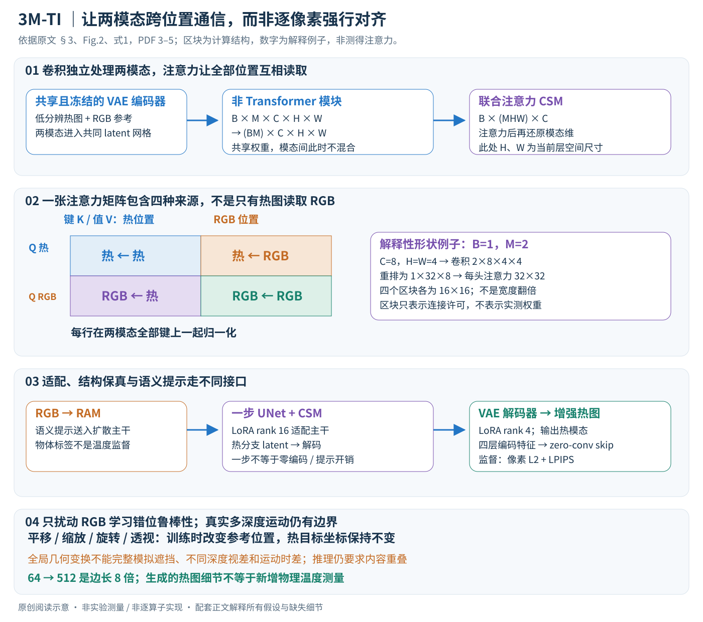

# 3M-TI: High-Quality Mobile Thermal Imaging via Calibration-free Multi-Camera Cross-Modal Diffusion

作者：Minchong Chen, Xiaoyun Yuan, Junzhe Wan, Jianing Zhang, Jun Zhang。

分类：imaging；交付形式：Markdown 中文论文讲解。

核对日期：2026-10-20。以下实验均为作者报告；本地完成原文阅读与讲解自检，未复现实验。

方法与配图详细版返工：2026-10-23。重读§3–4，核对Fig.2；补充张量重排、四区块注意力、LoRA/skip、训练边界和错位反例，未复现。

## 一句话总结

3M-TI让未标定RGB与低分辨热图在一步扩散模型内做跨模态注意力，以提高热成像感知细节和下游任务效果。

## 研究背景与动机

小型热传感器像素有限，RGB可提供边缘但严格相机标定费力，视差和不同步也会导致纹理错位。作者以潜空间对应与错位增强替代显式逐像素对齐，输出仍是生成增强图而非额外物理测量（第1–3页）。

## 方法总览

### 输入两种证据，输出一张增强热图

3M-TI的任务是：给定低分辨率热图\(I_{th}\)和没有逐像素配准的高分辨率RGB参考\(I_{RGB}\)，输出更高分辨率的热图\(\hat I_{th}\)。公开数据实验将热图降为64×64、RGB参考设为512×512，以高分辨热图作监督。相邻相机不保证相同视点、相同拍摄时刻，但仍需要足够的场景内容重叠；“calibration-free”不是允许输入两张无关照片。（§3.1、§4.1，PDF第3、5页）

输出可以包含从RGB和生成先验补出的结构，因此应叫热图重建/感知增强，不能直接理解为传感器新测到了512×512个独立温度值。64→512是边长8倍、像素数64倍，既不是物理传感器像元数增加，也不保证温度计量精度提升。

原创阅读图依据§3、Fig.2、式1，PDF第3–5页。注意力区块表示允许计算的连接，不是测得的注意力热力图；小网格和张量数字是解释例子。图中特别区分了没有显式标定、仍有场景重叠要求，以及生成细节和物理测温的不同。

### 主干来自一步扩散，信息在潜空间融合

作者使用SD-Turbo的一步潜空间扩散模型。两张输入图分别通过**共享且冻结的VAE编码器**，得到\(z^0_{th}\)和\(z^0_{RGB}\)；UNet在多个尺度上处理两模态，并把原有self-attention改成联合序列的cross-modal self-attention。最后只取增强后的热模态latent，经带LoRA和skip的VAE解码器输出热图。（§3.1–3.2、Fig.2，PDF第3–4页）

这里的“一步”指生成主干不再执行很多轮逆扩散，不是说整个系统只有一个神经网络算子。输入预处理、两个VAE编码、RGB语义提示、UNet、热分支解码均有成本。论文没有给出足以从正文唯一确定噪声/时间步/调度器的全部推理配置；不能把熟悉的SD-Turbo默认参数直接填进来当作本文设置。

RAM（Recognize Anything Model）从RGB产生语义文本提示，再给扩散主干提供语义条件。它不是输出最终热图的视觉通道，也不是人工阶段标签；即使提示说“汽车”，它也没有告诉模型该汽车每个点的真实温度。（§3.1，PDF第3–4页）

| 记号 | 含义 | 形状/边界 |
|---|---|---|
| \(I_{th},I_{RGB}\) | 热图和可见光参考 | 两种成像物理，不要求像素一一对应 |
| B | batch中的场景对数 | 不等于相机数量 |
| M | 同场景输入图数量 | 主设置2，即热图+RGB；多RGB只是可扩展方向 |
| \(C_\ell,H_\ell,W_\ell\) | 当前UNet尺度的通道与空间尺寸 | 不是原图分辨率，随层变化 |
| \(Z_\ell\) | 显式保留模态维的特征 | \(B\times M\times C_\ell\times H_\ell\times W_\ell\) |
| \(L_\ell=M H_\ell W_\ell\) | 联合注意力的序列长度 | 每个latent位置一个token |
| \(\hat I_{th}\) | 解码后的高分辨率热图 | 只有热分支被作为最终重建输出 |

表中增加下标\(\ell\)，是为了避免原文H/W与原图高宽同名造成混淆。低分辨率热图如何满足VAE输入的通道数、上采样与归一化，正文未逐项完整给出；这会影响精确复现，不能仅凭图中两份latent就假定原始64×64和512×512能不经处理直接堆叠。

## 核心创新与关键设计

### 第一步：卷积阶段把模态当作额外batch，保持处理独立

对非Transformer模块，作者把M折入batch：

\[B\times M\times C_\ell\times H_\ell\times W_\ell
\longrightarrow (BM)\times C_\ell\times H_\ell\times W_\ell.\]

共享模块因此分别处理热特征和RGB特征；同一个卷积核可以复用，但不会仅因为它们共享权重，就把两张图的不同位置直接加在一起。“模态间通信发生在哪一层”在此很清楚：主要在后面的联合注意力，而不是把RGB像素当作热像素逐点叠加。（§3.2，PDF第4页）

这也解释为什么简单channel concat不等价：若在通道维把两模态拼起来再投影，通常预设同一个空间槽位上的通道具有足够对应关系；本文则允许一个热位置读取RGB的其他空间位置，而不是把偏移完全交给局部卷积消化。

### 第二步：注意力阶段把模态和空间放进同一条序列

进入self-attention前，重排成

\[F_\ell\in\mathbb R^{B\times(MH_\ell W_\ell)\times C_\ell}.\]

这只是视图/维度重排，没有凭空生成新像素或学习到一个标定矩阵。两个模态的所有latent位置在同一序列中成为token，再复用原注意力的投影权重。用标准单头记号说明计算：

\[Q=F_\ell W_Q,\quad K=F_\ell W_K,\quad V=F_\ell W_V,\]
\[A=\operatorname{softmax}\left(\frac{QK^\top}{\sqrt{d_h}}\right),
\qquad O=AV.\]

这组公式是对Fig.2(b)与§3.2的通用注意力解释，原文没有另行列出它作为新损失或新定理。关键是Q、K、V都来自**联合的两模态序列**，所以A可以按查询/键来源分为四个区块：

\[A=\begin{bmatrix}
A_{th\leftarrow th}&A_{th\leftarrow RGB}\\
A_{RGB\leftarrow th}&A_{RGB\leftarrow RGB}
\end{bmatrix}.\]

每行表示一个查询从哪些键处聚合内容。热→热区块保留热模态内部关系，热←RGB区块引入可见光结构；RGB查询也可以读取热图以及RGB自身。每行softmax对整个联合键集合归一化，并不是把四个区块各自独立归一化后随意相加。

如果某个热位置位于行人轮廓边缘，而RGB边缘因视差偏了几格，该查询仍可选择更远处的RGB特征。这是无需固定同像素配对的原因。但是注意力是内容加权汇聚，不自动输出内参、外参、稠密光流或可解释的一对一匹配；多个位置可以读到同一键，权重也未必对应真实几何。

### 第三步：恢复模态维，继续多尺度处理

注意力输出再还原为\((BM)\times C_\ell\times H_\ell\times W_\ell\)，交给后续非注意力模块；在下一个注意力块再次合并token。因而跨模态交换贯穿UNet的多个尺度，而不是只在最开始融合一次。粗尺度更便宜、覆盖较大区域，细尺度保留位置细节；具体每层处理能力仍受预训练主干和微调数据限制。（§3.1–3.2，PDF第3–4页）

**一个仅用于理解的形状例子。** 假设某层B=1、M=2、\(H_\ell=W_\ell=4\)、C=8，则模态显式表示为1×2×8×4×4；卷积看到2×8×4×4；注意力看到1×32×8；一头权重矩阵是32×32。每个模态16个位置，四个来源区块各16×16。注意力后恢复原形状，不能把32个token误当作“热图空间宽度翻倍”。这些数字不是作者网络的实际层配置。

M个模态联合注意力每头含\((MHW)^2\)个配对；各模态独立注意力合计含\(M(HW)^2\)个配对。M=2时，联合是独立处理两图的2倍配对数，是单图的4倍，而不是“重排无参数所以计算也不增加”。增加RGB参考数量会使这个部分二次增长，显存实现和具体分辨率还会进一步影响实际成本。

### 为什么作者选择联合self-attention，而非标准cross-attention？

若只令热图作为Q、RGB作为K/V，标准cross-attention能传递RGB信息，但该模块本身不包含热←热的内部关系；联合形式同时允许热模态自关联与跨模态读取。原文Table 4比较了模态内self-attention、静态feature concat、仅跨模态cross-attention与CSM，完整CSM的LPIPS为0.1787，cross-attention为0.1953、feature concat为0.2164。（PDF第8页）

这个消融支持“在作者所用实现和训练条件下，联合形式更有效”，不证明所有cross-attention结构都不能保留热结构：完全可以另加模态内模块，但那是另一套模型。也不能仅由注意力类型推断图中每条纹理都得到真实热观测支持。

### 第四步：LoRA适配与结构skip分别解决什么？

预训练扩散主干具有自然图像生成先验，但任务是热图重建。作者用LoRA微调UNet和VAE解码器，rank分别16和4，冻结VAE编码器；Fig.2还以冻结主干和可训练低秩适配区分参数边界。（§3.1、Fig.2、§4.1，PDF第3–5页）

通用LoRA背景可写为

\[W=W_0+\Delta W,\qquad \Delta W=B_LA_L,\]

其中\(W_0\)保持冻结，\(A_L\in\mathbb R^{r\times d_{in}}\)、\(B_L\in\mathbb R^{d_{out}\times r}\)可训练。单层可训练矩阵参数为\(r(d_{in}+d_{out})\)，而不是完整\(d_{in}d_{out}\)。这里只解释低秩更新原理，不据此虚构所有注入层、缩放系数、初始化和总参数量；正文未完整列出这些细节。

另一条路径是VAE编码器到对应解码器层的结构skip：四个编码器下采样块的特征经过1×1零初始化卷积，再加入相应上采样块。用解释性记号表示为

\[\tilde h^{dec}_\ell=h^{dec}_\ell+W^{zero}_\ell h^{enc}_\ell,\qquad
W^{zero}_\ell\big|_{init}=0.\]

初始附加路径输出为0，减少一开始直接扰乱预训练解码的风险；训练后该卷积可把输入结构传给解码器。编码器权重冻结，也不妨碍其输出作为常量特征用于训练后面的投影。skip是一条可训练结构保真接口，不是把低分辨热图无损变成高分辨真实温度的物理捷径。（§3.1、Fig.2，PDF第3–4页）

因此“CSM重排不增加注意力权重”只描述该重排本身，不能推广成整个系统零额外参数：LoRA和zero-conv均有训练参数，RAM也有模型与推理成本。

### 第五步：只扰动RGB，用合成错位训练跨位置读取

原始公开RGB—热图数据往往已对齐，直接训练可能让模型过度依赖同坐标对应。作者对RGB做平移、缩放、旋转、透视变换；热图与监督热目标仍定义输出坐标，从而迫使模型在RGB位置偏移时寻找可用内容，而不是把预测目标整体跟着RGB一起移走。（§3.3、Fig.2(c)，PDF第4–5页）

把一个热边缘位置理解为固定坐标u；训练时相关RGB边缘可能在\(g(u)\)附近，联合注意力要从别处读取证据。这个例子只描述任务，不代表论文真的给出了已知稠密映射g或用它监督注意力。增强变换是训练时生成的扰动，不是推理时必须求解的相机标定。

单幅全局透视/仿射扰动不能完整模拟真实多深度视差、运动物体遮挡、新出现区域、滚动快门或不同时间的温度变化。作者也明确说不作物理模拟。因此“针对不同步增强”应读成提高某类错位鲁棒性，不能变成“任意延迟和任意运动都被校正”。变换范围、组合概率、边界填充及不可见区域策略还需核对实现。

### 第六步：用有监督像素和感知目标训练，不虚构去噪目标

原文唯一明确给出的训练损失为

\[L=L_2(\hat I_{th},I^*_{th})+\lambda L_{LPIPS}(\hat I_{th},I^*_{th}),
\qquad \lambda=1.\]

像素项约束输出靠近高分辨热目标；LPIPS在预训练视觉特征空间比较感知差异。二者存在取舍：纹理更像自然可见结构，不一定使像素误差或温度误差最小。正文称L2但没有逐项给出像素/通道归一化；\(\lambda=1\)也不意味着两项实际梯度贡献完全相同。（式1、§4.1，PDF第5页）

损失经VAE解码器、skip及UNet适配路径更新可训练参数。VAE编码器被冻结，RAM在正文作为提示生成器使用，不能凭空增加RAM联合训练目标。虽然模型叫diffusion，本文没有把普通扩散的噪声MSE列为额外核心监督；讲解中不补造该项，也不把一般多步采样公式冒充本文一步实现。

训练可概括为：构造低分辨热输入与高分辨目标、扰动RGB、生成提示、编码两模态、用联合注意力交换信息、解码热分支、计算重建损失并更新适配参数。推理不再需要高分辨热目标，仍需要低分辨热图、RGB参考和相应提示/模型。数据增强服务于训练鲁棒性，不是预测时必须随机扭曲用户RGB。

### 从实验设计倒推“能说明什么”

公开数据监督来自高分辨图的人工退化，和真实低成本传感器的噪声、动态范围、响应非线性未必一致；实拍又没有对应高分辨热真值。因此前者可测像素/感知保真，后者主要展示无参考图质和下游可用性，两者证据不能互换。M3FD原本没有官方split，论文抽取训练3822对、测试376对；若复现，必须核对是否存在相近场景泄漏，而不是只复述总数。（§4.1，PDF第5页）

实拍模块原生96×96再缩至64×64；这与“原生64像元的所有热相机都能8倍提升”不同。手机参与采集也不意味着SD-Turbo已在手机端实时运行，论文报告的训练是A800，不应凭硬件照片推断部署速度。（§3.4–4.1，PDF第5页）

最值得单独测试的是模态冲突：RGB有纹理而热图没有温差、热目标在黑暗RGB中不可见、两相机捕到不同运动状态、两模态视场只有部分重叠。在这些情况下，漂亮轮廓可能是错误引导。要评估温度保真，需要辐射标定、原始温度/辐射数据和独立测量指标；本文没有给出这类验证，不能用PSNR或检测F1代替。

### 复现到哪一步才算忠实？

先固定热输入通道与数值范围、共同latent网格构造、SD-Turbo版本和一步调度，再核对LoRA目标层、skip接线、RAM提示、错位增强及训练/测试划分。只有重排形状正确，还不足以重现模型。建议先检查无RGB和冲突RGB两个控制条件，再比较感知指标与像素指标；不同目标的提升应分别报告。

本次完成原文重读、Fig.2结构与Table 1–4设置核对，以及独立形状/复杂度推导。**没有执行上游代码、没有训练模型、没有新增重建图像或测温实验**；图中的网格与矩阵均是概念示意，不是模型内部可视化实测结果。

## 实验与关键结果

训练10922对、测试1176对来自IRVI/LLVIP/M3FD/PBVS；64²→512²，A80080GB约4小时8000步，batch4，lr2×10⁻⁵。第7页本文PSNR30.09/SSIM0.8610/LPIPS0.1787；CoRPLE30.47/0.8642在像素保真更好，DifIISR MUSIQ36.74也略高于本文36.66。实拍300对/100场景只报无参考指标；不能据其证明真实细节GT。

## 消融实验与证据强度

第8页去RGB LPIPS0.2106，去错位增强0.1917，全模型0.1787；改跨注意力0.1953、特征拼接0.2164。去RAM SSIM0.8616反略高于全0.8610。检测F1本文0.4724、RGB0.4643、GT热图0.4887；召回0.5455低于RGB0.5708，不能称逐项优于RGB。分割优势主要为定性展示。

## 局限与讨论

增强纹理可能来自RGB和生成先验，并不等于可靠温度分布或测温精度；无参考图质不能排除幻觉。热相机原生96²在论文缩到64²，8倍SR设置需明确。低光RGB失效或快速非刚性错位仍有限；移动采集平台不代表推理已在手机实时实现。

## 复现提示

先固定传感器动态范围、RGB热图视场重叠及训练测试划分，再测测温保真、边界错配和无RGB退化。训练LoRA UNet rank16、解码器rank4；DifIISR未按同数据重训，比较有边界。论文work-submit/3MTI入口未执行，未审查许可、权重与固定版本。

## 相关工作与阅读顺序

先读RGB引导热图SR、SwinFuSR/SwinPaste与一步扩散，再看联合注意力。用“感知增强”和“温度计量”两类目标检查，避免把看清楚当作测得准。

## 来源与校验

- 已渲染并目视核对 PDF 第7页关键表格/图；其余正文与公式通过原文文本核对。
- [CVF 官方论文页](https://openaccess.thecvf.com/content/CVPR2026/html/Chen_3M-TI_High-Quality_Mobile_Thermal_Imaging_via_Calibration-free_Multi-Camera_Cross-Modal_Diffusion_CVPR_2026_paper.html) · [所读 PDF](https://openaccess.thecvf.com/content/CVPR2026/papers/Chen_3M-TI_High-Quality_Mobile_Thermal_Imaging_via_Calibration-free_Multi-Camera_Cross-Modal_Diffusion_CVPR_2026_paper.pdf)。页码均为该 PDF 的页序。
- 阅读范围：正文、公式与实验表；补充材料、上游代码与权重未逐项核验。许可证和固定代码 commit 尚未确认，不复制原文全文或数据。
- PDF SHA-256：`3ed2977f6c4a1f2035b1ecd1368f2d6dd1cc0ffb6793a5828744cdbb777e621e`；版本为本次下载的 CVF 接收稿，核对日期 2026-10-20。
