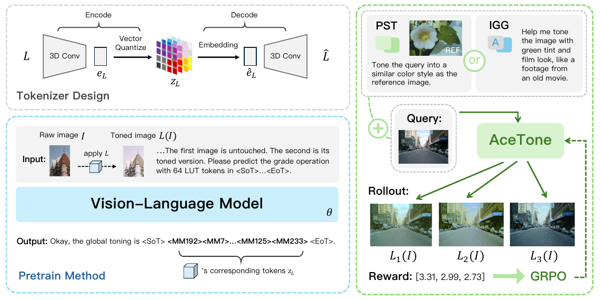

# AceTone: Bridging Words and Colors for Conditional Image Grading

核对日期：2026-10-21。实验数值均为作者报告；本地完成原文阅读与讲解自检，未复现实验。

## 一句话总结

AceTone让VLM生成64个离散LUT token，解码为全局三维颜色查找表，通过文本或参考图控制调色，并用颜色及审美奖励继续对齐。

## 研究背景与动机

扩散编辑可能改变物体或纹理，而专业调色通常希望保持几何内容、只调整颜色。固定滤镜库又难表达自由文本意图，因此作者把RGB→RGB变换本身变为可生成的紧凑表示。[§1–2，PDF1–2]

LUT保持像素位置，但不保证无颜色截断或信息损失；“non-destructive”主要指保存原图并将颜色操作分离，不代表映射可逆。

## 方法总览

原论文 Fig.2，PDF第3页。仅裁切相关图示，保留图内科学标签，著作权属于原作者；用于本篇方法分析，不并入本站原创图授权。[来源与作者](https://openaccess.thecvf.com/content/CVPR2026/html/Ma_AceTone_Bridging_Words_and_Colors_for_Conditional_Image_Grading_CVPR_2026_paper.html) · [PDF](https://openaccess.thecvf.com/content/CVPR2026/papers/Ma_AceTone_Bridging_Words_and_Colors_for_Conditional_Image_Grading_CVPR_2026_paper.pdf)。点击可打开高清图。

VQ-VAE把3×32×32×32 LUT压缩成4³=64个索引，码本256项，再用3D卷积解码。Qwen2.5-VL3B先学习从原图/调后图预测LUT，接着SFT适配参考风格与自然语言指令，最后GRPO按颜色匹配和审美采样多个LUT优化。[Fig.2、§3，PDF2–4]

预训练看得到调后目标图，实际文本推理只能看查询图和指令；参考任务还看另一个参考图，不能把目标结果偷偷作为部署输入。全局LUT不会为同RGB像素依据空间位置选择不同颜色变换。

## 核心创新与关键设计

tokenizer损失\(L=||L-\widehat L||_2^2+0.25||e_L-sg(\widehat e_L)||_2^2\)，码本以EMA更新。VLM以next-token交叉熵预测索引，参考任务联合颜色扰动增强。[式1–5，PDF3–4]

GRPO对一组结果的奖励做组内标准化，优化相对优势并加KL约束；颜色奖励为\(r_{color}=1/(\max(2,\Delta E)-1)\)，ΔE≤2时饱和为1，审美分从[0,5]缩放到[0,1]后相加。[式6–7、Algorithm1]

64个8bit索引为64字节，相对float32的3×32³个数约393216字节，编码比约99.98%；这不包含约4M参数tokenizer、3B VLM及其运行缓存，不能说整个调色系统体积缩小99.98%。论文将32³网格称“32-bit”时，应区分网格边长和每数值精度。

## 实验与关键结果

滤镜库约1万licensed LUT，专家库约3.4万，聚类为8192滤镜；以COCO、Adobe5K、PPR10K构造训练。约800K自动指令，经512条人工抽查与模型过滤；Transfer测试1024项、Instruct128项，声明图像与LUT隔离。[§4，PDF4–5]

训练tokenizer 8GPU约7小时，VLM冻结视觉编码器、调连接器与语言模型，8GPU约3天。[§5.1]

| 作者报告：Transfer1024 | SA-LUT | AceTone |
| --- | --- | --- |
| PSNR↑ | 18.14 | 22.49 |
| LPIPS↓ | 0.22 | 0.11 |
| ΔE↓ | 13.10 | 8.98 |
| DeQA审美↑ | 3.33 | 3.57 |

来源Table2，PDF6。LPIPS减半指该具体基准与对照，不是所有图像都改善50%。tokenizer单独平均ΔE1.38（某图示例2.64）不是端到端调色ΔE8.98，也不代表每一输入都低于2。

Instruct表列AceTone1.2秒、LPIPS0.22；文中vLLM低于300ms尚需同硬件、输入分辨率、批量及计时范围复核。

## 消融实验与证据强度

只用ΔE奖励的PSNR/LPIPS/ΔE/审美为22.51/0.11/8.93/3.29，加入审美后22.49/0.11/8.98/3.57：审美提升伴随颜色误差微增，不是全项优化。[Table4，PDF8]

20位参与者、每任务15例，本文被选最佳的比例PST41.4%、IGG46.9%，均非超过半数；一致性κ0.213。未统一显示校准、未做视觉筛查，不能把偏好当成客观色彩真值。Gemini排序是模型评价，须与真人研究分开。[Table3、5]

## 局限与讨论

极端光照、局部阴影和依赖纹理的色彩调整超出全局LUT表达力。模糊风格词有文化和个体差异，自动标注VLM本身可能误解颜色。

审美奖励依赖预训练评估模型，可能偏向其偏好。图像内容保持不等于视频逐帧色彩一致；正文未来工作才讨论视频动态。数据和滤镜声称有许可，本次未取得逐项再分发权利核验，不能据此镜像素材。

## 复现提示

[项目入口](https://github.com/martian422/AceTone)来自正文。建议 `data/color-grading/acetone/` 与 `experiments/color-grading/`，先核验数据与LUT许可、固定模型/tokenizer哈希、色彩空间、插值、输入gamma及原图备份，再用中性色卡和临时图评估裁切/色偏。

本次未核验commit或权重许可证，未训练或调用模型，也未用付费API生成标注。保留原图、LUT文件与处理参数，可撤回颜色操作而不覆盖唯一原始照片。

## 相关工作与阅读顺序

先理解3D-LUT是颜色立方体而非三维场景，再读VQ-VAE索引与next-token预测，随后区分预训练、两类SFT和GRPO。最后分开看tokenizer重建、端到端匹配、模型审美与人类偏好四种证据。

## 来源与校验

- [CVF官方论文页](https://openaccess.thecvf.com/content/CVPR2026/html/Ma_AceTone_Bridging_Words_and_Colors_for_Conditional_Image_Grading_CVPR_2026_paper.html) · [所读PDF](https://openaccess.thecvf.com/content/CVPR2026/papers/Ma_AceTone_Bridging_Words_and_Colors_for_Conditional_Image_Grading_CVPR_2026_paper.pdf)。页码均为PDF页序。
- 所读版本：2026-10-21从CVF下载的开放接收稿；PDF SHA-256：`8f71d1a9f86b13ce043af2592f9d4384801ff90664664b2bbbdc615d8a4d6ded`。
- 阅读范围：正文、方法公式、实验与消融；补充材料、代码及权重未逐项核验。reviewed表示本地讲解自检，不表示独立同行评审或实验复现。
- 关键公式/算法/表格页面已渲染核对，所引原图已单独检查；作者图示与本站原创素材权利分开记录。
