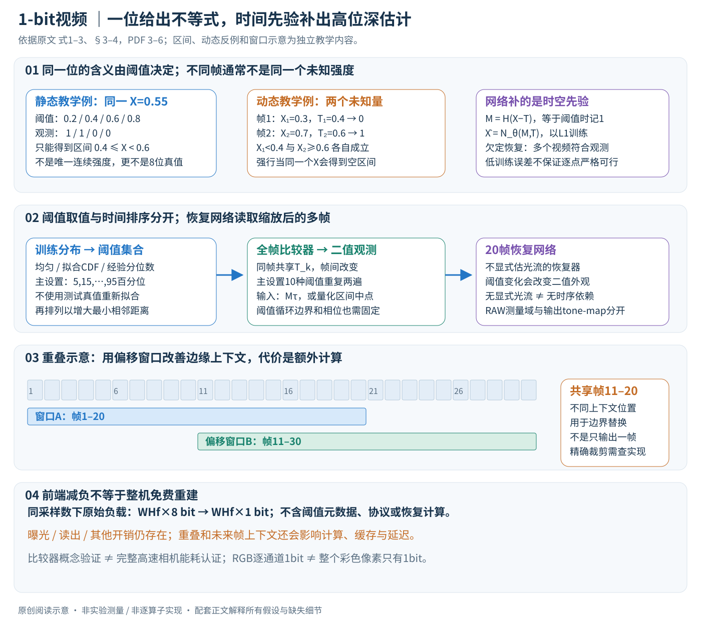

# A Bit is All You Need! Efficient Video Capture via Single Bit Imaging

核对日期：2026-10-20。以下实验均为作者报告；本地完成原文阅读与讲解自检，未复现实验。

方法与配图详细版返工：2026-10-23。重读测量与重建、阈值策略、RAW和硬件讨论；补充动态反例、输入缩放及系统成本边界；未复现。

## 一句话总结

每帧用一个随时间变化的阈值把像素压成1 bit，再利用跨帧先验恢复高位深视频；节省的是传感器输出，重建仍需神经网络计算。

## 研究背景与动机

高帧率、高分辨率成像受到ADC、芯片存储与数据传输限制。常规压缩通常在高位深采集之后发生，不能消除前端代价。固定阈值只能回答亮或暗，随时间改变阈值则为相邻帧提供不同强度约束。[§1–3，PDF1–3]

相邻时刻不再是同一张图，所以并不是把8个二值帧拼成一个准确8位像素；恢复依赖场景时空规律和训练先验。

## 方法总览

### 每个像素每帧的一位，到底回答了哪个问题

论文考虑把传感器前端的高位深量化改成一次比较：第\(k\)帧使用全帧共享阈值\(T_k\)，记录像素模拟强度\(X_{u,v,k}\)是否达到阈值。原式1为

\[
M_{u,v,k}=H(X_{u,v,k}-T_k),\quad
H(a)=\begin{cases}0&a<0\\1&a\ge0.\end{cases}
\]

因此\(M=1\)表示\(X\ge T_k\)，\(M=0\)表示\(X<T_k\)。单次观测只提供一个不等式，没有直接告诉网络原始强度是多少。等于阈值时记1，不能在实现中不加说明地写成严格大于。（§3.1，PDF第3页）

原创图依据式1–3、§3–4，PDF第3–6页；静态区间、动态矛盾例和四阈值排序均为独立教学构造，不是作者实验。

| 数据对象 | 形状/角色 | 不能据此断言的能力 |
|---|---|---|
| \(X\) | 高位深灰度视频或单通道信号 | RGB不是整像素共用一位即可完整恢复 |
| \(T_k\) | 每帧一个全局参考阈值 | 不是每像素另传完整高位深强度 |
| \(M\) | 与输入视频同空间/时间维度的二值张量 | 每帧空间采样数并未变成一个标量 |
| \(N_\theta\) | 使用多帧观测和阈值信息的恢复网络 | 网络需要计算，不是传感器直接输出8位真值 |
| \(\hat X\) | 网络估计的高位深视频 | 高数值精度容器不等于恢复了同等真实信息 |

它和单像素成像也不同：此处保留像素阵列，只降低每个像素每帧输出的位数。也不等于光子计数器记录“有没有收到光子”的传感机制；本文核心测量是与可变强度阈值比较。

### 为什么不同阈值能帮忙，却不能把视频当静态量化

对不动的、无噪声像素，如果多次用不同阈值观测同一个\(X\)，可以不断缩小它所在的强度区间。例如阈值为\(.2,.4,.6,.8\)，观测\((1,1,0,0)\)，则\(.4\le X<.6\)。这仍然是区间，不是唯一连续强度；只有结合离散量化档位等额外假设，才讨论精确的某位深编码。（§3.2，PDF第3–4页）

视频中各时刻实际是不同未知量\(X_k\)。假设某像素在\(T_1=.4\)时强度为\(.3\)、记录0；下一时刻在\(T_2=.6\)时强度为\(.7\)、记录1。合法测量分别说明\(X_1<.4\)、\(X_2\ge.6\)。若错误地把两帧当同一个静态\(X\)，就会得到\(X<.4\)且\(X\ge.6\)的空区间，误以为测量出错。问题来自不成立的静态假设。

所以“多帧收集了多位”不等于把8个时刻的二值结果拼成一个准确8位像素；它们并非同一数值按位读取。跨帧相似性、空间纹理和训练数据先验，才是欠定视频恢复的重要补充。

## 核心创新与关键设计

### 从可行域到网络：先验选择一个估计，不保证唯一真值

原式2用约束优化描述恢复问题：

\[
\hat X=\arg\min_X\mathcal R(X)
\quad\mathrm{s.t.}\quad H(X-T)=M.
\]

\(\mathcal R\)代表视频先验，同一个二值测量往往对应许多可行视频。作者没有把这条公式当作最终逐像素求解器，而是训练

\[
\hat X=N_\theta(M,T)
\]

直接映射到高位深估计，用输出和真值之间的\(\ell_1\)误差监督。（式3、§3.2，PDF第4页）论文没有在此列出网络输出经过显式投影、保证每个位置严格满足全部比较不等式的步骤，因此不能把“训练得出低L1误差”改写成“每次输出数学上严格满足可行域约束”。若做独立复现，可另外报告观测一致性，但不冒称作者已测试该指标。

当运动小、对应结构在相邻帧持续可见，时空先验较有帮助；突然遮挡、亮度跳变和快速运动会使其他帧难以约束当前像素。网络也可能用常见纹理补全不确定位置，不能以视觉好看替代真实细节恢复证据。

### 阈值有两个设计轴：取值分布和时间排列

固定不同阈值数\(n\)时，均匀间距在均匀强度等假设下能控制最坏区间宽度，但自然视频强度分布未必均匀。作者比较四类策略。（§3.3，PDF第4–5页）

1. **均匀且平滑变化。** 在强度范围内等距取阈值，时间上顺序渐增。静态时有规则覆盖，但视频中相邻测量可能长时间不翻转，难以显示短暂变化。
2. **均匀且非平滑。** 保留相同阈值集合，寻找使相邻阈值最小距离尽可能大的排列，增加连续测量条件的差异。这是max–min相邻间隔，不直接等于最大化所有相邻差的总和。
3. **非均匀且非平滑。** 从训练强度分布得到阈值，再排列。作者既尝试拟合Beta分布后经逆CDF映射，也尝试直接用经验分位数；主设置为训练数据的5、15、…、95百分位，共10个不同阈值。
4. **联合学习阈值。** 把阈值与恢复网络一起训练，反向时用连续sigmoid近似不可微的硬比较。硬件测量仍是阈值比较，不是最终输出连续sigmoid灰度；温度、梯度近似与限制范围需要实现核对。

独立排序例子：阈值集合\(\{.2,.4,.6,.8\}\)顺序排列的相邻距离最小为\(.2\)，而\((.4,.8,.2,.6)\)在**单个四项序列内部**的最小距离为\(.4\)。若循环重复，这个例子的末项\(.6\)到下一周期首项\(.4\)又只有\(.2\)，说明重复边界也需要核对。该例不声称是作者的10阈值序列，更不擅自补出其实际排列。

增加阈值数能缩小静态强度区间，却还要求恢复网络看到足够多帧，带来内存和计算；强运动下极端阈值还可能使整片区域接近全黑或全白。阈值越多、阈值越随机或越“学习化”都不是无条件更好。论文表2中经验非平滑32.77dB、均匀非平滑32.75dB，学习阈值32.68dB，不能据方法名称宣称学习阈值最优。（PDF第5–6页，作者报告）

### 用训练分布定阈值，不能从测试目标反推最优日程

非均匀阈值依赖强度分布，也依赖该数据是线性RAW还是经ISP/tone mapping处理的图像。论文从训练随机裁剪统计分布。如果测试时用完整真值视频重新计算分位数，再宣称这是固定传感器阈值，会使用真实部署中并不存在的信息，应与作者训练分布方案区分。

阈值全阵列共享，所以可作为低维元信息或预先约定的日程保留；它不是每像素一份8位数据。不同相机标定、增益、曝光和动态范围变化都可能使训练分布与部署分布不同。阈值日程与恢复网络必须按一致的数值尺度解释。

### 怎样把阈值交给恢复网络

作者测试三种输入：直接二值\(M\)、乘当前阈值\(M\tau\)、以及映射至两个量化区间的中点：

\[
M=0\mapsto\frac\tau2,\qquad
M=1\mapsto\frac{1+\tau}{2}.
\]

这是对强度已归一到\([0,1]\)的情况：0对应\([0,\tau)\)，1对应\([\tau,1]\)，两个映射值是各自区间的中点。它们不是真实强度的无偏估计保证，除非再有合适的区间内分布假设。（§4.1.4、表4，PDF第6页）

乘阈值时，\(M=1\)显式携带\(\tau\)幅度，\(M=0\)仍映射为0；因此不应把这种单通道缩放称为对\((M,\tau)\)在所有位置都无损的一一编码。网络还可以利用预先固定的阈值周期和多帧上下文。具体输入是否另拼阈值通道、时序相位如何保持，须按采用的恢复器实现核对，不能从理论式\(N(M,T)\)自行添加代码结构。

### 为什么不依赖显式光流，仍然需要跨帧信息

普通光流通常利用对应物体的外观在相邻帧相近这一线索。此处同一个物体点即使强度不变，也会因阈值变化从1翻到0，破坏直接的亮度对应；反过来位移也可能被极端阈值掩盖。作者因此选用不显式估计光流的Aswin、EfficientSCI++、Res2former、Shiftnet等恢复器，而不是发明一个必须先精准算光流的新管线。（§3.2、§4.1，PDF第4–5页）

不含显式光流模块不等于没有学习时序对齐或时空依赖，也不意味着这些网络在二值输入上无需重新训练。主要贡献是采集/阈值策略及对应恢复方案的评估，不能给网络名称加上原文未披露的自创层结构。

### 20帧窗口与重叠替换：收益来自更多有效上下文

默认设置将10个不同阈值重复两次，形成20帧输入，网络恢复相应高位深帧。窗口边缘帧一侧上下文不足，质量通常比中间帧差。作者把输入再平移10帧运行恢复，用偏移窗口中对应的较好位置替换原窗口的边界结果，称为overlap。（§4.1.1，PDF第5页）

例如第一窗口覆盖帧1–20，第二窗口覆盖11–30；帧11–20在两个窗口都有输出。可以让来自更有利上下文的位置参与最终拼接，但文中没有在这一段给出所有序列起止端的确切裁剪和替换索引，不把这个例子当作已核查的作者实现。它也不是在一个窗口内平均10种阈值、从而只输出一帧。

重叠多运行了恢复网络，可能增加计算和缓冲。若某输出使用未来帧，就有前视延迟；不能只凭源视频帧率宣称端到端零延迟实时。论文表1应在相同overlap开关下比较，表3的平滑日程长度消融也不能与最优非平滑主表混为一谈。

### RAW实验的阈值域与目标域要分开

Real-RawVSR实验将14位线性输入归一到\([0,1]\)，在这个域模拟比较器，但可训练网络直接输出tone-mapped视频。作者采用\(X^{1/\gamma}\)、\(\gamma=1.6\)，并用tone-mapped阈值\(\tau^{1/\gamma}\)缩放二值输入。平均28.36dB对应这个输出任务，不是“恢复原始14位线性RAW”的同一个评价。（§4.2，PDF第7页）

正文另报告直接线性RAW恢复：ReCRVD为28.49dB、Real-RawVSR为32.14dB，任务和目标不同，不能只比较dB大小选“最好版本”。彩色示例把RGB通道分别送入灰度恢复器，这通常意味着每通道单比特观测，不是整个RGB像素合计只用一位就保存了三通道测量。

### 硬件节省与整机成本：计算没有凭空消失

一次比较器输出降低的是ADC/片上存储/传出数据量。若空间分辨率\(W\times H\)、帧率\(f\)、每样本\(b\)位，则不考虑协议与阈值元数据的原始通量约为\(WHfb\) bit/s；从8位变为1位，在相同采样数下理想负载为原来的1/8。它不是神经网络恢复后的文件一定缩小8倍，也不是整机功耗一定降8倍。（§5，PDF第8页）

论文帧周期分析\(T_f=T_e+T_r+T_o\)分别包含曝光、读出和其他开销；减少读出不等于消除曝光/复位限制。作者对ramp ADC比较次数的讨论不能套成所有ADC架构每个8位样本都必须256次比较。硬件概念验证是数字视频转模拟电压，再由高速比较器产生二值数据，不等于已交付一台新型高速相机并完成完整能耗、延迟与成像噪声认证。（§3.1、§5，PDF第3、8页）

更关键的是恢复被转移到外部深度网络；作者明确其计算功耗可能高于传统高位深视频采集。因此可讨论前端瓶颈和系统取舍，不能在没有整机测量时宣称总体更省电。5000fps示例来自已有高速视频的二值模拟，也不是本地或作者完整系统实时生成5000fps的证明。

### 复现边界与本次自检

应固定训练分位数、具体阈值排列及循环相位、硬比较等号、强度归一化、输入缩放、20帧/10帧平移、边界拼接、训练L1与输出域，并把模拟噪声和实际比较器数据分开。还需查补充材料的网络训练配置、sigmoid反向近似与可用代码许可。

本次只独立检查比较不等式、静态/动态反例、阈值间距、量化中点和数据量公式，未运行恢复网络、处理视频或测量电路。实际纹理忠实度、运动鲁棒性和功耗由作者实验范围支持，不能从这些代数例子补造新的性能数据。

## 实验与关键结果

GoPro为22个训练视频、11个测试视频，250 fps的8位灰度；此处二值输入主要由已有高位深视频模拟。[§4.1，PDF5]

| 作者设置 | PSNR↑ / SSIM↑ |
| --- | --- |
| Aswin，经验阈值，重叠 | 32.77 / 0.9239 |
| Aswin，同设置无重叠 | 32.24 / 0.9174 |
| EfficientSCI++，重叠 | 32.17 / 0.9207 |
| GoPro训练Aswin，XVFI测试 | 35.09 / 0.9397 |
| 同模型，QUIVER测试 | 34.76 / 0.9329 |

前3行为Table1，PDF5；后2行为§4.1.5，PDF7。XVFI取125个视频、每个60帧、1000fps，QUIVER取30个120帧视频、2000fps。不同数据难度不同，不能从更高PSNR推出更高帧率更容易的一般规律。Real-RawVSR的tone-mapped目标平均28.36dB，极端运动失败样例仅18.27dB。[PDF7]

## 消融实验与证据强度

同一Aswin设置的重叠结果：均匀平滑31.31dB，均匀非平滑32.75dB，经验非平滑32.77dB，学习阈值32.68dB。收益主要来自排序，不能宣传学习阈值最好。[Table2，PDF6]

平滑序列不同阈值数8/10/20的无重叠PSNR为29.23/29.29/26.50dB，10阈值重复为30.32dB；这项消融不能与最优非平滑设置混为一谈。输入不缩放的重叠PSNR31.74，乘阈值32.75。[Table3–4]

作者用数字视频转模拟电压再经比较器作硬件概念验证，含非理想比较器的EfficientSCI++结果30.77dB/0.9074。它不是完整新型相机整机的实测能耗或帧率认证。[§3.1、Table5]

## 局限与讨论

高运动、低帧率会削弱时间先验，RAW失败样例明确展示这一点。RGB逐通道输入恢复，不等于1bit就完整编码一个RGB彩色像素。前端吞吐与ADC比较次数分析属于硬件潜力；网络推理成本被转移到外部，作者明确其能耗可能高于传统高位深采集。[§5，PDF8]

5000fps示例来自已有高速视频模拟二值观测，不能写成本地或作者完整系统实时输出5000fps。

## 复现提示

先用获准的短视频建立二值模拟器，保留线性RAW或tone-mapped的处理区别，固定训练集分位数与阈值排序。记录20帧窗口、10帧偏移的重叠策略，比较时统一边界帧处理。阈值分布不得利用测试集强度重新拟合而不披露。

建议原视频放 `data/single-bit-video/`，模拟观测与结果分目录保存。本地仅阅读核对，未运行网络、设计电路或测量功耗；补充材料中的精确训练参数与代码许可未核验。

## 相关工作与阅读顺序

先理解1bit量化的不等式约束，再比较snapshot compressive imaging与光子计数相机。它们的光学或传感机理不同，不能只因输出二值就视为相同。最后读§5，区分前端节省、外部计算和整机收益。

## 来源与校验

- [CVF 官方论文页](https://openaccess.thecvf.com/content/CVPR2026/html/Gandikota_A_Bit_is_All_You_Need_Efficient_Video_Capture_via_CVPR_2026_paper.html) · [所读 PDF](https://openaccess.thecvf.com/content/CVPR2026/papers/Gandikota_A_Bit_is_All_You_Need_Efficient_Video_Capture_via_CVPR_2026_paper.pdf)。页码均为该 PDF 的页序。
- 阅读范围：正文、公式与实验表；补充材料、上游代码与权重未逐项核验。许可证和固定代码 commit 尚未确认，不复制原文全文或数据。
- PDF SHA-256：`c7968704df84818ea8986d5962d25cf8568d9cab5b4244e5c56f519bb758d1ed`；版本为本次下载的 CVF 接收稿，核对日期 2026-10-20。

- 视觉核对：已渲染查看 PDF 第6页，核对关键公式或实验表；正文阅读到结论与局限，未读独立补充材料。
