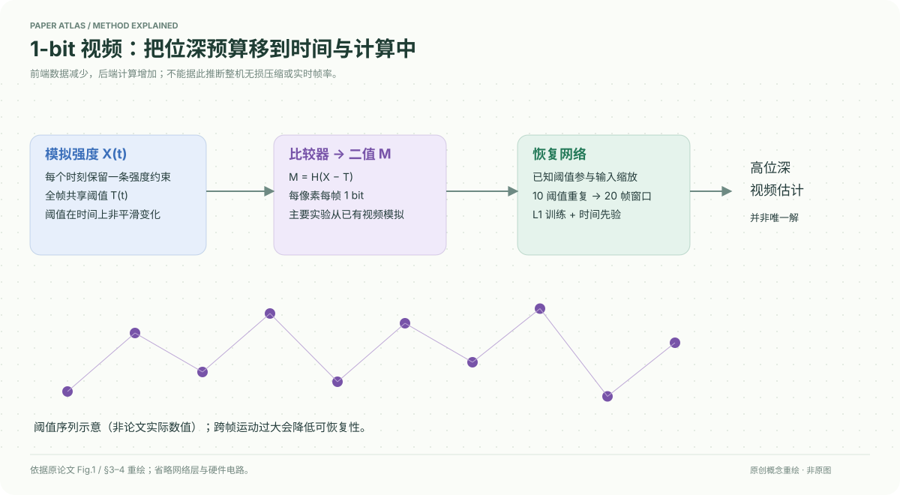

# A Bit is All You Need! Efficient Video Capture via Single Bit Imaging

核对日期：2026-10-20。以下实验均为作者报告；本地完成原文阅读与讲解自检，未复现实验。

## 一句话总结

每帧用一个随时间变化的阈值把像素压成1 bit，再利用跨帧先验恢复高位深视频；节省的是传感器输出，重建仍需神经网络计算。

## 研究背景与动机

高帧率、高分辨率成像受到ADC、芯片存储与数据传输限制。常规压缩通常在高位深采集之后发生，不能消除前端代价。固定阈值只能回答亮或暗，随时间改变阈值则为相邻帧提供不同强度约束。[§1–3，PDF1–3]

相邻时刻不再是同一张图，所以并不是把8个二值帧拼成一个准确8位像素；恢复依赖场景时空规律和训练先验。

## 方法总览

高位深信号与全帧共享阈值比较得到二值观测；已知阈值用于输入缩放，恢复网络同时观察20帧。默认10个不同阈值重复两次，窗口重叠后替换质量较差的边界帧。[Fig.1、§4.1，PDF2、5]

## 核心创新与关键设计

观测模型为
\[M(u,v,k)=H(X(u,v,k)-T(k)),\qquad \hat X=N_\theta(M,T).\]
一个二值观测只给出不等式，视频恢复解不唯一。正文用带先验的约束优化说明这一点，实际采用L1监督的恢复网络，不是逐像素直接解出真值。[式1–3，PDF3–4]

阈值选择有两个问题：数值覆盖哪些强度，时间上按什么顺序出现。作者将均匀或训练集经验分位数阈值重新排列，使相邻值尽量不平滑，以免连续画面长期全黑或全白。经验阈值取5、15、…、95百分位。增加不同阈值不一定更好：更长上下文提高计算，密集平滑阈值也会丢失时间变化。[§3.3]

普通光流依赖外观对应，二值化阈值变化会破坏这种对应，因此测试Aswin、EfficientSCI++等不依赖显式光流估计的恢复网络。阈值乘输入或映射至量化区间中点，都把阈值信息传给网络。

## 实验与关键结果

GoPro为22个训练视频、11个测试视频，250 fps的8位灰度；此处二值输入主要由已有高位深视频模拟。[§4.1，PDF5]

| 作者设置 | PSNR↑ / SSIM↑ |
| --- | --- |
| Aswin，经验阈值，重叠 | 32.77 / 0.9239 |
| Aswin，同设置无重叠 | 32.24 / 0.9174 |
| EfficientSCI++，重叠 | 32.17 / 0.9207 |
| GoPro训练Aswin，XVFI测试 | 35.09 / 0.9397 |
| 同模型，QUIVER测试 | 34.76 / 0.9329 |

前3行为Table1，PDF5；后2行为§4.1.5，PDF7。XVFI取125个视频、每个60帧、1000fps，QUIVER取30个120帧视频、2000fps。不同数据难度不同，不能从更高PSNR推出更高帧率更容易的一般规律。Real-RawVSR的tone-mapped目标平均28.36dB，极端运动失败样例仅18.27dB。[PDF7]

## 消融实验与证据强度

同一Aswin设置的重叠结果：均匀平滑31.31dB，均匀非平滑32.75dB，经验非平滑32.77dB，学习阈值32.68dB。收益主要来自排序，不能宣传学习阈值最好。[Table2，PDF6]

平滑序列不同阈值数8/10/20的无重叠PSNR为29.23/29.29/26.50dB，10阈值重复为30.32dB；这项消融不能与最优非平滑设置混为一谈。输入不缩放的重叠PSNR31.74，乘阈值32.75。[Table3–4]

作者用数字视频转模拟电压再经比较器作硬件概念验证，含非理想比较器的EfficientSCI++结果30.77dB/0.9074。它不是完整新型相机整机的实测能耗或帧率认证。[§3.1、Table5]

## 局限与讨论

高运动、低帧率会削弱时间先验，RAW失败样例明确展示这一点。RGB逐通道输入恢复，不等于1bit就完整编码一个RGB彩色像素。前端吞吐与ADC比较次数分析属于硬件潜力；网络推理成本被转移到外部，作者明确其能耗可能高于传统高位深采集。[§5，PDF8]

5000fps示例来自已有高速视频模拟二值观测，不能写成本地或作者完整系统实时输出5000fps。

## 复现提示

先用获准的短视频建立二值模拟器，保留线性RAW或tone-mapped的处理区别，固定训练集分位数与阈值排序。记录20帧窗口、10帧偏移的重叠策略，比较时统一边界帧处理。阈值分布不得利用测试集强度重新拟合而不披露。

建议原视频放 `data/single-bit-video/`，模拟观测与结果分目录保存。本地仅阅读核对，未运行网络、设计电路或测量功耗；补充材料中的精确训练参数与代码许可未核验。

## 相关工作与阅读顺序

先理解1bit量化的不等式约束，再比较snapshot compressive imaging与光子计数相机。它们的光学或传感机理不同，不能只因输出二值就视为相同。最后读§5，区分前端节省、外部计算和整机收益。

## 来源与校验

- [CVF 官方论文页](https://openaccess.thecvf.com/content/CVPR2026/html/Gandikota_A_Bit_is_All_You_Need_Efficient_Video_Capture_via_CVPR_2026_paper.html) · [所读 PDF](https://openaccess.thecvf.com/content/CVPR2026/papers/Gandikota_A_Bit_is_All_You_Need_Efficient_Video_Capture_via_CVPR_2026_paper.pdf)。页码均为该 PDF 的页序。
- 阅读范围：正文、公式与实验表；补充材料、上游代码与权重未逐项核验。许可证和固定代码 commit 尚未确认，不复制原文全文或数据。
- PDF SHA-256：`c7968704df84818ea8986d5962d25cf8568d9cab5b4244e5c56f519bb758d1ed`；版本为本次下载的 CVF 接收稿，核对日期 2026-10-20。

- 视觉核对：已渲染查看 PDF 第6页，核对关键公式或实验表；正文阅读到结论与局限，未读独立补充材料。
