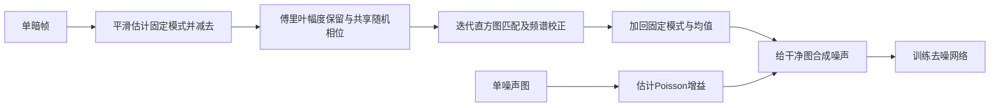

# 2-Shots in the Dark：两张校准图生成更真实的传感器噪声

论文：**2-Shots in the Dark: Low-Light Denoising with Minimal Data Acquisition**，Liying Lu、Raphael Achddou、Sabine Süsstrunk，CVPR2026，15496–15505页。

[官方页](https://openaccess.thecvf.com/content/CVPR2026/html/Lu_2-Shots_in_the_Dark_Low-Light_Denoising_with_Minimal_Data_Acquisition_CVPR_2026_paper.html) · [PDF](https://openaccess.thecvf.com/content/CVPR2026/papers/Lu_2-Shots_in_the_Dark_Low-Light_Denoising_with_Minimal_Data_Acquisition_CVPR_2026_paper.pdf) · [论文所列代码](https://github.com/IVRL/2-Shots-in-the-Dark)

分类：计算成像／暗光去噪／噪声合成。核对日期：2026-10-20。正文阅读与自检完成，未运行作者代码；页码为PDF页码。

## 一句话总结

每个ISO只用一张噪声图估计光子噪声增益、一张暗帧刻画其他噪声，通过共享随机相位和迭代直方图／频谱约束生成训练噪声，降低配对数据采集成本。

## 研究背景与动机

真实相机噪声不仅是白高斯噪声，还可能有条纹、固定模式和跨通道相关。简单参数模型难以描述全部性质，学习噪声分布又常依赖大量配对数据。本文将暗帧残差视为近似平稳的随机纹理，从频域合成新实例。[PDF 1–3]

“两张”指每个ISO的噪声校准采集，不是去噪网络全部训练数据。实验仍使用SID等数据的干净图像作为合成训练底图。[§4.2，PDF 5]

## 方法总览

依据Fig.2与§3–4重绘。暗帧指无光条件下拍摄的传感器输出，不是把普通照片在软件里涂黑。

## 核心创新与关键设计

先用大核高斯平滑估计低频固定模式S，再减掉S及通道均值得到残差R。其傅里叶幅度 \(|\mathcal F(R)|\) 提供空间相关性先验；在相位上加随机偏移，并在Bayer通道间复用同一相位偏移，避免破坏原有跨通道关系。[§3.1，PDF 3–4]

仅保持频谱不保证重尾、偏斜等边缘分布，于是交替做直方图匹配和幅度谱校正，默认10轮，再加回固定模式与均值。它近似同时满足两类约束，不应声称已保证所有高阶联合统计完全等同真实传感器。

信号相关光子噪声使用Poisson模型。论文写为 \(y=g\mathcal P(x)+n_{other}\)，因此 \(Var(y)=g(gx)+Var(n_{other})\)，通过局部均值近似干净信号做线性估计。[式15，PDF 5] 不要混用这里的x与另一种 \(g\mathcal P(x/g)\) 记号而漏掉增益缩放。

## 实验与关键结果

Table 2（PDF 6，已渲染核对）是用不同噪声合成方案训练去噪网络后的PSNR／SSIM，不是噪声样本自身的重建分数：

| 数据与曝光比 | PMN | NoiseDiff | 本文 |
| --- | --- | --- | --- |
| SID ×100 | 43.47／0.961 | 43.92／0.961 | 43.57／0.961 |
| SID ×300 | 37.87／0.934 | 37.90／0.929 | 37.77／0.929 |
| ELD ×100 | 46.99／0.984 | 46.95／0.978 | 47.13／0.986 |
| ELD ×200 | 44.85／0.969 | 45.11／0.971 | 44.89／0.969 |

本文在数据采集量很少时具有竞争力，但不是每项最好。跨传感器LRID-Outdoor ×256时本文42.72／0.958，PMN43.01／0.970，也应保留这种不利结果。[Table 3]

实验使用单暗帧估计dark shading correction，与大量暗帧估计的方案成本不同；比较时既要看输出质量，也要看校准数据需求。

## 消融实验与证据强度

去掉共享相位相关性或迭代直方图匹配，SID上的去噪一般变差，定性图显示条纹或颜色失真。[Fig.4–5、Table 4，PDF 6–8] 但ELD ×100消融中去相关性的PSNR47.18略高于完整47.14，不能说每一指标都严格改善。

尤其要区分校准设置：主实验增益由单噪声图估计，文中说明消融使用16组干净／噪声对估计增益。因此主表与消融完整模型数值不同，不应拼接为同一“两张校准图”设置。[PDF 8]

## 局限与讨论

作者假定成像条件稳定，主要按ISO建模，尚未显式纳入温度、曝光时长和读出时间；传感器升温和黑电平漂移可能改变分布。单帧估计固定模式也可能把随机低频成分误当固定项。这是低采集成本与估计充分性的取舍。

## 复现提示

先确认RAW/Bayer通道布局、黑电平、数值归一化、FFT归一化、实数共轭约束与共享相位实现，再测试频谱、直方图、跨通道相关和最终去噪。不能直接把线性传感器域方案当作任意压缩sRGB图片的噪声模型。

需要每个ISO的真实噪声图与暗帧，以及用于合成训练的干净图像。完整网络训练配方和部分实现细节在附录，本轮未读；代码commit、许可证与依赖未核验。未读取用户照片、未下载数据集、未执行第三方代码。

## 相关工作与阅读顺序

Poisson-Gaussian解释基本噪声，ELD解释重尾与条纹，SFRN解释直接采暗帧patch，随机相位纹理合成解释本文主机制。建议Fig.2→§3→Table 1采集量→Table 2→§4.5不同增益设置→局限。

## 来源与校验

依据正文1–8页，第6页表格和第7页结果图已渲染查看。PDF SHA-256：`c619a70910b9b9c4a35343208418000e20153bec2024cd927e13ddb5606ce852`。AI辅助独立讲解已自检，无独立专家审稿、未复现实验；附录与代码未读，不转载作者图片或全文。
