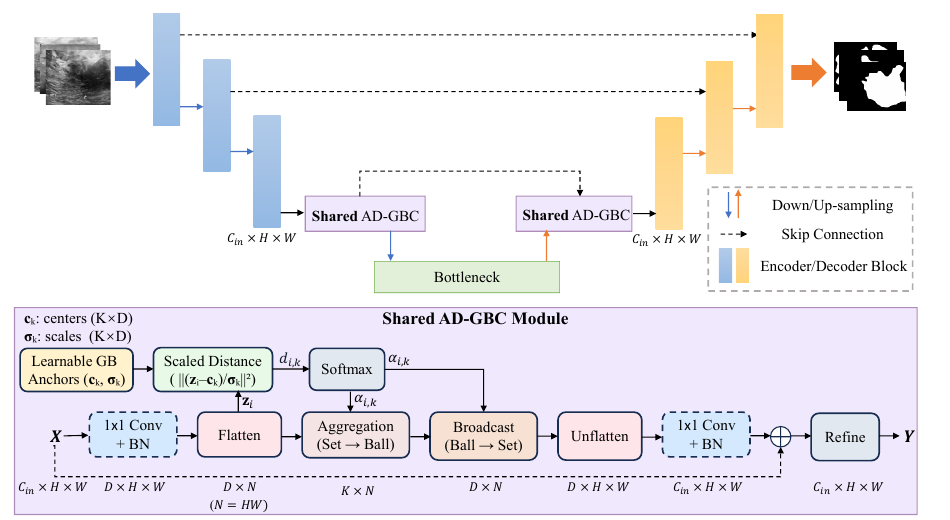

# AD-GBC: Anisotropic Granular-Ball Skip-Connection Refiner for UNet-Based Medical Image Segmentation

核对日期：2026-10-22。实验数值均为作者报告；本地完成原文阅读与讲解自检，未复现实验。

## 一句话总结

AD-GBC在UNet的跳连和对应解码特征上共享一组各向异性粒球，用软分配聚合并回传上下文，提高小型医学分割数据集上的验证指标；现有随机分割实验不能直接推出临床泛化能力。（PDF第1–3、6页）

## 研究背景与动机

UNet跳连能保留空间细节，却也会把编码特征中的噪声和语义差异直接传入解码器。作者希望给两端建立共同的特征组织方式：相似像素先聚到有限个粒球，再把聚合结果广播回像素。这里的球位于特征空间，不能把它直观画成图像上严格互不重叠的病灶区域。（PDF第1–3页）

## 方法总览

原论文Fig.2，PDF第3页。仅裁切相关图示，保留图内科学标签；著作权属于原作者，用于本篇方法分析，不并入本站原创图授权。[来源与作者](https://openaccess.thecvf.com/content/CVPR2026/html/Shen_AD-GBC_Anisotropic_Granular-Ball_Skip-Connection_Refiner_for_UNet-Based_Medical_Image_Segmentation_CVPR_2026_paper.html) · [PDF](https://openaccess.thecvf.com/content/CVPR2026/papers/Shen_AD-GBC_Anisotropic_Granular-Ball_Skip-Connection_Refiner_for_UNet-Based_Medical_Image_Segmentation_CVPR_2026_paper.pdf)。点击可打开高清图。

图2显示模块用于较深的三组跳连及相应解码特征，并共享参数；原UNet主干和其他跳连仍保留。输入先投影成 \(N\times D\) 特征，计算与K个中心的缩放距离，再softmax分配；经“像素→粒球→像素”聚合、残差和卷积细化输出。作者默认K=32，正文设置中D等于输入通道数，不能一概假设这里必定执行了降维。（PDF第3–4页）

## 核心创新与关键设计

**各向异性。** 距离 \(d_{ik}=\|(z_i-c_k)\oslash\sigma_k\|_2^2\)，分配 \(\alpha_{ik}=\mathrm{softmax}_k(-d_{ik}/\tau)\)。向量尺度控制不同特征维的伸缩，是轴对齐椭球，尚不是完整协方差度量。softmax一般处处非零，所以图示椭球边界不代表严格截断的支持域。（PDF第3–4页）

**聚合。** 中心更新表示为 \(c'_k=\sum_i\alpha_{ik}z_i\)，再广播 \(\hat z_i=\sum_k\alpha_{ik}c'_k\)。前式没有除以分配权重总和，不能误写成加权均值；其幅值会受到像素数量和分配质量影响。上下文近似经过低秩聚合，残差则保留未被聚类表达的细节。

**约束。** 式(8)为 \(L_{Wdiv}=\|\mu\|^2+\mathrm{tr}\Sigma-(2/\sqrt D)\mathrm{tr}\Sigma^{1/2}\)，鼓励中心分布展开；另一个尺度损失让 \(\sigma_k^2\) 拟合软分配下的维度方差，目标采用stop-gradient。总损失由BCE、Dice及这两项组成。K=32时经验协方差秩至多31，因此若D更大，正则不能凭空使其在全部D维满秩。（PDF第4–5页）

## 实验与关键结果

作者使用BUSI647张、GlaS165张、CVC612张和ISIC2017训练部分2,000张；GlaS缩放512²，其余256²。采用80/20随机训练/验证划分、三个数据种子、Adam、batch8、400轮，并选验证IoU最优模型。这里报告的是该验证协议，不能称为独立官方测试集成绩。（PDF第6页）

| Rolling-UNet-L上的IoU/% | 基础模型 | 加AD-GBC |
|---|---:|---:|
| BUSI | 67.85 | 69.30 |
| GlaS | 87.99 | 89.37 |
| CVC | 85.77 | 87.45 |
| ISIC2017 | 84.10 | 84.95 |

表2（PDF第6页）。U-KAN在BUSI从65.76升至69.86。表3中Rolling-UNet-L参数28.32→28.92M，计算量262.96→304.32GFLOPs，约增加15.7%；四集平均IoU81.43→82.77。参数增幅小并不意味着计算成本同样小，GFLOPs也不能直接代替运行延迟。（PDF第7页）

## 消融实验与证据强度

GlaS表4中，基线IoU87.99，标量尺度88.12，向量尺度88.28；向量尺度加中心分散约束为88.70，加尺度约束88.78，两项共同使用89.63，F1为94.51。组合结果支持约束互补，但此处完整变体89.63与主表89.37不同，正文未充分解释配置差异，应分别引用。（PDF第7页）

表5的BUSI参数扫描也不是越多粒球越好：温度1时K16/32/64分别69.58、70.71、66.30；温度0.1时66.76、69.90、69.16。超参数最优点70.71不能替换主表69.30。HD95的物理单位未在正文中明确，不能擅自解释为毫米。（PDF第7–8页）

## 局限与讨论

数据规模小，随机验证划分没有充分说明患者、检查序列和视频层面的隔离；CVC相邻帧尤其需要检查相关性。四个数据集分别训练和评估不等于跨医院迁移。中心分散的理论讨论也应谨慎：定理1在低维重建相同Gram矩阵，不能单独证明任意成对余弦损失都完全不反映秩，因为给定Gram矩阵本身已决定内在秩。经验改进可以成立，但不应把解释性论证扩展为普遍定理。（PDF第5–8页）

## 复现提示

[作者代码仓库](https://github.com/SiaShen-dot/AD-GBC)作为后续实现审查入口，本轮未核查commit、许可证或执行训练。复现需要固定病人/视频隔离、三个划分种子、最佳验证模型选择策略、共享模块调用方式、BN统计、温度和K，以及粒球参数0.01与主干0.0001的不同学习率。先用临时随机张量验证聚合维度、正尺度和协方差平方根的数值稳定，再进行数据实验；当前讲解未声称这些运行检查已经通过。医学数据与权重不纳入本仓库。（PDF第3–7页）

## 相关工作与阅读顺序

先回顾UNet跳连与编码/解码语义差异，再阅读可学习聚类或原型聚合。结合式(1)–(8)区分球的几何尺度、软分配和中心多样性正则；最后把表2主实验、表4消融和表5超参数扫描分开看。与Rolling-UNet、U-KAN的比较应保持相同数据划分和模型选择方式，不能仅拼接各自最好的公开数字。（PDF第2–8页）

## 来源与校验

- [CVF官方论文页](https://openaccess.thecvf.com/content/CVPR2026/html/Shen_AD-GBC_Anisotropic_Granular-Ball_Skip-Connection_Refiner_for_UNet-Based_Medical_Image_Segmentation_CVPR_2026_paper.html) · [所读PDF](https://openaccess.thecvf.com/content/CVPR2026/papers/Shen_AD-GBC_Anisotropic_Granular-Ball_Skip-Connection_Refiner_for_UNet-Based_Medical_Image_Segmentation_CVPR_2026_paper.pdf)。页码均为PDF页序。
- 所读版本：2026-10-22从CVF下载的开放接收稿；PDF SHA-256：`3d5c73b6495dc3febf0a2c5875264b0f844cc6e3ce84d66d14e32fbe40e4daf2`。
- 阅读范围：正文、方法公式、实验与消融；补充材料、代码及权重未逐项核验。reviewed表示本地讲解自检，不表示独立同行评审或实验复现。
- 方法图与关键公式/表格已渲染核对，所引原图已单独检查；未对新文章进行浏览器交互验收。作者图示与本站原创素材权利分开记录。
