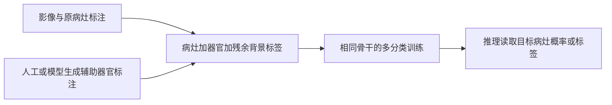

# BackSplit：别把病灶之外的一切都叫背景

论文：**BackSplit: The Importance of Sub-dividing the Background in Biomedical Lesion Segmentation**，Rachit Saluja、Asli Cihangir、Ruining Deng、Johannes C. Paetzold、Fengbei Liu、Mert R. Sabuncu，CVPR 2026，8492–8502 页。

[官方论文页](https://openaccess.thecvf.com/content/CVPR2026/html/Saluja_BackSplit_The_Importance_of_Sub-dividing_the_Background_in_Biomedical_Lesion_CVPR_2026_paper.html) · [原文 PDF](https://openaccess.thecvf.com/content/CVPR2026/papers/Saluja_BackSplit_The_Importance_of_Sub-dividing_the_Background_in_Biomedical_Lesion_CVPR_2026_paper.pdf)

分类：医学视觉 / 病灶分割 / 辅助监督。最后核对：2026-10-20。正文已读并自检，未复现实验；页码为PDF页码。本文讨论研究方法，不提供患者诊断或临床性能保证。

## 一句话总结

把单一“非病灶背景”拆成器官、组织等有意义类别，与病灶一起训练多分类分割模型，让模型多学一点解剖上下文；这是一种监督设计，而非新骨干网络。

## 研究背景与动机

病灶通常体积小、分布稀疏。如果所有非病灶像素都是同一类，模型既要把肾脏、肝脏、空气等截然不同的结构都归为背景，又要识别其中细微异常。将背景拆分后，模型能学习“病灶相对于哪种组织出现”。辅助标签可来自人工，也可由已有器官分割模型提前生成。[§1–2，PDF 1–3]

这不等于给器官内像素硬性施加病灶位置限制；主要改变的是训练标签空间与监督信息。

## 方法总览

图为根据正文重绘。额外器官分割主要用于训练标签准备，不要求部署时每次先运行一个器官模型；但标签准备有独立计算和质量成本。

## 核心创新与关键设计

### 细标签比合并标签保留更多信息

令细类别为 \(Y\)，病灶二分类为 \(Z=\mathbf1[Y=c]\)。在同一参数化概率模型和正则条件下，细标签score为 \(s_Y=\nabla_\theta\log p_\theta(Y\mid X)\)，粗标签score满足：

\[
s_Z=\mathbb E[s_Y\mid Z,X],\qquad
I_Y=I_Z+\mathbb E[\operatorname{Var}(s_Y\mid Z,X)]\succeq I_Z.
\]

依据Lemma 1、Theorem 1，PDF 4。合并标签相当于看不到背景内部差异，条件方差项刻画损失的信息；若这些差异不再提供额外score信息，可以取等号。

### 理论结论的适用边界

论文进一步在模型正确设定、标准正则条件及可用的非奇异Fisher矩阵等假设下，讨论MLE的渐近协方差与平滑预测函数的方差。[§3.3，PDF 5]

这是**同一概率模型下标签粗化的信息关系和大样本渐近分析**，不是“任何深度网络、多加任意伪标签都必然提高有限测试集Dice”的证明。深度分割的损失、优化、不完全标注、模型误设与标签噪声，都可能不满足理想条件。论文也承认小数据下细标签可能放大采样噪声。[§5，PDF 8]

### 辅助标签可以不完美

论文尝试人工器官标注、用AbdomenAtlas训练模型得到的伪标注、TotalSegmentator / VIBE-Segmentator输出，以及nnInteractive生成的辅助结构。支持结构通常与目标病灶相邻，但如何最优选择结构仍留待研究。[§4，PDF 6–8]

## 实验与关键结果

五套数据包括KiTS23（489 CT）、PANTHER-MR（92 MRI）、NSCLC-Radiomics（415 CT）、AutoPET3（1611 CT/PET）和MSWAL（484 CT）。骨干包括U-Net、ResEncU-Net和SegResNet；主要结果采用五折交叉验证。[§4.1–4.3，PDF 6–7]

Table 2（PDF 7）中U-Net使用模型生成的辅助器官标注，摘选如下，已对照原页面核对：

| 任务 | 训练方式 | Dice↑ | HD95↓ | NSD↑ |
| --- | --- | ---: | ---: | ---: |
| AutoPET肿瘤 | 标准 | 0.3881 | 637.6150 | 0.3478 |
| AutoPET肿瘤 | BackSplit | 0.4435 | 594.8048 | 0.4128 |
| MSWAL所有病灶均值 | 标准 | 0.2724 | 399.9756 | 0.5577 |
| 同上 | BackSplit | 0.3190 | 347.1125 | 0.6218 |
| MSWAL肾结石 | 标准 | 0.1950 | 471.4653 | 0.6247 |
| MSWAL肾结石 | BackSplit | 0.1639 | 484.3217 | 0.5401 |

平均表现改善，但肾结石三个指标均退化。Table 1的部分HD95、NSD也有反例。因此原文“持续改善所有指标”的概括应谨慎阅读，不能据摘要写成无例外收益。Dice是重叠度；HD95反映较大边界偏差；NSD在该分割背景下是normalized surface Dice，不能因正文某处称surface distance就把指标方向弄反。

作者表中各设置参数量按百万位精度相同，支持没有明显增加主体模型规模；不过多分类输出通道与标签准备并非严格零成本，未实测时不应宣称任何设备上延迟完全相同。

## 消融实验与证据强度

Table 3比较不同自动辅助分割来源，**仅一折**；Table 4的7／10点击nnInteractive实验也为一折，且点击是从参考掩码随机采样的模拟操作，不能当作真实临床标注时间或全自动无人工流程。[PDF 7–8]

Fig.3显示少量样本带辅助标注时，性能可能先下降，增加辅助覆盖后才恢复并提升。它说明辅助标注覆盖度与一致性很重要，不能只给极少数病例添加器官标签然后预期必有收益。[§4.6，PDF 8]

## 局限与讨论

核心限制是辅助标签来源与任务相关性。错误器官伪标签、类别优先级冲突、不同模态域偏移可能把噪声引入训练。现有实验主要是回顾性数据集交叉验证，不能据此推断对新医院、设备或人群已取得临床有效性。

定理为监督粒度提供合理解释，但有限样本、非凸优化的结果仍需实验验证。应特别关注病灶种类的分层结果，平均Dice变好可能掩盖某个类别变差。

## 复现提示

保持两组nnU-Net架构与自动配置一致，固定病例级五折划分、预处理、病灶标签和评价脚本；只改变辅助监督。先明确定义病灶与器官重叠时的类别优先级、无辅助标签病例如何计算损失，再开展训练，避免把缺失器官标注误作真实背景。

正文说详细超参数在补充材料，本轮未读；不补写未经核实的学习率、epoch或输出通道实现。需核查辅助模型与数据许可、预训练数据和评价集是否重叠，以及HD95的单位和空预测处理。未运行代码，仓库地址、commit、许可与实测成本尚未核验，不提供临床部署建议。

## 相关工作与阅读顺序

先了解多分类softmax、交叉熵与nnU-Net，再读标签粗化的信息分解。与增加器官分支的多任务网络不同，BackSplit强调通过标签空间提供上下文；两者不能只凭名称认定等价。

建议 Fig.1 → §4实验 → Table 2反例 → §3.2定理 → §3.3假设 → Fig.3部分标注。先建立实际问题，再理解理论能解释的范围。

## 来源与校验

依据CVF公开接收版正文1–8页；Table 2所在第7页已渲染核对，理论证明所在补充材料未读，未声称独立复核所有证明。PDF SHA-256：`b92c3d0842b8b916732094fc88316f8c374ecf76a7ed5850210eb587fc39af23`，为本地摘要。概念图独立重绘，未转载作者图片或全文。AI辅助讲解已自检，无独立专家审稿，未复现实验。
