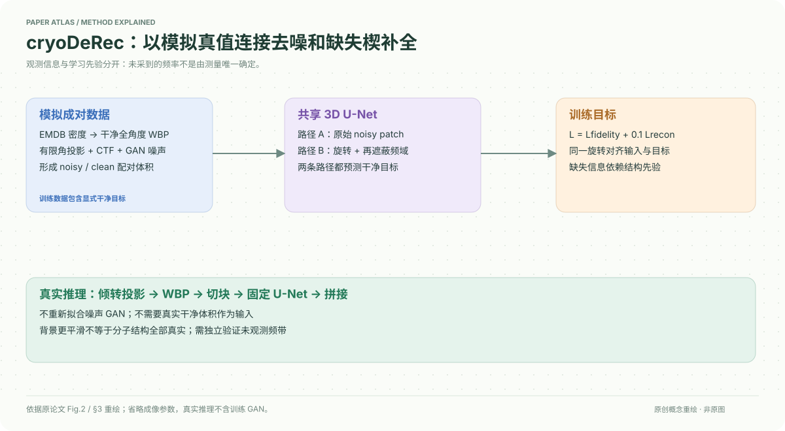
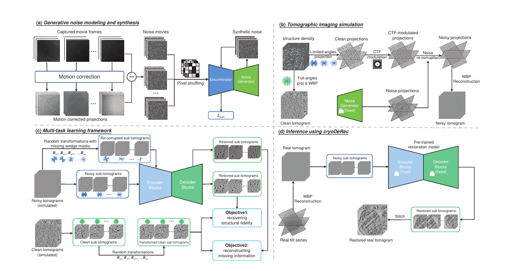

# A Supervised Multi-task Framework for Joint cryo-ET Restoration Enabled by Generative Physical Simulation

核对日期：2026-10-20。以下实验均为作者报告；本地完成原文阅读与讲解自检，未复现实验。

## 一句话总结

cryoDeRec用物理模拟提供完整干净监督，再用同一U-Net联合学习去噪与缺失楔补全，把模拟数据上的知识迁移到真实冷冻电镜断层图。

## 研究背景与动机

低电子剂量带来低信噪比，有限倾转范围造成傅里叶空间缺失楔；先去噪再补全可能互相传播误差。真实实验无法得到同一细胞的完整无噪真值，作者选择改善模拟而非完全依赖自监督。[§1–2，PDF1–2]

这里的“恢复”包含训练结构先验对未观测频率的预测，不等于由观测唯一确定真实结构；作者也明确说明了这一点。

## 方法总览

先从电影帧与运动校正投影的差提取近似噪声，用WGAN-GP训练噪声生成器。再将EMDB密度放置于模拟体积，生成受CTF及噪声影响的有限角度投影，经WBP得到输入；无CTF、无噪、全角度投影的WBP结果作为目标。共享恢复网络学习原始输入及旋转后再次遮蔽的输入。[Fig.2，PDF3；§3，PDF4–5]

真实推理只需要WBP体积、切块、恢复网络和拼接，不重新训练噪声GAN。

### 对照原文流程图

原论文 Fig.2，PDF第3页。仅裁去页边与其他正文，保留图内文字与结构；图片著作权属于原作者，作为本篇方法分析的有限引图，**不属于本站原创SVG的授权范围**。[原文与作者信息](https://openaccess.thecvf.com/content/CVPR2026/html/Wang_A_Supervised_Multi-task_Framework_for_Joint_cryo-ET_Restoration_Enabled_by_CVPR_2026_paper.html) · [PDF](https://openaccess.thecvf.com/content/CVPR2026/papers/Wang_A_Supervised_Multi-task_Framework_for_Joint_cryo-ET_Restoration_Enabled_by_CVPR_2026_paper.pdf)。上方中文图为简化重绘，本图用于核对被省略的细节。

## 核心创新与关键设计

第一个目标是配对体积均方误差：\(L_{fidelity}=N^{-1}\sum_i\|f(V_i^{sn})-V_i^{sg}\|_2^2\)。第二个先旋转，再在频域增加缺失楔：
\[\widetilde V_{R_i}^{sn}=\mathcal F^{-1}(M_i\odot\mathcal F(V_{R_i}^{sn})),\quad L_{recon}=N^{-1}\sum_i\|f(\widetilde V_{R_i}^{sn})-V_{R_i}^{sg}\|_2^2.\]
总损失为\(L=L_{fidelity}+0.1L_{recon}\)。配对目标必须与输入使用相同刚体旋转；额外遮蔽使网络学习不同朝向上的缺失信息。[式6–10，PDF4–5]

噪声差分仍可能含运动残差与结构成分；分布直方图吻合不能单独证明所有空间相关性都正确。CTF段把空间频率f写为“1 Å”，单位口径存在疑问，复现时应核验频率网格和像素尺寸，不能照字面把常量代入整个频谱。

## 实验与关键结果

训练密度来自EMD-13390、11999、31086，有限角度±60°、步长1/2/3°、散焦1.5 μm；恢复网络5级U-Net、96³ patch、重叠32、batch4、100epoch，Adam学习率0.001，20% patch作验证。[§3.3，PDF5]

| 作者报告 | 对照 | cryoDeRec |
| --- | --- | --- |
| EMPIAR-10045 CNR/ENL↑ | IsoNet 0.361/70.943 | 0.506/342.288 |
| EMPIAR-10499 CNR/ENL↑ | IsoNet 0.336/65.664 | 1.637/162.764 |
| Tomo-5lzf SNR0.1 PSNR/SSIM↑ | IsoNet 7.10/0.401 | 10.82/0.836 |
| Tomo-1qvr ±50° PSNR/SSIM↑ | IsoNet 7.03/0.443 | 10.81/0.850 |

来源Table1–3，PDF6–7。四个真实数据集不再微调，均用WBP。CNR衡量选区对比、ENL衡量背景均匀性，二者不能替代结构真值验证；实际数据不存在用于PSNR的完整真值。

## 消融实验与证据强度

EMPIAR-10643去掉Lrecon时CNR/ENL为2.174/171.225，完整损失2.434/193.694；EMPIAR-10499为1.318/145.883→1.637/162.764。[Table4，PDF8]

Table4中10499的Noisy CNR写0.022，Table1为0.018，需核验选区与笔误。Fig.8将倾转步长3°增为5°仍写“wider missing wedge”；固定±60°时主要改变角度采样稀疏性，并没有扩大端点所决定的缺失楔。实验不能据此直接宣称覆盖任意更窄倾转范围。

## 局限与讨论

学习先验可能把未见生物结构补成训练结构；平滑背景可提高ENL而掩盖细节。仅三种训练结构、四种真实实验的泛化范围有限。补充材料的选区、数据生成与网络细节尚未精读；不能将本方法用于诊断或分子结构认定的可靠性保证。

重叠patch随机划分可能使验证集空间相关，正文未充分交代是否按独立模拟体积划分；需要复现时确认。

## 复现提示

建议 `data/cryo-et/cryoderec/`，按EMDB/EMPIAR各自使用条件取得密度、投影及元数据；不将原始体积放进仓库。先固定像素尺寸、CTF单位、噪声GAN训练来源、WBP程序和patch划分，再评估保留频带与未观测频带。

正文给出[代码与数据入口](https://github.com/ZhidongYang/CryoDeRec)，本次未核验许可证、commit或运行环境；本地只阅读与作图，未训练和恢复真实电镜数据。

## 相关工作与阅读顺序

先理解有限角度断层成像与傅里叶切片，再读Noise2Noise/Topaz和IsoNet，最后看双目标与真实数据指标边界。与普通图像去噪相比，重要差别是未观测频率只能靠先验约束。

## 来源与校验

- [CVF 官方论文页](https://openaccess.thecvf.com/content/CVPR2026/html/Wang_A_Supervised_Multi-task_Framework_for_Joint_cryo-ET_Restoration_Enabled_by_CVPR_2026_paper.html) · [所读 PDF](https://openaccess.thecvf.com/content/CVPR2026/papers/Wang_A_Supervised_Multi-task_Framework_for_Joint_cryo-ET_Restoration_Enabled_by_CVPR_2026_paper.pdf)。页码均为该 PDF 的页序。
- 阅读范围：正文、公式与实验表；补充材料、上游代码与权重未逐项核验。许可证和固定代码 commit 尚未确认，不复制原文全文或数据。
- PDF SHA-256：`65b16c124674019e7466922920eb035677f1929ff5e955a3b185d2938ce7672d`；版本为本次下载的 CVF 接收稿，核对日期 2026-10-20。
- 视觉核对：原PDF第3页已渲染检查，核对关键图表及公式排版。原创方法图为概念重绘，细节以原文为准。
