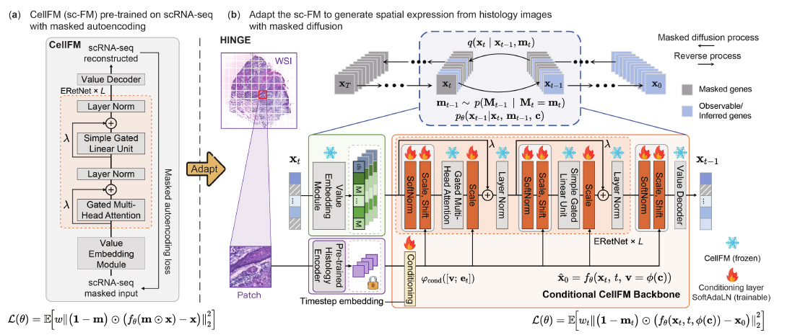

# Adapting a Pre-trained Single-Cell Foundation Model to Spatial Gene Expression Generation from Histology Images

核对日期：2026-10-22。实验数值均为作者报告；本地完成原文阅读与讲解自检，未复现实验。

## 一句话总结

HINGE冻结单细胞基础模型CellFM，通过视觉条件调制和逐基因掩码生成，把病理图像转成空间表达预测；相关性改善不表示能够从图像完整恢复真实转录组或替代测序。（PDF第1–5页）

## 研究背景与动机

同样的组织形态可对应不同细胞组成和表达状态，病理到基因表达不是唯一确定映射。现有生成方法较少直接利用单细胞基础模型中的基因关联，但单细胞模型又缺乏视觉输入，且掩码预训练与全维高斯去噪不匹配。HINGE同时处理条件接口和输入目标匹配，主实验只实例化CellFM，并未实证覆盖所有单细胞基础模型。（PDF第1–3页）

## 方法总览

原论文Fig.1，PDF第3页。仅裁切相关图示，保留图内科学标签；著作权属于原作者，用于本篇方法分析，不并入本站原创图授权。[来源与作者](https://openaccess.thecvf.com/content/CVPR2026/html/Fang_Adapting_a_Pre-trained_Single-Cell_Foundation_Model_to_Spatial_Gene_Expression_CVPR_2026_paper.html) · [PDF](https://openaccess.thecvf.com/content/CVPR2026/papers/Fang_Adapting_a_Pre-trained_Single-Cell_Foundation_Model_to_Spatial_Gene_Expression_CVPR_2026_paper.pdf)。点击可打开高清图。

图1左侧是CellFM原掩码自编码；右侧将冻结的病理编码器和时间步条件注入CellFM各层。训练随机遮住部分基因，仅预测被遮住部分；早期偏重较低遮挡率，随后覆盖全时间步。推理从全部基因被遮住的状态开始，逐步抽样哪些位置重新可见，并用预测值填入；已可见位置保留，因此随机性来自掩码轨迹，而不是一开始加入高斯噪声。（PDF第3–5页）

## 核心创新与关键设计

累计可见率 \(\bar\alpha_t=(1-t/T)^\zeta\)，正向 \(m_t\sim Bern(\bar\alpha_t)\)、\(x_t=m_t\odot x_0\)。反向以 \(\pi_t=(\bar\alpha_{t-1}-\bar\alpha_t)/(1-\bar\alpha_t)\)决定被遮住基因是否恢复，再保留旧可见值、填入新预测。损失为仅遮挡维度上的加权平方误差，权重 \(w_t=\pi_t\)。掩码使用专门token ID，与真实零表达区分，不能只把输入零值当成缺失标记。（PDF第4–5页）

SoftNorm将原表示与标准化表示按可学习η混合，再乘条件缩放、加条件偏移；子层输出通过接近1初始化的门控进入原残差和LayerNorm。η、缩放和偏移初始为0，门控接近1，使初始行为近似原模型。冻结基础权重有助避免遗忘，但新条件路径仍可改变函数和基因相关结构，不能视为严格保持原生物学知识的证明。（PDF第5页）

## 实验与关键结果

数据为cSCC12切片/4患者、Her2ST36切片/8人、Kidney23切片/22人；采用留一切片测试，其余训练中留10%早停。**留切片不等于留患者**，同一人其他切片可能参与训练。基因与CellFM24,078词表取交集，再按训练切片均值和方差选HMHVG；表达及误差处于log尺度。（PDF第6页）

| 表1作者报告 | HINGE PCC-50↑ | PCC-200↑ | 参考基线PCC-200 |
|---|---:|---:|---:|
| cSCC | 0.705±0.006 | 0.613±0.008 | STFlow 0.578±0.012 |
| Her2ST | 0.566±0.008 | 0.446±0.010 | Stem 0.433±0.019 |
| Kidney | 0.428±0.009 | 0.309±0.010 | TRIPLEX 0.299±0.025 |

跨测试切片与三随机种子统计。Kidney的MSE1.459、MAE0.964，高于TRIPLEX1.315/0.915，因而不是全部指标最优。基因共表达矩阵及marker图是结构性补充，不能证明基因调控因果关系。（PDF第6–7页）

## 消融实验与证据强度

表2–5主要在**单个cSCC P2_ST_rep3切片**开展，不能与全数据均值混用。PCC-200随机训练0.6395、仅调decoder0.7699、骨干LoRA0.7618，HINGE0.8021。高斯扩散0.6415，掩码无课程0.7932，完整0.8021，支持匹配预训练目标的价值。（PDF第8页）

去SoftNorm为0.7874，去恒等初始化0.7722；UNI单编码器0.7871，CONCH0.7783，联合0.8021。各消融说明所选配置互补，尚不足以证明每个新患者都同幅受益。随机填掩码与填零几乎相同，是专门掩码token生效的合理结果，而非所有输入缺失都无关紧要。

## 局限与讨论

相同组织图像不能识别全部潜在表达状态，生成样本的不确定性是否校准也未由PCC验证。留切片协议、候选基因选择和预训练数据重叠需要进一步审计；其他单细胞骨干兼容性是架构论述，不是多骨干实验。正文缺少足以复现全部学习率、时间步和采样预算的细节，相关分析在附录。本文仅作方法阅读，不据此给出医疗诊断建议。（PDF第3–8页）

## 复现提示

[作者仓库](https://github.com/donghaifang/HINGE)待核查commit、许可证、模型获取条件和附录配置；本轮未下载病理数据、测序数据或模型。复现应保留患者/切片ID、只在训练集做基因选择、表达归一化、mask轨迹、时间步预算与多个生成样本的聚合规则。部署研究还需患者级及外部机构测试，报告相关性、绝对误差与不确定性；目前没有本地训练或生物实验验证。（PDF第4–8页）

## 相关工作与阅读顺序

先了解空间转录组spot与单细胞RNA表达的差异，再读CellFM掩码预训练。随后对照Stem高斯扩散、STFlow流匹配，理解HINGE为何采用掩码过程。最后看Kidney误差反例和单切片消融范围，避免将相关性较高误解成每个基因表达数值都更准确。（PDF第1–8页）

## 来源与校验

- [CVF官方论文页](https://openaccess.thecvf.com/content/CVPR2026/html/Fang_Adapting_a_Pre-trained_Single-Cell_Foundation_Model_to_Spatial_Gene_Expression_CVPR_2026_paper.html) · [所读PDF](https://openaccess.thecvf.com/content/CVPR2026/papers/Fang_Adapting_a_Pre-trained_Single-Cell_Foundation_Model_to_Spatial_Gene_Expression_CVPR_2026_paper.pdf)。页码均为PDF页序。
- 所读版本：2026-10-22从CVF下载的开放接收稿；PDF SHA-256：`4df3bc0d1dd8a5e792610b4a2f8c89126936abba57f86058a7ce9c7efbfc5bf9`。
- 阅读范围：正文、方法公式、实验与消融；补充材料、代码及权重未逐项核验。reviewed表示本地讲解自检，不表示独立同行评审或实验复现。
- 方法图与关键公式/表格已渲染核对，所引原图已单独检查；未对新文章进行浏览器交互验收。作者图示与本站原创素材权利分开记录。
