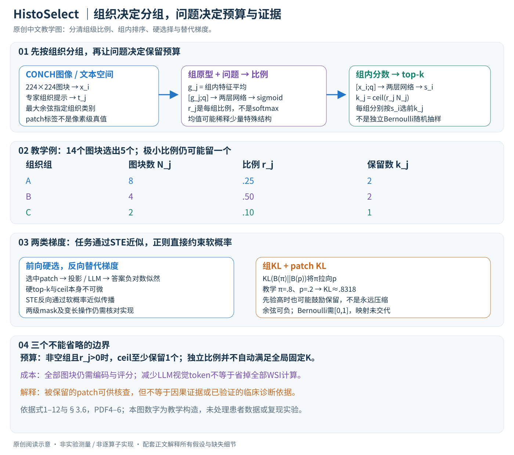

# Act Like a Pathologist: Tissue-Aware Whole Slide Image Reasoning

核对日期：2026-10-21。实验数值均为作者报告；本地完成原文阅读与讲解自检，未复现实验。

方法与配图详细版返工：2026-10-23。重读§3–4；展开两级预算、KL方向、STE近似与训练接口。未复现实验。

## 一句话总结

HistoSelect先按组织类型给病理切片分组，再按问题分配各组预算和挑选局部patch，用较少视觉token回答全切片问题。

## 研究背景与动机

全切片包含大量重复组织和与当前问题无关的区域，均匀采样容易把上下文窗口花在无效位置。作者借鉴病理医生先找组织区域、再查看关键细节的流程，学习两级选择器，而不是只用全局注意力热图解释答案。[§1–2，PDF1–3]

选出支持答案的图块有助于检查证据，但与临床可靠性、病因推断或诊断获批是不同层次的结论。本篇是研究方法解析，不把自动问答分数解释成临床有效性。

## 方法总览

### 从全切片到答案：两级选择解决两个不同问题

输入是一张全切片图像和一个问题，输出是文字答案及保留的图块集合。HistoSelect先将非重叠图块编码并按组织类型分组，然后根据问题决定每组留多少，再在组内决定具体留哪些，最后把保留特征交给多模态语言模型。（§3、Fig.3，PDF第3–6页）

原创图依据式1–12和§3.6。图块数量、概率与KL计算均为教学例子，不是病理图像测量或诊断结果。

| 表示 | 维度/类型 | 功能 |
|---|---|---|
| \(X=[x_1,\ldots,x_N]\) | \(N\times d\) | 全部图块的视觉特征 |
| \(q\) | \(d\) | CONCH文本编码器得到的问题特征 |
| \(t_j\) | \(d\)，共M类 | 专家设计的组织类型提示特征 |
| \(I_j,N_j,g_j\) | 索引集合、整数、\(d\)维向量 | 组内成员、数量、均值原型 |
| \(r_j\) | 标量，理论上在(0,1) | 第j组保留比例 |
| \(s_i\) | 标量，理论上在(0,1) | 图块i组内排序分数 |
| \(k_j\) | 整数 | 第j组最终选取数量 |
| \(Z\) | \(K\times d\)，\(K=\sum_jk_j\) | 保留下来的视觉token |

论文将图块切成224×224，用CONCH提取patch特征，同时使用LongNet获取切片级特征，语言模型是Qwen2.5-7B-Instruct。主文没有把LongNet、选择器与投影器之间全部形状和连接细节写齐，不能仅凭示意图补成完整可执行网络。（§4，PDF第6页）

## 核心创新与关键设计

### 组织分组：比较图块与组织提示，而非回答问题

每个组织提示描述一个类型，如肿瘤、间质、淋巴细胞。图块分到余弦相似度最大的类别：

\[
l_i=\arg\max_j\frac{x_i^\top t_j}{\|x_i\|\|t_j\|}.
\]

这个步骤使用组织提示，不直接使用当前问题。它为后续提供可解释的类别分组，同一切片在不同问题下可以共享图块特征与组织标签，问题变化主要改变后续选择。（式1，PDF第4页）

这是一种patch级语义指派，不能自动等同于精确像素分割或可靠的病理标注。一个224×224图块可能混有多种组织，argmax仍只给一个标签；提示不覆盖的异常组织也会被迫指向某个已知类。按标签分组还不要求所有成员空间相连，不能把一个语义组误读为一个连续病灶区域。分组错误会影响后续预算和证据覆盖。

### Group Sampler：问题决定各类组织保留比例

对非空组平均池化：

\[
g_j=\frac1{N_j}\sum_{i\in I_j}x_i,\qquad
r_j=\sigma(F_{\rm group}([g_j;q])).
\]

拼接向量维度为 \(2d\)，两层线性网络输出标量logit，sigmoid将其变成比例。问题若关注某类组织，模型可给相应组较高比例；若只关注另一种结构，预算也可以改变。（式2–3，PDF第4–5页）

平均原型压缩了整组信息，但会淡化少量特殊图块。例如大组中仅有很少的异常结构，平均特征可能仍接近常见组织；这是组级压缩的潜在失败点。空组 \(N_j=0\) 不能直接除以零，实际实现需要跳过或定义默认处理，正文未给出精确规则。

\(r_j\)是每组的比例，不是所有组之间归一化的softmax。因此不同组比例之和无须等于1，组的大小还会影响实际保留数量，不能只看哪个 \(r_j\) 大就判断哪个组占最多token。

### Patch Selector：组内排序，数量仍由组级比例控制

每个图块与同一个问题特征拼接：

\[
s_i=\sigma(F_{\rm patch}([x_i;q])),\qquad
k_j=\lceil r_jN_j\rceil,
\quad Z_j=\operatorname{TopK}_{i\in I_j}(s_i,k_j).
\]

所有 \(Z_j\) 合并成LLM的视觉输入。虽然 \(s_i\)叫选择概率，正文前向步骤是按分数确定性top-k，不是对每个图块独立抛一次Bernoulli硬币。全局排序也不能替代组内排序：组级预算已经决定每类留多少。（式4–5，PDF第5页）

**贯穿教学例：**某切片分成三组，大小为8、4、2；预测比例分别0.25、0.5、0.1。组预算是2、2、1，总共保留5/14个token。第一组按 \(s_i\)取前2，第二组取前2，第三组即使比例只有0.1也取1。换一个问题时，组预算和每组的排序都可以改变。

只要 \(N_j>0\) 且理论上的 \(r_j>0\)，向上取整就使 \(k_j\ge1\)。因而不能按这些公式宣称“完全删除所有无关组织组”。在数学设定下还有 \(M_{\rm nonempty}\le K\le N\)，以及 \(0\le K-\sum_jr_jN_j<M_{\rm nonempty}\)。很多小组会带来取整开销。有限精度、额外全局截断或预算校准可能改变这些性质，但主文未完整规定这些额外操作。

Table 6报告1k、2k、5k、10k token设置，主文的独立sigmoid比例本身并不严格保证 \(\sum_j\lceil r_jN_j\rceil\) 等于指定全局预算；复现要核对如何把预算实验与选择公式衔接，不能自行猜成某种softmax归一化。

### 学习目标：答案要正确，同时让选择接近相关性先验

概念上的信息瓶颈目标为最大化：

\[
I(Z;Y\mid q)-\beta I(Z;X\mid q).
\]

第一项希望压缩后的证据保留答案信息，第二项限制对原始输入的依赖。作者用组级、patch级变量拆分复杂度项：

\[
I(Z_g,Z_p;X\mid q)=I(Z_g;X\mid q)+I(Z_p;X\mid Z_g,q).
\]

这解释为何两层选择分别有正则，而不只是对最后token数量加一个罚项。可训练目标是答案负对数似然加两个Bernoulli KL：（式6–12，PDF第5–6页）

\[
L=L_{\rm VQA}+\beta_gL_{\rm group}+\beta_pL_{\rm patch},
\quad L_{\rm VQA}=-\sum_t\log p_\theta(y_t\mid y_{<t},Z,q),
\]

\[
L_{\rm group}=\frac1M\sum_jD_{\rm KL}(B(r_j)\|B(p_j^g)),\quad
L_{\rm patch}=\frac1N\sum_iD_{\rm KL}(B(s_i)\|B(p_i^p)).
\]

组项对每个组平均，patch项对每个patch平均，二者不是同一种权重方式。大组包含更多patch，因此在patch项中贡献更多项，但在组项中仍只有一个组级项。\(\beta_g,\beta_p\)控制两种约束强度，正文没有给出足够细节来唯一恢复所有超参数。

### KL的含义与余弦先验的复现边界

\[
D_{\rm KL}(B(\pi)\|B(p))=
\pi\log\frac\pi p+(1-\pi)\log\frac{1-\pi}{1-p}.
\]

对 \(0<\pi,p<1\)，当 \(\pi=p\) 时为0；其对 \(\pi\) 的导数为 \(\log[\pi(1-p)/(p(1-\pi))]\)，因此最小化会把预测拉向先验。教学例中 \(\pi=0.8,p=0.2\)，KL约0.8318；这个正则会压低0.8。若先验本身是0.9，它反而可能鼓励保留，不能笼统说KL永远减少token。

作者直接把图像/问题余弦相似度描述为Bernoulli参数。余弦可为负，Bernoulli要求[0,1]，而对数计算还需处理0与1端点。正文未说明映射与裁剪。将余弦映射为 \((c+1)/2\) 再裁剪是一种可能的工程方案，但它不是本讲解已核实的作者实现，不能擅自替原文补上。

先验还依赖图像与问题，本讲解只按主文解释为相关性伪先验；严格信息瓶颈上界的成立条件需要结合补充推导核对，不能把普通固定先验的结论直接移植。未读补充材料不计作已验证证据。

### 硬选择如何训练：STE是替代梯度

前向用硬top-k保留实际图块，减少LLM处理的视觉token；反向用软概率的梯度近似，让答案损失能够影响两级选择器。top-k索引与ceil数量跳变不是普通可微函数，STE并未改变这一事实。（§3.6，PDF第6页）

一个常见的**教学表达**是 \(m_{\rm ST}=\operatorname{stopgrad}(m_{\rm hard}-m_{\rm soft})+m_{\rm soft}\)。前向数值等于硬mask，反向对软mask的导数为1。这仅解释直通思想，原文没有给出完整组/patch两级mask构造、变长gather和组级数量梯度细节，因此不能把这行式子称为作者的完整实现。

实际训练分两阶段：先训练投影器完成模态对齐，再联合微调投影器、HistoSelect和LLM的LoRA。文本答案的teacher-forcing损失经LLM与投影器回传，并借助STE近似影响选择；KL直接约束软比例/分数。正文未声称全量微调Qwen所有参数，也不能据“端到端”推断所有预训练图像模块都更新。（§4实施细节，PDF第6页）

### 推理、复杂度与解释边界

推理时先获得全部图块特征和组织标签，问题编码后计算组比例、patch分数与组内top-k，再将选中的视觉特征投影到LLM接口并逐token生成答案。通常不再需要答案真值和训练KL。保留图块可供读者检查，但“被选中”只表明模型选择了它，不证明它是因果上必要或足够的诊断证据。

组织相似度计算涉及全部 \(N\) 个图块与 \(M\) 个提示，组均值也需遍历特征；patch评分仍覆盖全部图块。朴素组内排序成本约 \(\sum_jN_j\log N_j\)，top-k实现可优化。减少的是后续视觉token预算，不能忽略前面的WSI编码成本，亦不能将70%视觉token删减直接换成端到端3.3倍加速。

在固定预算对照中，形态问答准确率为随机88.84、DivPrune90.01、简单相似度92.22、HistoSelect94.57；去掉组/patch选择分别91.78/92.07，支持两层都具有作用。5k token诊断85.79优于10k的85.12，说明更多token并不自动更好，但不是任意任务的最优预算定理。（Table 4–6，PDF第8页）

复现应核对组织提示集合、空组、ceil与全局预算、先验合法化、STE两级实现、投影和LongNet连接、冻结参数与评估划分。当前只完成原文方法核查、教学算例和页面验证，没有读取患者数据、训练模型或验证临床有效性。

## 实验与关键结果

公开SlideBench-VQA为4560切片、176K问答，WSI-Bench为9850切片、180K问答；另有375切片/问答的私有卵巢独立测试集。使用官方划分、CONCH与LongNet、Qwen2.5-7B-Instruct；先训练投影对齐，再联合训练选择器、投影与LLM LoRA。[§4，PDF6]

| 作者报告 | SlideChat | HistoSelect |
| --- | --- | --- |
| 闭合问答跨类别平均 | 80.88% | 83.80% |
| 私有卵巢诊断 | 69.33% | 73.33% |
| 报告生成BLEU-4 / ROUGE-L | 0.215 / 0.450 | 0.221 / 0.463 |
| 形态问答WSI-P / WSI-R | 0.512 / 0.541 | 0.538 / 0.589 |

来源Table1–2，PDF7。83.80是表中任务类别均值，不是所有问答逐样本总体准确率。治疗类别97.92%与Quilt-LLaVA并列；治疗WSI-R 0.801低于Quilt-LLaVA的0.807，不能称各指标独占第一。WSI-P/R使用LLM评审，与人工诊断准确率不同。

## 消融实验与证据强度

同预算下，随机、DivPrune、简单相似度和本文的形态准确率分别88.84/90.01/92.22/94.57%，支持学习选择优于单纯多样性或余弦排序。去组选择器91.78%，去patch选择器92.07%，两级结合最好。[Table4–5，PDF8]

1k/2k/5k/10k token的诊断准确率82.15/83.80/85.79/85.12%，5k优于10k。作者称约保留30%、减少70%视觉token；主文没有完整的端到端耗时表，不能改写成总体加速3.3倍。[Table6，PDF8]

两位病理专家5分量表：组织分割4.17/3.67，问题相关性4.80/3.87，答案充分性4.67/3.73。这是小规模可解释性主观评价，正文表中三问，也不足以证明临床部署可靠。[Table3，PDF7]

## 局限与讨论

错误组织提示可能把关键patch分错，相关性先验也可能偏向问题中的表面词汇。罕见病灶、跨机构染色与扫描仪差异可能改变选择质量；私有375样本测试难以由第三方完整复查。

主文未充分说明全局token预算如何约束各组ceil后的总和、空组处理、STE具体实现和相似度概率化。以IB为动机的正则项鼓励贴近动态相似度先验，不单独保证稀疏度或诊断信息完整性。

## 复现提示

[作者代码入口](https://github.com/winston52/HistoSelect)需要进一步核验commit、许可证、组织提示与超参数。本次未读取补充材料或代码。先复核官方公开数据拆分是否按患者隔离、编码器权限与标签来源，再复现token筛选、固定预算和真实端到端成本。

建议 `experiments/medical/histoselect/`，切片、患者资料和模型权重不入库。这里没有运行模型、处理真实患者数据或作本地临床验证，图表结果全部为作者报告。

## 相关工作与阅读顺序

先了解MIL与全切片特征提取，再读CONCH、SlideChat和WSI-LLaVA，最后理解信息瓶颈与STE。阅读时沿组织分组→问题预算→组内排序→答案四步检查，分别判断压缩收益和证据是否充分。

## 来源与校验

- [CVF官方论文页](https://openaccess.thecvf.com/content/CVPR2026/html/Huang_Act_Like_a_Pathologist_Tissue-Aware_Whole_Slide_Image_Reasoning_CVPR_2026_paper.html) · [所读PDF](https://openaccess.thecvf.com/content/CVPR2026/papers/Huang_Act_Like_a_Pathologist_Tissue-Aware_Whole_Slide_Image_Reasoning_CVPR_2026_paper.pdf)。页码均为PDF页序。
- 所读版本：2026-10-21从CVF下载的开放接收稿；PDF SHA-256：`8b4db1dedb41e0b781d39d5681bb7e3bb945cefb5cd254255412bf5562d8a184`。
- 阅读范围：正文、方法公式、实验与消融；补充材料、代码及权重未逐项核验。reviewed表示本地讲解自检，不表示独立同行评审或实验复现。
- 方法图与关键公式/表格已渲染核对，所引原图已单独检查；未对新文章进行浏览器交互验收。作者图示与本站原创素材权利分开记录。
