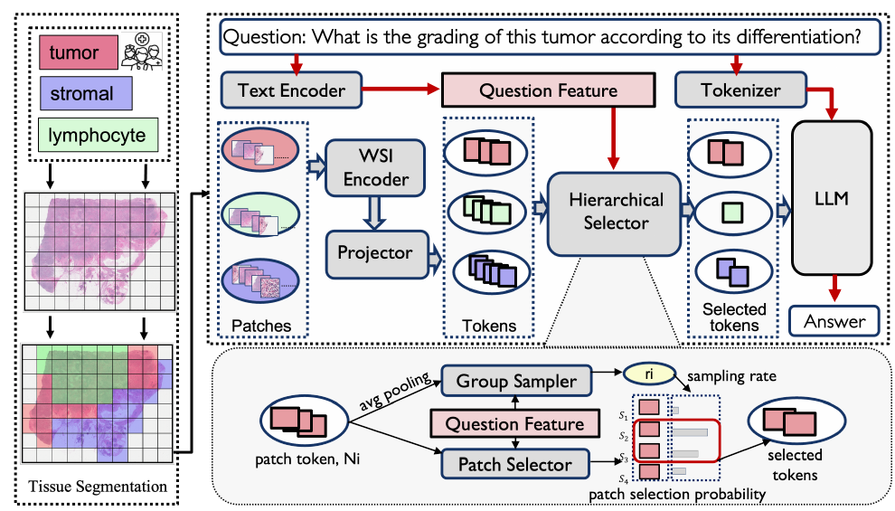

# Act Like a Pathologist: Tissue-Aware Whole Slide Image Reasoning

核对日期：2026-10-21。实验数值均为作者报告；本地完成原文阅读与讲解自检，未复现实验。

## 一句话总结

HistoSelect先按组织类型给病理切片分组，再按问题分配各组预算和挑选局部patch，用较少视觉token回答全切片问题。

## 研究背景与动机

全切片包含大量重复组织和与当前问题无关的区域，均匀采样容易把上下文窗口花在无效位置。作者借鉴病理医生先找组织区域、再查看关键细节的流程，学习两级选择器，而不是只用全局注意力热图解释答案。[§1–2，PDF1–3]

选出支持答案的图块有助于检查证据，但与临床可靠性、病因推断或诊断获批是不同层次的结论。本篇是研究方法解析，不把自动问答分数解释成临床有效性。

## 方法总览

原论文Fig.3，PDF第4页。仅裁切相关图示，保留图内科学标签；著作权属于原作者，用于本篇方法分析，不并入本站原创图授权。[来源与作者](https://openaccess.thecvf.com/content/CVPR2026/html/Huang_Act_Like_a_Pathologist_Tissue-Aware_Whole_Slide_Image_Reasoning_CVPR_2026_paper.html) · [PDF](https://openaccess.thecvf.com/content/CVPR2026/papers/Huang_Act_Like_a_Pathologist_Tissue-Aware_Whole_Slide_Image_Reasoning_CVPR_2026_paper.pdf)。点击可打开高清图。

CONCH对224²图块编码，利用病理专家设计的组织提示进行余弦相似度分类，把图块分成肿瘤、间质、淋巴细胞等语义组。组均值与问题特征送入Group Sampler，决定每组保留比例；组内Patch Selector给每个patch打分，留下top-k后送入下游LLM。[Fig.3、§3.1–3.3，PDF4–5]

选择器是两层线性网络。训练前向使用硬选择、反向用STE把梯度传给软概率；这种替代梯度是优化近似，不是top-k真正可微。提取整张切片特征仍有成本，删减送进LLM的token不等于省掉所有图像编码。

## 核心创新与关键设计

设组j有N_j个patch，平均特征g_j、问题q：
\[r_j=\sigma(F_{group}([g_j;q])),\quad s_i=\sigma(F_{patch}([x_i;q])),\quad k_j=\lceil r_jN_j\rceil.\]
保留组内分数s_i最大的k_j个；非空组在r_j>0时至少留下一个，不能按公式说它会把所有无关组完全删除。[式2–5，PDF4–5]

目标为答案负对数似然加两级Bernoulli KL：
\[\mathcal L=\mathcal L_{VQA}+\beta_g\overline{D_{KL}(B(r_j)\|B(p_j^g))}+\beta_p\overline{D_{KL}(B(s_i)\|B(p_i^p))}.\]
作者把p设为图像/问题余弦相似度。但余弦范围[-1,1]，Bernoulli参数需要[0,1]且求对数须处理端点；正文未说明映射和裁剪，复现不能直接代入负数。这个先验还依赖输入，严格IB上界的解释需结合未读补充推导核实。[式8–12，PDF5–6]

## 实验与关键结果

公开SlideBench-VQA为4560切片、176K问答，WSI-Bench为9850切片、180K问答；另有375切片/问答的私有卵巢独立测试集。使用官方划分、CONCH与LongNet、Qwen2.5-7B-Instruct；先训练投影对齐，再联合训练选择器、投影与LLM LoRA。[§4，PDF6]

| 作者报告 | SlideChat | HistoSelect |
| --- | --- | --- |
| 闭合问答跨类别平均 | 80.88% | 83.80% |
| 私有卵巢诊断 | 69.33% | 73.33% |
| 报告生成BLEU-4 / ROUGE-L | 0.215 / 0.450 | 0.221 / 0.463 |
| 形态问答WSI-P / WSI-R | 0.512 / 0.541 | 0.538 / 0.589 |

来源Table1–2，PDF7。83.80是表中任务类别均值，不是所有问答逐样本总体准确率。治疗类别97.92%与Quilt-LLaVA并列；治疗WSI-R 0.801低于Quilt-LLaVA的0.807，不能称各指标独占第一。WSI-P/R使用LLM评审，与人工诊断准确率不同。

## 消融实验与证据强度

同预算下，随机、DivPrune、简单相似度和本文的形态准确率分别88.84/90.01/92.22/94.57%，支持学习选择优于单纯多样性或余弦排序。去组选择器91.78%，去patch选择器92.07%，两级结合最好。[Table4–5，PDF8]

1k/2k/5k/10k token的诊断准确率82.15/83.80/85.79/85.12%，5k优于10k。作者称约保留30%、减少70%视觉token；主文没有完整的端到端耗时表，不能改写成总体加速3.3倍。[Table6，PDF8]

两位病理专家5分量表：组织分割4.17/3.67，问题相关性4.80/3.87，答案充分性4.67/3.73。这是小规模可解释性主观评价，正文表中三问，也不足以证明临床部署可靠。[Table3，PDF7]

## 局限与讨论

错误组织提示可能把关键patch分错，相关性先验也可能偏向问题中的表面词汇。罕见病灶、跨机构染色与扫描仪差异可能改变选择质量；私有375样本测试难以由第三方完整复查。

主文未充分说明全局token预算如何约束各组ceil后的总和、空组处理、STE具体实现和相似度概率化。以IB为动机的正则项鼓励贴近动态相似度先验，不单独保证稀疏度或诊断信息完整性。

## 复现提示

[作者代码入口](https://github.com/winston52/HistoSelect)需要进一步核验commit、许可证、组织提示与超参数。本次未读取补充材料或代码。先复核官方公开数据拆分是否按患者隔离、编码器权限与标签来源，再复现token筛选、固定预算和真实端到端成本。

建议 `experiments/medical/histoselect/`，切片、患者资料和模型权重不入库。这里没有运行模型、处理真实患者数据或作本地临床验证，图表结果全部为作者报告。

## 相关工作与阅读顺序

先了解MIL与全切片特征提取，再读CONCH、SlideChat和WSI-LLaVA，最后理解信息瓶颈与STE。阅读时沿组织分组→问题预算→组内排序→答案四步检查，分别判断压缩收益和证据是否充分。

## 来源与校验

- [CVF官方论文页](https://openaccess.thecvf.com/content/CVPR2026/html/Huang_Act_Like_a_Pathologist_Tissue-Aware_Whole_Slide_Image_Reasoning_CVPR_2026_paper.html) · [所读PDF](https://openaccess.thecvf.com/content/CVPR2026/papers/Huang_Act_Like_a_Pathologist_Tissue-Aware_Whole_Slide_Image_Reasoning_CVPR_2026_paper.pdf)。页码均为PDF页序。
- 所读版本：2026-10-21从CVF下载的开放接收稿；PDF SHA-256：`8b4db1dedb41e0b781d39d5681bb7e3bb945cefb5cd254255412bf5562d8a184`。
- 阅读范围：正文、方法公式、实验与消融；补充材料、代码及权重未逐项核验。reviewed表示本地讲解自检，不表示独立同行评审或实验复现。
- 方法图与关键公式/表格已渲染核对，所引原图已单独检查；未对新文章进行浏览器交互验收。作者图示与本站原创素材权利分开记录。
