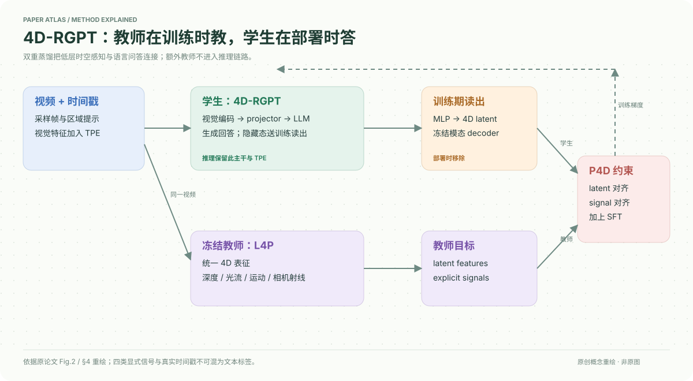

# 4D-RGPT: Toward Region-level 4D Understanding via Perceptual Distillation

核对日期：2026-10-20。以下实验均为作者报告；本地完成原文阅读与讲解自检，未复现实验。

## 一句话总结

4D-RGPT把冻结4D感知教师的潜特征与显式信号蒸馏到视频语言模型，再用真实时间戳编码改善区域级时空问答。

## 研究背景与动机

“这辆车多快”同时需要跟踪同一对象、理解深度和知道时间间隔；只做最终答案SFT不必然学到低层感知。区域提示又使对象指代更精确，要求模型理解第一帧指定对象后持续跟踪，而不是只凭类别常识猜测。[PDF1–2]

## 方法总览

原创重绘，依据Fig.2及§4。橙色模块仅用于训练，教师L4P不进入部署推理。

NVILA-Lite-8B学生的视觉特征加入时间戳TPE，经projector和LLM得到隐藏态；训练读出将隐藏态变为4D潜表示，再用冻结模态解码头读出深度、光流、运动和相机射线，分别匹配L4P教师。[PDF3–5]

## 核心创新与关键设计

训练目标由答案交叉熵、潜特征差异\(L_{LD}\)和显式模态差异\(L_{ED}=\sum_{n,m}\omega_m\ell_m(P_m^{(n)},\hat P_m^{(n)} )\)组成。模态解码器把抽象特征约束为可解释感知任务；“不需要4D人工标注”依赖教师提供伪监督，不是完全没有几何先验。

TPE用sin/cos编码实际秒数，避免不同视频帧率却以相同帧序号代替真实时间。主配置冻结视觉编码器、更新projector与LLM；摘要式“端到端”不表示所有模块均训练。[式3–7，PDF4–5；Table7，PDF8]

## 实验与关键结果

第6页六个非区域基准中，NVILA→本文分别为STI33.8→37.6、VLM4D46.5→52.7、MMSI31.3→33.3、OmniSpatial37.2→40.4、SAT62.0→64.7、VSTI45.2→59.1；作者概括平均约+5.3个百分点。不同基准的选择题/数值相对准确率并非同一物理测量。

第7页R4D-Bench统一16帧、SoM区域提示：平均37.9→42.2，静态29.1→32.9，动态41.3→45.7；但FalsePositive40.7→40.2退步，GPT-4o总体42.8仍高于本文42.2。该基准780视频，摘要表约1.5k QA、正文称1.4k，精确发行条数待数据核验。

## 消融实验与证据强度

第7–8页，直接4D-SFT R4D40.1，特征拼接39.5，几何位置编码36.0，本文42.2。仅latent40.2、仅explicit39.8，组合42.2；从latent加深度使STI34.2→33.4，故不是每个模态逐项都改善。去时间提示41.0、烧录时间标记41.1、文本时间41.5、TPE42.2，支持时间编码的增益但非任意时间推理保证。

## 局限与讨论

R4D由已有STI/VLM4D问题改造成区域题，虽经检测、分割、VLM匹配和人工验证，仍受原标签与抽样影响。某些时间例图为额外标注方便阅读，不能假设测试输入给出完整逐帧追踪。更高选择题分数不等于精确恢复连续速度；未证明复杂遮挡和长视频的普遍鲁棒性。

## 复现提示

核对真实时间单位、帧采样、SoM区域ID、teacher各模态损失及固定权重。训练细节多在未读补充材料，不能臆造显存或GPU数量。官方项目入口见PDF1；代码commit、数据许可与权重可用性未确认，未本地训练或运行。

## 相关工作与阅读顺序

先了解NVILA、L4P与区域提示，再将本文和3D-IDE比较：二者都让辅助几何监督主要留在训练，但本文更明确针对动态感知、4D多模态蒸馏和时间编码。

## 来源与校验

- [CVF 官方论文页](https://openaccess.thecvf.com/content/CVPR2026/html/Yang_4D-RGPT_Toward_Region-level_4D_Understanding_via_Perceptual_Distillation_CVPR_2026_paper.html) · [所读 PDF](https://openaccess.thecvf.com/content/CVPR2026/papers/Yang_4D-RGPT_Toward_Region-level_4D_Understanding_via_Perceptual_Distillation_CVPR_2026_paper.pdf)。页码均为该 PDF 的页序。
- 阅读范围：正文、公式与实验表；补充材料、上游代码与权重未逐项核验。许可证和固定代码 commit 尚未确认，不复制原文全文或数据。
- PDF SHA-256：`58709974ef25bcaf8604476442538c34ba4a2afb77accf27b31963c069d7561b`；版本为本次下载的 CVF 接收稿，核对日期 2026-10-20。

- 视觉核对：渲染查看 PDF 第 8 页，检查关键实验表或方法相关证据；未将作者实验表述为本地复现。
