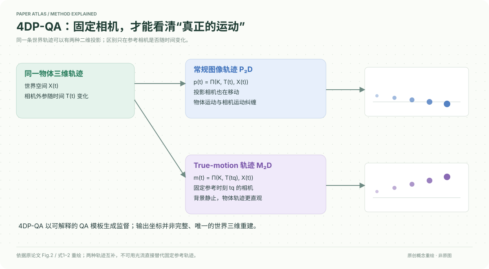

# 4DP-QA: Scalable QA for 4D Perception in Vision Language Models

核对日期：2026-10-20。以下实验均为作者报告；本地完成原文阅读与讲解自检，未复现实验。

## 一句话总结

4DP-QA从几何与运动数据自动构造40万问答，将固定参考相机下的True-motion轨迹作为监督，改善VLM对物体/相机运动的区分。

## 研究背景与动机

画面中向左不一定代表物体真的向左：相机也可能向右移动更快。只学习表面光流或粗语言描述，容易把两种运动混同。本文主要贡献是数据构造与感知任务，而非一个全新大模型架构。[PDF1–3]

## 方法总览

原创重绘，依据Fig.2与式1–2。两条投影来自同一三维轨迹，固定参考不是恢复绝对世界坐标的充分条件。

将SHIFT、VirtualKITTI2、AriaDigitalTwin、HOT3D及Kubric统一为相机、深度、实例与6D姿态格式；按运动与可见性筛样本，把连续几何量映为标签，再填语言模板。视频对象可用描述、像素或圈选引用。[PDF3–5]

## 核心创新与关键设计

常规轨迹\(p(t)=\Pi(K,T(t),X(t))\)随相机变化；True-motion为\(m_{t_q}(t)=\Pi(K,T(t_q),X(t))\)，固定查询时刻相机外参。若相机不动，两者相同；若物体只沿参考光轴运动，二维轨迹仍可能缺乏明显位移，所以这不是完整三维运动表示。

训练把轨迹坐标归一化至[0,1]并保留三位小数，同时输出遮挡标志；打乱输出帧顺序防止自回归插值捷径。模板阈值随数据源设置，不能忽略离散化与领域偏差。[PDF3–5]

## 实验与关键结果

40万训练QA来自3.3M帧，另2.2k基准来自317k留出帧；表1全部原始源总3.6M，不能与训练帧数混用。32帧448²、batch128、一轮约3.1k步，32A100约9小时、冻结视觉编码器。

第6页Qwen2.5VL7B基准46.6→84.3%，NVILA42.3→84.4%；外部VLM4D分别52.3→63.6、42.8→60.5。随机基线40.8%源于混合题型，不是全部四选一25%。外部提升比自有基准更能说明迁移，但仍不证明真实轨迹数值已准确。

## 消融实验与证据强度

第7页保持总样本数不变，以20%跟踪QA替换普通QA；NVILA仅普通问答自有/外部85.9/55.3，加入True-motion84.4/60.5，表明牺牲少量域内分数换迁移。加普通跟踪为84.5/56.7，两种各10%为85.4/58.1，不是越多任务越好。再加L4P编码器外部真实56.4→51.8退步、合成73.3→85.4改善，总体60.5→60.0略降，不能概括成全面提升。[Table4]

## 局限与讨论

自动QA质量取决于源几何GT、对象命名及阈值；人工多轮验证主要用于基准，不等于全部40万都逐条人工审核。训练标签依赖高质量几何，泛化到普通网络视频还需外部重建误差分析。轨迹定性结果有用，但正文没有给出充分的通用追踪数值排行榜。

## 复现提示

准备源数据时逐个核查许可，不镜像受限视频。建议D:/datasets/4dp-qa/按版本放QA与视频引用；原文未确认发行体积、压缩格式及官方校验，下载状态应保留未知。区分标准VLM数据实验与增加L4P推理分支的4D-VLM实验；后者有额外模型开销。本地未运行训练或付费模板生成。

## 相关工作与阅读顺序

先了解相机投影、点跟踪和L4P，再比较VLM4D、4D-RGPT。4D-RGPT把感知教师压入训练，本文还研究直接用轨迹问答教普通架构，两条路线不应混写。

## 来源与校验

- [CVF 官方论文页](https://openaccess.thecvf.com/content/CVPR2026/html/Cho_4DP-QA_Scalable_QA_for_4D_Perception_in_Vision_Language_Models_CVPR_2026_paper.html) · [所读 PDF](https://openaccess.thecvf.com/content/CVPR2026/papers/Cho_4DP-QA_Scalable_QA_for_4D_Perception_in_Vision_Language_Models_CVPR_2026_paper.pdf)。页码均为该 PDF 的页序。
- 阅读范围：正文、公式与实验表；补充材料、上游代码与权重未逐项核验。许可证和固定代码 commit 尚未确认，不复制原文全文或数据。
- PDF SHA-256：`4881e1611ce7f28fb1484ff4cccfbab7a1a036a49212154fdab36096360f3463`；版本为本次下载的 CVF 接收稿，核对日期 2026-10-20。

- 视觉核对：渲染查看 PDF 第 7 页，检查关键实验表或方法相关证据；未将作者实验表述为本地复现。
