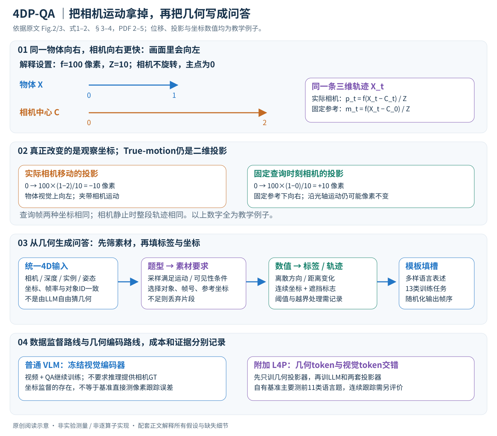

# 4DP-QA: Scalable QA for 4D Perception in Vision Language Models

核对日期：2026-10-20。以下实验均为作者报告；本地完成原文阅读与讲解自检，未复现实验。

方法与配图详细版返工：2026-10-23。重读§3–5并核对投影与QA管线；展开坐标、采样、标签规则、两条训练路线与基准边界，未复现。

## 一句话总结

4DP-QA从几何与运动数据自动构造40万问答，将固定参考相机下的True-motion轨迹作为监督，改善VLM对物体/相机运动的区分。

## 研究背景与动机

画面中向左不一定代表物体真的向左：相机也可能向右移动更快。只学习表面光流或粗语言描述，容易把两种运动混同。本文主要贡献是数据构造与感知任务，而非一个全新大模型架构。[PDF1–3]

## 方法总览

### 核心是把几何监督做成问答，不是另造一个万能跟踪器

4DP-QA从带相机、深度、实例和对象姿态信息的视频中生成训练问答，让普通VLM学习相机运动、物体运动和空间关系。另有两种点跟踪问答：一类跟随真实画面上的点，另一类把同一三维点的运动投到固定参考相机。主要贡献是任务定义和数据生产；额外接L4P几何编码器是另一条实验分支，不是所有结果都必须使用的组件。（§3–4，PDF第3–6页）

原创阅读图依据Fig.2–3、式1–2及§3–4，PDF第2–5页。相机/物体位移与投影数字是手算例子，不是作者数据；固定相机得到的仍是二维轨迹，不等于完整三维速度真值。

| 量 | 含义 | 在训练数据构造中的作用 |
|---|---|---|
| \(X_t\in\mathbb R^3\) | 同一个三维点随时间的位置 | 将物体运动与相机变化分开描述 |
| \(T_t,K\) | 每帧相机外参与内参 | 决定真实相机的投影 |
| \(t_q,p_{t_q}\) | 查询帧和其中的查询像素 | 指定要跟踪哪个点 |
| \(p_t\) | 随实际相机投影的像素位置 | visual point tracking答案 |
| \(m_{t_q}(t)\) | 固定查询帧相机下的投影 | true-motion point tracking答案 |
| 实例/对象标识与描述 | 对象身份引用 | 避免“那个杯子”指向错误实例 |
| 离散标签 | 左/右、靠近/远离等 | 由连续几何量和阈值生成 |
| 连续答案 | 帧索引、归一化坐标、遮挡标记 | 给VLM更细粒度的感知监督 |

## 核心创新与关键设计

### 1. 表观运动为什么会与物体运动相反？

普通二维跟踪记为

\[p_t=\Pi(K,T_t,X_t).\]

同一个物体点在世界中运动，相机也在运动，因此屏幕位移是两者共同作用的投影结果。“画面向左”不能单独证明物体在固定场景中向左。（式1、Fig.2，PDF第2–3页）

用标准针孔背景展开：若外参把世界点变到相机坐标\(X_c=R_t(X_t-C_t)\)，齐次像素\(\tilde p=KX_c\)，还需除以深度得到二维坐标。这里的外参写法仅用于说明，相机到世界/世界到相机的实际数据约定需统一；不能直接把数据源原矩阵不加转换混用。

**手算例子。** 焦距100像素、主点0、深度恒为10，相机不旋转。物体横坐标从0变1，相机中心从0移到2。实际画面横坐标从\(100(0-0)/10=0\)变成\(100(1-2)/10=-10\)：画面向左，但物体相对固定世界横轴确实向右。数字只用于理解，不是相机标定建议或作者样本。

### 2. True-motion把观察相机固定在查询时刻

作者改用

\[m_{t_q}(t)=\Pi(K,T_{t_q},X_t),\]

所有时刻都保留同一个参考外参\(T_{t_q}\)，仅让物体点Xt变化。上例固定在初始相机位置0，则投影从0变10，显示向右；静止背景点的投影则不再随实际相机移动而改变。（式2，PDF第3页）

在查询时刻，\(m_{t_q}(t_q)=p_{t_q}\)，两种任务有相同起点。相机完全不动时\(T_t=T_{t_q}\)，两条轨迹相同。若相机不动但物体动，true-motion并不会人为把它变成静止；它消除的是观察坐标变化，不是消除所有运动。

### 3. 固定参考不等于绝对世界运动的完整表示

True-motion仍是二维投影。沿参考相机光轴运动的点，深度可以变化很多而像素位置几乎不动；不同三维轨迹也可能有相同二维投影。更换参考帧，还会改变观察方向和二维分量。因此它是更直观、图像对齐的运动表示，不是唯一世界坐标速度或所有物理量的充分统计量。

若固定视点下点跑出画面、来到相机后方或被遮挡，坐标及可见性约定也需处理。正文说明输出归一化坐标和遮挡标记，但没有逐项给出所有越界/无效投影规则；复现不能默默把所有异常坐标clip到[0,1]，因为那会改变轨迹含义。

### 4. 要生成这种监督，必须先有三维对应关系

实际画面跟踪可以靠外观对应估计；true-motion还需深度和相机姿态，才能把跨帧点放到同一三维参照中。作者使用源数据提供的深度、相机参数、实例及对象6DoF姿态构造轨迹，而不是让语言模板凭想象写“向左”。（§3.1–3.2，PDF第3–4页）

对刚体对象，可用一个局部对象点q说明：对象位姿把q变到各时刻世界位置Xt，再投影到真实或固定相机。也可由查询像素及深度反投影，并结合对象姿态建立局部坐标。这个过程是几何理解背景，不代表原文对所有非刚性人物、手部和动态表面都只用了同一刚体公式。

位姿、深度、时间同步或实例标识错误，会一起进入答案。特别是“第t帧的物体A”和“第t+1帧外观相近物体B”不能因为类名相同就当同一点。源数据标准化因此是监督质量的一部分，而不是简单把文件名改成统一格式。

### 5. 多来源先统一坐标、帧率与对象引用

输入来源包括SHIFT、Virtual KITTI 2、Aria Digital Twin、HOT3D和Kubric，覆盖合成驾驶、真实室内第一视角和仿真场景。预处理统一坐标系、分辨率、帧率、相机、深度、分割、元数据和姿态，再交给同一QA管线。（Table 1、§3.2，PDF第3–4页）

对象原类名未必唯一，作者使用VLM根据框和初始类别补充描述。问句还可通过某帧的像素坐标或圈选区域引用对象。三种引用模式各有优势：描述自然但可能歧义，坐标精确但要求帧号明确，圈选直接但增加可视提示。不能把描述模型的名称出现理解成几何答案由该模型自由生成。

### 6. 问题类型先提出约束，再筛适合的视频片段

QA生成器先选问题模板，并要求素材满足条件。例如比较两个运动对象，需要至少两个合适且可见的移动实例；相机运动题则可能要求相机移动或保持静止的特定条件。采样器随机取片段，检查相机/对象运动与可见性，若对象不足或运动不够明确就丢弃。（Fig.3、§3.2，PDF第4页）

这样减少了“问了一个视频里根本看不清的问题”，但也形成选择偏差：阈值清晰、运动明显的片段更易进入训练，模糊边界样本可能不足。不同数据源使用不同启发式阈值，不能把所有来源的“静止”误认为同一世界单位速度阈值。

参考坐标也随题型变化：屏幕空间、某帧相机空间、对象自身坐标或重力对齐坐标。描述“汽车向前”若是对象自身坐标，与“在首帧画面里向右”可以同时成立。模板必须说明参照，否则再准确的数值也可能配出有歧义的语言答案。

### 7. 连续几何到离散语言，中间有一层规则

距离、位移、方向和旋转先在指定坐标中计算，再映为类别词。例如距离变化对应靠近/远离/不变，平移对应上下左右前后，旋转对应pan/tilt/roll等。阈值用来避免极小数值变化被写成强烈运动；它不是从最终文本推理得到的真值。（§3.2，PDF第4页）

作者用LLM扩写多种问题和答案措辞，几何标签仍由管线填入模板槽位。把“语言多样化”与“重新决定几何答案”分开，是这一自动生成设计的重要边界。即使如此，措辞中的否定、坐标参照或对象指代仍可能出错，不能由模板存在就推断全部QA完全无噪声。

### 8. 四类13种题，不只问物体往哪里走

相机类包括相机移动/转动和相机—物体距离变化；物体类包括旋转、相对首帧方向、自身坐标运动、路程比较和对象间距离变化；空间类包括深度、对象间距离以及跨帧多视点版本；最后两题型是普通与true-motion跟踪。（§3.3，PDF第5页）

路程比较与起终点位移不同：绕了一圈回到原地，净位移可接近0但路程不为0。跨帧深度也需要指定以哪一时刻的观察或对象作为参照，不能拿每帧自己的相机距离直接混成一个“绝对深度”答案。这些细节解释为什么任务需要几何与坐标系统，而不只是视频caption。

### 9. 轨迹数值写成答案，并随机化输出帧顺序

训练跟踪题将坐标归一化并保留三位小数，答案包含目标帧索引、坐标与遮挡标志。作者随机化输出轨迹帧顺序，并在query中指定需要的帧号，降低模型仅按前一个输出坐标外推下一个的捷径。（§4.1，PDF第5页）

随机化的是**答案中请求/输出帧的顺序**，不能画成把输入视频时序随意打乱。它也不能排除所有捷径：模型仍可能记住模板或数据分布。坐标离散到三位小数还引入量化误差，在448像素宽的例子中0.001归一化单位约0.448像素；这只是分辨率换算，不是模型误差已经低于半像素。

遮挡标志描述可见性，不应与物体是否存在或是否运动混为同一标签。遮挡时仍可定义三维轨迹，但在仅视觉输入下更依赖推断；数据管线如何处理长期不可见、越界和身份恢复，需进一步核对实现。

### 10. 普通VLM与附加几何编码器是两套训练路线

普通VLM用32帧、448×448视频和QA继续训练，视觉编码器冻结，batch128、1 epoch约3.1K步。Qwen与NVILA学习率不同，报告每模型32张A100约9小时。它没有要求推理时提供深度/相机GT，几何主要用来构造训练监督。（§4.1–4.2，PDF第5页）

额外4D-VLM分支把L4P几何特征经MLP投影，与视觉token交错送入LLM。先固定其他组件，仅训练几何投影器约1.5K步；再解冻LLM和两套投影器，使用完整训练集约3.1K步。视觉/几何编码器始终冻结。不能把这条分支的额外计算、预训练能力和阶段数漏掉后与普通VLM称为同预算。（PDF第5–6页）

两条路线回答不同问题：前者检验几何QA数据本身能否教会普通架构，后者检验直接注入几何特征是否另有帮助。Table 4里L4P分支在真实外部集下降、合成集上升，说明额外几何模块不是无条件改善。

### 11. 自有基准并没有直接量化所有连续跟踪精度

400K训练QA来自3.3M训练帧；2.2K基准QA来自317K留出帧，主基准涵盖前11种相机/物体/空间题，采用四选一或是非题，按字符串匹配计准确率。它没有把最后两种连续跟踪题变成同一个像素误差排行榜。（§4.1、Table 2，PDF第5–6页）

因此训练后84%左右的自有基准准确率，不是84%的点轨迹精确恢复成功率；随机40.8%也来自混合题型，而非全是四选一的25%。人工多轮检查明确用于基准质量，不等于全部400K训练QA都经逐条人工审核。

外部VLM4D测试能提供迁移证据，但仍是该外部题集上的语言答案准确率。要主张通用点追踪精度，还需要分离坐标误差、遮挡判断、长期漂移与相机补偿误差，当前正文主要展示相关定性结果和迁移增益。

### 12. 复现与扩展的边界

首先核对每个源数据的许可与split，统一相机矩阵方向、时间戳、单位、重力轴和实例ID；再保存每类题的筛选阈值、模板、离散标签规则和连续答案格式。把普通轨迹和固定相机轨迹一起渲染可检查相机平移是否被正确消除，并用静止背景作对照。

作者指出可用现成4D重建器扩展到普通视频，但重建估计误差也会变成标签噪声，不能把GT几何数据的质量直接转移到网络视频。训练帧、总源帧和QA条目数是三种不同计数，发布时也应分别记录。

本次重读方法及训练设置，核对式1–2和Fig.3；投影、坐标和量化例子为独立推导。补充材料、源数据访问协议、代码/权重固定版本未逐项核验，**未下载数据本体、调用付费模板生成服务或复现实验**。

## 实验与关键结果

40万训练QA来自3.3M帧，另2.2k基准来自317k留出帧；表1全部原始源总3.6M，不能与训练帧数混用。32帧448²、batch128、一轮约3.1k步，32A100约9小时、冻结视觉编码器。

第6页Qwen2.5VL7B基准46.6→84.3%，NVILA42.3→84.4%；外部VLM4D分别52.3→63.6、42.8→60.5。随机基线40.8%源于混合题型，不是全部四选一25%。外部提升比自有基准更能说明迁移，但仍不证明真实轨迹数值已准确。

## 消融实验与证据强度

第7页保持总样本数不变，以20%跟踪QA替换普通QA；NVILA仅普通问答自有/外部85.9/55.3，加入True-motion84.4/60.5，表明牺牲少量域内分数换迁移。加普通跟踪为84.5/56.7，两种各10%为85.4/58.1，不是越多任务越好。再加L4P编码器外部真实56.4→51.8退步、合成73.3→85.4改善，总体60.5→60.0略降，不能概括成全面提升。[Table4]

## 局限与讨论

自动QA质量取决于源几何GT、对象命名及阈值；人工多轮验证主要用于基准，不等于全部40万都逐条人工审核。训练标签依赖高质量几何，泛化到普通网络视频还需外部重建误差分析。轨迹定性结果有用，但正文没有给出充分的通用追踪数值排行榜。

## 复现提示

准备源数据时逐个核查许可，不镜像受限视频。建议D:/datasets/4dp-qa/按版本放QA与视频引用；原文未确认发行体积、压缩格式及官方校验，下载状态应保留未知。区分标准VLM数据实验与增加L4P推理分支的4D-VLM实验；后者有额外模型开销。本地未运行训练或付费模板生成。

## 相关工作与阅读顺序

先了解相机投影、点跟踪和L4P，再比较VLM4D、4D-RGPT。4D-RGPT把感知教师压入训练，本文还研究直接用轨迹问答教普通架构，两条路线不应混写。

## 来源与校验

- [CVF 官方论文页](https://openaccess.thecvf.com/content/CVPR2026/html/Cho_4DP-QA_Scalable_QA_for_4D_Perception_in_Vision_Language_Models_CVPR_2026_paper.html) · [所读 PDF](https://openaccess.thecvf.com/content/CVPR2026/papers/Cho_4DP-QA_Scalable_QA_for_4D_Perception_in_Vision_Language_Models_CVPR_2026_paper.pdf)。页码均为该 PDF 的页序。
- 阅读范围：正文、公式与实验表；补充材料、上游代码与权重未逐项核验。许可证和固定代码 commit 尚未确认，不复制原文全文或数据。
- PDF SHA-256：`4881e1611ce7f28fb1484ff4cccfbab7a1a036a49212154fdab36096360f3463`；版本为本次下载的 CVF 接收稿，核对日期 2026-10-20。

- 视觉核对：渲染查看 PDF 第 7 页，检查关键实验表或方法相关证据；未将作者实验表述为本地复现。
