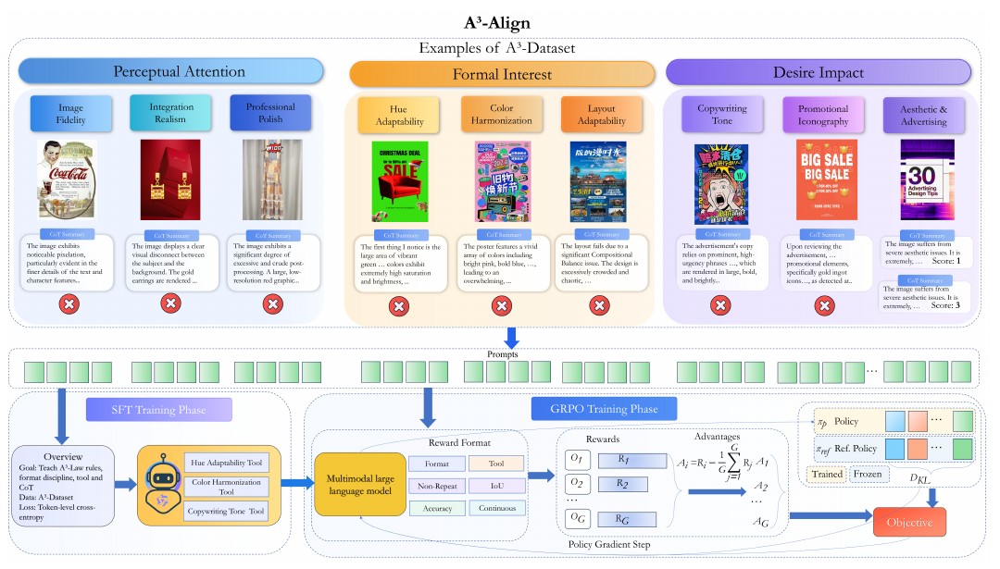

# A3: Towards Advertising Aesthetic Assessment

核对日期：2026-10-20。以下实验均为作者报告；本地完成原文阅读与讲解自检，未复现实验。

## 一句话总结

A³把广告审美拆成感知、形式和欲望影响三个评价层次，用人工标签与模型生成理由构建数据，再以SFT和多奖励GRPO训练专用评估器。

## 研究背景与动机

广告图像不仅需要画质，还涉及排版、文案、促销标志和品牌感受。单一审美分数难指出具体问题，作者于是把AIDA相关理论变成可标注的规则体系。[§1–3，PDF1–4]

A³-Law在这里是作者提出的评价框架，并非已由本论文实验确立的普遍认知定律；与框架标签一致也不等于真实商业转化提高。

## 方法总览

三阶段规则指导30K广告图、120K指令响应对的构建：人工给二元判断、框和1–5分，模型基于答案生成解释，再抽样专家验收。Qwen3-VL-8B-Instruct先SFT学习格式与规则，再GRPO按有效任务组合奖励。[Fig.2–3、§3，PDF3–6]

色相/色彩工具与OCR为部分规则提供辅助证据；促销图标不外包给检测器。生成的解释文本不是人类真实推理过程，也不保证忠实反映模型内部机制。

图：原论文 Fig.3，PDF第4页。仅裁去页边及无关正文，图内内容未改；著作权属于原作者，用于本篇方法分析，不按本站原创图重新授权。[原文与作者信息](https://openaccess.thecvf.com/content/CVPR2026/html/Ji_A3_Towards_Advertising_Aesthetic_Assessment_CVPR_2026_paper.html) · [PDF](https://openaccess.thecvf.com/content/CVPR2026/papers/Ji_A3_Towards_Advertising_Aesthetic_Assessment_CVPR_2026_paper.pdf)。点击可查看高清图。

## 核心创新与关键设计

连续评分奖励\(R_{score}=\exp[-(s-\widehat s)^2/(2\sigma^2)]\)，鼓励接近人工评分。总奖励仅对当前任务启用的项加权归一化：
\[R_{total}=\frac{\sum_{i\in A}\alpha_i R_i}{\sum_{i\in A}\alpha_i}.\]
其余包括格式、句子与n-gram不重复、二元正确性、工具调用及引用、匹配框IoU>0.5。[式1–2、§3.3，PDF5–6]

格式可解析、不重复都不能保证解释逻辑正确；IoU奖励只奖励成功匹配框时如何惩罚多余框，正文聚合细节还需核验。工具被引用也不自动证明模型正确理解数值。

## 实验与关键结果

8×H200训练，GRPO n4、σ1.237；按8:1:1划分，正文声明不重叠。分类看ACC、图标定位mAP@0.5、主观评分看SRCC/PLCC。[§4.1，PDF6]

| 作者报告 | Qwen3-VL8B基座 | A³-Align |
| --- | --- | --- |
| Image Fidelity ACC↑ | 0.454 | 0.870 |
| 图标存在ACC↑ | 0.157 | 0.926 |
| 图标mAP@0.5↑ | 0.011 | 0.701 |
| 审美属性SRCC↑ | 0.564 | 0.880 |
| 广告属性SRCC↑ | 0.533 | 0.838 |

来源Table1，PDF7。与未做该领域专训的模型比较显示专用对齐价值，不是通用能力总体排名。所谓购买行动意愿+1.20来自五位评估者对100图的1–5分评价，**不是实测点击、销量或40.1%收入提升**。

## 消融实验与证据强度

无解释训练审美SRCC0.805，完整0.880；去IoU奖励图标mAP0.624，完整0.701；去工具奖励色相ACC0.751，完整0.824。[Table2，PDF8]

这支持训练组成在该基准上有作用，但缺少跨文化真实投放因果实验。正文说thinking对闭源模型“始终有益”，表中ClaudeOpus4.1审美SRCC0.772→0.722等反例不支持逐项保证；本笔记保留例外。

## 局限与讨论

密集排版会引发图标幻觉和合并，极简高端设计可能被低估，这是作者明确的失败模式。人工规则、模型生成解释、训练目标与测试标注共享同一框架，容易强化评估闭环；按品牌/模板隔离的泛化还需核实。[PDF8]

理论声称的阶段门槛并未通过本研究的脑认知实验验证。不同地区、品类、用户偏好的标定留待后续；不要用单一分数替代设计师判断或投放实验。

## 复现提示

建议 `data/ad-aesthetics/a3/`，先核验图像、商标和再分发许可；记录图像级划分，确保一张图的不同QA不跨训练测试。验收时分开输出规则判断、框、评分与工具证据，允许人工复核。

[数据/代码/模型入口](https://github.com/euleryuan/A3-Align)来自论文；本次未核验版本、commit、许可证或执行8B模型。未使用付费API，也没有替用户发布或筛选真实广告。

## 相关工作与阅读顺序

先区分图像质量、审美和商业效果，再读A³的规则操作化、数据验收、奖励设计。重点读Table1–2和失败模式，避免从与人工分数相关推导出商业收益因果关系。

## 来源与校验

- [CVF 官方论文页](https://openaccess.thecvf.com/content/CVPR2026/html/Ji_A3_Towards_Advertising_Aesthetic_Assessment_CVPR_2026_paper.html) · [所读 PDF](https://openaccess.thecvf.com/content/CVPR2026/papers/Ji_A3_Towards_Advertising_Aesthetic_Assessment_CVPR_2026_paper.pdf)。页码均为该 PDF 的页序。
- 阅读范围：正文、公式与实验表；补充材料、上游代码与权重未逐项核验。许可证和固定代码 commit 尚未确认，不复制原文全文或数据。
- PDF SHA-256：`6a7cb48b4a43bfbf38857150ce5db47cceb8b2bc52fb7fb461c93715f1af1a04`；版本为本次下载的 CVF 接收稿，核对日期 2026-10-20。
- 视觉核对：PDF第4页及所引流程图已渲染检查；本地未复现实验。
