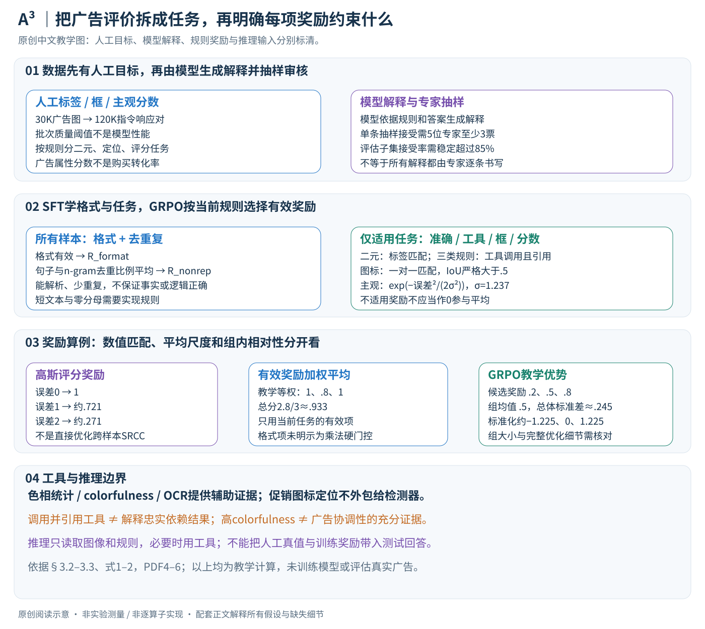

# A3: Towards Advertising Aesthetic Assessment

核对日期：2026-10-20。以下实验均为作者报告；本地完成原文阅读与讲解自检，未复现实验。

方法与配图详细版返工：2026-10-24。展开数据链、SFT、任务奖励、GRPO与推理边界。未复现实验。

## 一句话总结

A³把广告审美拆成感知、形式和欲望影响三个评价层次，用人工标签与模型生成理由构建数据，再以SFT和多奖励GRPO训练专用评估器。

## 研究背景与动机

广告图像不仅需要画质，还涉及排版、文案、促销标志和品牌感受。单一审美分数难指出具体问题，作者于是把AIDA相关理论变成可标注的规则体系。[§1–3，PDF1–4]

A³-Law在这里是作者提出的评价框架，并非已由本论文实验确立的普遍认知定律；与框架标签一致也不等于真实商业转化提高。

## 方法总览

### 输入输出：按规则评价广告，而非直接预测转化率

A³由评价框架A³-Law、数据集A³-Dataset和训练模型A³-Align组成。给定广告图像及指定评价规则，模型生成结构化回答：可能是是否合格的二元标签、促销图标框，或1–5分主观评分，并附解释；部分规则允许调用工具。输出类型随任务变化，不是每张图必然同时产生所有输出。（§3、Fig.2–3，PDF第3–6页）

原创图根据§3.2–3.3与式1–2，教学奖励算例非作者实验。框架名称中的Law不应理解为已证明的普遍认知定律，论文中的广告属性评分也不是实际点击或购买数据。

## 核心创新与关键设计

### 先定义评价规则，再构建可监督的不同任务

第一层Perceptual Attention关注图像质量、合成协调性与专业细节；第二层Formal Interest关注色相适配、色彩协调和布局；第三层Desire Impact关注文案语气、促销图标以及主观审美/广告属性。论文从心理学与广告理论组织出这些阶段，但没有给出一个已测量的生理阈值系统。不能把“先通过感知门槛”的理论叙述直接实现成未公开的数字硬门控。（§3.1，PDF第2–4页）

八种二元规则分别对应Image Fidelity、Integration Realism、Professional Polish、Hue Adaptability、Color Harmonization、Layout Adaptability、Copywriting Tone和Promotional Iconography；促销图标额外有定位任务，另有两个主观评分维度。它们需要不同监督与指标：有无图标的判断正确，不代表框的位置正确；排序相关性高，也不等于每个预测分数精确。

### 数据链条：人工答案先确定，模型解释后生成

作者先由接受培训的标注员给出规则标签、框和分数，按批抽样质检。客观标注接受阈值为准确率高于0.93，框标注平均IoU高于0.92，主观评分SRCC高于0.85。以上是标注批次的接受标准，不是最终模型达到的性能。（§3.2，PDF第4–5页）

随后多个多模态模型在规则及既有答案条件下生成解释文本。5位专家对抽样解释投票，至少3票才接受单条；迭代到评估子集接受率稳定超过85%。因此人工主要提供目标答案并检查解释，不能把整个120K指令响应对都描述为专家逐字撰写、逐条一致通过。模型事后生成的理由也不等于真实人类思维轨迹或模型内部因果机制。

数据含30K广告图和120K指令响应对。二者不是120K独立图像，按图像/来源去重与拆分口径会影响泛化判断。正文报告8:1:1训练、验证、测试且无重叠，但未充分展开所有近重复创意、模板和品牌隔离规则，本讲解不补称其做了严格跨品牌外推实验。（Fig.2、§4.1，PDF第3、6页）

### 工具负责提供证据，不负责替模型作全部判断

Hue Analysis Tool提供色相簇的中心色相、亮度和饱和度；Color Harmonization Tool提供Hasler colorfulness指标；DeepSeek-OCR提取文字用于文案语气判断。颜色指标可以量化一些图像属性，但colorfulness不等于广告设计协调性的充分统计量，OCR识字正确也不等于语气合适。模型需要结合规则解释工具结果。（§3.2，PDF第5页）

作者刻意不为Promotional Iconography调用外部检测器，要求模型自己定位与解释图标。这与其他三项工具辅助任务要分开，不能把定位提升归功于未使用的检测器。主文没有完整披露每个工具参数、失败回退与结果schema，不能直接恢复一套已核实可执行的工具链。

### 第一阶段SFT：学习任务格式和回答，而不是先优化奖励

底座为Qwen3-VL-8B-Instruct。SFT使用图像、问题/规则、解释和答案组成的训练样本，以token级交叉熵学习输出。若写成通用教学形式：

\[
L_{\rm SFT}=-\sum_t\log\pi_\theta(y_t\mid I,Q,y_{<t}),
\]

其中 \(I\) 是图像，\(Q\) 指定规则，\(y_t\) 是目标响应token。目标不仅包含最后标签，也包括结构化格式、解释与工具使用样式；实际哪些token参与损失、工具输出是否mask，主文未完整规定。该公式用于解释常规SFT，不冒充原文给出的完整训练代码。

这一步让后续RL采样较容易得到可解析候选。SFT学到的是训练响应分布，仍可能生成流畅但错误的理由，因此第二阶段还针对具体答案和任务信号奖励。（Fig.3、§3.3）

### 第二阶段GRPO：按当前任务组合有效奖励

所有样本均使用格式与去重复奖励：

\[
R_{\rm format}=\mathbf1\{\text{tags valid}\},\qquad
R_{\rm nonrep}=\tfrac12\left(1-\frac dN+
\frac{|\operatorname{uniq}(n\text{-grams})|}{|n\text{-grams}|}\right).
\]

\(N\) 是句子数，\(d\) 是重复句计数；后一项是n-gram去重比例。格式奖励说明输出能解析，去重复奖励抑制退化循环，二者都不能单独保证事实正确或逻辑连贯。无句子、没有足够n-gram的短回答会出现分母边界，正文未交代处理细节。训练设置给出 \(n=4\)，不能据这一记号擅自推断GRPO每组恰好采4个回答。（§3.3–4.1，PDF第5–6页）

规则相关奖励只在适用任务加入：

| 任务 | 额外奖励 | 奖励实际检查什么 |
|---|---|---|
| 八类二元判断 | \(R_{\rm acc}\) | 预测标签等于人工标签 |
| 色相、色彩、文案 | \(R_{\rm tool}\) | 工具已调用且推理中引用 |
| 促销图标定位 | \(R_{\rm IoU}\) | 一对一匹配后IoU严格大于0.5 |
| 审美、广告属性评分 | \(R_{\rm score}\) | 与人工分数的数值距离 |

工具奖励的条件比“忠实使用证据”弱：即使工具被调用并被提及，也不能只凭该指示量证明解释真正受结果约束。图标框先通过最优一对一匹配，避免同一真值框被多个预测重复领取奖励，但正文仅明确配对级奖励，未完整说明未匹配预测、空真值和样本级聚合方式；不能将它直接当成mAP训练目标。

### 连续评分奖励的尺度与实际数值

\[
R_{\rm score}=\exp\left[-\frac{(s-\widehat s)^2}{2\sigma^2}\right],
\qquad \sigma=1.237.
\]

\(s\) 是预测，\(\widehat s\) 是人工参照。完全相同得到1，偏差越大连续下降；它不是判断是否落在某个粗区间。采用作者 \(\sigma\) 的教学计算：误差1时约0.721，误差2时约0.271。高斯曲线对正负误差对称，并没有直接优化SRCC这种跨样本排序指标；评分一致性与排序相关性要分别看。（式1、§4.1，PDF第6页）

设当前有效奖励集合为 \(\mathcal A\)，权重非负：

\[
R_{\rm total}=\frac{\sum_{i\in\mathcal A}\alpha_iR_i}{\sum_{i\in\mathcal A}\alpha_i}.
\]

有效项权重和须大于0。不同任务只平均各自适用奖励，而非把不适用项当0。教学二元样本若格式1、去重复0.8、准确率1，等权总分为0.933；加入不适用的工具/框奖励并算0会错误拉低到另一尺度。归一化控制尺度，却不保证各任务难度相同。（式2）

格式奖励在文字中被称为后续奖励的基础，但式2只是加权平均，没有明确乘法门控：除非实现规定无效格式导致其他项不可计算/为0，否则不能自动断言格式不对总奖励就为0。需要在复现中核对解析与失败规则。

### GRPO怎样利用候选奖励，而非直接对离散标签求导

为解释GRPO，可把同一输入的多个候选奖励作组内标准化：\(A_i=(R_i-\overline R)/(\operatorname{std}(R)+\epsilon)\)，再提高相对好候选的生成概率、限制策略变化。这是通用教学说明；主文未给出完整GRPO目标、组大小、裁剪和KL超参数，不能假装这些已由本文核实。

教学候选奖励0.2、0.5、0.8时，以总体标准差约0.245得到优势约−1.225、0、1.225。奖励相同的候选不提供组内相对区分；格式等容易满足的奖励也可能很快饱和。训练优化的是生成响应的策略，不是对“标签是否相等”这个布尔表达式直接求梯度。

训练结束后，推理给定图像和规则，模型生成解释与相应输出，必要时调用支持的工具。无需人工真值来计算训练奖励，否则会把评测答案泄漏到推理。主文报告8张H200上的训练，不代表本地Plus会员可直接复现同等训练成本。（§4.1）

### 如何解释性能与复现边界

促销图标的Accuracy0.926和mAP0.701分别评价有无/合格判断及定位，不能混成一个正确率；Aesthetic Attribute SRCC0.880是与人类评分排序的一致性，也不是商业收益提升。模型专门对A³规则和数据训练，比较通用模型说明该任务内的提升，不足以证明所有文化与投放场景通用。（Table 1，PDF第7页）

复现须固定规则文字、标注划分、工具版本、解析schema、各任务有效奖励及权重、IoU聚合、短文本去重边界和GRPO参数。本文没有运行工具评估真实广告，没有调用付费模型、训练或复现实验；原文未公开清楚的接口均保留为待核对。

## 实验与关键结果

8×H200训练，GRPO n4、σ1.237；按8:1:1划分，正文声明不重叠。分类看ACC、图标定位mAP@0.5、主观评分看SRCC/PLCC。[§4.1，PDF6]

| 作者报告 | Qwen3-VL8B基座 | A³-Align |
| --- | --- | --- |
| Image Fidelity ACC↑ | 0.454 | 0.870 |
| 图标存在ACC↑ | 0.157 | 0.926 |
| 图标mAP@0.5↑ | 0.011 | 0.701 |
| 审美属性SRCC↑ | 0.564 | 0.880 |
| 广告属性SRCC↑ | 0.533 | 0.838 |

来源Table1，PDF7。与未做该领域专训的模型比较显示专用对齐价值，不是通用能力总体排名。所谓购买行动意愿+1.20来自五位评估者对100图的1–5分评价，**不是实测点击、销量或40.1%收入提升**。

## 消融实验与证据强度

无解释训练审美SRCC0.805，完整0.880；去IoU奖励图标mAP0.624，完整0.701；去工具奖励色相ACC0.751，完整0.824。[Table2，PDF8]

这支持训练组成在该基准上有作用，但缺少跨文化真实投放因果实验。正文说thinking对闭源模型“始终有益”，表中ClaudeOpus4.1审美SRCC0.772→0.722等反例不支持逐项保证；本笔记保留例外。

## 局限与讨论

密集排版会引发图标幻觉和合并，极简高端设计可能被低估，这是作者明确的失败模式。人工规则、模型生成解释、训练目标与测试标注共享同一框架，容易强化评估闭环；按品牌/模板隔离的泛化还需核实。[PDF8]

理论声称的阶段门槛并未通过本研究的脑认知实验验证。不同地区、品类、用户偏好的标定留待后续；不要用单一分数替代设计师判断或投放实验。

## 复现提示

建议 `data/ad-aesthetics/a3/`，先核验图像、商标和再分发许可；记录图像级划分，确保一张图的不同QA不跨训练测试。验收时分开输出规则判断、框、评分与工具证据，允许人工复核。

[数据/代码/模型入口](https://github.com/euleryuan/A3-Align)来自论文；本次未核验版本、commit、许可证或执行8B模型。未使用付费API，也没有替用户发布或筛选真实广告。

## 相关工作与阅读顺序

先区分图像质量、审美和商业效果，再读A³的规则操作化、数据验收、奖励设计。重点读Table1–2和失败模式，避免从与人工分数相关推导出商业收益因果关系。

## 来源与校验

- [CVF 官方论文页](https://openaccess.thecvf.com/content/CVPR2026/html/Ji_A3_Towards_Advertising_Aesthetic_Assessment_CVPR_2026_paper.html) · [所读 PDF](https://openaccess.thecvf.com/content/CVPR2026/papers/Ji_A3_Towards_Advertising_Aesthetic_Assessment_CVPR_2026_paper.pdf)。页码均为该 PDF 的页序。
- 阅读范围：正文、公式与实验表；补充材料、上游代码与权重未逐项核验。许可证和固定代码 commit 尚未确认，不复制原文全文或数据。
- PDF SHA-256：`6a7cb48b4a43bfbf38857150ce5db47cceb8b2bc52fb7fb461c93715f1af1a04`；版本为本次下载的 CVF 接收稿，核对日期 2026-10-20。
- 视觉核对：PDF第4页及所引流程图已渲染检查；本地未复现实验。
